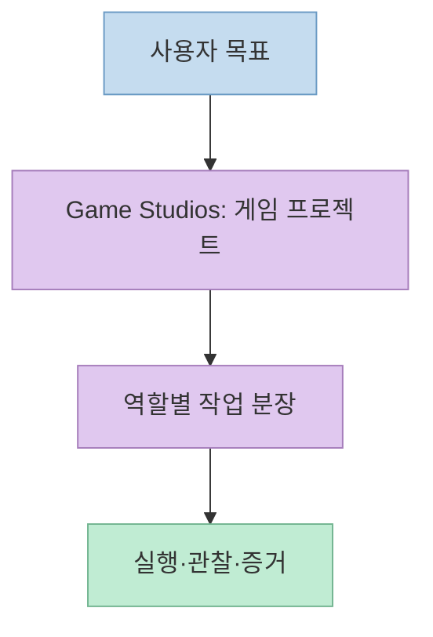
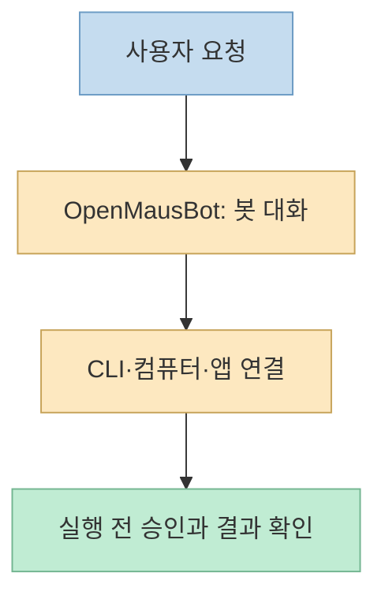
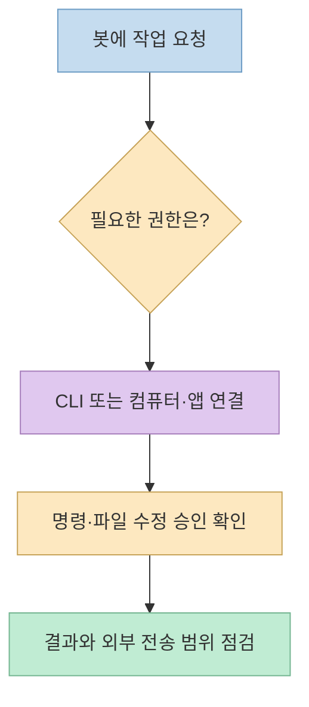

[원본 쇼츠](https://youtu.be/3cMaHbezoxU)는 두 오픈소스를 연달아 소개한다. **Claude Code Game Studios**는 게임 제작 과정을 역할별 에이전트로 조직하는 템플릿이고, **OpenMausBot**은 여러 AI 봇을 대화 상대처럼 다루는 데스크톱 앱이다. 둘 다 에이전트를 쓰지만 해결하려는 문제와 실행 환경은 다르다.

<!--more-->

## Sources

- [원본 YouTube Shorts](https://youtu.be/3cMaHbezoxU) — 영상의 소개 순서와 설명.
- [Claude Code Game Studios 공식 저장소](https://github.com/Donchitos/Claude-Code-Game-Studios) — 구성, 시작 방법, 게임 실행·스크린샷 검증 규칙.
- [OpenMausBot 공식 저장소](https://github.com/milind-soni/OpenMausBot) — CLI 연결, 컴퓨터 사용, 승인 카드, 플랫폼 지원과 데이터 저장 위치.
- [기존 분석 글](/post/2026/05/2026-05-03-claude-code-game-studios-hierarchy-collaboration/) — Game Studios의 조직 구조를 더 자세히 다룬 글. 당시 구성 숫자는 현재 README와 다를 수 있다.

## 1. 같은 에이전트라도 중심 단위가 다르다

영상 [0:06~0:43](https://youtu.be/3cMaHbezoxU?t=6)은 첫 프로젝트를 게임 개발팀처럼 소개하고, [0:45~1:21](https://youtu.be/3cMaHbezoxU?t=45)은 두 번째 프로젝트를 메신저형 봇 앱으로 설명한다. 전자는 **프로젝트 안의 업무 분장**, 후자는 **사용자가 대화하고 승인하는 인터페이스**가 중심이다. 어느 쪽도 “AI 49개가 늘 동시에 실행된다”거나 “봇마다 독립된 컴퓨터가 기본 제공된다”는 뜻으로 읽으면 안 된다.

## 2. Game Studios: 숫자보다 위임·검증 규칙

영상은 [0:06~0:33](https://youtu.be/3cMaHbezoxU?t=6)에 **49개 에이전트와 74개 스킬**, 디렉터→부서 리드→전문가의 계층, Unity·Unreal·Godot 지원을 강조한다. [공식 README](https://github.com/Donchitos/Claude-Code-Game-Studios) 상단도 현재 49 agents·74 skills로 안내하지만, 저장소의 짧은 설명에는 72 skills가 남아 있다. **구성 숫자는 버전과 표기 위치에 따라 달라질 수 있으므로**, 설치 시점의 파일과 README를 기준으로 확인하는 편이 안전하다. 또한 에이전트 수는 역할 정의의 수이지 동시 실행 성능의 측정치가 아니다.

이 템플릿에서 더 중요한 것은 완료 조건이다. [README의 player-visible change 규칙](https://github.com/Donchitos/Claude-Code-Game-Studios)은 화면에 보이는 변경을 마쳤다고 하려면 게임을 실행해 관찰하고, 스크린샷을 `production/qa/evidence/`에 남기도록 요구한다. 코드 파싱만 통과한 상태와 실제 게임 화면을 확인한 상태를 구분하는 **프로젝트의 작업 규칙**이다. 모든 사용자 환경에서 자동으로 이 규칙이 지켜진다는 보증은 아니다.

영상 [0:33~0:43](https://youtu.be/3cMaHbezoxU?t=33)의 시작 흐름은 저장소를 복제하고 Claude Code를 프로젝트 루트에서 열어 `/start`를 사용하는 것이다. [공식 안내](https://github.com/Donchitos/Claude-Code-Game-Studios)에 따르면 루트의 `CLAUDE.md`와 `project.yaml`이 핵심이며, 하위 폴더에서 시작하면 훅이나 권한 설정이 누락될 수 있다. 이 저장소는 완성 게임 배포본이 아니라 **게임 제작 워크플로 템플릿**이다.

## 3. OpenMausBot: 대화형 인터페이스와 실행 권한의 분리

영상 [0:55~1:13](https://youtu.be/3cMaHbezoxU?t=55)은 연락처처럼 봇을 만들고 Claude·Codex·Grok을 선택하는 사용 경험을 보여준다. [공식 README](https://github.com/milind-soni/OpenMausBot)는 기존 `claude`, `codex`, `grok` CLI 로그인/구독을 사용하거나 직접 API 키를 넣는 경로를 설명한다. 따라서 **CLI 경로에서는 별도 API 키 없이 시작할 수 있지만**, 구독료나 모델 이용 비용까지 없어진다는 뜻은 아니다.

컴퓨터와 외부 앱 사용도 선택한 연결 방식에 달려 있다. README에는 로컬 호스트 제어, 격리된 로컬 VM, 클라우드 Linux 컴퓨터 같은 경로가 나오며, 호스트 제어는 명시적 동의와 지원 환경이 필요하다. Gmail·Slack 같은 앱 연결은 추가 연동 설정이 필요할 수 있다. **“봇마다 자기 컴퓨터와 모든 앱이 기본 제공된다”는 식으로 일반화하면 과장**이다. 대화와 설정은 기본적으로 로컬 `~/.openmausbot`에 저장되지만, 모델 CLI나 선택적 클라우드·앱 연동을 쓰면 데이터가 외부 서비스로 전달될 수 있다. [OpenMausBot README](https://github.com/milind-soni/OpenMausBot)

영상 [1:13~1:21](https://youtu.be/3cMaHbezoxU?t=73)이 보여주는 파일 수정 승인 카드는 중요한 안전 장치다. 공식 README도 셸 명령과 파일 편집 등에 대한 인라인 승인 카드를 설명한다. 다만 **승인 UI가 모든 위험을 자동 제거하지는 않는다**. 연결한 CLI·컴퓨터·앱의 실제 권한과 승인 요청의 변경 범위를 사용자가 확인해야 한다. 배포 대상은 macOS, Windows, Ubuntu 24.04이며 플랫폼별 지원 범위에는 차이가 있다. 예를 들어 Ubuntu Wayland에서는 호스트 컴퓨터 제어가 비활성화된다. [플랫폼 안내](https://github.com/milind-soni/OpenMausBot)

## 실전 적용 포인트

1. **게임 프로젝트의 역할 분담과 QA 체계**가 필요하면 Game Studios를 검토한다. 먼저 작은 변경 하나에 대해 실행 화면과 스크린샷 증거까지 남기는지 확인한다.
2. **여러 모델 CLI를 대화형으로 운영**하고 싶다면 OpenMausBot을 검토한다. 실제 사용 전 연결할 CLI 로그인, 컴퓨터 제어 범위, 앱 권한, 과금 경로를 각각 확인한다.
3. 두 프로젝트의 에이전트 수나 승인 기능을 **품질·보안의 보증값**으로 받아들이지 않는다. 작은 작업을 직접 돌려 결과와 권한 요청을 검증한다.

## 핵심 요약

- Game Studios는 **게임 제작 조직과 검증 절차**를 템플릿으로 만든다.
- OpenMausBot은 **여러 AI 봇과 실행 도구를 대화·승인 UI로 연결**한다.
- “49개 에이전트”, “API 키 불필요”, “로컬 저장”은 각각 **동시 실행·무료 사용·외부 전송 없음**을 의미하지 않는다.

## 결론

두 프로젝트는 AI 에이전트의 서로 다른 병목을 다룬다. Game Studios는 **누가 무엇을 만들고 어떻게 검증할지**, OpenMausBot은 **어떤 봇에게 작업을 맡기고 어느 권한을 승인할지**에 집중한다. 영상은 출발점으로 유용하지만 실제 선택은 공식 문서의 실행 조건과 권한 경계를 확인한 뒤 해야 한다.
