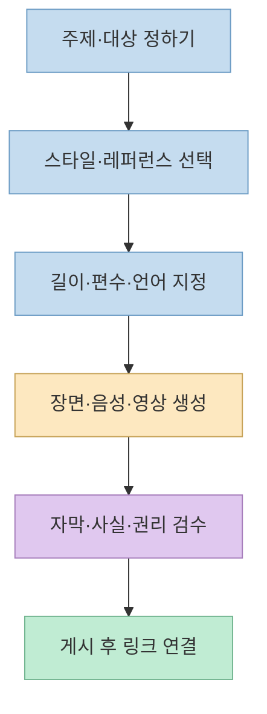
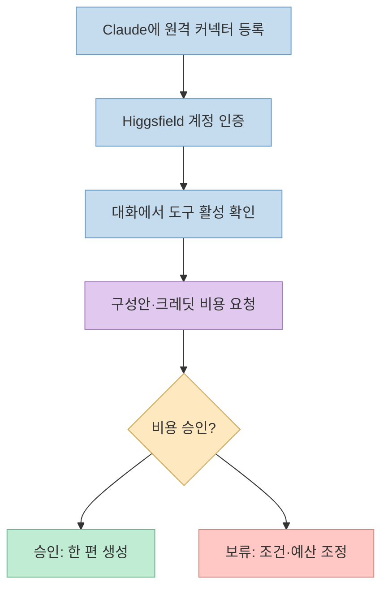
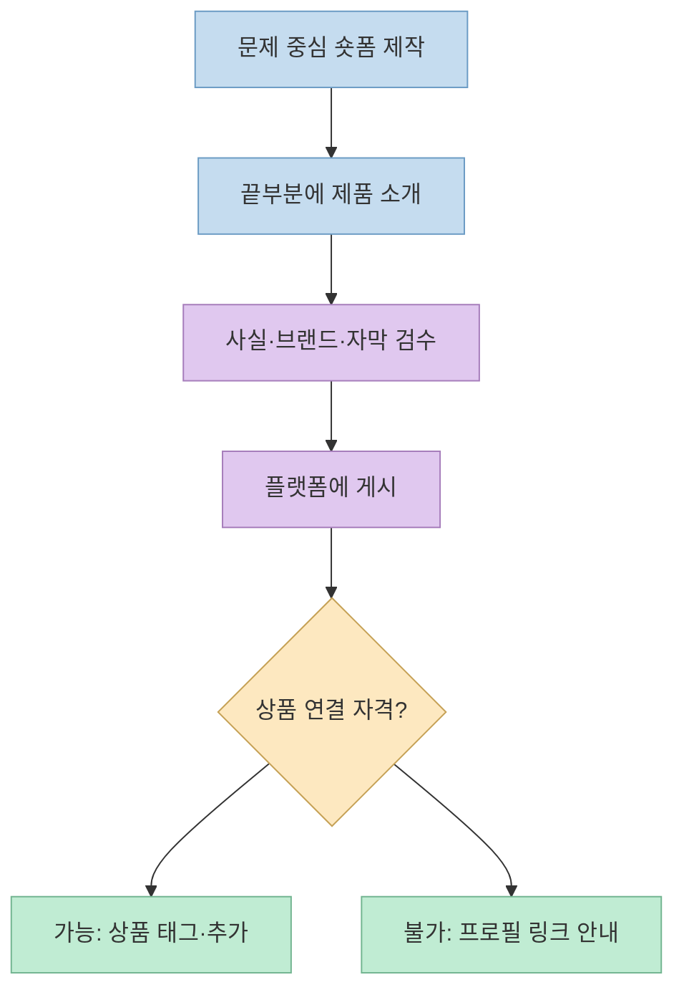

[게으른 빌더의 가이드](https://lazyowen.com/guides/higgsfield-content-factory-claude)는 Higgsfield Content Factory를 Claude에 연결해 **주제 한 문장에서 30초 세로 영상 한 편**을 만드는 과정을 설명한다. 실제로는 “조회수를 자동으로 뽑는 공장”보다는 **스타일 선택→장면·음성 생성→검수→게시**의 제작 흐름을 대화형 도구로 묶은 서비스다. 레퍼런스 영상의 높은 조회수는 새 영상의 성과를 보증하지 않으며, 생성에는 크레딧이 든다.

<!--more-->

## Sources

- [원본 가이드](https://lazyowen.com/guides/higgsfield-content-factory-claude) — 다섯 단계의 실전 흐름, 프롬프트 조건과 검수 체크리스트. 공개 페이지를 직접 확인했다.
- [Higgsfield Content Factory](https://higgsfield.ai/content-factory) — 레퍼런스·주제·길이·편수 선택 UI.
- [Higgsfield의 Content Factory 소개](https://higgsfield.ai/blog/higgsfield-introduces-content-factory) — 생성 과정, 지원 길이, 언어, 크레딧 기준.
- [Higgsfield의 Claude MCP 연결 안내](https://higgsfield.ai/blog/Generate-AI-Videos-From-Claude-with-Higgsfield-MCP) — 공식 서버 주소, 계정 연결, 과금과 결과 위치.
- [Claude의 원격 MCP 커넥터 도움말](https://support.claude.com/en/articles/11175166-get-started-with-custom-connectors-using-remote-mcp) — 무료 플랜 한도, 권한·승인 유의사항.
- [Claude의 Plugins UI 변경 안내](https://support.claude.com/en/articles/17740565-manage-plugins-skills-and-connectors-from-one-plugins-page) — 2026년 10월부터 단계적으로 바뀌는 메뉴 이름.

## 1. Content Factory가 실제로 자동화하는 범위

[공식 소개](https://higgsfield.ai/blog/higgsfield-introduces-content-factory)에 따르면 Content Factory는 질문형 주제에서 장면을 나누고, 각 장면의 시각 자료와 나레이션을 생성해 영상을 조립한다. 미리 준비된 스타일이나 레퍼런스는 **화면의 형식·속도·도입부**를 안내하는 자료다. 원본 콘텐츠의 문장·이야기·인물을 복사하는 것이 목적은 아니다. 제품 화면에는 레퍼런스별 조회수와 좋아요 수가 표시되지만, 그 수치는 **원본 예시의 성과**이지 새로 생성할 영상의 예상 조회수가 아니다. [Content Factory 화면](https://higgsfield.ai/content-factory)

원본 가이드는 한 편짜리 **30초·9:16** 영상을 첫 실험으로 제안한다. [공식 Content Factory](https://higgsfield.ai/content-factory)에도 30초와 1 episode가 보이고, [공식 소개](https://higgsfield.ai/blog/higgsfield-introduces-content-factory)는 15초부터 5분까지, 한 번에 1~4편의 설정을 안내한다. 처음부터 여러 편을 돌리기보다 작은 단위로 생성하고 결과와 비용을 확인하는 것이 합리적이다.

## 2. Claude와 Higgsfield 연결: 무료 커넥터와 유료 생성은 별개

[원본 가이드의 1단계](https://lazyowen.com/guides/higgsfield-content-factory-claude)는 Claude 웹·데스크톱 앱에서 Higgsfield 커넥터를 추가하고 로그인하도록 안내한다. Higgsfield가 [공식 MCP 페이지](https://higgsfield.ai/mcp)와 [연결 안내](https://higgsfield.ai/blog/Generate-AI-Videos-From-Claude-with-Higgsfield-MCP)에 표시한 서버 주소는 `https://mcp.higgsfield.ai/mcp`다. Claude에서 이 주소를 등록한 뒤 **Higgsfield 계정으로 연결을 허용**하고, 새 대화에서 해당 커넥터가 켜졌는지 확인한다. API 키를 별도로 붙여 넣는 방식은 아니다.

메뉴 이름은 한 가지로 고정해 적기 어렵다. 원본 가이드와 Higgsfield 안내에는 `Customize → Connectors`가 나오지만, [Claude 공식 변경 안내](https://support.claude.com/en/articles/17740565-manage-plugins-skills-and-connectors-from-one-plugins-page)에 따르면 2026년 10월 29일부터 일부 계정은 `Plugins` 화면으로 통합된다. 따라서 메뉴가 보이지 않으면 현재 계정에서 **커넥터 또는 Plugins 설정**을 찾는 편이 정확하다. 팀·기업 계정은 관리자가 먼저 등록해야 할 수 있다. [Claude 커넥터 도움말](https://support.claude.com/en/articles/11175166-get-started-with-custom-connectors-using-remote-mcp)

Claude 무료 플랜에서 **커스텀 커넥터 1개**를 연결할 수 있다는 점은 [Claude 공식 도움말](https://support.claude.com/en/articles/11175166-get-started-with-custom-connectors-using-remote-mcp)이 확인한다. 그러나 이는 **영상 생성이 무료**라는 말이 아니다. [Higgsfield 공식 안내](https://higgsfield.ai/blog/Generate-AI-Videos-From-Claude-with-Higgsfield-MCP)는 MCP를 통한 생성이 매번 크레딧을 소모하며, 웹사이트에서 제공하는 무료·무제한 혜택이 MCP 호출에 그대로 적용되지 않는다고 명시한다. 커넥터에 자체 지출 한도도 없으므로 비용을 확인한 뒤 한 건씩 승인해야 한다.

## 3. 스타일·주제·완성 조건을 분리해서 입력한다

[원본 가이드의 2~3단계](https://lazyowen.com/guides/higgsfield-content-factory-claude)는 Content Factory에서 `Use as reference`로 스타일을 고르거나 직접 참조 자료를 넣고, `Make a video about…`에 주제를 **한 문장**으로 적도록 한다. “뇌”처럼 넓은 단어보다 “잠든 동안 뇌에서 일어나는 변화”처럼 장면이 떠오르는 질문이 구성에 도움이 된다. 이어 `Generate in Claude`를 눌러 요청을 넘기거나, Claude에서 Content Factory 사용을 명시한다. [공식 소개](https://higgsfield.ai/blog/higgsfield-introduces-content-factory)도 명확한 질문, 점층적 전개, 톤과 레퍼런스의 목적을 먼저 정하라고 권한다.

Claude에 보낼 지시는 **주제**와 **완성 조건**을 분리하면 좋다. 예를 들어 “30초, 세로 9:16, 1편, 첫 장면에서 질문 제시, 중간에서 설명, 끝에서 핵심 정리. 한국어 나레이션과 읽기 쉬운 자막이 가능한지 먼저 확인. 생성 전에 장면 구성과 실제 크레딧 비용을 알려 주고 기다리기”처럼 적는다. 이는 원본 가이드의 긴 프롬프트를 작업 요건으로 재구성한 예시다. Higgsfield의 [공식 소개](https://higgsfield.ai/blog/higgsfield-introduces-content-factory)는 Claude에서 프롬프트 언어 또는 지정 언어로 나레이션을 만들 수 있으나, 영어·러시아어 외 언어에는 억양이 있을 수 있다고 밝힌다. 한국어 자막의 정확성이나 효과음 지원을 모든 설정에서 보장하는 공식 근거는 확인되지 않았으므로 **생성 전 가능 여부와 결과물을 직접 확인**해야 한다.

[공식 가격 예시](https://higgsfield.ai/blog/higgsfield-introduces-content-factory)는 길이와 편수에 따라 크레딧이 달라짐을 보여 준다. 다만 현재 문서에는 원본 가이드가 권하는 **30초·1편의 확정 비용이 명시돼 있지 않다**. 다른 길이의 가격으로 임의 계산하지 말고, 실제 생성 화면 또는 커넥터의 비용 안내를 확인해야 한다. 수정·재생성도 추가 크레딧을 쓸 수 있다. [Higgsfield의 Claude MCP 안내](https://higgsfield.ai/blog/Generate-AI-Videos-From-Claude-with-Higgsfield-MCP)

## 4. 제품을 붙일 때는 영상 제작과 판매 연결을 나눈다

[원본 가이드의 4단계](https://lazyowen.com/guides/higgsfield-content-factory-claude)는 제품 이름을 처음부터 반복하는 광고 대신, **제품이 해결하려는 문제를 먼저 설명하고 마지막에 제품을 짧게 소개**하는 구성을 제안한다. 예시의 “앞 25초 설명, 끝 5초 소개”는 하나의 편집 전략이지 조회수나 전환율이 높아진다는 검증 결과는 아니다. 건강·효능처럼 민감한 주제를 다룬다면 근거 없는 효능을 넣지 말고, 영상 속 사실 주장·자막·음성의 일치 여부를 검수해야 한다. [Content Factory 공식 소개의 사실 확인 권고](https://higgsfield.ai/blog/higgsfield-introduces-content-factory)

영상 생성과 **제품 링크 연결**도 다른 일이다. [원본 가이드의 5단계](https://lazyowen.com/guides/higgsfield-content-factory-claude)는 완성 영상을 게시한 뒤, 자격이 있는 계정에서는 플랫폼의 상품 추가·제품 태그 기능을 사용하고 그렇지 않으면 프로필의 판매 페이지 링크를 안내한다. Higgsfield가 TikTok Shop이나 Instagram Shopping에 상품을 자동 등록하는 것은 아니다. 해당 기능은 **지역·계정 자격·플랫폼 정책에 따라 달라지므로** 실제 게시 화면에서 메뉴와 요구 사항을 확인해야 한다. [TikTok의 상품 추가 도움말](https://support.tiktok.com/en/business-and-creator/tiktok-shop-for-creators/adding-products-to-videos)

## 실전 적용 포인트

1. 처음에는 **30초·1편**으로 시험하고, 생성 전에 장면 구성·언어 지원·크레딧 비용을 확인한다. 승인 전에는 생성하지 않도록 요청한다.
2. 레퍼런스에서는 **도입부·속도·화풍**만 참고하고, 다른 사람의 영상 내용·인물·브랜드를 그대로 복제하지 않는다.
3. 결과를 받을 때 첫 2초의 주제 전달력, 휴대폰에서의 자막 가독성, 나레이션·자막 일치, 9:16 비율, 제품 표현의 사실성을 직접 검수한다.
4. 재생성이나 수정에도 비용이 들 수 있으므로 수정 범위를 한 장면·한 문장처럼 좁히고, 게시 플랫폼의 AI 콘텐츠 표시 및 상품 링크 요건을 별도로 확인한다.

## 핵심 요약

- Content Factory는 **주제·레퍼런스를 바탕으로 장면·음성·영상을 조립**하지만 조회수를 보증하지 않는다.
- Claude의 커스텀 커넥터를 무료 플랜에서 1개 쓸 수 있어도 **Higgsfield MCP 생성에는 크레딧**이 든다.
- **제작, 비용 승인, 결과 검수, 판매 링크 연결**은 각각 별도 단계다.

## 결론

이 가이드에서 가져갈 핵심은 “한 줄로 바이럴 영상을 찍어 내는 비법”이 아니라 **반복 가능한 숏폼 제작 절차와 비용·품질 통제**다. 연결만으로 끝내지 말고 주제와 레퍼런스의 역할을 분명히 정하고, 한 편씩 승인·검수한 뒤 플랫폼에서 제품 연결을 마무리해야 한다.
