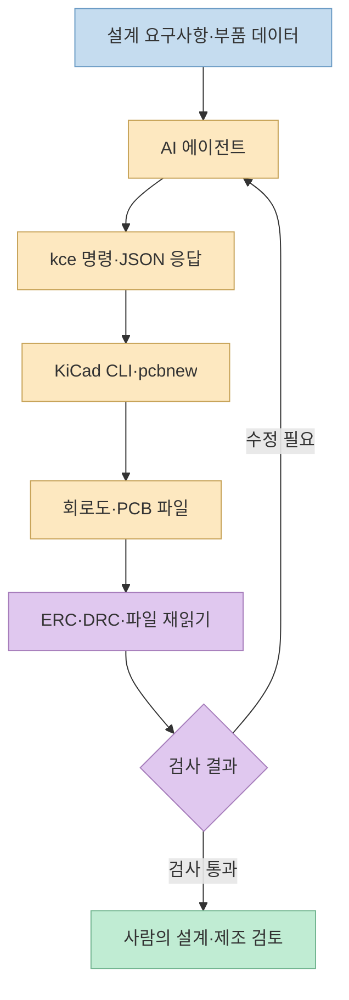
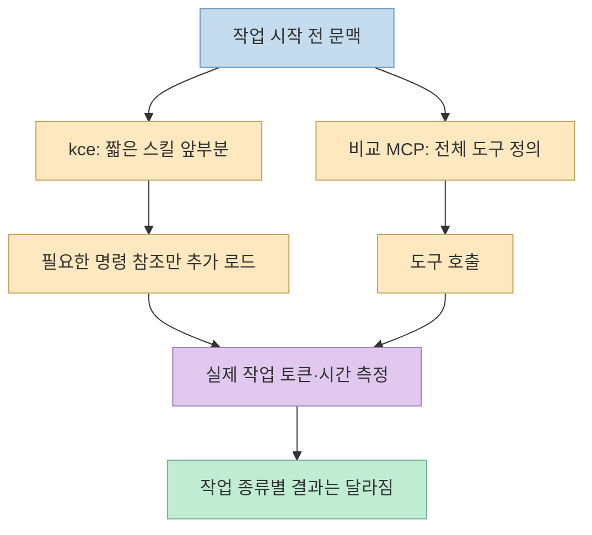
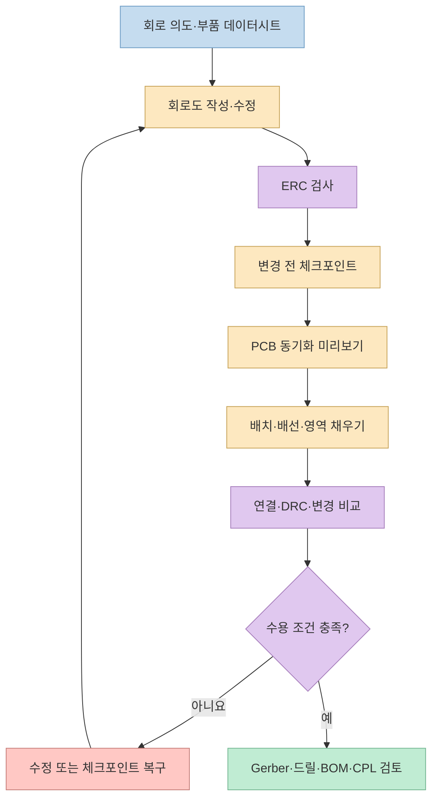

[Threads 작성자](https://www.threads.com/share/_rhvC6c7-/)는 무료 오픈소스 도구로 AI 에이전트가 PCB를 설계·검증할 수 있다며 [kicad-cli-extended](https://github.com/Hybirdss/kicad-cli-extended)를 공개했다. 핵심은 새로운 PCB 설계 엔진이 아니라, **KiCad 10의 기존 CLI와 `pcbnew`를 AI 에이전트가 다루기 쉬운 명령·JSON 인터페이스로 확장**한 것이다. 설계와 검사를 자동화할 수는 있지만, ERC·DRC 통과가 전기적 동작이나 제조 가능성을 보증하지는 않는다.

<!--more-->

## Sources

- [원본 Threads 공유 링크](https://www.threads.com/share/_rhvC6c7-/) · [연결된 원문과 작성자 댓글](https://www.threads.com/@siya_dl/post/DfGtws7GlDY) — 브라우저로 공개 본문과 댓글을 확인했다.
- [kicad-cli-extended 공식 저장소](https://github.com/Hybirdss/kicad-cli-extended) — 기능, 설치, 예시, 벤치마크 방법, 라이선스.
- [KiCad 10 공식 CLI 문서](https://docs.kicad.org/10.0/en/cli/cli.html) — 원래 `kicad-cli`의 명령 범위와 ERC·DRC 인터페이스.
- [KiCad 공식 PCB 편집기 문서](https://docs.kicad.org/master/en/pcbnew/pcbnew.html) — DRC가 검사하는 설계 규칙과 설정 범위.

## 1. 공식 `kicad-cli`와 무엇이 다른가

[KiCad 공식 CLI](https://docs.kicad.org/10.0/en/cli/cli.html)는 회로도 ERC, PCB DRC, BOM·Gerber·드릴 파일 내보내기 등 자동화 명령을 이미 제공한다. 따라서 “공식 CLI로는 검증을 못 한다”는 뜻은 아니다. 차이는 **AI가 회로도와 PCB를 단계적으로 수정하고, 수정 전후 상태를 비교·복구하며, 결과를 일관된 JSON으로 읽는 작업**에 있다.

[프로젝트 README](https://github.com/Hybirdss/kicad-cli-extended)에 따르면 `kce`는 공식 CLI 명령을 감싸면서 회로도 부품·배선·라벨 편집, 회로 의도에 따른 배치, 회로도에서 PCB 업데이트, 배치 점수·자동 라우팅, 제조 파일 패키징, 변경 비교, 체크포인트를 추가한다. 내부적으로는 실제 KiCad 10의 `kicad-cli`와 `pcbnew` Python 모듈을 사용하며, 기록한 파일을 KiCad 도구로 다시 읽어 저장 결과를 확인한다. **독립적인 서드파티 프로젝트**로, KiCad 공식 제품은 아니다.



## 2. “MCP 대비 1/400”은 무엇을 측정한 숫자인가

Threads의 **최대 1/400 토큰** 주장은 [저장소 벤치마크](https://github.com/Hybirdss/kicad-cli-extended)의 특정 비교에서 나온다. `kce`의 항상 로드되는 스킬 앞부분은 **157토큰**, 비교 대상으로 선택한 한 KiCad MCP 서버의 전체 도구 정의는 **63,420토큰**이었다. 나누면 약 404배 차이가 난다. 즉 **작업을 시작하기 전에 모델 문맥에 노출되는 도구 설명량**의 비교다.

이 숫자를 “PCB 한 장을 400배 적은 토큰으로 설계한다”거나 “MCP 호출보다 언제나 싸다”는 뜻으로 넓히면 안 된다. 같은 README에서 `kce`의 전체 `SKILL.md`는 3,737토큰, 전체 명령 참조는 필요할 때 읽는 11,238토큰이라고 밝힌다. 벤치마크의 개별 작업에서도 `kce`가 늘 적은 토큰을 쓴 것은 아니다. 예를 들어 저장소가 보고한 Gerber·드릴 출력 호출은 `kce` **2,771토큰**, 비교 대상 MCP 서버는 **645토큰**이다. 저자 측이 고른 도구와 데모 보드, 측정 방식에 따른 결과이며 독립적인 전체 세션 평가가 아니다.

따라서 설계 의도는 “CLI가 본질적으로 MCP보다 우월하다”가 아니라, **명령 하나와 필요할 때 읽는 스킬 문서로 초기 문맥 점유를 낮추는 방식**이다. 반대로 CLI는 호출마다 프로세스가 시작될 수 있어 시간·상태 관리의 절충이 있다. 저장소는 이를 위한 상주 `serve` 워커도 제공한다.



## 3. 회로도에서 제조 파일까지의 실제 흐름

[README의 LED 보드 예시](https://github.com/Hybirdss/kicad-cli-extended)는 2핀 전원 커넥터, 저항, LED를 놓고 핀에 네트 라벨을 붙인 뒤 ERC를 실행한다. 다음으로 보드 외곽선을 그리고, 회로도 정보를 PCB에 동기화하고, 배치·연결·DRC를 확인한 다음 제조 패키지를 만든다. 이는 `회로 의도 → 회로도 → PCB → 설계 검사 → 제조 출력`이라는 각 경계를 보여 주는 **예시**이지, 임의의 회로 사양을 넣으면 최적 보드가 자동 완성된다는 약속이 아니다.

```bash
kce --json info doctor
kce --json check erc --fail-on-error
kce --json --dry-run pcb update --stable-uuids
kce --json pcb update --stable-uuids
kce --json pcb connectivity
kce --json check drc --fail-on-error
kce --json fab package --preset jlcpcb --fail-on-drc --no-step
```

위 명령들은 **이미 해당 프로젝트의 회로도·PCB 파일과 규칙이 준비된 상태**를 전제로 한 순서 예시다. 새 프로젝트를 만드는 명령, 라이브러리 선택과 부품 배치, 외곽선 설정 등은 별도 단계다. 설치 역시 KiCad 10.x와 Python 3.10 이상이 선행 조건이며, 저장소는 `uv tool install git+https://github.com/Hybirdss/kicad-cli-extended`와 `kce --json info doctor`를 안내한다. 실제 실행 전에는 도구 버전과 대상 프로젝트를 확인해야 한다.

안전한 편집에는 **미리보기와 복구 지점**이 중요하다. 저장소는 `--dry-run`으로 회로도→PCB 갱신의 부품 교체·패드 이동·기존 트랙 연결 영향을 먼저 살피고, `session checkpoint`로 수정 전 상태를 남기며, `project compare`로 허용하지 않은 변경을 찾아내는 흐름을 문서화한다. `run`의 다단계 계획은 사전 정의한 수용 조건을 만족하지 못하면 프로젝트 파일 변경을 되돌리도록 설계됐다. 그래도 변경 영향 범위를 사람이 확인하지 않은 채 실제 제조 파일을 내보내서는 안 된다.



## 4. ERC·DRC 통과와 실물 검증은 다른 일이다

[KiCad 공식 CLI 문서](https://docs.kicad.org/10.0/en/cli/cli.html)에 따르면 ERC는 회로도의 전기 규칙 위반을, DRC는 PCB의 설계 규칙 위반을 보고한다. [PCB 편집기 문서](https://docs.kicad.org/master/en/pcbnew/pcbnew.html)는 DRC가 **보드 설정에 정의된 제약**과 패드 연결을 검사한다고 설명한다. 따라서 규칙이 빠졌거나 심각도를 무시로 설정하면 검사 통과가 의미하는 범위도 좁아진다. 전원 예산, 실제 부품 핀맵, 열·신호 무결성, 제조사의 공정 한계, 조립 방향, 실물 동작은 별도 검토가 필요하다.

`kce` 저장소도 **깨끗한 DRC가 제조사 규격 충족을 뜻하지 않는다**고 경고한다. LED 예시는 벌거숭이 기판 출력이며, 조립품으로 주문하려면 공급업체 부품 번호를 확인하고 BOM·CPL을 제조사 뷰어에서 검토하라고 안내한다. Threads 작성자 역시 댓글에서 실물로 받아보면 다른 문제가 생길 수 있다고 인정했다. 그러므로 “AI가 검증했다”는 표현은 **설정한 자동 검사와 파일 검증을 수행했다**는 뜻으로 한정해야 한다.

프로젝트는 [GPL-3.0-or-later](https://github.com/Hybirdss/kicad-cli-extended/blob/main/LICENSE) 라이선스의 독립 오픈소스다. 도구 자체가 무료여도 KiCad 실행 환경, 에이전트 이용료, 부품·제조·실측 비용은 별개다. Threads 작성자가 댓글에 언급한 [Altium용 동반 저장소](https://github.com/Hybirdss/altium-cli-extended)는 별도 프로젝트이므로 KiCad용 `kce`의 기능·검증 결과를 그대로 이전해 해석하면 안 된다.

## 실전 적용 포인트

1. **작은 데모로 시작한다.** `info doctor`로 KiCad·Python·라이브러리를 확인한 뒤, 공식 README의 LED 보드 예시처럼 입력과 기대 결과가 명확한 프로젝트로 시험한다.
2. **검사 실패를 명시적으로 처리한다.** ERC·DRC에 `--fail-on-error` 같은 게이트를 붙이고, 위반 건수만 읽은 채 성공으로 넘기지 않는다.
3. **변경 전후를 비교한다.** 회로도 변경은 체크포인트와 `--dry-run`, PCB 동기화 결과의 패드·트랙 영향, `project compare`로 제한된 범위만 바뀌었는지 확인한다.
4. **제조 단계는 별도 승인한다.** Gerber·드릴·BOM·CPL과 부품 공급 상태를 제조사 규격·뷰어로 확인하고, 시제품을 실제 측정한다.

## 핵심 요약

`kicad-cli-extended`는 **KiCad 10을 AI 에이전트가 명령형·JSON 방식으로 다루기 쉽게 만든 확장 도구**다. “1/400”은 한 비교 조건의 초기 도구 정의 토큰 수이며, 전체 PCB 제작 비용이나 작업 토큰 절감을 뜻하지 않는다. ERC·DRC와 파일 재읽기는 중요한 자동화 게이트지만, 회로의 기능과 제조·조립 품질은 엔지니어의 검토 및 실물 시험이 필요하다.

## 결론

이 프로젝트의 가치는 PCB 설계를 프롬프트 한 번으로 대체하는 데보다, **반복 가능한 수정·검사·출력 절차를 에이전트가 실행하도록 만드는 데** 있다. 작은 회로부터 명시적 검증 게이트를 세우고, 제조 전에 사람과 실물 테스트가 책임질 경계를 유지하는 방식으로 활용해야 한다.
