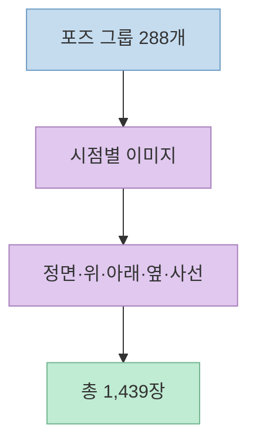
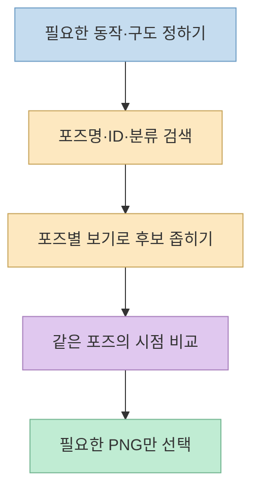
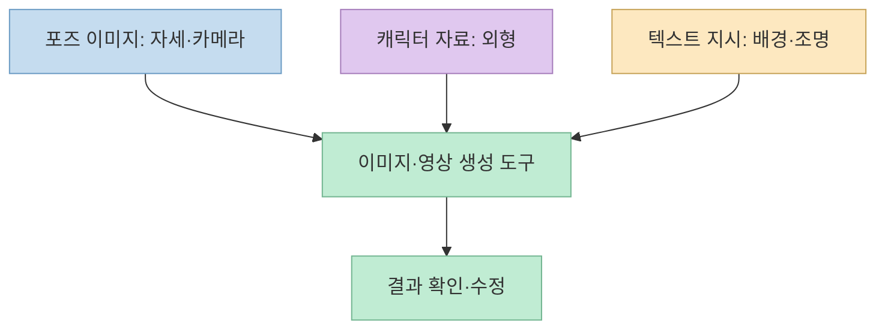

[Threads 글](https://www.threads.com/share/_2kG4ovkp/)은 이미지·영상 제작에 쓸 수 있는 **포즈 참조 이미지 1,439장**을 소개한다. 이어진 작성자 댓글은 [POSE-DB-01](https://ai-pose-gallery.pages.dev/) 사이트로 연결된다. 직접 확인해 보니 이 숫자는 서로 다른 포즈 1,439종이 아니라 **같은 포즈를 여러 카메라 각도에서 보여 주는 이미지 항목의 총수**다.

<!--more-->

## Sources

- [원본 Threads 공유 글](https://www.threads.com/share/_2kG4ovkp/) — 본문과 사이트 링크를 단 작성자 댓글. 공유 링크가 [원문](https://www.threads.com/@won.wizard/post/DfElK-anwtA)으로 이동하며, 공개 페이지의 메타데이터와 Jina Reader로 내용을 확인했다.
- [POSE-DB-01 원본 사이트](https://ai-pose-gallery.pages.dev/) — 갤러리 데이터, 사용 팁, 주의사항과 다운로드 UI. 공개 HTML에 포함된 데이터 항목을 확인했다.

## 1. 1,439장과 288개 포즈는 다른 숫자다

원본 글은 얼굴 없는 회색 마네킹 선화가 **3:4 비율**로 제공되며, 정면·위·아래·옆·사선 시점을 볼 수 있다고 설명한다. [사이트의 안내문](https://ai-pose-gallery.pages.dev/)도 같은 특징을 적고 있다. 그래서 동일한 동작을 다른 카메라 각도에서 검토할 때 유용하다. 반면 이 이미지는 얼굴, 의상, 배경까지 완성된 캐릭터 자료는 아니다.

2026년 10월 30일에 [사이트의 공개 페이지 데이터](https://ai-pose-gallery.pages.dev/)를 확인한 결과, **이미지 레코드 1,439개**, 계열과 포즈 번호를 묶은 **포즈 그룹 288개**였다. 288개 포즈의 각 시점이 모두 5장이라면 1,440장이지만, 한 그룹에는 아래 시점 한 장이 없어 총 1,439장이다. 이 수는 사이트가 이후 갱신되면 달라질 수 있다. 따라서 “포즈 1,439개”가 아니라 **“포즈 참조 이미지 1,439장”**이라고 읽어야 정확하다.

공개 데이터의 큰 분류도 이미지 항목 기준으로 **1인 전신 일반형 365장, 1인 전신 성인 지향형 399장, 1인 상반신 400장, 2인 포즈 275장**으로 나뉜다. 이 수치는 사이트의 데이터 배열을 분류별로 센 값이며, 작업에 쓸 수 있는 개별 포즈의 품질이나 다양성을 평가한 결과는 아니다. 일부 항목은 성인 지향 포즈가 포함되므로, 업무·교육 환경에서 사용할 때 분류를 확인하고 필요한 항목만 선택하는 편이 좋다. [POSE-DB-01](https://ai-pose-gallery.pages.dev/)

## 2. 갤러리에서 찾고, 같은 포즈의 시점을 비교한다

[사이트](https://ai-pose-gallery.pages.dev/)에는 **포즈명·ID·분류 검색**, 필터, **포즈별 보기와 한 장씩 보기** 전환, 원본 크기 PNG 다운로드 기능이 보인다. 상세 보기에는 좌우로 카메라 각도를 바꾸고 위아래로 앞뒤 포즈를 넘기는 키보드 안내도 있다. 이미지가 많을수록 먼저 목적에 맞는 분류를 좁힌 다음, 같은 포즈의 각도를 비교하는 순서가 효율적이다.

예를 들어 캐릭터가 앉은 장면을 만들려면 먼저 앉은 자세 계열에서 동작을 고르고, 최종 장면의 카메라와 가까운 시점의 이미지를 선택한다. 같은 캐릭터를 여러 장면에 배치한다면 **포즈 번호와 시점**을 함께 기록해 두는 편이 재현에 도움이 된다. 이는 갤러리 구조를 활용한 작업 방법이지, 특정 이미지 생성 도구에서 포즈가 정확히 재현된다는 보장은 아니다. [갤러리 탐색 UI](https://ai-pose-gallery.pages.dev/)

## 3. 포즈 참조와 완성 이미지 참조를 분리한다

[사이트의 사용 팁](https://ai-pose-gallery.pages.dev/)은 각종 AI 도구의 포즈·구도 참조 기능에 이미지를 넣고, 얼굴·의상·배경은 프롬프트나 별도 참조 이미지로 보충하라고 안내한다. 원본 크기 PNG는 세부 형태를 참조하는 데 사용할 수 있다. 같은 포즈 이미지를 계속 쓰면 생성된 이미지나 영상의 자세를 맞추는 데 도움이 될 수 있다고도 설명한다. 다만 **참조 기능 지원 여부와 반영 강도는 사용하는 도구에 따라 다르므로**, 이 갤러리만으로 일관성이 자동 보장되지는 않는다.

작업 지시를 만들 때는 역할을 분리하면 명확하다. **포즈 참조는 관절 배치와 시점**, 별도 캐릭터 참조는 **얼굴·의상·색**, 텍스트 지시는 **배경·조명·장면 목적**을 맡긴다. 결과가 어긋나면 어느 정보가 충돌했는지 되짚기 쉽다. 이것은 사이트의 “얼굴·복장·배경을 따로 더하라”는 안내를 바탕으로 정리한 실전 적용 방식이다. [사이트 사용 팁](https://ai-pose-gallery.pages.dev/)

## 4. 상업적 작품 활용과 이미지 재배포는 구분해야 한다

사용 범위를 확인하지 않고 “무료 이미지”라고만 생각하면 안 된다. [사이트의 주의사항](https://ai-pose-gallery.pages.dev/)은 **작품 제작에서의 상업적 이용·편집·참고 이용을 허용**하고 출처 표기를 필수로 요구하지 않는다. 반면 **원본 크기든 가공한 버전이든 이미지 데이터 자체를 재배포·전재·재판매하는 것은 금지**한다. 따라서 이 블로그에도 갤러리 이미지를 복제해 넣지 않고 원본 사이트만 링크한다. 완성 작품의 사용과 참조 이미지 파일을 다시 배포하는 일은 다른 행위다.

사이트는 이미지가 실존 인물이 아닌 마네킹 선화이며, **실존 인물이나 미성년자를 나타내는 용도 및 공서양속에 반하는 용도에는 사용하지 말라**고 명시한다. 특히 일부 분류가 성인 지향이라는 점을 고려하면, 사용할 프로젝트의 대상과 맥락에 맞는지 먼저 검토해야 한다. [POSE-DB-01 주의사항](https://ai-pose-gallery.pages.dev/)

## 실전 적용 포인트

1. 원하는 동작을 고른 다음 **카메라 각도까지 맞는 이미지**를 선택한다. 1,439장을 모두 내려받을 필요는 없다.
2. 생성 도구에 **포즈 참조 입력 기능**이 있는지 먼저 확인하고, 얼굴·의상·배경은 별도 입력으로 분리한다.
3. 결과를 비교할 때 포즈 번호, 선택한 시점, 사용한 도구와 설정을 함께 기록한다.
4. 갤러리 이미지 파일을 공유 자료집이나 블로그 첨부파일로 다시 배포하지 않는다. 필요한 사람에게는 [원본 사이트](https://ai-pose-gallery.pages.dev/)를 안내한다.

## 핵심 요약

- POSE-DB-01의 **1,439장은 이미지 수**이고, 확인 시점의 포즈 그룹은 **288개**다.
- 마네킹 선화는 **포즈·구도 참조**용이다. 얼굴·의상·배경은 따로 정해야 한다.
- **상업적 작품 제작 활용은 허용**, 이미지 데이터 자체의 **재배포·재판매는 금지**된다.

## 결론

이 갤러리는 많은 독립 포즈를 무작정 모은 곳이라기보다, **같은 포즈를 여러 시점으로 비교하는 참조 도구**에 가깝다. 숫자보다 검색·시점 선택·참조 분리 방식이 실사용에 중요하며, 이용 전에는 원본 사이트의 최신 주의사항을 확인해야 한다.
