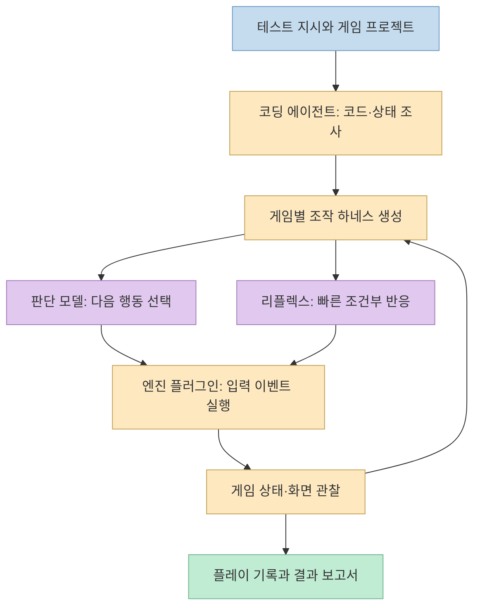
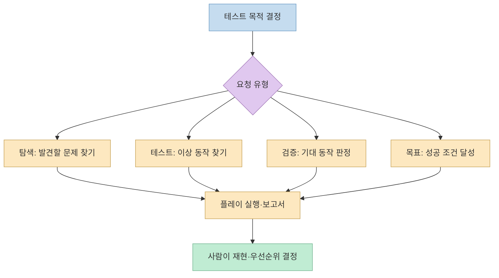
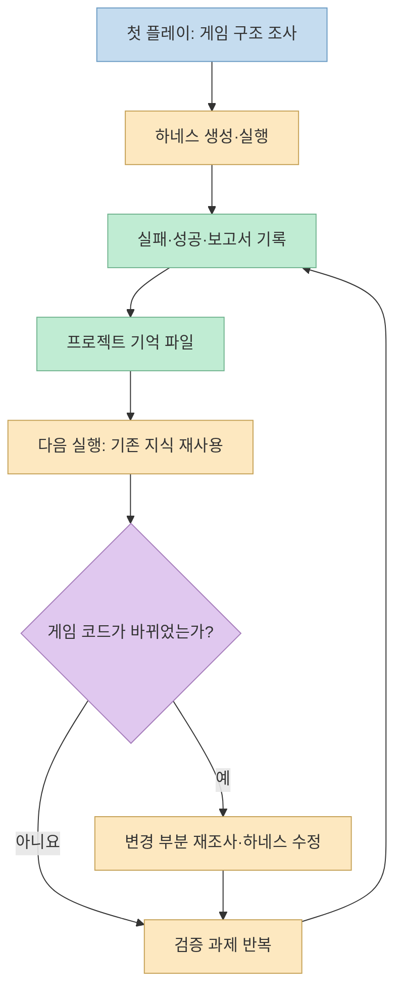

[Threads 글](https://www.threads.com/share/BAxmAWsKL9/)은 AI 에이전트가 게임을 직접 플레이하며 버그를 찾는 오픈소스 도구 **Aura Autopilot**을 소개한다. 실제로 [공식 저장소](https://github.com/ramenvr/autopilot)는 Unreal·Unity·Godot 에디터에서 자연어로 플레이테스트를 지시하는 경로를 제공한다. 다만 모든 게임에서 자동으로 버그를 빠짐없이 찾는 범용 QA 대체재라기보다는, **게임별 조작 방법을 학습하고 반복 가능한 검증을 수행하는 도구**로 보는 것이 정확하다.

<!--more-->

## Sources

- [원본 Threads 공유 링크](https://www.threads.com/share/BAxmAWsKL9/) · [연결된 원문과 작성자 댓글](https://www.threads.com/@escape.salary/post/DfIxg66E-f5) — 브라우저로 본문과 댓글을 확인했다.
- [Aura Autopilot 공식 저장소](https://github.com/ramenvr/autopilot) — 지원 버전, 설치·연결 방법, 프롬프트 유형, 라이선스.
- [공식 Autopilot 문서](https://www.tryaura.dev/documentation/autopilot/) — 엔진별 플러그인 설치와 실행 흐름.
- [개발팀 기술 설명·평가 보고서](https://www.tryaura.dev/updates/autopilot-continually-learning-real-time-general-playtesting-system/) — 아키텍처, 프로젝트 기억, 자체 벤치마크 조건.
- [공식 소개 페이지](https://www.tryaura.dev/autopilot/) — 다운로드와 벤치마크 요약.

## 1. 텍스트 지시가 실제 게임 플레이로 이어지는 구조

Autopilot은 단순히 게임 화면을 캡처해 LLM에 다음 버튼을 묻는 구조가 아니다. [개발팀 설명](https://www.tryaura.dev/updates/autopilot-continually-learning-real-time-general-playtesting-system/)에 따르면 **엔진 플러그인**이 게임 상태를 읽고 실제 사용자 입력 이벤트를 주입한다. 별도 **에이전트 서비스**는 코딩 에이전트, 게임별 조작 하네스, 판단 모델, 프로젝트 기억 파일을 관리하며 플러그인과 WebSocket으로 통신한다.

코딩 에이전트는 프로젝트 소스와 에디터의 플레이 상태를 조사해, 그 게임에 맞는 **하네스**를 작성한다. 하네스는 “W키 누르기” 같은 저수준 조작을 “목표로 이동하기”, “공격 피하기” 같은 의미 있는 행동으로 묶어 판단 모델에 제공한다. 판단 모델은 플레이 중 어떤 행동을 취할지 선택한다. 회피처럼 결정 주기보다 빠른 반응이 필요한 동작은 하네스의 조건부 **리플렉스 함수**가 직접 입력을 내보내도록 설계했다. 개발팀은 판단 모델의 출력 주기를 대략 0.25초라고 설명하지만, 이는 모든 게임·환경의 고정 지연 보증은 아니다.

## 2. 탐색·테스트·검증·목표 달성은 서로 다르다

[공식 README](https://github.com/ramenvr/autopilot)는 프롬프트를 네 가지로 나눈다. **탐색**은 레벨이나 시스템을 돌아보는 열린 과제이고, **테스트**는 현재 레벨에서 이상해 보이는 부분을 찾는 요청이다. **검증**은 “도끼로 나무를 치면 흔들리는가”처럼 기대 동작이 관찰되는지 확인한다. **목표**는 “체력을 일정 수준 이상 유지하며 보스를 처치하라”처럼 성공 조건을 달성하는 과제다. 이 구분이 있어야 보고서의 의미를 판단할 수 있다. 목표에 도착했다는 사실과 특정 기능이 정상 동작한다는 판정은 다른 결과다.

에디터 플러그인에서 요청하면 Autopilot은 플레이 세션을 열고 소스 코드와 플레이 상태를 조사한 뒤 행동을 실행하며, 종료 후 보고서를 만든다고 설명한다. 검증 과제는 **기대 결과, 관찰 가능한 조건, 실패 기준**을 명확히 쓸수록 사람이 결과를 재확인하기 쉽다. 예를 들어 “나무가 흔들리는지 봐줘”만 쓰기보다 대상 나무, 공격 수단, 판정할 시간 범위, 흔들림의 관찰 기준을 함께 정하는 편이 낫다. 이는 공식 예시를 실제 QA 절차에 적용하기 위한 제안이지 도구가 자동으로 모든 기준을 설정한다는 뜻은 아니다.

## 3. “플레이할수록 똑똑해진다”는 모델 재학습이 아니다

Threads의 반복 플레이 주장은 [개발팀 기술 설명](https://www.tryaura.dev/updates/autopilot-continually-learning-real-time-general-playtesting-system/)에서 **게임별 파일 기반 기억**으로 구체화된다. 저장되는 것은 게임 지식, 사실 메모, 재사용 가능한 하네스 코드, 이전 실행 흔적과 보고서다. 다음 실행에서는 이미 조사한 구성요소를 다시 파악하는 시간을 줄이고, 효과가 있었던 조작 코드를 출발점으로 삼을 수 있다. 이는 **기반 모델의 가중치를 게임을 할 때마다 훈련한다는 뜻이 아니다.** 소스 코드가 바뀌면 변경 사실을 코딩 에이전트에 알리는 방식도 설명한다.

개발팀은 소울라이크 게임 사례에서 여러 번 시도하며 무기·방어구와 전투 전술을 바꾼 뒤 보스 공격 회피용 리플렉스에 도달했다고 보고한다. 이것은 특정 사례에서의 적응을 보여 주지만, 다른 게임에서도 같은 횟수로 보스를 이기거나 처음부터 플레이가 안정적이라는 보장은 아니다. 공식 README도 첫 실행의 하네스는 다소 서툴 수 있다고 안내하며, 초기 **10분 탐색 실행은 선택 사항**이라고 명시한다.

## 4. 지원 엔진, 설치 경로와 사용 비용

[공식 저장소의 설치 안내](https://github.com/ramenvr/autopilot)는 Windows와 macOS에서 **Unreal Engine 5.4–5.8, Unity 6 이상, Godot 4.7 이상**을 대상으로 사전 빌드된 패키지를 안내한다. Unreal은 프로젝트의 `Plugins/`에, Unity는 Package Manager의 tarball 설치로, Godot은 `addons/`에 넣고 플러그인을 활성화한다. 소스에서 직접 빌드하는 경로는 현재 README상 **Unreal만 지원**한다. 엔진을 두루 지원한다는 표현과 모든 엔진에서 같은 설치·빌드 경로를 제공한다는 뜻은 구분해야 한다.

기본 경로는 엔진 에디터의 Autopilot UI에서 사용하는 것이다. [README](https://github.com/ramenvr/autopilot)에 따르면 이 경로는 Aura 요금제 **또는 BYOK API 키**를 사용한다. Claude Code·Codex와 연결할 때는 `autopilot connect claude` 또는 `autopilot connect codex`로 스킬과 MCP 서버를 연결하며, 해당 경로는 사용자의 Claude·ChatGPT 구독을 이용한다고 안내한다. 따라서 **저장소 코드가 Apache-2.0 오픈소스인 것과 실행에 필요한 서비스·모델 사용 비용은 별개**다. 실제 과금·한도는 선택한 경로에서 확인해야 한다.

설정에는 Aura 계정의 로그인 흐름과 실행 기록 공유 여부 선택이 있다. 소스 코드를 조사하고 플레이 흔적을 남기는 도구이므로, 비공개 프로젝트라면 계정 연결, API 키, 실행 데이터 공유 설정을 팀의 보안 정책에 맞춰 검토해야 한다. [README의 제거 안내](https://github.com/ramenvr/autopilot)는 플러그인을 제거해도 프로젝트 기억을 기본적으로 보존하며, 삭제하려면 별도 선택이 필요하다고 명시한다.

## 5. 개발팀 벤치마크는 어떻게 읽어야 하나

[공식 소개 페이지](https://www.tryaura.dev/autopilot/)는 Autopilot이 Claude Code보다 평균 **1.7배 빠르고**, 7개 과제를 모두 통과했다고 강조한다. [기술 설명](https://www.tryaura.dev/updates/autopilot-continually-learning-real-time-general-playtesting-system/)을 보면 이는 **Unreal Engine 5.8의 한 템플릿 게임에서 7개 검증·목표 과제**를 수행한 개발팀 자체 평가다. 각 실행은 기억을 비운 상태에서 시작했고, 세 시스템 모두 같은 Windows 머신에서 테스트했다. 개발팀은 우회 플레이를 실패로 분류했으며, Claude Code에는 Unreal Python Remote Execution을 통해 플레이하도록 했다.

보고된 평균 과제 시간은 Autopilot **262초**, Claude Code **437초**이고, 첫 시도 통과는 각각 **7/7**, **5/7**이다. 시간 측정은 첫 생성 토큰부터 마지막 생성 토큰까지이며 플레이 창 시작 같은 설정 단계는 제외됐다. 비교 대상·하네스·게임·과제 수가 제한적이므로 **독립 검증된 범용 우위나 모든 엔진의 성능 결과로 일반화해서는 안 된다.** 이 평가에서는 기억을 비워 두었으므로 앞 절의 장기 기억 효과를 직접 검증한 수치로 해석할 수도 없다.

## 실전 적용 포인트

1. **지원 버전을 먼저 확인한다.** 현재 프로젝트의 Unreal·Unity·Godot 버전과 운영체제가 공식 패키지 대상인지 확인한다.
2. **작은 검증 과제로 시작한다.** 레벨 하나, 행동 하나, 관찰할 결과 하나를 정하고 첫 보고서를 사람이 직접 재현한다.
3. **초기 하네스를 평가한다.** 첫 플레이가 부정확할 수 있으므로 실패를 곧바로 게임 버그로 확정하지 말고 입력·상태 읽기·게임 규칙 이해를 분리한다.
4. **기억과 공유 설정을 관리한다.** 프로젝트 변경 뒤 이전 하네스가 유효한지 확인하고, 팀의 코드·데이터 보안 규칙에 맞춰 로그인과 기록 공유를 설정한다.
5. **사람의 플레이테스트를 남긴다.** 자동 과제 통과 후에도 조작감, 난이도, 재미, 접근성, 예외적인 플레이 방식은 사람이 검토한다.

## 핵심 요약

Aura Autopilot은 **코딩 에이전트가 게임별 조작 하네스를 만들고 판단 모델이 실제 입력을 선택하는 플레이테스트 시스템**이다. 반복 실행의 개선은 프로젝트 기억 파일과 재사용 가능한 하네스에서 나오며, 기반 모델을 매번 재훈련하는 것은 아니다. Unreal·Unity·Godot을 지원하지만 설치 조건과 비용 경로가 다르고, 개발팀의 7개 과제 벤치마크는 한정된 자체 평가다.

## 결론

이 도구의 적합한 역할은 사람이 같은 동작을 수십 번 반복하는 부담을 줄이고 **재현 가능한 검증 루프를 늘리는 것**이다. 작은 과제로 하네스의 정확도를 확인하고, 보고서를 실제 플레이로 재검증한 뒤 범위를 넓히는 편이 안전하다.
