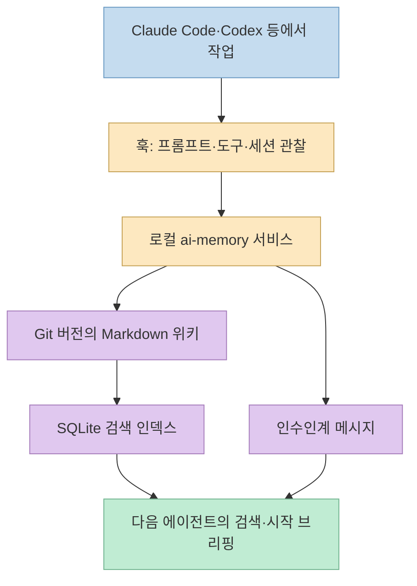
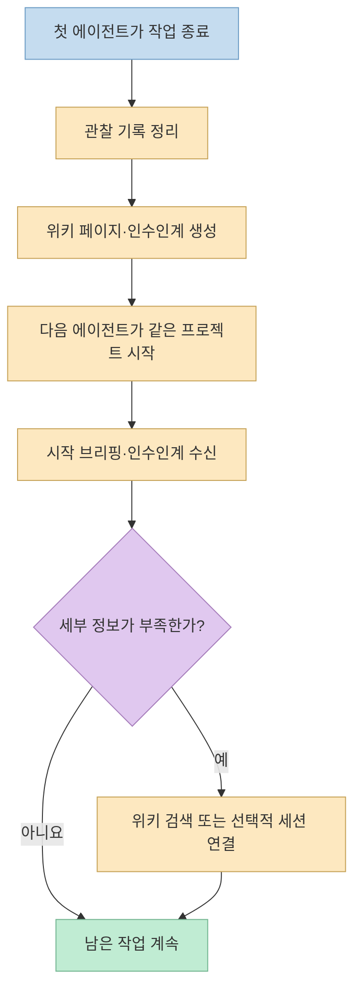
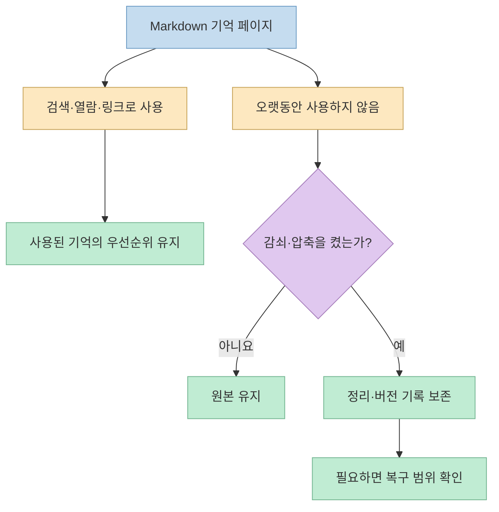

[AI씬의 쇼츠](https://youtube.com/shorts/Wh72wXtnGb4?si=6nmEravZiVhOha2Q)는 Claude Code에서 작업하다 Codex로 바꿔도 맥락을 이어받는 도구 **ai-memory**를 소개한다. [공식 저장소](https://github.com/akitaonrails/ai-memory)의 핵심은 AI 모델이 저절로 영구 기억을 갖는 것이 아니라, **코딩 에이전트의 작업 기록을 로컬 서비스가 수집해 공용 Markdown 위키와 인수인계 메시지로 만드는 방식**이다. 이점과 함께 기록 범위·보존·공유 권한을 확인해야 한다.

<!--more-->

## Sources

- [원본 Shorts: 코딩 AI 20종이 기억 하나를 나눠 쓰는 ai-memory](https://youtube.com/shorts/Wh72wXtnGb4?si=6nmEravZiVhOha2Q) — 자동 자막의 시점 정보와 영상 설명을 대조했다.
- [ai-memory 공식 저장소](https://github.com/akitaonrails/ai-memory) — 지원 에이전트, 기억 구조, 기본 동작과 설치 안내.
- [에이전트용 설치 안내](https://github.com/akitaonrails/ai-memory/blob/main/INSTALL_FOR_AGENTS.md) — 설치 후 연결 대상과 설정 변경 범위.
- [데이터 처리 문서](https://github.com/akitaonrails/ai-memory/blob/main/DATA_HANDLING.md) · [보안 문서](https://github.com/akitaonrails/ai-memory/blob/main/docs/security.md) — 기본 로컬 저장, 선택적 외부 전송, 인증·보존 조건.

## 1. “기억 하나를 공유한다”는 말의 실제 구조

영상은 [0:08부터](https://youtu.be/Wh72wXtnGb4?t=8) 여러 코딩 AI가 같은 기억을 쓴다고 설명한다. [공식 README](https://github.com/akitaonrails/ai-memory)는 Claude Code, Codex, Cursor, Gemini CLI 등을 포함한 여러 클라이언트에서 **라이프사이클 훅과 MCP 연결**을 지원한다. 에이전트가 남긴 프롬프트, 도구 호출, 세션 경계 등의 관찰값을 수집하고, 세션 종료 때 읽기 쉬운 기억 페이지로 정리한다. 지원 여부와 훅·MCP의 제공 범위는 클라이언트마다 다르므로, “20종 이상”이 모두 똑같은 방식으로 기록·검색한다는 뜻은 아니다.

기억의 **원본은 Git으로 버전을 관리하는 일반 Markdown 파일**이고, SQLite 데이터베이스는 검색을 위한 파생 인덱스다. [쇼츠 0:27](https://youtu.be/Wh72wXtnGb4?t=27) 따라서 파일을 열어 직접 읽고 고칠 수 있다. 인덱스를 다시 만들 수 있다는 점은 장점이지만, 원본 파일을 수동 수정할 때도 출처와 문맥을 확인해야 한다. 기록은 사실 검증을 대신하지 않으며, 오래된 결론이나 실패한 시도도 기억에 남을 수 있다.

## 2. 에이전트를 바꿔도 어디까지 자동으로 이어지나

쇼츠는 [0:19부터](https://youtu.be/Wh72wXtnGb4?t=19) 같은 작업 폴더에서 다른 AI를 켜면 진행 상황·실패·남은 일을 인수인계한다고 말한다. [공식 README](https://github.com/akitaonrails/ai-memory)의 인수인계는 소유자가 지정된 메시지를 **한 번만 가져가는 프로토콜**이다. 새 에이전트는 이를 시작 브리핑으로 받거나 기록을 검색한다. 단순히 두 모델이 같은 내부 대화창을 보는 방식은 아니다.

기본 브리핑은 길이가 제한되어 있어 지난 대화의 모든 세부사항을 보존하지 않는다. 저장소는 더 정확한 세션 연결이 필요할 때 `ai-memory run`으로 에이전트를 시작해, 이전 에이전트의 **로컬 원본 기록에 대한 일시적 투영**을 함께 쓰는 선택 경로를 설명한다. 직접 Claude Code나 Codex를 실행하는 일반 경로는 기존대로 동작한다. 따라서 “코덱스로 전환하면 아무 설정 없이 과거 대화를 100% 복원한다”는 해석은 과장이다.

## 3. “자주 쓰는 기억은 오래 남는다”와 삭제의 차이

[쇼츠 0:36](https://youtu.be/Wh72wXtnGb4?t=36)은 사용한 기억이 더 오래 남고, 사용하지 않은 기억은 흐려진다고 설명한다. 공식 문서상 **접근에 따라 보존 우선순위를 높이는 기능은 기본 활성화**돼 있다. 반면 기억을 압축하거나 중복을 합치고, 단계별 감쇠 규칙으로 내용을 바꾸는 기능은 **기본 비활성화**이며 운영자가 켜야 한다. 이 차이를 생략하면 모든 기억이 자동으로 지워지거나 매일 새롭게 재작성되는 것처럼 오해하기 쉽다.

기억이 검색에서 뒤로 밀리거나 페이지가 정리되어도 원본은 Git 버전 기록에 남을 수 있고, 공식 README는 `restore-page`로 복구하는 경로를 안내한다. [쇼츠 0:42](https://youtu.be/Wh72wXtnGb4?t=42) 이는 실수 복구에는 유용하지만 **민감정보의 완전 삭제와는 다르다.** 보존 정책과 백업·버전 기록까지 포함해 삭제 범위를 검토해야 한다. 기본 기능인 기록·검색·인수인계는 별도 LLM API 호출 없이 작동하지만, 선택한 LLM 제공자나 클라우드 임베딩 제공자를 붙이면 비용과 외부 데이터 전송이 생길 수 있다.

## 4. 설치 전에 확인할 변경 범위와 데이터 흐름

[공식 빠른 시작](https://github.com/akitaonrails/ai-memory)은 macOS·Linux에 릴리스 바이너리를 설치한 뒤 `ai-memory setup`을 실행한다. 설치 스크립트는 릴리스의 SHA-256 체크섬을 확인한다고 설명한다. `setup`은 사용자 서비스, 데이터 디렉터리, 인증 토큰을 만들고 발견한 코딩 에이전트의 **MCP·훅·스킬 설정**을 연결한다. “명령 두 줄”은 입력하는 명령의 수이지 바뀌는 파일과 서비스가 두 개뿐이라는 뜻은 아니다. [쇼츠 0:51](https://youtu.be/Wh72wXtnGb4?t=51)

특히 아무 대상도 지정하지 않으면 감지한 여러 에이전트를 연결할 수 있다. 먼저 `ai-memory setup --plan`으로 변경 계획을 읽고, 필요한 클라이언트만 `--agent`로 지정하는 편이 안전하다. [에이전트용 설치 문서](https://github.com/akitaonrails/ai-memory/blob/main/INSTALL_FOR_AGENTS.md)는 `--agent codex`처럼 연결 대상을 선택할 수 있다고 설명한다. 원격 설치 스크립트를 실행하기 전에는 공식 릴리스와 스크립트 내용을 확인해야 한다. 이 글은 도구를 **설치하거나 사용해 본 결과가 아니라 공식 문서를 검토한 내용**이다.

[데이터 처리 문서](https://github.com/akitaonrails/ai-memory/blob/main/DATA_HANDLING.md)에 따르면 기본 저장은 사용자 관리 디렉터리의 로컬 파일이며 자체 사용량 텔레메트리는 없다. 다만 기본 로컬 임베딩 모델의 파일이 없으면 최초 실행 때 Hugging Face에서 모델 약 87MB를 **다운로드**한다. 저장한 프로젝트 내용의 업로드는 아니지만, 완전 무네트워크 실행과는 구분해야 한다. 클라우드 임베딩이나 LLM 제공자를 선택하면 저장 페이지·세션 관찰값이 외부로 전송될 수 있다. 기록 전 비밀값 제거는 최선의 노력이지 완벽한 보장이 아니므로, 민감한 저장소는 캡처 제외 규칙을 검토해야 한다.

쇼츠가 말한 [서버·팀 공유](https://youtu.be/Wh72wXtnGb4?t=47)는 별도 운영 단계다. 한 서버를 여러 장치에서 쓰거나 팀원에게 열 때는 **사용자별 권한, 인증, HTTPS, 프로젝트 격리**를 구성해야 한다. [보안 문서](https://github.com/akitaonrails/ai-memory/blob/main/docs/security.md)는 새 설치의 인증 토큰과 원격 접속 시 TLS 보호를 설명한다. 단순히 포트를 인터넷에 공개하는 것은 안전한 공유 설정이 아니다.

## 실전 적용 포인트

1. **작은 프로젝트에서 시험한다.** 한 에이전트의 기록·검색을 확인한 뒤 두 번째 에이전트 연결과 인수인계를 점검한다.
2. **설치 계획부터 읽는다.** `setup --plan`과 `--agent`로 바뀔 설정과 연결 대상을 제한하고, 기존 MCP·훅과 충돌하지 않는지 살핀다.
3. **인수인계 내용을 검증한다.** “완료”, “실패”, “남은 일”은 이전 작업 기록에서 생성된 주장이다. 실제 파일·테스트 상태와 대조한 뒤 이어간다.
4. **민감정보 보존을 설계한다.** 캡처 제외, Git 버전 기록, 선택적 외부 모델 전송, 서버 접근 권한을 함께 확인한다.

## 핵심 요약

ai-memory는 **여러 코딩 에이전트가 공용 Markdown 위키와 일회성 인수인계 메시지를 사용하도록 연결하는 로컬 서비스**다. 기본 기록·검색·인수인계에는 별도 LLM API 키가 필요 없지만, 설치는 사용자 서비스와 에이전트 설정을 바꾸며 최초 로컬 모델 다운로드가 있을 수 있다. 기억의 사용 빈도 반영은 기본 동작이고, 내용 감쇠·압축과 외부 LLM 연결은 별도 선택이다.

## 결론

에이전트를 바꿀 때 같은 배경을 반복 설명하는 일이 많다면 유용한 구조다. 다만 **기억이 편리해질수록 기록할 데이터와 보존할 기간도 관리해야 한다.** 작은 프로젝트에서 설정·검색·인수인계·복구를 검증한 뒤 팀 공유로 확장하는 편이 좋다.
