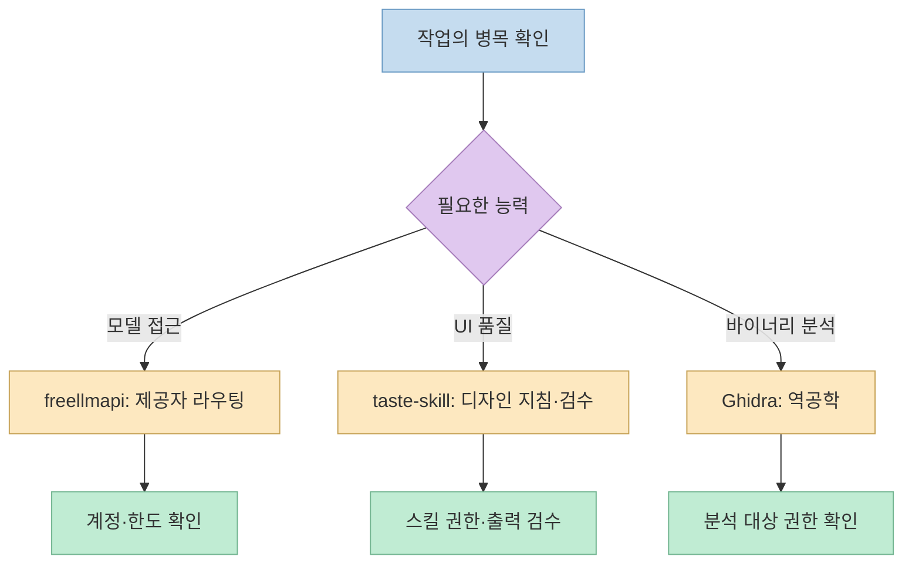
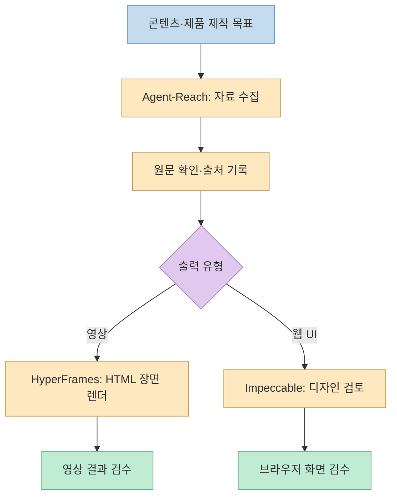
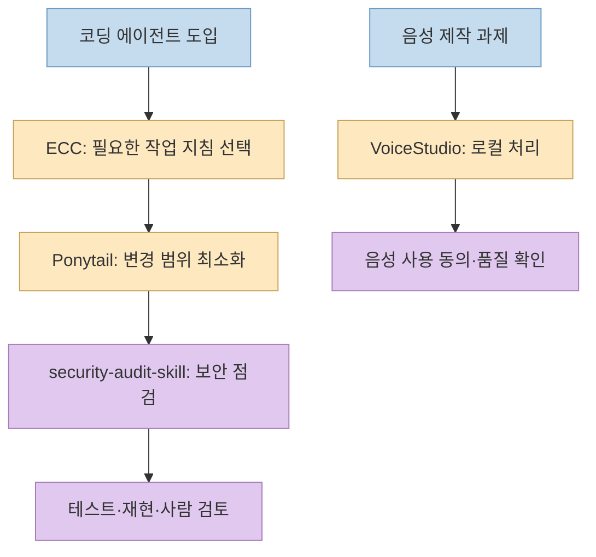

[AI씬의 쇼츠](https://youtube.com/shorts/Wxyc-OuCeC8?si=Xv1aZwyv4-aKA3sr)는 2026년 10월 GitHub 월간 인기 저장소 10곳을 소개한다. 영상 설명 기준으로 이들이 10월 30일까지 받은 별의 합은 **244,881개**다. 다만 별 증가량은 관심의 지표이지 품질, 보안, 실제 비용의 검증 결과가 아니다. 아래에서는 자동 자막의 이름 오류를 영상 설명과 공식 저장소로 바로잡고, **무슨 일을 하는 도구인지와 도입 전 확인할 조건**을 함께 살펴본다.

<!--more-->

## Sources

- [원본 Shorts: 10월 깃허브 TOP10](https://youtube.com/shorts/Wxyc-OuCeC8?si=Xv1aZwyv4-aKA3sr) — 자동 자막의 시점 정보와 영상 설명의 저장소·10월 30일 집계값을 대조했다.
- 공식 저장소: [freellmapi](https://github.com/tashfeenahmed/freellmapi), [taste-skill](https://github.com/Leonxlnx/taste-skill), [Ghidra](https://github.com/NationalSecurityAgency/ghidra), [Agent-Reach](https://github.com/Panniantong/Agent-Reach), [HyperFrames](https://github.com/heygen-com/hyperframes).
- 공식 저장소: [Impeccable](https://github.com/pbakaus/impeccable), [ECC](https://github.com/affaan-m/ECC), [security-audit-skill](https://github.com/cloudflare/security-audit-skill), [Ponytail](https://github.com/DietrichGebert/ponytail), [VoiceStudio](https://github.com/debpalash/VoiceStudio).
- 순위 밖 신인: [DeepInfer](https://github.com/deepseek-ai/DeepInfer).

## 1. 10위부터 8위: API 접근·디자인·역공학

**10위 [freellmapi](https://github.com/tashfeenahmed/freellmapi)**는 여러 무료 LLM 제공자의 모델 엔드포인트를 **하나의 OpenAI 호환 `/v1` 인터페이스**로 묶고, 라우팅과 실패 시 전환을 제공한다. 쇼츠는 “무료 AI 34곳”이라고 소개한다. [영상 0:03](https://youtu.be/Wxyc-OuCeC8?t=3) 저장소 설명에도 34개 제공자가 등장하지만, 이것이 **키 없이 무제한 무료 추론**이라는 뜻은 아니다. 제공자별 계정·무료 할당량·이용약관을 확인해야 하며, 저장소는 개인 실험 용도라고 명시한다.

**9위 [taste-skill](https://github.com/Leonxlnx/taste-skill)**은 코딩 에이전트에 디자인 방향·참고 이미지·브라우저 검수 절차를 제공하는 스킬이다. [영상 0:09](https://youtu.be/Wxyc-OuCeC8?t=9) “디자인 감각”은 새로운 이미지 모델이 추가된다는 뜻보다, 에이전트가 흔한 템플릿을 그대로 반복하지 않도록 **아트 디렉션과 결과 검토 기준을 주는 방식**으로 이해하는 편이 맞다. 도입 전에는 스킬 파일이 프로젝트에 어떤 지침을 추가하는지 읽어야 한다.

**8위 [Ghidra](https://github.com/NationalSecurityAgency/ghidra)**는 미국 국가안보국이 공개한 **소프트웨어 역공학 프레임워크**다. [영상 0:13](https://youtu.be/Wxyc-OuCeC8?t=13) 실행 파일 분석·디컴파일·디버깅이 주된 목적이며, 나머지 AI 에이전트용 스킬과 같은 종류의 도구가 아니다. 10월 별 증가량으로 한 목록에 묶였을 뿐, 일반적인 개발 워크플로에 곧바로 설치해야 하는 필수품은 아니다.

## 2. 7위부터 5위: 조사·영상 제작·프런트엔드 품질

**7위 [Agent-Reach](https://github.com/Panniantong/Agent-Reach)**는 에이전트가 YouTube·Reddit·GitHub 등 외부 플랫폼의 정보를 읽고 검색하도록 돕는 CLI다. [영상 0:17](https://youtu.be/Wxyc-OuCeC8?t=17) “인터넷 전체를 무료로 읽는다”는 식의 보장은 아니다. 플랫폼별 접근 가능 범위와 로그인·차단·수집 정책이 다르며, 에이전트가 읽은 결과 역시 원문과 대조해야 한다.

**6위 [HyperFrames](https://github.com/heygen-com/hyperframes)**는 **HTML 기반 장면을 영상으로 렌더링**하는 개발 도구다. 쇼츠 제작에 실제로 사용했다는 것은 영상 제작자의 설명이다. [영상 0:21](https://youtu.be/Wxyc-OuCeC8?t=21) 페이지를 영상으로 바꾸는 파이프라인이 필요한지, 이미 쓰는 편집기나 렌더 도구와 어떻게 연결할지 판단하는 것이 먼저다. 라이브러리의 존재와 최종 영상 품질은 별개다.

**5위 [Impeccable](https://github.com/pbakaus/impeccable)**은 코딩 에이전트가 프런트엔드의 시각적 완성도를 높이도록 **디자인 어휘·검토·감사 지침**을 제공한다. [영상 0:24](https://youtu.be/Wxyc-OuCeC8?t=24) “AI 티 나는 디자인”을 자동으로 없애 준다기보다, 더 구체적인 디자인 방향을 요청하고 결과를 비평하는 도구로 봐야 한다. 앞의 taste-skill과 기능이 일부 겹치므로 둘을 한꺼번에 넣기보다 하나씩 시험해 보는 편이 비교하기 쉽다.

## 3. 4위부터 1위: 에이전트 작업 방식과 로컬 음성

**4위 [ECC](https://github.com/affaan-m/ECC)**는 Claude Code·Codex 등 코딩 에이전트에 적용할 스킬, 기억, 보안, 조사 중심의 **작업 하네스**다. 영상은 “스킬 314개”라고 소개한다. [영상 0:27](https://youtu.be/Wxyc-OuCeC8?t=27) 스킬 수 자체가 성능을 보장하지는 않으며, 여러 지침을 한꺼번에 넣으면 기존 프로젝트 규칙과 충돌할 수 있다. 필요한 구성만 선별하고 실제 작업에서 효과를 검증해야 한다.

**3위 [Cloudflare security-audit-skill](https://github.com/cloudflare/security-audit-skill)**은 코딩 에이전트가 보안 문제를 찾고, 결과를 독립적으로 확인 가능한 형태로 정리하도록 하는 감사 스킬이다. [영상 0:31](https://youtu.be/Wxyc-OuCeC8?t=31) 설치만으로 취약점이 자동으로 사라지는 것은 아니다. 발견 사항의 재현 가능성, 오탐 여부, 수정 후 재검증이 필요하다. 영상은 10월 별 증가량 **29,622개**와 10월 코드 수정 없음도 언급한다. [영상 0:36](https://youtu.be/Wxyc-OuCeC8?t=36) 공식 GitHub 커밋 기록을 10월 1~30일로 조회했을 때 해당 기간의 커밋은 없었다. 별 증가는 코드 변경량과 같은 지표가 아니라는 사례다.

**2위 [Ponytail](https://github.com/DietrichGebert/ponytail)**은 코딩 에이전트에 **필요한 코드만 만들도록 하는 지침과 검토 절차**를 적용한다. [영상 0:42](https://youtu.be/Wxyc-OuCeC8?t=42) 영상의 “코드가 절반 넘게 줄었다”는 수치는 제작자 측 실험 주장으로, 모든 프로젝트에서 같은 감소율이 나온다는 뜻이 아니다. 코드량뿐 아니라 테스트 통과·보안·유지보수성을 함께 비교해야 한다.

**1위 [VoiceStudio](https://github.com/debpalash/VoiceStudio)**는 음성 복제·음성 디자인·더빙·전사·오디오북 제작을 로컬 환경에서 다루는 프로젝트다. [영상 0:48](https://youtu.be/Wxyc-OuCeC8?t=48) 영상 설명은 10월 별 증가량을 **47,778개**로 기록한다. 로컬 실행은 클라우드 API를 반드시 호출해야 한다는 뜻은 아니지만, 모델 다운로드·연산 자원·음성 데이터 사용 권한을 확인해야 한다. 특히 타인의 목소리를 복제할 때는 동의와 이용 목적이 중요하다.

## 4. 순위 밖 신인과 숫자의 해석

영상은 별도로 [DeepSeek의 DeepInfer](https://github.com/deepseek-ai/DeepInfer)를 “이달의 신인”으로 소개한다. [영상 0:55](https://youtu.be/Wxyc-OuCeC8?t=55) 공식 저장소는 이를 **DeepSeek 모델용 대규모 고성능 추론 프레임워크**라고 설명한다. 영상 설명의 **24,285개**는 10월 16일 공개 이후 10월 30일까지 받은 별이라는 스냅샷 수치다. 자막은 숫자를 잘못 인식하므로 이 값은 영상 설명을 기준으로 했다. 이 도구는 일반 사용자가 챗봇을 무료로 쓰는 앱이 아니라 추론 서비스를 운영하는 인프라에 가깝다.

TOP 10의 별 증가량을 더하면 **244,881개**로 영상 설명과 일치한다. 하지만 이는 서로 다른 종류의 저장소에 대한 **10월 30일 기준 관심도 합계**일 뿐, 프로젝트의 독립적인 품질 평가나 도입 우선순위가 아니다. 저장소의 기능·라이선스·데이터 전송·모델 비용·유지보수 상태는 각각 확인해야 한다.

## 실전 적용 포인트

1. **문제부터 고른다.** 모델 라우팅, 자료 수집, UI 검수, 영상 제작, 보안 감사, 음성 처리 중 현재 병목 하나를 정한다.
2. **공식 저장소를 읽는다.** 별 수보다 설치 방법, 권한, 라이선스, 외부 계정·API 비용, 최근 변경을 확인한다.
3. **기존 도구와 한 번에 하나만 비교한다.** 같은 과제에서 결과 품질, 작업 시간, 모델 사용량을 기록한다.
4. **에이전트 스킬은 코드로 취급한다.** 저장소의 `SKILL.md`·훅·스크립트가 파일이나 네트워크에 어떤 영향을 주는지 설치 전에 확인한다.

## 핵심 요약

이 쇼츠의 TOP 10은 **AI 에이전트 스킬, 인터넷 조사 도구, 영상·음성 제작 도구, 역공학 프레임워크가 섞인 인기 목록**이다. 244,881개 별과 각 순위는 영상이 밝힌 10월 30일의 집계값이다. 도입 판단에는 순위보다 **해결할 문제, 실행 조건, 비용과 권한, 결과 검증 방법**이 더 중요하다.

## 결론

관심 있는 저장소가 있다면 목록 전체를 설치하기보다 **자신의 작업 흐름에서 하나만 골라 작은 과제로 시험**해 보자. 인기 지표를 출발점으로 쓰되, 실제 채택은 공식 문서와 재현 가능한 결과로 결정하는 편이 낫다.
