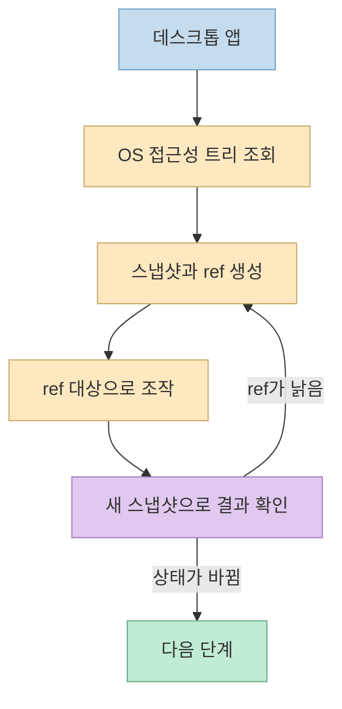
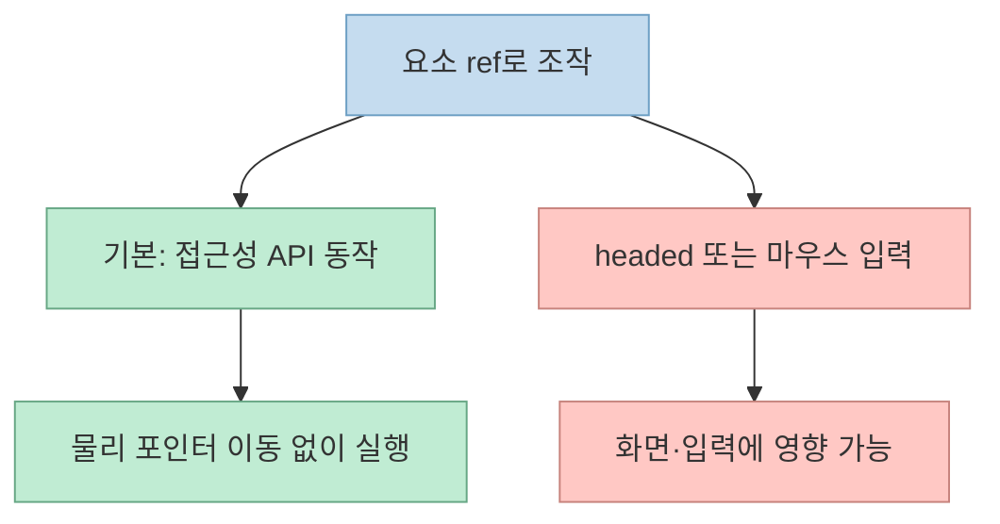

짧은 [영상](https://youtube.com/shorts/LTYkSGxkdTw?si=SIbkC7YPRpzB8Q4_)에는 여러 AI 에이전트의 커서가 데스크톱 앱 위를 돌아다니지만 사용자의 마우스는 움직이지 않는다. 주인공은 [Vercel Labs의 `agent-desktop`](https://github.com/vercel-labs/agent-desktop)이다. 핵심은 화면 좌표를 추측해 클릭하는 대신 **운영체제 접근성 트리에서 조작할 요소를 식별** 한다는 점이다.

<!--more-->

## Sources

- [원본 YouTube Shorts](https://youtube.com/shorts/LTYkSGxkdTw?si=SIbkC7YPRpzB8Q4_) — 한국어 자동 생성 자막을 구간별로 확인했다. YouTube MCP가 제공되지 않아 자막 API를 대체 경로로 사용했다.
- [`vercel-labs/agent-desktop` 공식 저장소](https://github.com/vercel-labs/agent-desktop) — 작동 방식, 설치, 플랫폼별 지원 범위.
- [공식 FAQ](https://github.com/vercel-labs/agent-desktop/blob/main/docs/faq.md) · [설치 및 권한 안내](https://github.com/vercel-labs/agent-desktop/blob/main/docs/install.md) — 개인정보 및 OS별 제약.

## 1. 스크린샷 좌표 대신 접근성 요소를 읽는다

영상은 [13초부터](https://youtu.be/LTYkSGxkdTw?t=13) 화면 사진에서 버튼 위치를 짐작하는 대신 운영체제의 접근성 기능으로 버튼 목록을 읽는다고 설명한다. [공식 README](https://github.com/vercel-labs/agent-desktop)는 앱의 접근성 트리를 스냅샷으로 가져오고, 조작 가능한 요소마다 `ref`를 부여한다고 설명한다. 에이전트는 `ref`를 대상으로 클릭하거나 값을 바꾼 뒤 **다시 스냅샷을 읽어** 결과를 검증한다. 이 관찰→행동→재관찰 루프는 영상의 [17~23초](https://youtu.be/LTYkSGxkdTw?t=17) 설명과 일치한다.



실제 [README의 예시](https://github.com/vercel-labs/agent-desktop#quick-start)는 `agent-desktop snapshot --app Finder -i`로 스냅샷을 얻고, `agent-desktop click @s8f3k2p9:e8`처럼 **스냅샷 ID가 포함된 참조** 로 누른 뒤 다시 스냅샷을 찍는다. 영상의 '번호만 부르면 끝'은 개념 설명이다. 현재 문서의 참조는 단순한 `@e8` 숫자표가 아니며, UI가 변해 참조가 낡으면 새 스냅샷을 얻어야 한다.

## 2. 사용자의 커서가 움직이지 않는 이유

영상은 [23초부터](https://youtu.be/LTYkSGxkdTw?t=23) 기본 설정에서 사용자의 마우스·키보드·작업 중인 창을 건드리지 않는다고 말한다. [공식 README](https://github.com/vercel-labs/agent-desktop#quick-start)에 따르면 기본 `ref` 동작은 **헤드리스** 로 접근성 API를 통해 실행되며, 포인터 이동이나 창의 포그라운드 활성화를 요구하지 않는다. 반대로 `--headed` 옵션이나 물리적 입력 명령은 다른 동작 경로다. 따라서 '절대로 사용자 입력을 방해하지 않는다'는 보장으로 확대해서는 안 된다.



영상의 [28~41초](https://youtu.be/LTYkSGxkdTw?t=28)에는 에이전트별 이름표가 붙은 커서가 나오지만, 이어서 그것은 **표시용 그림** 이고 실제 조작은 순서대로 이뤄진다고 설명한다. 공식 저장소에도 `cursor-overlay` 명령이 있다. 다만 이 영상만으로 여러 에이전트의 모든 작업이 언제나 직렬화된다고 단정할 수는 없다. 시각적 커서 수와 실제 동시 입력 수를 같은 것으로 보지 않는 것이 정확하다.

## 3. 지원 OS와 설치 조건

영상은 [41초](https://youtu.be/LTYkSGxkdTw?t=41)에 macOS·Windows·Linux와 한 줄 설치를 언급한다. [공식 README](https://github.com/vercel-labs/agent-desktop#installation)의 npm 경로는 다음과 같다.

```bash
npm install -g agent-desktop
agent-desktop version
```

그러나 설치가 끝나도 OS 권한·세션 조건이 충족돼야 한다. [공식 설치 문서](https://github.com/vercel-labs/agent-desktop/blob/main/docs/install.md)에 따르면 macOS에서는 접근성 권한이 필요하고, 스크린샷을 찍으려면 화면 기록 권한이 추가된다. Windows에서는 터미널과 같은 무결성 수준의 앱에 별도 권한 허용 없이 접근할 수 있으나 관리자 권한 앱에 입력하려면 에이전트 쪽도 권한 상승이 필요하다. Linux는 그래픽 세션과 `at-spi2-core`가 필요하며, 특히 X11·Wayland의 입력 및 창 제어 지원 범위가 다르다. '세 OS 지원'은 **세 OS에서 모든 명령이 동일하게 동작한다** 는 뜻이 아니다.

## 4. 못 읽는 UI와 개인정보 위험

영상은 [43초](https://youtu.be/LTYkSGxkdTw?t=43)에 버튼 목록이 없는 앱을 조작하기 어렵고 읽어 간 화면에 개인정보가 담길 수 있다고 경고한다. [공식 FAQ](https://github.com/vercel-labs/agent-desktop/blob/main/docs/faq.md)도 접근성 트리에 노출되지 않는 UI는 도구가 볼 수 없다고 설명한다. 스크린샷 명령은 별도로 있지만, 그것이 모든 접근성 결핍을 자동으로 해결한다는 뜻은 아니다.

또한 스냅샷에는 창 제목과 UI 텍스트가, 클립보드·알림·스크린샷·명령 결과에는 사용자가 보고 있던 민감한 정보가 포함될 수 있다. [공식 README](https://github.com/vercel-labs/agent-desktop)와 [FAQ](https://github.com/vercel-labs/agent-desktop/blob/main/docs/faq.md)는 이런 기록을 공개 로그나 업로드에 넣지 말라고 안내한다. 네이티브 CLI 자체에는 원격 모델 서비스가 필수는 아니지만, 별도 모델 연동을 쓰면 전달 범위를 따져야 한다. 실험할 때는 비공개 앱·비밀번호 관리자·고객 데이터가 열린 화면을 피하고, 저장한 추적·스크린샷을 검토해야 한다.

## 실전 적용 포인트

1. 민감하지 않은 앱에서 `snapshot`으로 실제로 보이는 요소와 `ref`를 확인한다.
2. 한 요소만 조작하고 새 스냅샷으로 **결과를 검증** 한다. 낡은 `ref`는 다시 가져온다.
3. `--headed`나 물리 입력이 필요한지, 해당 OS에서 명령이 지원되는지 확인한다.
4. 스냅샷·추적·클립보드 출력의 보관 위치와 외부 모델 전달 여부를 정한 뒤 실제 업무에 연결한다.

## 핵심 요약

- Agent Desktop은 데스크톱 앱의 접근성 트리를 읽고 요소 `ref`로 조작하는 Rust CLI·C 라이브러리다.
- 기본 참조 동작은 헤드리스이지만, 물리 입력 경로까지 사용자 작업과 무관한 것은 아니다.
- 영상의 여러 커서는 표시 기능이며, 병렬로 보이는 것과 실제 동시 조작은 구분해야 한다.
- OS별 권한·기능 차이와 접근성 정보 누락, 개인정보가 가장 중요한 도입 제약이다.

## 결론

이 도구의 핵심은 AI에게 '눈에 보이는 커서'를 더해 주는 것이 아니라 **앱 UI를 구조화된 참조로 읽고, 행동 후 상태를 다시 확인하게 하는 것** 이다. 실제 도입에서는 화려한 시연보다 접근성 품질과 권한·정보 노출 범위를 먼저 검증해야 한다.
