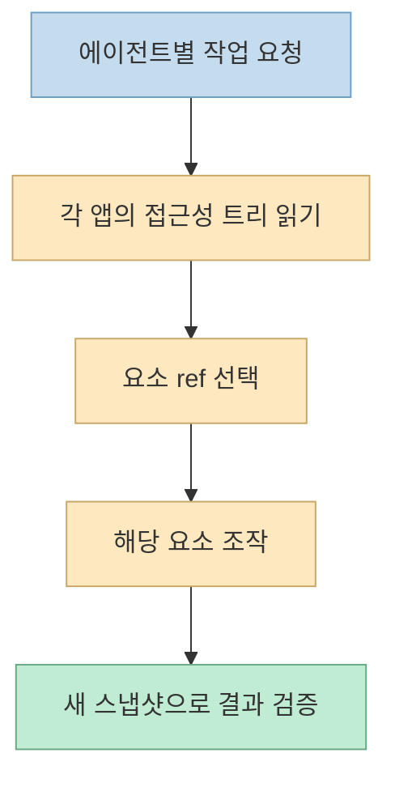
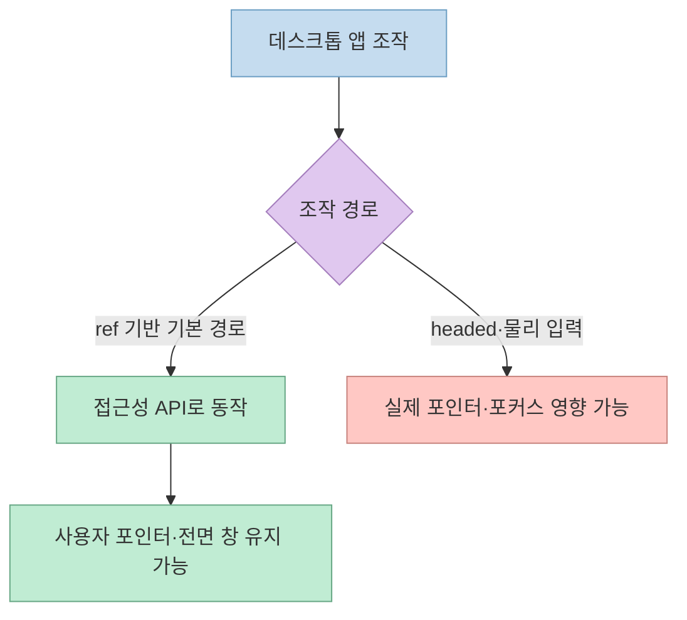

한 [YouTube Shorts](https://youtube.com/shorts/luEhiMTWlW8?si=sgh_TQHOcViMZh9F)는 AI 에이전트 여러 개가 같은 컴퓨터에서 메모 작성, 미리 알림, 계산기를 함께 다루는 장면을 보여준다. 도구는 Vercel Labs의 오픈소스 **Agent Desktop** 이다. 이 글은 앞서 다룬 [접근성 트리와 커서 표시의 작동 원리](/post/2026/11/2026-11-02-agent-desktop-accessibility-refs-cursor-overlay-shorts/)보다는, **사용자가 PC를 쓰는 동안 에이전트가 다른 창에서 작업하는 시연** 의 의미와 한계에 집중한다.

<!--more-->

## Sources

- [원본 YouTube Shorts](https://youtube.com/shorts/luEhiMTWlW8?si=sgh_TQHOcViMZh9F) — 한국어 자동 생성 자막을 구간별로 확인했다. YouTube MCP가 연결돼 있지 않아 자막 API를 대체 경로로 사용했다.
- [Vercel Labs `agent-desktop` 공식 저장소](https://github.com/vercel-labs/agent-desktop) — CLI의 작동 방식, 헤드리스 동작, 설치와 플랫폼별 지원 범위.
- [공식 저장소의 에이전트 지침](https://github.com/vercel-labs/agent-desktop/blob/main/AGENTS.md) · [설치 문서](https://github.com/vercel-labs/agent-desktop/blob/main/docs/install.md) · [FAQ](https://github.com/vercel-labs/agent-desktop/blob/main/docs/faq.md) — 도구와 에이전트의 구분, 권한, 개인정보 위험.

## 1. 세 에이전트가 동시에 일한다는 장면

영상은 [시작 부분](https://youtu.be/luEhiMTWlW8?t=0)에서 세 에이전트가 메모·미리 알림·계산기를 조작한다고 소개하고, [29~39초](https://youtu.be/luEhiMTWlW8?t=29)에 사용자의 실제 마우스 대신 버튼과 입력란을 직접 다뤄 다른 일을 방해하지 않는다고 주장한다. [공식 README](https://github.com/vercel-labs/agent-desktop)는 데스크톱 앱의 **운영체제 접근성 트리** 를 읽고 각 요소의 `ref`를 반환하는 CLI라고 설명한다. AI는 그 참조를 대상으로 행동한 뒤 새 스냅샷으로 결과를 확인한다.



여기서 Agent Desktop은 **AI 모델이나 스케줄러가 아니라 에이전트가 호출하는 도구** 다. [저장소 지침](https://github.com/vercel-labs/agent-desktop/blob/main/AGENTS.md)은 LLM이 내장돼 있지 않고 관찰·행동 루프는 호출한 에이전트 쪽에 있다고 명시한다. 따라서 화면에 세 에이전트가 보인다는 사실과 도구가 모든 앱에 대해 충돌 없는 병렬 실행을 보장한다는 주장은 다르다. 영상의 [79~85초](https://youtu.be/luEhiMTWlW8?t=79) 사례는 **서로 다른 앱에서 계산과 글쓰기를 마친 시연** 으로 읽어야 한다. 같은 문서나 동일한 입력란을 동시에 수정할 때의 충돌 해결까지 입증하지는 않는다.

## 2. 사용자의 마우스를 빼앗지 않는 조건

영상 제작자는 [61~78초](https://youtu.be/luEhiMTWlW8?t=61)에 자신이 다른 앱을 쓰는 동안, 뒤에 있던 계산기가 앞에 나오지 않고 에이전트가 버튼을 눌렀으며 최소화한 창에도 글을 썼다고 보고한다. 공식 [README의 기본 동작](https://github.com/vercel-labs/agent-desktop#quick-start)도 참조 기반 행동은 접근성 API를 사용하며, 기본적으로 포인터를 이동시키거나 창을 전면 활성화하지 않는다고 설명한다. 영상의 경험과 문서의 설계 방향은 대체로 맞아떨어진다.



단, **'사용자 작업을 절대 방해하지 않는다'는 보장은 아니다.** README는 `--headed` 옵션에서 물리 입력을 허용하며, 플랫폼별로 가능한 명령이 다르다고 안내한다. 뒤에 있는 창이나 최소화된 창을 조작할 수 있는지도 해당 앱이 접근성 요소와 필요한 동작을 노출하는지에 좌우된다. 영상의 두 창 성공 사례를 모든 앱의 동작 보장으로 확대하면 안 된다.

## 3. Claude Code·Codex에 붙이는 것은 무엇인가

영상은 [41~53초](https://youtu.be/luEhiMTWlW8?t=41)에 Claude Code와 Codex 같은 에이전트에서 사용하고, 저장소 주소를 줘 프로그램과 스킬을 설치할 수 있다고 설명한다. 공식 저장소는 CLI 설치를 `npm install -g agent-desktop`으로 안내하고, 별도로 에이전트가 명령을 올바르게 호출하도록 돕는 **스킬 문서** 를 제공한다. 즉 설치와 스킬 추가는 도구 자체와 사용 지침을 준비하는 과정이지, 특정 AI 제품에 Agent Desktop이 기본 내장됐다는 뜻은 아니다.

```bash
npm install -g agent-desktop
agent-desktop version
```

[공식 설치 문서](https://github.com/vercel-labs/agent-desktop/blob/main/docs/install.md)에 따르면 macOS에서 앱 접근성 조작에는 **손쉬운 사용(Accessibility) 권한** 이 필요하다. 하지만 영상의 '처음 한 번 권한만 주면 끝'도 작업 범위에 따라 달라진다. 스크린샷에는 화면 기록 권한, 알림 센터 접근에는 추가 권한이 필요할 수 있다. Windows에서는 앱 권한 수준의 차이, Linux에서는 그래픽 세션과 `at-spi2-core`, X11·Wayland 차이를 확인해야 한다. [공식 README](https://github.com/vercel-labs/agent-desktop#platform-support)는 세 OS의 명령 지원 범위를 별도로 표시한다.

영상의 [18~28초](https://youtu.be/luEhiMTWlW8?t=18)에 등장하는 **Claude Code의 다른 컴퓨터 사용 방식과의 비교** 는 그 영상 제작자의 경험으로 남겨 두는 것이 안전하다. 제품·기능별 실행 방식이 달라질 수 있고, 이 쇼츠만으로 Claude Code의 모든 컴퓨터 사용 기능이 언제나 단일 세션만 가능하다거나 모든 다른 앱을 숨긴다고 입증할 수는 없다.

## 4. 병렬 작업보다 먼저 확인할 위험

서로 다른 에이전트가 같은 PC에 접근하면, 편집 충돌뿐 아니라 **정보 노출 범위** 도 늘어난다. [공식 FAQ](https://github.com/vercel-labs/agent-desktop/blob/main/docs/faq.md)는 스냅샷의 UI 텍스트·창 제목, 클립보드, 알림, 스크린샷, 추적 결과에 개인 정보가 포함될 수 있다고 경고한다. 네이티브 CLI에는 원격 모델이 필수는 아니지만, 호출한 에이전트나 별도 모델 연동이 데이터를 어디로 보내는지는 별개 문제다.

또한 접근성 트리가 없는 UI는 이 경로로 읽을 수 없다. [저장소 지침](https://github.com/vercel-labs/agent-desktop/blob/main/AGENTS.md)은 웹 페이지 자동화까지 Agent Desktop의 역할로 보지 않고 별도 브라우저 도구를 권한다. 여러 앱을 오가는 시나리오라면 앱별 접근성 품질, 세션 분리, 에이전트별 권한, 공유 데이터의 충돌 정책을 먼저 정해야 한다.

## 실전 적용 포인트

1. **작은 분리 작업부터:** 계산기·임시 메모처럼 서로 다른 앱과 데이터를 다루는 작업으로 시작한다. 영상의 [시연](https://youtu.be/luEhiMTWlW8?t=55)도 이 범위다.
2. **결과를 독립 확인:** 명령 성공 응답만 믿지 말고 새 스냅샷과 앱 상태로 실제 결과를 검증한다.
3. **충돌 조건을 시험:** 두 에이전트가 같은 앱·문서·필드에 접근할 때 누가 소유권을 갖는지 정한다. 영상은 이 조건을 시험하지 않았다.
4. **권한과 로그를 검토:** 앱 접근 범위, 스냅샷·추적 저장 위치, 외부 모델 전달 가능성을 확인한다.

## 핵심 요약

- Agent Desktop은 AI 에이전트가 호출하는 **데스크톱 접근성 기반 CLI** 이며 자체적으로 AI 에이전트를 실행하지 않는다.
- 영상은 여러 에이전트가 서로 다른 앱에서 작업한 사례를 보여주지만, 범용적인 병렬 처리·충돌 방지 보장은 아니다.
- 기본 `ref` 행동은 물리 마우스를 움직이지 않지만, 옵션·명령·OS·앱에 따라 포커스와 입력에 영향이 생길 수 있다.
- macOS 손쉬운 사용 권한 외에도 작업에 따라 추가 권한이 필요하며, 스냅샷과 로그의 개인정보를 관리해야 한다.

## 결론

이 쇼츠가 보여주는 실용적 가능성은 **에이전트가 별도 앱의 접근성 요소를 조작하는 동안 사용자는 자신의 화면을 계속 쓸 수 있다는 것** 이다. 여러 에이전트를 실제 업무에 도입하려면 시연의 성공을 일반 보장으로 받아들이기보다, 자신의 앱에서 백그라운드 조작·충돌·정보 노출을 각각 검증해야 한다.
