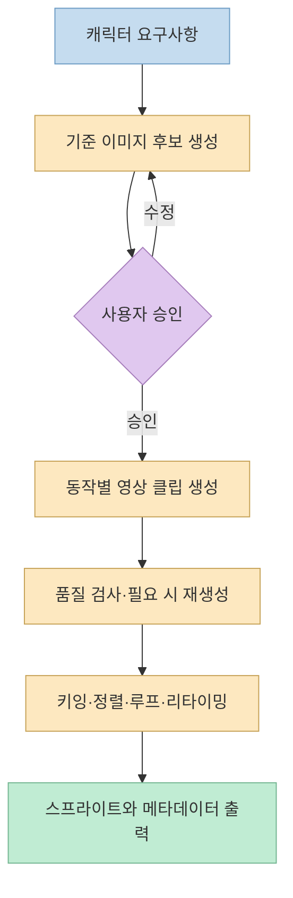
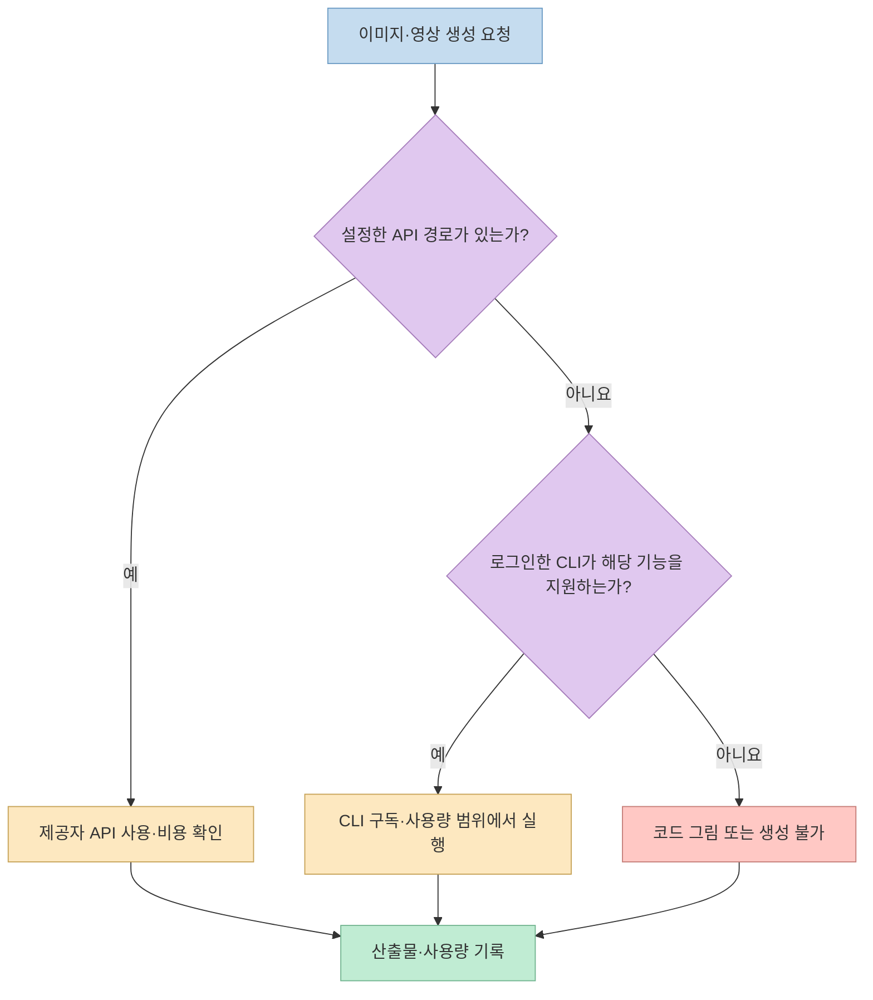

[Threads 글](https://www.threads.com/share/BBSaBskK7W/)은 **Agent Sprite Forge 0.4**를 “캐릭터 그림 한 장을 Godot·Aseprite용 동작 세트로 바꾸는 스킬”로 소개하며, 제작 흐름·성능 수치·API 없는 시작·설치를 네 가지로 설명한다. 이 저장소는 [이전 글]()에서 파이프라인을 자세히 다뤘다. 이번에는 새 Threads 글의 **주장별 확인 범위와 실제 사용 시 빠지기 쉬운 조건**에 집중한다.

<!--more-->

## Sources

- [원본 Threads 공유 링크](https://www.threads.com/share/BBSaBskK7W/) · [연결된 원문과 작성자 댓글](https://www.threads.com/@think.5x/post/DfMd5ppn-np) — 브라우저로 공개 본문과 이어진 설명을 확인했다.
- [Agent Sprite Forge 공식 저장소](https://github.com/0x0funky/agent-sprite-forge) — 0.4 제작 흐름, 설치, 출력 형식과 제공자 경로.
- [0.4 실제 실행·측정 기록](https://github.com/0x0funky/agent-sprite-forge/blob/main/docs/validation-2026-10-06.md) — 여우 스프라이트와 배경 제거·동작 길이의 자체 측정.
- [공식 알려진 한계](https://github.com/0x0funky/agent-sprite-forge/blob/main/docs/known-limitations.md) — 생성 품질·플랫폼·엔진 가져오기 검증 범위.

## 1. “그림 한 장에서 동작 세트”는 승인과 클립 생성이 필요하다

Threads의 첫 번째 설명처럼 `generate2dsprite`로 **기준 이미지 후보 세 장**을 만들고 하나를 승인한 뒤, `video2dsprite`가 idle·walk·run·attack·jump·hurt 같은 동작을 다루는 흐름은 [공식 Quickstart](https://github.com/0x0funky/agent-sprite-forge#quickstart)와 일치한다. 다만 한 장을 선택하면 프레임이 저절로 생기는 것이 아니다. **동작마다 이미지→영상 클립을 별도로 생성**하고, Python 도구가 배경 제거·위치 정렬·루프 구간·공격 타이밍·출력을 처리한다. [Threads 작성자의 첫 번째 설명](https://www.threads.com/@think.5x/post/DfMd5ppn-np)

저장소는 발 접지점으로 달리기 속도를 계산하는 예시를 보여 준다. 이것은 특정 데모에서 발 미끄러짐을 줄이는 **측정 기반 처리 방식**이지 모든 캐릭터·모션에서 접지가 완벽하다는 보증은 아니다. 영상 모델이 빠른 팔다리나 점프에서 모양을 바꾸면 클립을 다시 만들고 사람 눈으로 검수해야 한다. [공식 0.4 설명](https://github.com/0x0funky/agent-sprite-forge#whats-new-in-04--the-big-upgrade), [알려진 한계](https://github.com/0x0funky/agent-sprite-forge/blob/main/docs/known-limitations.md)

## 2. 숫자는 실제 데모의 전후 측정이지 보편적 성능이 아니다

Threads의 두 번째 설명에 나온 **48×64 픽셀 여우 달리기 프레임의 색상 594~709개 → 16~19개**, **145프레임 키잉 시간 271초 → 44초**, **공격 모션 4.1초 → 0.7초**는 [저장소의 0.4 전후 측정](https://github.com/0x0funky/agent-sprite-forge#whats-new-in-04--the-big-upgrade)과 일치한다. 색상 감소는 제한된 팔레트와 이진 알파를 적용한 **픽셀 마감** 결과다. 키잉 시간은 해당 클립에 적용한 새 배경 제거 처리의 기록이고, 공격 길이는 느린 원샷을 게임에 맞게 다시 배치한 예시다.

따라서 “모든 영상이 여섯 배 빨리 처리된다”거나 “모든 공격 동작이 0.7초가 된다”고 일반화할 수 없다. 0.4의 [실행 기록](https://github.com/0x0funky/agent-sprite-forge/blob/main/docs/validation-2026-10-06.md)은 특정 캐릭터와 환경의 자체 검증 자료다. **품질 검사 수치가 해부학, 캐릭터 정체성, 움직임의 매력을 자동으로 승인하지 않는다**는 점도 공식 한계 문서가 명시한다.

## 3. “API 키 없이 시작”과 “무료 영상 생성”은 다르다

Threads의 세 번째 설명대로 `route_media.py`는 **설정한 제공자 API 키 → 로그인한 Codex·Grok CLI → 코드로 그리는 대안** 순서로 경로를 찾는다. [공식 제공자 안내](https://github.com/0x0funky/agent-sprite-forge#routes-and-providers)는 OpenAI·Gemini·xAI·BytePlus·fal.ai를 지원한다고 설명한다. API 키가 없어도 기준 이미지나 코드 그림을 시험할 수 있지만, **동작별 이미지→영상 경로가 실제로 가능한지**는 로그인한 CLI의 기능·사용량 또는 별도 영상 제공자에 달려 있다.

즉 코드 그림 대안이 있다고 해서 `video2dsprite`가 자동으로 무료 영상 모델을 얻는 것은 아니다. CLI도 사용자의 구독·계정 한도를 소모할 수 있고, API 호출에는 비용이 붙을 수 있다. [README](https://github.com/0x0funky/agent-sprite-forge)는 생성 경로와 사용량을 기록하며 예산·호출 상한을 설정할 수 있다고 설명한다. **처음부터 전체 동작 세트 대신 한 동작만 시험**해 예상 비용과 품질을 확인하는 편이 안전하다.

## 4. 설치 명령과 출력 형식은 맞지만 엔진 검수는 남는다

Threads의 네 번째 설명에 나온 [Claude Code 플러그인 설치](https://github.com/0x0funky/agent-sprite-forge#quickstart)는 공식 README의 명령과 일치한다. Python에는 `numpy`, `Pillow`, `scipy`가 필요하고, 영상·스프라이트 세트 작업에는 **ffmpeg 5.1 이상**이 필요하다. `--sparse`는 플러그인 매니페스트와 스킬만 받는 방식이다. Codex·Grok은 같은 명령을 그대로 쓰는 것이 아니라 저장소를 클론한 뒤 각 호스트용 설치 스크립트를 사용한다.

결과는 PNG 아틀라스와 `animation.json`, 알파 WebM, Godot `SpriteFrames`, Aseprite JSON, Tiled·LDtk용 맵 형식 등으로 **내보낼 수 있다**. 다만 [알려진 한계](https://github.com/0x0funky/agent-sprite-forge/blob/main/docs/known-limitations.md)에 따르면 0.4 출력물의 **실제 Godot·Aseprite 편집기 가져오기는 아직 검증되지 않았다.** 파일 생성·디코딩 검사와 게임 엔진에서의 정상 애니메이션은 다른 단계다. 피벗, 프레임 순서, 투명도, 루프 타이밍을 프로젝트에서 직접 확인해야 한다.

또한 저장소의 [MIT 라이선스](https://github.com/0x0funky/agent-sprite-forge/blob/main/LICENSE)는 **코드와 문서**에 적용된다. 생성한 이미지·영상의 상업적 이용 조건은 선택한 모델 제공자의 약관과 입력 캐릭터의 권리에 따로 좌우된다.

## 실전 적용 포인트

1. **기준 이미지를 먼저 승인한다.** 첫 결과를 곧바로 여섯 동작에 확장하면 외형 오류도 같이 증폭된다.
2. **한 동작으로 경로를 점검한다.** 이미지·영상 제공자, CLI 로그인, 예산·호출 상한을 확인한 뒤 idle 또는 walk만 시도한다.
3. **자체 측정값을 자신의 환경에서 다시 잰다.** 팔레트, 배경 제거 시간, 공격 타이밍은 샘플·설정·하드웨어에 따라 달라진다.
4. **엔진에서 재생까지 확인한다.** 내보낸 파일이 생성됐다는 것과 Godot·Aseprite에서 원하는 대로 재생되는 것은 다르다.

## 핵심 요약

Threads의 네 가지 설명은 **공식 0.4 README의 큰 흐름과 대체로 일치**한다. 그러나 기준 이미지 승인과 동작별 영상 생성이 필요하고, 제시된 성능 수치는 특정 데모의 자체 측정이다. API 키가 없어도 시작할 수 있다는 말은 무료 영상 생성 보장이 아니며, 엔진별 출력 형식은 실제 편집기 가져오기 검수가 남아 있다.

## 결론

Agent Sprite Forge는 캐릭터 애니메이션의 **생성·후처리·내보내기 공정을 연결하는 스킬**로 볼 만하다. 한 캐릭터·한 동작을 작은 비용으로 시험하고, 사람이 결과와 권리·엔진 호환성을 확인한 뒤 동작 세트를 늘리는 방식이 현실적이다.
