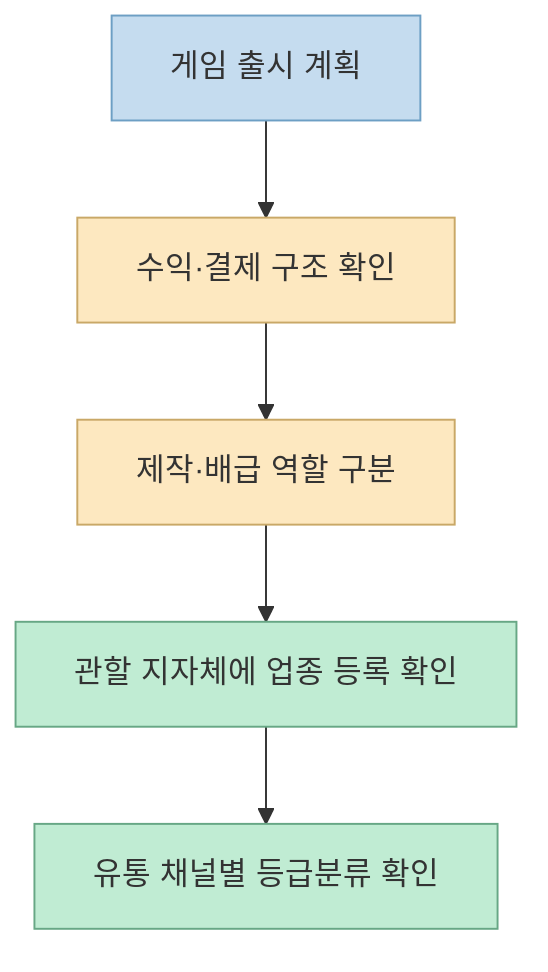
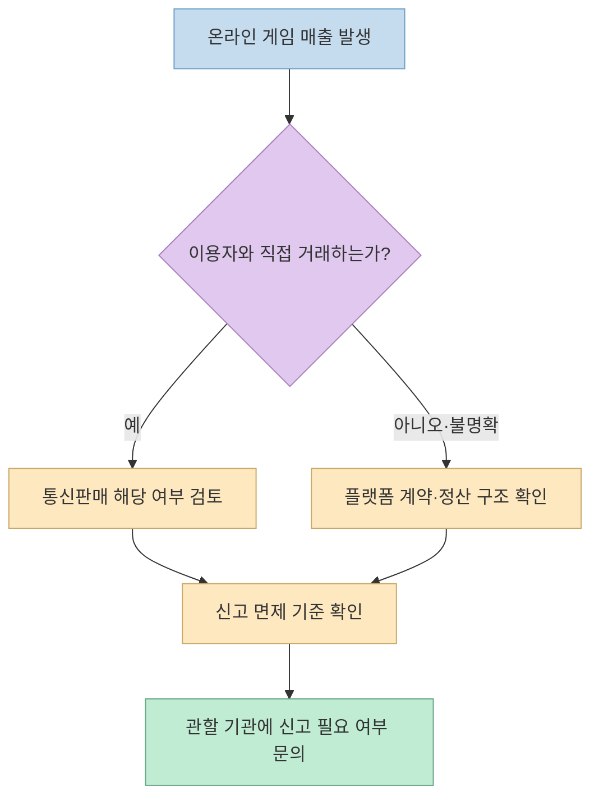
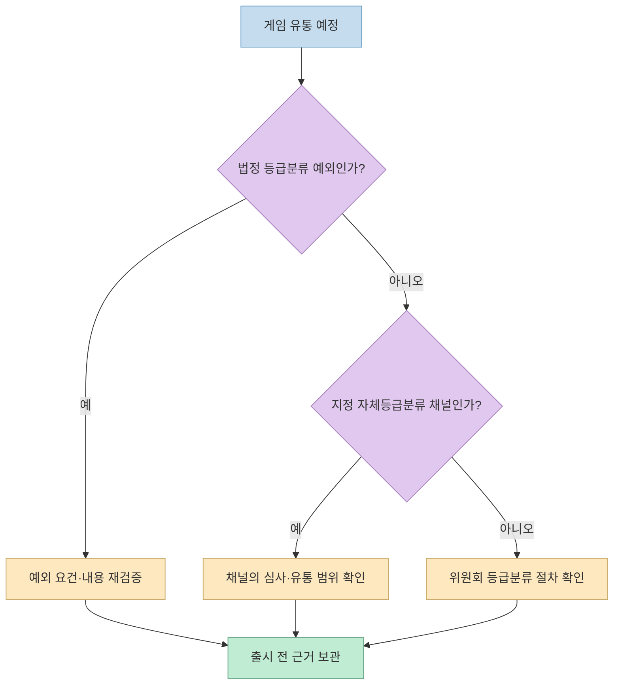

게임을 처음 출시할 때 개발보다 행정 절차가 더 낯설 수 있다. 한 [Threads 게시물](https://www.threads.com/share/BAd0NzAi-e/)은 사업자등록, 통신판매업 신고, 게임제작·배급업 등록, 등급분류를 거치며 230만 원이 넘는 비용을 아꼈다고 설명한다. 유용한 경험담이지만, **개별 게임에 적용된 결과** 와 **모든 개발자에게 적용되는 규칙** 은 구분해야 한다.

<!--more-->

## Sources

- [원문 Threads 공유 링크](https://www.threads.com/share/BAd0NzAi-e/) · [원문 게시물](https://www.threads.com/@feiven.dev/post/DfMW-lyIJx5) — 브라우저로 본문을 확인했다. 공유 페이지의 일반 HTTP 추출로는 본문 확보가 불안정해 브라우저 추출을 사용했다.
- [게임산업진흥에 관한 법률 제21조: 등급분류](https://www.law.go.kr/LSW/lsLinkCommonInfo.do?chrClsCd=010202&lsJoLnkSeq=1032690493), [제21조의2: 자체등급분류사업자](https://www.law.go.kr/LSW/lsLinkCommonInfo.do?lsJoLnkSeq=1025570085), [제21조의3: 자체등급분류 게임물의 통보](https://www.law.go.kr/LSW/lsLinkCommonInfo.do?lsJoLnkSeq=1025570443)
- [게임산업진흥에 관한 법률 제25조: 게임제작업 등의 등록](https://www.law.go.kr/LSW/lsLinkCommonInfo.do?lsJoLnkSeq=1032690261), [시행규칙 제15조: 등록 절차](https://www.law.go.kr/LSW/lsInfoP.do?lsId=010196)
- [전자상거래법 제12조: 통신판매업자 신고](https://www.law.go.kr/lsLinkCommonInfo.do?lsJoLnkSeq=1029561435), [정부24 통신판매업신고 안내](https://m.gov.kr/mw/AA020InfoCappView.do?CappBizCD=11300000006&HighCtgCD=A09006&Mcode=10020&srhQuery=2023&tp_seq=01)
- [국세청: 일반과세자와 간이과세자 구분](https://www.nts.go.kr/nts/cm/cntnts/cntntsView.do?cntntsId=7802), [국세청: 간이과세 배제 업종 안내](https://www.nts.go.kr/nts/cm/cntnts/cntntsView.do?cntntsId=7777&mi=2233)

> 이 글은 2026년 11월 2일 확인한 자료를 바탕으로 한 절차 점검표다. 특정 게임·사업자의 법률 또는 세무 판단을 대신하지 않는다. 출시 국가, 결제 구조, 유통 채널, 게임 내용에 따라 담당 기관의 판단이 달라질 수 있다.

## 1. 먼저 사업과 유통 방식을 분리한다

원문은 사업자등록을 한 뒤 게임제작업과 배급업을 각각 등록했다고 한다. 여기서 사업자등록은 세무 절차이고, 게임제작업·배급업 등록은 게임산업법상 업종 절차다. [게임산업법 제25조](https://www.law.go.kr/LSW/lsLinkCommonInfo.do?lsJoLnkSeq=1032690261)는 게임제작업 또는 게임배급업을 영위하려는 자의 관할 지자체 등록을 규정하면서 특정 기관의 제작 등 예외도 열거한다. **게임을 만든다는 사실만으로 언제나 두 업종 모두 등록해야 한다는 뜻은 아니다.** 직접 제작만 하는지, 다른 게임을 유통·배급하는지, 실제 영위 형태가 무엇인지 관할 지자체에 확인해야 한다.

원문에서 등록 비용은 제작업·배급업 각각 약 2만 원이었다고 한다. 실제로 [대전 서구의 수수료 안내](https://seorami.com/kor/sub01_01_07_01.do)에는 각 신규 등록 2만 원이 제시돼 있다. 다만 이는 **한 지자체의 수수료 예시** 이지 전국 어디서나 총 4만 원이라는 보장은 아니다. 자택 사업장과 장비 목록을 제출했다는 설명도 글쓴이의 경험이므로, 필요 서류·시설 요건은 관할 창구에서 재확인하는 편이 안전하다.

## 2. '게임제작업은 무조건 일반과세자'인가

원문은 게임제작업이라 간이과세가 불가능했다고 설명한다. 그러나 [국세청 안내](https://www.nts.go.kr/nts/cm/cntnts/cntntsView.do?cntntsId=7802)는 간이과세 여부를 매출 기준과 간이과세 배제 업종 여부로 구분한다. [국세청의 배제 업종 안내](https://www.nts.go.kr/nts/cm/cntnts/cntntsView.do?cntntsId=7777&mi=2233)에는 제조업 등 여러 항목이 있으나, 이 자료만으로 **모든 게임 개발 사업이 항상 간이과세 배제** 라고 단정할 수 없다. 업종 코드, 복수 사업장, 실제 사업 내용에 따라 세무 판단이 달라질 수 있다.

따라서 원문의 과세유형은 개인 사례로 읽고, 자신의 업종 코드와 매출 예상, 기존 사업장 여부를 확인한 뒤 홈택스 또는 관할 세무서에 문의해야 한다. 사업자등록 자체를 등급분류나 게임제작업 등록과 같은 절차로 혼동하지 않는 것도 중요하다.

## 3. 온라인 매출과 통신판매업 신고는 같은 말이 아니다

[전자상거래법 제12조](https://www.law.go.kr/lsLinkCommonInfo.do?lsJoLnkSeq=1029561435)는 통신판매업자의 신고 의무를 정하면서, 거래 횟수·규모가 고시 기준 이하인 경우의 예외를 둔다. [정부24 안내](https://m.gov.kr/mw/AA020InfoCappView.do?CappBizCD=11300000006&HighCtgCD=A09006&Mcode=10020&srhQuery=2023&tp_seq=01)는 전기통신매체 등을 통해 소비자와 **직접 상거래** 하는 통신판매업의 신고 민원이라고 설명한다. 게임에서 수익이 발생한다는 사실만으로 결제 주체와 거래 구조를 보지 않고 신고 의무를 확정할 수는 없다.

원문은 통신판매업에 연 4만~5만 원이 든다고 적었지만, [정부24가 표기한 신고 **수수료는 없음**](https://m.gov.kr/mw/AA020InfoCappView.do?CappBizCD=11300000006&HighCtgCD=A09006&Mcode=10020&srhQuery=2023&tp_seq=01)이다. 원문의 금액은 등록면허세 등 다른 부담을 가리킬 가능성이 있으나, 게시물만으로 항목을 확정할 수 없다. 신고 수수료와 세금은 별도로 확인해야 한다.

## 4. 등급분류와 '유통통보 0원'의 정확한 의미

[게임산업법 제21조](https://www.law.go.kr/LSW/lsLinkCommonInfo.do?chrClsCd=010202&lsJoLnkSeq=1032690493)에 따르면 게임물을 유통하거나 이용에 제공할 목적으로 제작·배급하려는 자는 원칙적으로 **유통·제공 전에** 위원회 또는 지정된 자체등급분류사업자로부터 등급분류를 받아야 한다. 비영리 제작·배급 게임 등 일부 예외가 있지만 대통령령의 요건이 붙고, 청소년이용불가 기준에 해당하는 내용은 해당 예외에서 제외된다. 따라서 '무료 웹게임이면 등급분류가 필요 없다'는 식의 일반화도 위험하다.

원문은 원스토어·스토브인디의 자체등급분류 경로를 거쳐 별도 위원회 심의 비용을 아꼈다고 설명한다. 여기서 **자체등급분류는 개발자가 임의로 연령 등급을 붙이는 행위가 아니다.** [제21조의2](https://www.law.go.kr/LSW/lsLinkCommonInfo.do?lsJoLnkSeq=1025570085)에 따라 지정받은 사업자의 제도다. [제21조의3](https://www.law.go.kr/LSW/lsLinkCommonInfo.do?lsJoLnkSeq=1025570443)는 그 사업자가 분류한 게임물의 관련 정보를 위원회에 통보하도록 정한다. 게시물의 '유통통보'를 개인 개발자의 보편적인 무료 신청 절차로 이해해서는 안 된다.

또 하나의 쟁점은 **플랫폼 밖 웹 배포** 다. 원문 작성자는 전화 문의를 통해 같은 게임을 웹으로 제공하는 경우도 가능하다는 취지의 안내를 받았다고 한다. 그러나 공개된 게시물에는 해당 게임의 등급분류 결과, 플랫폼 계약 범위, 실제 통보 내역이 제시되지 않았다. 따라서 특정 플랫폼에서 받은 등급이 독립 웹사이트까지 자동으로 유효하다고 결론 내릴 수 없다. 등급분류의 대상 게임, 버전, 배포 채널과 변경 범위를 게임물관리위원회 및 해당 자체등급분류사업자에 **서면으로** 확인하는 것이 안전하다. '230만 원 절약'과 '0원'도 원문 작성자의 견적·경험일 뿐 모든 게임의 법정 비용표는 아니다.

## 실전 적용 포인트

출시 전에는 한 번에 '얼마면 되나'를 묻기보다 다음 정보를 정리해 담당 기관에 각각 확인하는 편이 정확하다.

1. **게임 정보:** 장르, 연령대, 유료 요소, 광고·후원, 청소년이용불가 요소, 시험 배포 여부를 기록한다.
2. **판매 구조:** 직접 결제인지, 스토어가 거래를 중개하는지, 누가 소비자에게 판매하고 환불을 처리하는지 계약서로 확인한다.
3. **사업 구조:** 자신이 제작만 하는지, 타인의 게임까지 배급하는지 정리해 지자체에 게임제작업·배급업 등록 필요 여부와 서류·수수료를 묻는다.
4. **등급 경로:** 위원회 심의, 지정 자체등급분류사업자, 법정 예외 중 어느 경로에 해당하는지 게임별로 확인한다. 플랫폼에서 자체등급분류를 받은 경우 웹·다른 스토어 유통 가능 범위를 별도로 묻는다.
5. **증빙 보관:** 기관 답변, 등급 결과, 플랫폼 계약, 신고·등록증, 적용한 예외 조항을 게임 버전별로 보관한다.

## 핵심 요약

- 원문의 비용과 등록 경험은 **사례** 이며, 사업 형태와 관할 기관에 따라 달라질 수 있다.
- 게임제작업·배급업 등록, 세무상 사업자등록, 통신판매업 신고, 게임 등급분류는 서로 다른 절차다.
- 통신판매업 신고 민원의 정부24 수수료는 없지만, 실제 신고 의무와 별도 세금은 거래 구조 및 요건을 확인해야 한다.
- 자체등급분류는 지정 사업자가 수행한다. 플랫폼 등급과 유통통보가 모든 웹 배포를 자동으로 허용한다는 근거는 원문만으로 확인되지 않는다.

## 결론

이 게시물의 가장 유용한 메시지는 '무조건 240만 원을 절약할 수 있다'가 아니다. **게임별 유통 경로와 사업 구조를 먼저 정리하고, 서로 다른 행정 절차를 각각 확인하면 불필요한 비용과 출시 리스크를 줄일 수 있다** 는 점이다. 단정적인 소셜미디어 체크리스트보다 공식 법령과 담당 기관의 개별 답변을 최종 기준으로 삼자.
