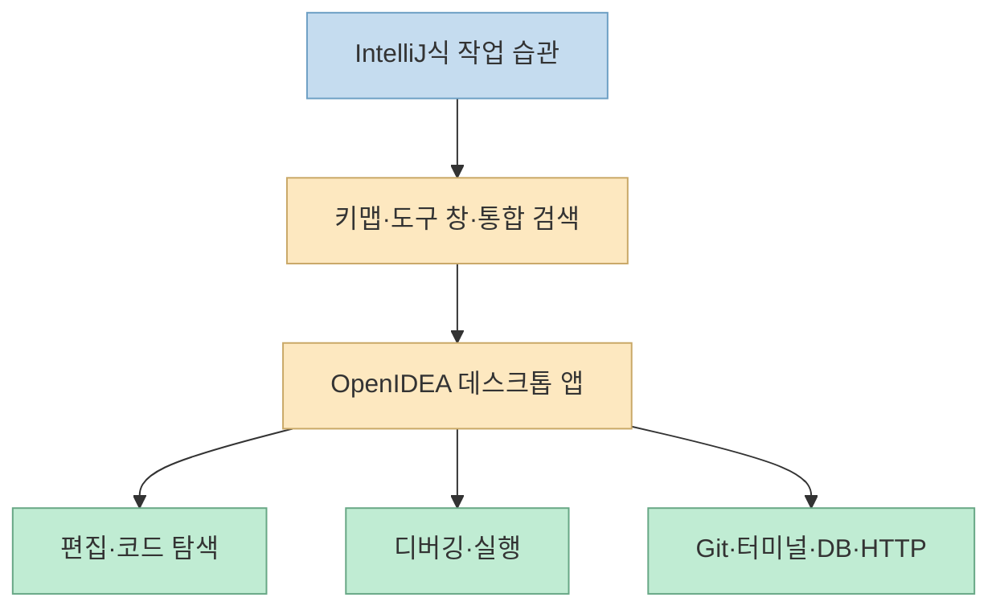
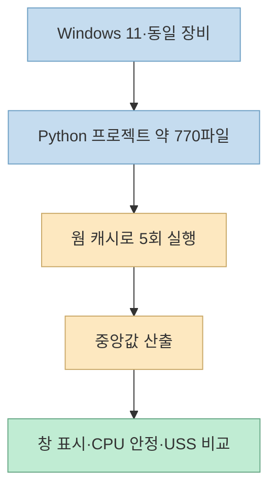
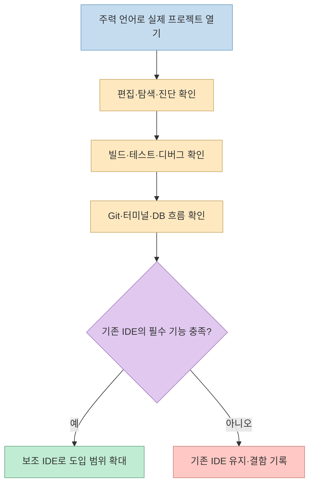

한 [Threads 게시물](https://www.threads.com/share/BCRB2VVSWV/)은 IntelliJ IDEA의 작업 흐름을 Rust로 다시 만든 **OpenIDEA** 를 소개하며 프로젝트 열기 0.9초, 메모리 169MB를 강조한다. 인상적인 수치지만, IDE의 가치는 실행 속도뿐 아니라 언어 분석·디버깅·확장성까지 함께 봐야 한다. 공식 저장소를 기준으로 무엇이 확인되고 무엇은 아직 직접 시험해야 하는지 정리했다.

<!--more-->

## Sources

- [원문 Threads 공유 링크](https://www.threads.com/share/BCRB2VVSWV/) · [실제 게시물](https://www.threads.com/@githubprojects/post/DfMN4CFG9_J) — 일반 웹 열기로 본문에 접근하지 못해 브라우저로 추출했다.
- [OpenIDEA 공식 GitHub 저장소와 README](https://github.com/l0ng-ai/openidea) — 기능 소개, 벤치마크 조건, 라이선스.
- [OpenIDEA `package.json`](https://github.com/l0ng-ai/openidea/blob/main/package.json) — 프런트엔드·편집기 의존성과 개발 스크립트.
- [OpenIDEA 성능 비교 도구](https://github.com/l0ng-ai/openidea/tree/main/perf/compare) · [릴리스 페이지](https://github.com/l0ng-ai/openidea/releases) — 재현 경로와 배포 패키지.

## OpenIDEA가 복제하려는 것은 무엇인가

프로젝트의 목표는 IntelliJ IDEA의 소스 코드를 그대로 이식하는 것이 아니다. [공식 README](https://github.com/l0ng-ai/openidea)는 키맵, 도구 창, Search Everywhere 같은 **사용 흐름** 을 Rust 코어를 가진 데스크톱 앱으로 제공한다고 설명한다. 편집기, 코드 인사이트, 디버거, Git, 터미널, 데이터베이스, HTTP 클라이언트를 한 화면에 묶고 60개 이상 언어를 다룬다고 소개한다. 프로젝트는 JetBrains와 무관하며, 저장소 라이선스는 Apache-2.0이다.

저장소의 [패키지 설정](https://github.com/l0ng-ai/openidea/blob/main/package.json)에는 React, CodeMirror 6, Tauri 2 API, xterm.js가 의존성으로 보인다. 따라서 'Rust로 재작성'을 **모든 계층이 순수 Rust라는 뜻** 으로 받아들이면 부정확하다. 사용자 인터페이스와 편집기에는 웹 기술이, 네이티브 앱 계층에는 Rust·Tauri가 사용되는 구성이다. 저장소의 `src`, `src-tauri`, `crates` 디렉터리도 이 분리를 보여준다.

## 0.9초와 169MB는 어떻게 측정됐나

[공식 README의 비교](https://github.com/l0ng-ai/openidea#benchmark)는 약 770개 파일의 Python 프로젝트 `freqtrade`를 **웜 캐시** 상태에서 열고 5회 실행의 중앙값을 사용했다. Windows 11, 32코어 AMD CPU, 62GB RAM 환경에서 OpenIDEA는 창 표시 0.9초·CPU 안정 상태 1.1초·전체 프로세스 USS 메모리 169MB, IntelliJ IDEA 2026.2.3은 각각 3.1초·13.2초·2,011MB로 보고됐다. 두 프로그램을 같은 관찰 방식으로 측정했다는 것이 프로젝트의 설명이다.

여기서 핵심은 **같은 '준비 완료'가 같은 분석 완료를 뜻하지 않는다** 는 점이다. README도 IntelliJ가 Python을 더 깊게 분석하므로 두 제품의 준비 상태는 동등한 작업량이 아니라고 직접 단서를 단다. 따라서 위 숫자는 특정 환경에서의 **프로젝트 작성자 측정치** 이지, 모든 OS·프로젝트에서의 보편적 우위나 IDE 기능 동등성을 입증하지 않는다. [비교 도구](https://github.com/l0ng-ai/openidea/tree/main/perf/compare)가 공개돼 있으므로 자신의 저장소와 장비에서 재측정하는 것이 가장 낫다.

## '60개 이상 언어 지원'을 해석하는 법

공식 소개의 60개 이상 언어는 폭넓은 언어 처리 범위를 말하지만, 각각이 IntelliJ 수준의 리팩터링·코드 분석·디버깅을 동일하게 제공한다는 뜻은 아니다. 기능이 필요한 언어별로 파일 열기와 문법 강조, 자동완성, 정의 이동, 진단, 실행 구성, 디버거를 **따로** 시험해야 한다. 새 IDE에 팀의 전체 작업 흐름을 옮기기 전에 확인해야 할 것도 이 부분이다.

## 설치와 시험의 현실적인 순서

[릴리스 페이지](https://github.com/l0ng-ai/openidea/releases)는 Windows·macOS·Linux용 패키지를 제공한다. 직접 빌드하려면 [README의 안내](https://github.com/l0ng-ai/openidea#build)에 따라 Rust 1.96, Node 22, pnpm, Tauri의 플랫폼별 필수 구성요소를 준비하고 `pnpm install` 뒤 `pnpm tauri dev`를 실행한다. 이는 소스 개발 경로이며, 일반적인 첫 시험에는 릴리스 패키지를 이용하는 편이 간단하다. 패키지 다운로드·실행 전에는 릴리스 출처와 자신의 OS·CPU 아키텍처를 확인해야 한다.

실제 검증은 사용 중인 IntelliJ 프로젝트 하나를 정해 동일한 조건에서 비교하는 방식이 좋다. 첫 실행과 재실행을 나누고, 메모리 측정에는 앱의 모든 프로세스를 포함하며, 단순히 창이 뜬 시점과 인덱싱·진단을 사용할 수 있는 시점을 구분하자. 기존 플러그인이나 작업 환경을 그대로 이식할 수 있다고 가정하지 말고, 필수 기능을 하나씩 확인해야 한다.

## 실전 적용 포인트

- **속도 검증:** 공식 수치는 웜 캐시·소규모 Python 프로젝트·특정 Windows 장비의 결과로 기록한다. 자기 프로젝트에서는 콜드·웜 실행을 구분해 측정한다.
- **기능 검증:** 가장 자주 쓰는 언어에서 코드 분석 깊이, 디버거, 테스트 실행, 리팩터링, 플러그인 의존도를 체크한다.
- **도입 판단:** 새 도구를 기존 IDE의 즉시 교체품으로 보기보다 보조 편집기 또는 시험 환경에서 먼저 평가한다. [릴리스 변경 내역](https://github.com/l0ng-ai/openidea/releases)도 확인한다.

## 핵심 요약

OpenIDEA는 IntelliJ의 **작업 흐름** 을 Rust·Tauri 기반 앱에 재구성한 오픈소스 IDE다. 0.9초·169MB 수치는 공식 저장소의 특정 조건에서 나온 작성자 측정치이며, IntelliJ와 언어 분석 작업량이 같다는 의미는 아니다. 편집기와 UI에도 React·CodeMirror 같은 웹 기술이 쓰인다.

## 결론

OpenIDEA는 가벼운 실행과 익숙한 IDE 구성에 관심이 있다면 시험해 볼 만하다. 다만 도입 결정은 홍보 숫자보다 **자신의 프로젝트에서 필요한 언어 분석과 개발 흐름이 실제로 작동하는지** 에 달려 있다.
