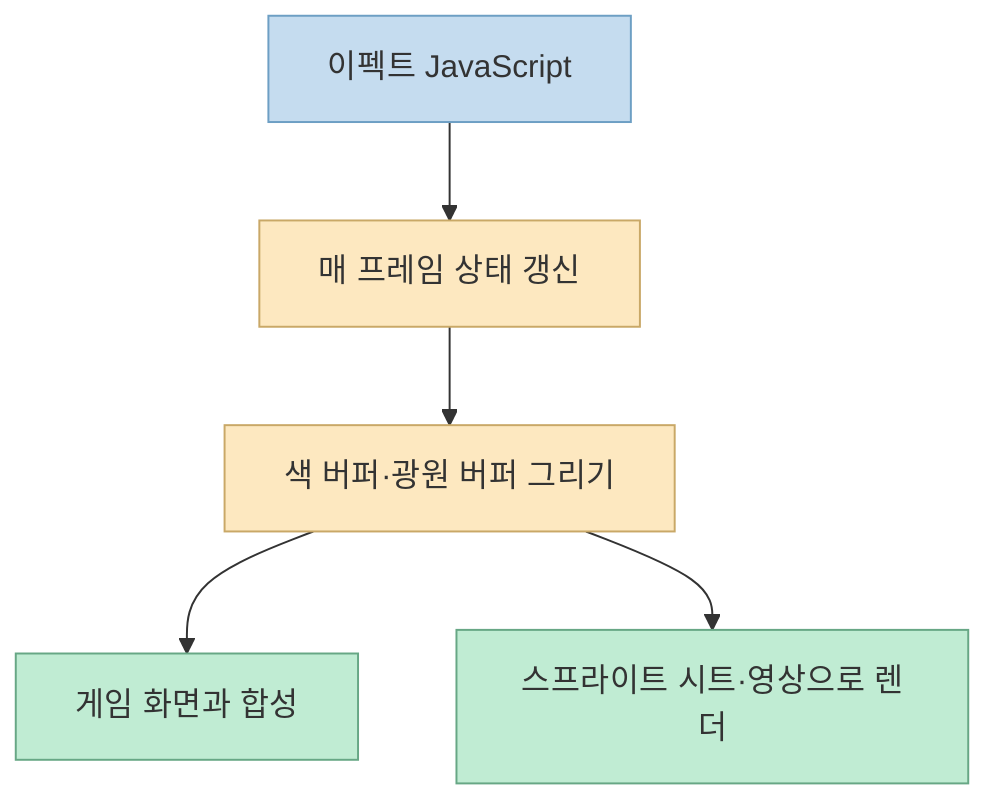
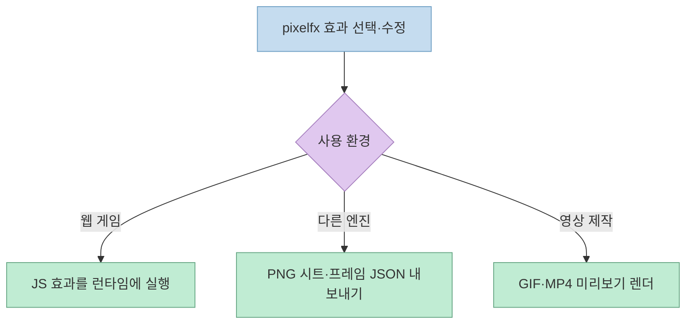
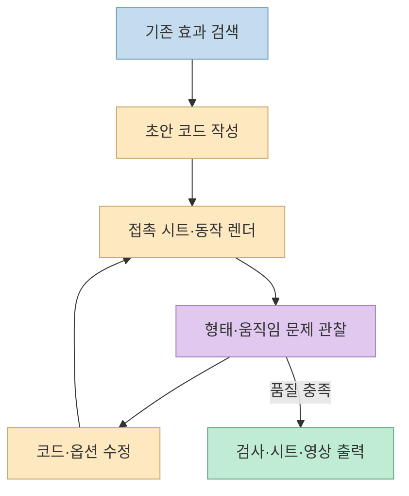

한 [네이버 블로그 실험기](https://m.blog.naver.com/mr_choo/224460938307)는 Claude Code에 “라면 냄비가 끓어 넘치는 픽셀 이펙트”를 요청해 약 7분 만에 반복 재생 영상을 만들었다고 소개한다. 흥미로운 지점은 생성 시간 자체보다 **결과가 MP4 한 편으로 끝나지 않고, 게임에서 재사용할 수 있는 코드와 프레임 자산으로 이어진다** 는 데 있다. 원문의 단일 실험과 [`pixelfx` 공식 저장소](https://github.com/patch-gg/pixelfx)가 보장하는 기능을 분리해 살펴보자.

<!--more-->

## Sources

- [원문 네이버 블로그](https://m.blog.naver.com/mr_choo/224460938307?referrerCode=1) — 모바일 페이지를 HTTP로 추출했다. `referrerCode`는 추적 파라미터라 본문 확인에는 정규화한 URL을 사용했다.
- [`patch-gg/pixelfx` 공식 저장소와 README](https://github.com/patch-gg/pixelfx) · [공식 갤러리](https://patch-gg.github.io/pixelfx/) — 이펙트 구조와 사용·내보내기 경로.
- [동봉된 `pixelfx` 스킬](https://github.com/patch-gg/pixelfx/blob/main/skills/pixelfx/SKILL.md) · [MIT 라이선스](https://github.com/patch-gg/pixelfx/blob/main/LICENSE) — 작성 루프, 실행 환경과 이용 조건.

## 1. 그림 파일 모음이 아니라 코드형 이펙트 라이브러리

원문은 244개 이펙트와 21개 분류를 소개하며, 각 이펙트가 PNG·GIF 원본이 아니라 JavaScript 파일이라고 설명한다. [공식 README](https://github.com/patch-gg/pixelfx#whats-in-it)도 각 이펙트를 `src/fx/<category>/<name>.js` 한 파일로 구성하고, 불·물·마법·근접 공격·UI 등 21개 범주에 **244개**가 있다고 밝힌다. 이는 이미지를 한 번 생성해 보관하는 방식이 아니라, 매 프레임의 픽셀과 빛을 코드로 계산하는 방식이다.

원문의 “그림 파일이 한 장도 없다”는 표현은 **원본 이펙트 정의가 코드** 라는 뜻으로 읽어야 한다. [공식 스킬 설명](https://github.com/patch-gg/pixelfx/blob/main/skills/pixelfx/SKILL.md)은 렌더 후 PNG 프레임 시트와 GIF·MP4 미리보기를 만들 수 있다고 안내한다. 즉 이미지가 전혀 만들어지지 않는 제품은 아니다. 또한 공식 README의 244개 표기와 갤러리 페이지에 남아 있는 232개 표기가 서로 다르므로, 정확한 수량은 확인 시점의 저장소 버전과 실제 카탈로그를 기준으로 봐야 한다.

## 2. 게임에 넣는 경로가 결과물의 가치를 바꾼다

원문은 [갤러리](https://patch-gg.github.io/pixelfx/)에서 효과를 재생하고 속도·배경·팔레트·좌우 반전을 시험한 다음, 웹 게임이면 코드를, 다른 엔진이면 스프라이트 시트를 가져갈 수 있다고 설명한다. [공식 README의 사용 예시](https://github.com/patch-gg/pixelfx#use-one)는 Canvas 기반 게임에서 `createFx`로 이펙트를 만들고 `update`·`draw`·`composite`를 게임 루프에 연결하는 방법을 제시한다. 같은 문서는 `node tools/render.mjs ice/frost-nova --sheet`로 투명 PNG 그리드와 프레임 위치·길이를 담은 JSON을 내보내는 경로도 제시한다. 엔진에 따라 가져오는 방식은 달라지므로, 시트 출력이 모든 엔진 프로젝트에 무수정으로 꽂힌다는 뜻은 아니다.

코드형 이펙트라 **팔레트 옵션으로 색을 바꾸기 쉽다** 는 점도 공식 문서와 일치한다. 예를 들어 README는 `palette`에 어두운색부터 밝은색까지의 색상 배열을 전달해 같은 불 이펙트를 다른 색으로 렌더하는 예를 보여준다. 다만 “모든 효과를 명령 한 줄로 원하는 미술 스타일에 완벽히 맞춘다”는 보장은 아니다. 형태·타이밍·광원 배합이 맞지 않으면 소스 수정과 시각적 검수가 필요하다.

## 3. Claude 스킬이 추가하는 것은 ‘눈으로 보고 고치는 절차’

원문 작성자는 라면 이펙트 요청 한 줄을 넣은 뒤 Claude가 초안을 렌더하고 프레임 시트를 보며 여섯 차례 다듬었다고 보고한다. 지적한 문제는 거품이 팝콘처럼 보이는 형태, 너무 일정한 넘침, 회색 공 같은 김, 테두리 줄무늬, 과한 버너 빛, 잘 보이지 않는 국물이었다. 이는 원문 작성자가 관찰한 **그 한 번의 실행 기록** 이다. [동봉된 스킬](https://github.com/patch-gg/pixelfx/blob/main/skills/pixelfx/SKILL.md)의 일반적인 방법은 기존 효과 검색 → 초안 작성 → 접촉 시트 렌더 → 눈으로 확인 → 수정 → 다시 렌더이며, `tools/check.mjs`로 이음새·랜덤성·느린 프레임 등을 검사하도록 안내한다.

이 루프가 중요한 이유는 코드가 문법적으로 맞아도 효과가 시각적으로 어색할 수 있기 때문이다. 특히 반복 재생형 효과는 **첫 프레임과 마지막 프레임의 연결** 을 실제 재생으로 확인해야 한다. 원문에서는 냄비가 계속 보이는 라면 장면을 단발 폭발형보다 반복형으로 바꿨다고 한다. 이는 재생 목적에 맞춘 설계 선택이지, 모든 효과가 반복형이어야 한다는 규칙은 아니다.

## 4. 7분 대 6분 47초 비교에서 말할 수 있는 것

원문 작성자는 스킬을 쓴 경우 7분 4초·수정 6회·API 비용 환산 약 2.3달러, 스킬 없이 같은 요청을 한 경우 6분 47초·수정 3회·약 1.6달러였다고 적었다. 스킬을 쓰지 않은 결과도 보기에 괜찮았으나 10초 단발 영상이었고, 스킬을 사용한 결과는 4.8초 반복에 라이브러리 규격의 코드·팔레트·게임 엔진용 내보내기를 활용할 수 있었다는 것이 작성자의 판단이다. 이 숫자는 **한 작성자의 두 실행 사례** 로, 모델·프롬프트·환경을 바꿔 여러 번 반복한 벤치마크가 아니다. 그러므로 pixelfx가 항상 더 빠르거나 싸거나 좋은 그림을 만든다는 결론은 나오지 않는다.

비교에서 실제로 유의미한 차이는 **납품 형태** 다. 최종 목표가 쇼츠용 영상 하나라면 영상 파일만으로 충분할 수 있다. 반대로 게임에 넣고 색·속도·방향을 바꾸며 재사용해야 한다면 원본 코드와 스프라이트 시트, 프레임 메타데이터의 가치가 커진다. 제작 시간과 API 비용을 판단할 때는 출력 목적을 먼저 정해야 한다.

## 5. 타격 연출과 설치에서 놓치기 쉬운 조건

원문은 검을 휘두르는 효과에 `stop: 0.14`가 있고, 맞는 순간 잠깐 멈추는 것이 타격감에 기여한다고 소개한다. [공식 README의 `act` 예시](https://github.com/patch-gg/pixelfx#acting)에도 `hits`에 `stop: 0.14`와 흔들림·밀어내기 값이 들어 있으며, 캐릭터 등장 효과 61개와 연속 동작 12개가 몸의 준비·타격·회복을 다룬다고 설명한다. 하지만 **0.14초 하나가 타격감의 보편적인 비밀** 은 아니다. 애니메이션 간격, 화면 흔들림, 사운드, 입력 반응과 함께 조정할 값이다. README도 자신의 캐릭터를 쓰는 경우 해당 타이밍 데이터를 읽어 게임 쪽 애니메이션과 정지를 연결하라고 안내한다.

Claude Code에서 사용하려면 [README의 플러그인 설치 안내](https://github.com/patch-gg/pixelfx#the-skill)를 따르거나 `skills/pixelfx`를 스킬 폴더에 복사할 수 있다. 코드만 쓰려면 저장소의 `src/core`와 필요한 효과를 가져오거나 GitHub 패키지로 설치한다. [스킬 문서](https://github.com/patch-gg/pixelfx/blob/main/skills/pixelfx/SKILL.md)는 Node 18 이상을 요구하고 GIF·MP4 미리보기에 `ffmpeg`가 선택적으로 필요하다고 밝힌다. 오픈소스 라이선스는 [MIT](https://github.com/patch-gg/pixelfx/blob/main/LICENSE)로 상업적 사용을 허용하지만, 라이선스·저작권 고지 조건은 지켜야 한다. 원문 작성자가 언급한 128픽셀 원본 확대와 영어 문서 부담도 실제 프로젝트에서는 따로 시험할 항목이다.

## 실전 적용 포인트

1. **먼저 갤러리에서 유사 효과를 찾는다.** 새로 만들기 전에 팔레트·방향·시드만 바꿔 해결할 수 있는지 확인한다.
2. **출력 목적을 정한다.** 웹 게임의 런타임 코드, 다른 엔진의 시트·JSON, 영상용 GIF·MP4 중 무엇이 필요한지 먼저 결정한다.
3. **렌더 결과를 실제로 본다.** 접촉 시트만 보지 말고 반복 지점과 전후 동작을 애니메이션으로 확인한다.
4. **비용과 시간을 직접 기록한다.** 원문의 7분·API 비용을 자신의 환경에 그대로 적용하지 않는다.
5. **배포 전 자산과 라이선스를 검토한다.** 색·해상도·픽셀 확대 방식, 프레임 메타데이터, MIT 고지 조건을 확인한다.

## 핵심 요약

- pixelfx는 픽셀 이펙트 **코드** 와 Claude Code 작성 스킬을 함께 제공한다. 공식 README 기준 이펙트는 244개·21개 범주다.
- 스킬의 차별점은 일회성 그림 생성보다 **검색→렌더→시각 검토→수정→검사** 루프와 게임에서 재사용할 출력 형식이다.
- 7분 4초·6회 수정·약 2.3달러는 원문 작성자의 한 번의 실험값으로, 일반적인 성능 보장은 아니다.
- `stop: 0.14`는 타격 연출의 한 예이며, 게임 전체의 동작과 연결하려면 개발자가 타이밍을 통합해야 한다.

## 결론

이 사례는 “AI가 7분 만에 예쁜 픽셀아트를 그린다”보다 **코드로 만든 이펙트를 보고 고치면서, 게임에 넣을 수 있는 형태로 완성한다** 는 데 의미가 있다. 영상 한 편만 필요하다면 스킬의 이점이 작을 수 있지만, 반복 재생·색 변경·엔진 재사용이 목표라면 pixelfx의 작업 방식이 훨씬 구체적인 출발점이 된다.
