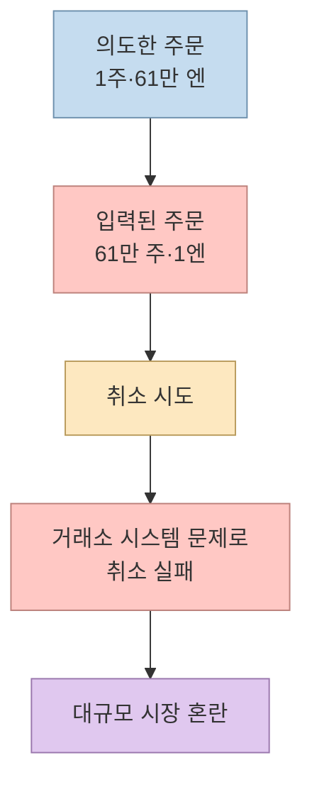
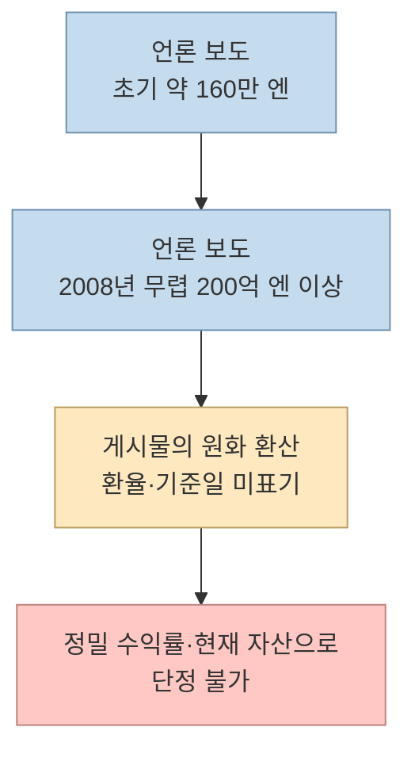
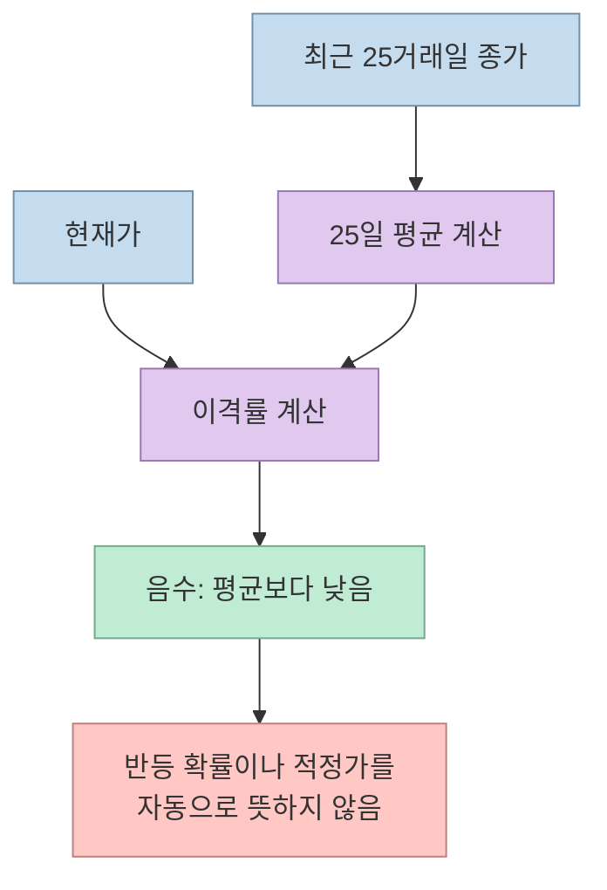
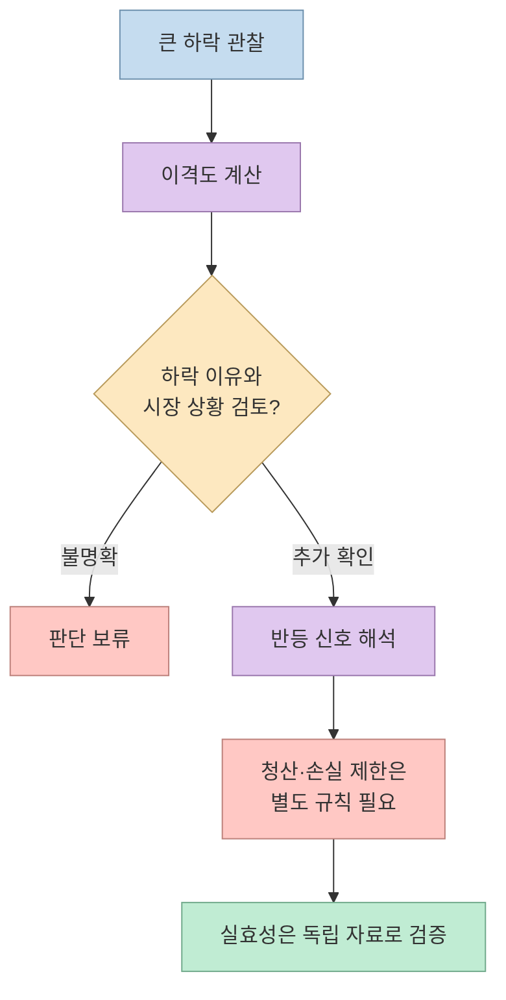

일본 개인 투자자 BNF를 소개한 [Threads 연속 게시물](https://www.threads.com/share/BAb8hJrHnp)은 2005년 제이컴 오발주 사건을 출발점으로, 그가 사용했다는 매매 원칙 세 가지를 정리한다. 흥미로운 사례지만 **확인된 사건**, **언론이 전한 인물 정보**, **게시물 작성자가 재구성한 규칙** 은 서로 다른 층위의 주장이다. 특히 특정 이격도 수치를 그대로 매수 신호로 받아들여서는 안 된다. 이 글은 출처를 대조해 그 경계를 설명하며, 투자 권유가 아니다.

<!--more-->

## Sources

- [원문 Threads 공유 링크](https://www.threads.com/share/BAb8hJrHnp) — 작성자의 본문과 이어지는 댓글을 확인했다. `scrapling-get`은 첫 게시물만 반환해 연속 댓글이 누락됐으므로 `browser`로 전환했다. [직접 게시물 주소](https://www.threads.com/@bullstory1/post/DfRPBRhmC_R).
- [일본 금융청: 도쿄증권거래소에 대한 업무개선명령](https://www.fsa.go.jp/news/newsj/17/syouken/f-20051214-1.html) — 2005년 12월 제이컴 주문 오류와 취소 실패에 대한 공식 기록.
- [일본 금융청: 2005년 12월 16일 장관 기자회견](https://www.fsa.go.jp/en/conference/gaiyoue/daijin/e20051216.html) — 오류 주문과 관련한 개인 투자자의 이익에 대한 당시 당국의 발언.
- [오리콘: BNF의 초기 자금과 투자 방식 소개](https://life.oricon.co.jp/rank_certificate/news/2052820/) — 2015년 보도. 자산 규모와 거래 방식에 대한 2차 자료이며 감사된 거래 내역은 아니다.

## 제이컴 오발주는 어떤 사건인가

원문은 2005년 제이컴 신규 상장 당시 미즈호증권이 **1주를 61만 엔에 매도**하려다 **61만 주를 1엔에 매도**하는 주문을 냈다고 소개한다. [일본 금융청의 업무개선명령](https://www.fsa.go.jp/news/newsj/17/syouken/f-20051214-1.html)은 실제로 대규모 잘못된 매도 주문이 입력됐고, 이를 취소하지 못한 데 거래소 시스템의 문제가 있었음을 기록한다. 즉, 사건 자체는 확인된다. 그러나 공식 문서가 특정 개인의 거래 수량·당일 손익까지 인증하는 것은 아니다.

게시물은 BNF가 7,100주를 사서 약 20억 엔을 벌었다고 쓴다. 이 숫자는 **게시물의 주장** 으로 읽어야 한다. 여기서 확인한 금융청 문서만으로는 해당 수량과 개인별 이익을 입증할 수 없다. 금융청 [기자회견 자료](https://www.fsa.go.jp/en/conference/gaiyoue/daijin/e20051216.html)도 개인 투자자의 상당한 이익에 관한 당시 설명이지, 게시물 속 숫자 전체를 확정하는 개인 거래 명세는 아니다. 또한 오발주를 포착한 거래와 아래의 25일선 이격도 전략은 발생 원인부터 다르다. 하나의 이례적 시장 사고를 반복 가능한 지표 전략의 성공 사례로 취급하면 인과관계가 뒤섞인다.

## ‘1400만 원에서 1700억 원’이라는 제목을 읽는 법

[오리콘의 2015년 소개 기사](https://life.oricon.co.jp/rank_certificate/news/2052820/)는 BNF의 초기 자금을 약 **160만 엔**, 2008년 무렵 알려진 규모를 **200억 엔 이상**으로 전한다. 원문의 원화 수치는 이 엔화 수치를 옮겨 표현한 것으로 보이지만, 적용 환율과 평가 기준일이 적혀 있지 않다. 따라서 ‘1400만 원 → 1700억 원’을 정밀한 수익률 계산의 입력값으로 쓰기 어렵다. 더구나 200억 엔이라는 보도상 규모를 검증된 순수 매매 이익 또는 현재 자산으로 바꿔 읽어서도 안 된다.

## 첫째 원칙: 25일선 이격도는 무엇을 측정하나

게시물의 첫 번째 원칙은 과거에 강했던 종목이 25일 이동평균선에서 크게 밀렸을 때 살펴본다는 것이다. 저자는 **-20%~-35%**, 또는 이격도 지수 **65~80**이라는 범위를 제시한다. 이는 게시물의 요약 수치이지, 여기서 확인한 공식 자료나 BNF의 검증된 매매 매뉴얼에서 확정한 문턱값이 아니다. [오리콘 기사](https://life.oricon.co.jp/rank_certificate/news/2052820/)는 단기 매매와 가격 움직임에 대한 관심을 소개하지만, 이 숫자들을 공식 규칙으로 제시하지 않는다.

25일 이동평균은 최근 25거래일 종가의 평균이다. 이격률은 `(현재가 - 25일 평균) ÷ 25일 평균 × 100`으로 계산한다. 평균이 100이고 현재가가 80이라면 이격률은 -20%, `현재가 ÷ 평균 × 100`으로 표시하는 이격도 지수는 80이다. 현재가가 65라면 각각 -35%와 65가 된다. **65~80과 -35%~-20%는 같은 상대적 거리의 다른 표기** 일 뿐, 과거에 평균으로 돌아올 확률을 말하지 않는다.

가격이 평균에서 멀어진 이유가 일시적 수급인지, 기업 가치의 지속적 훼손인지, 시장 전체의 급락인지는 이 숫자만으로 구별할 수 없다. ‘예전에 주도주였으니 다시 오른다’는 결론도 성립하지 않는다. 원문이 PER·PBR·뉴스보다 가격을 봤다고 요약한 부분 역시 BNF가 모든 거래에서 다른 정보를 배제했다는 증거로 확대해서는 안 된다.

## 둘째·셋째 원칙: 반등 확인과 빠른 청산

게시물의 두 번째 원칙은 이격도가 커진 즉시 사지 말고, 낙폭이 멈추거나 거래량과 함께 되돌림이 나타나는지를 살피라는 것이다. 세 번째는 반등 후 오래 보유하지 않고 며칠 안에 청산하며, 예상과 다르면 손실을 빨리 끊으라는 설명이다. [오리콘 기사](https://life.oricon.co.jp/rank_certificate/news/2052820/)도 BNF를 단기 매매와 빠른 손절을 중시하는 투자자로 묘사한다. 하지만 **거래량 조건, 반등 판정식, ‘며칠’이라는 보유 기간, 손절 폭** 은 이 자료들로 특정할 수 없다. 게시물의 세부 조건은 작성자의 해석으로 남겨둬야 한다.

위 흐름은 원문의 설명을 **검토 절차로 재구성한 그림** 이며 BNF의 실제 주문 알고리즘이 아니다. 반등을 확인한 뒤에도 가격은 다시 하락할 수 있고, 주문이 기대 가격에 체결된다는 보장도 없다. 원문이 붙인 차트도 작성자가 **원칙 설명을 위한 가상 예시** 라고 명시한다. 백테스트나 실제 수익 증거로 인용할 수 없다.

## 실전 적용 전에 검증할 질문

이 사례를 학습 자료로 쓰려면 ‘BNF처럼 거래하기’보다 **주장마다 어떤 자료가 필요한가** 를 먼저 묻는 편이 안전하다. 이격도 문턱값이 특정 시장·기간에서 작동했는지 보려면 신호를 사전에 정의하고, 상장폐지 종목까지 포함한 표본과 거래비용을 반영한 뒤, 규칙을 고정한 상태로 별도 기간에서 평가해야 한다. 이는 게시물이 성과를 입증했다는 뜻이 아니라, 그 주장을 검증하려면 필요한 최소한의 설계다. 특정 종목·시점·비중을 정하는 투자 지침은 아니다.

## 핵심 요약

- 제이컴의 대규모 오발주와 취소 실패는 일본 금융청 기록으로 확인된다. BNF의 정확한 매수량과 당일 이익은 여기서 확인한 공식 문서만으로 확정할 수 없다.
- 25일선 이격률 **-20%~-35%** 와 이격도 지수 **80~65**는 같은 산술적 범위다. 반등 확률이나 적정가를 뜻하지 않는다.
- ‘반등 확인 후 짧게 보유하고 빠르게 손절’은 게시물의 요약과 언론의 일반적 묘사를 구분해 읽어야 한다. 세부 주문 규칙은 검증되지 않았다.
- 게시물의 차트는 가상 예시이며, 이례적인 오발주 거래를 반복 가능한 기술적 매매의 검증 사례로 삼을 수 없다.

## 결론

이 이야기에서 재현할 만한 것은 수익 숫자나 단일 이격도 문턱값이 아니라, **사건 기록과 해석을 분리하는 태도** 다. 가격 지표는 관찰 도구일 수 있지만, 그것만으로 매수 이유와 위험 관리, 기대 성과를 증명하지는 못한다.
