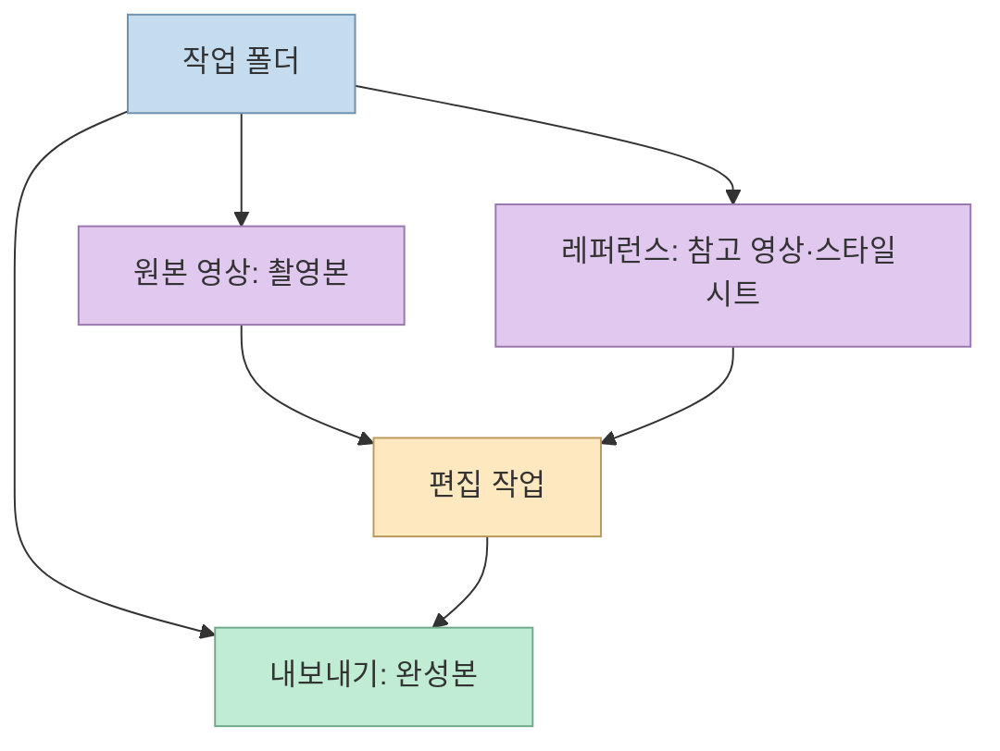
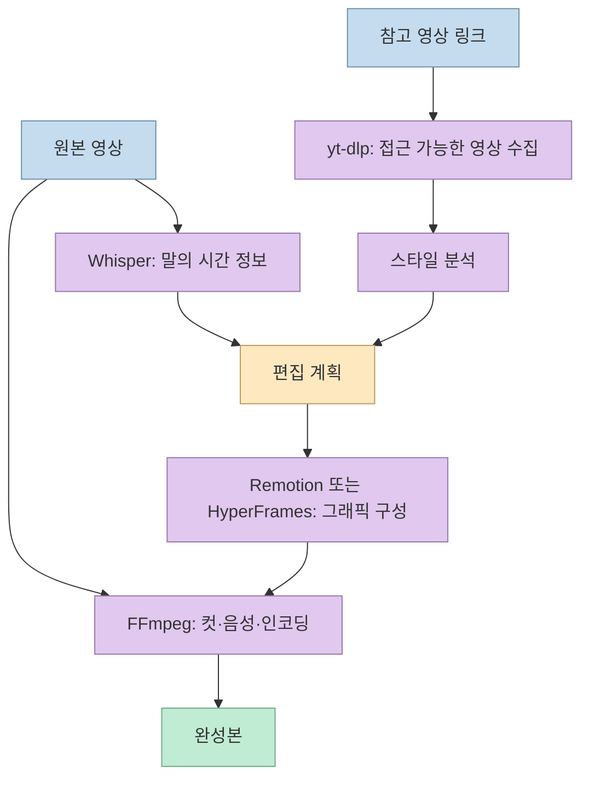
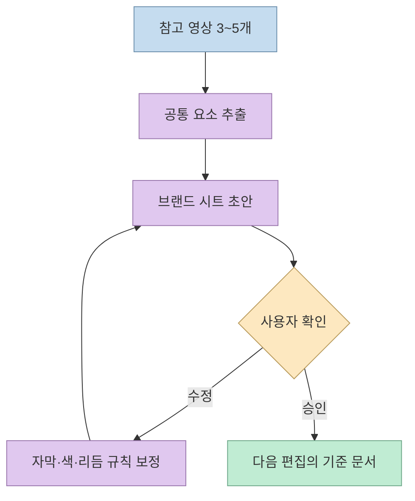
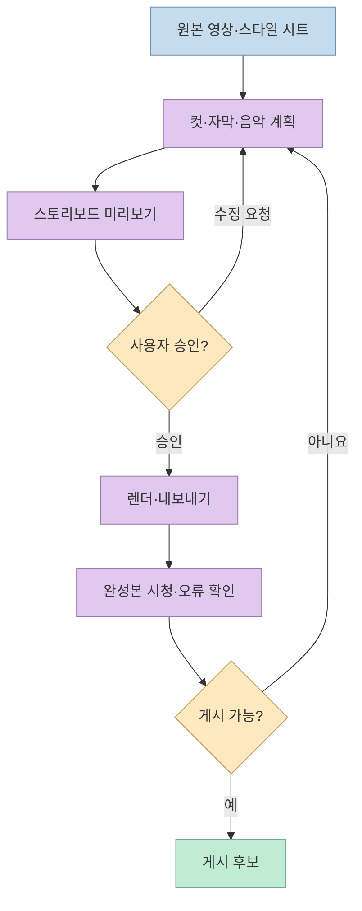

[이 쇼츠](https://youtube.com/shorts/oilrvcotD-8?si=dntEHKzgfxGJIHH4)는 클로드 데스크톱 앱에서 작업 폴더를 열고, 편집 도구와 참고 영상을 연결한 뒤, 원본 영상을 넣어 스토리보드를 먼저 검토하는 과정을 소개한다. 영상만으로는 화면에 표시된 다섯 도구의 이름과 프롬프트 전문을 확인하기 어렵지만, 제작자의 [후속 가이드](https://sdk-kim-builds.com/guides/claude-ai-video-editor-setup/)가 이를 공개한다. 핵심은 "한 번 요청하면 완성"보다 **입력 파일, 스타일 기준, 렌더 전 승인, 최종 검수** 를 분리하는 데 있다.

<!--more-->

## Sources

- [원본 유튜브 쇼츠](https://youtube.com/shorts/oilrvcotD-8?si=dntEHKzgfxGJIHH4) — `youtube-transcript-api`로 자막을 확인했다. YouTube 전용 MCP가 연결되지 않아 자막 추출 경로를 사용했다. 영상 속 화면의 링크·프롬프트는 자막만으로 복원하지 않았다.
- [추가 레퍼런스: 영상 제작자의 AI 영상 편집자 가이드](https://sdk-kim-builds.com/guides/claude-ai-video-editor-setup/) — 쇼츠 화면에만 표시된 정보를 보완하는 제작자 원문. 세 폴더의 역할, 다섯 도구, 세 단계 프롬프트, 스타일 시트와 제작 중 겪은 문제를 확인했다.
- [HyperFrames 공식 소개](https://github.com/heygen-com/hyperframes/blob/main/docs/introduction.mdx), [Remotion 라이선스 안내](https://www.remotion.dev/docs/license/faq) — 도구 기능과 라이선스 조건을 확인하는 공식 자료.

## 먼저 폴더 세 개로 입력과 출력을 분리한다

영상은 `AI 영상 편집자`라는 작업 폴더 안에 **원본 영상, 레퍼런스, 내보내기** 폴더를 만들고, 클로드 앱의 새 대화에서 이 폴더를 선택하라고 안내한다. 제작자 가이드는 `원본 영상/`에는 촬영본, `레퍼런스/`에는 참고 영상과 스타일 문서, `내보내기/`에는 완성본을 두도록 설명한다. 폴더 이름 자체가 특별한 기능은 아니지만, 뒤에서 사용할 지시문의 경로와 일치해야 파일을 잘못 찾지 않는다. [영상 8~26초](https://youtu.be/oilrvcotD-8?t=8), [제작자 가이드](https://sdk-kim-builds.com/guides/claude-ai-video-editor-setup/)

"폴더를 선택했다"는 것과 "모든 명령 실행을 허용했다"는 것은 다르다. 제작자 가이드는 폴더 접근 허용과 설치·실행 명령의 승인 창을 각각 설명한다. 특히 가이드는 세션에서 파일이 클라우드로 처리될 수 있다고 주의시키므로 회사 기밀 영상이나 비공개 자료를 넣기 전 데이터 처리 범위를 확인해야 한다. 승인이 중간에 멈추면 실제 파일을 읽지 못했는데도 대화만 이어질 수 있다. 이 경우 결과 파일이나 스토리보드의 존재를 확인하는 편이 안전하다. [제작자 가이드](https://sdk-kim-builds.com/guides/claude-ai-video-editor-setup/)

## 다섯 도구는 같은 편집기를 다섯 번 설치하는 것이 아니다

영상은 화면에 표시된 링크 다섯 개를 전달하라고만 말한다. 제작자 가이드에 명시된 도구는 **Remotion, HyperFrames, FFmpeg, Whisper, yt-dlp** 다. 역할은 각각 React 기반 영상 구성, HTML 기반 영상 구성, 영상 자르기·인코딩, 음성 전사, 참고 영상 수집이다. 다섯 도구를 항상 모두 써야 한 편이 나오는 것은 아니며, 영상의 형태와 필요한 작업에 따라 선택하는 편이 자연스럽다. HyperFrames의 공식 소개도 HTML 프로젝트를 프레임 단위로 렌더하는 방식을 설명한다. [영상 27~31초](https://youtu.be/oilrvcotD-8?t=27), [제작자 가이드](https://sdk-kim-builds.com/guides/claude-ai-video-editor-setup/), [HyperFrames 공식 소개](https://github.com/heygen-com/hyperframes/blob/main/docs/introduction.mdx)

설치 요청은 제3자 코드를 내려받아 실행할 수 있으므로 링크의 저장소 소유자와 명령을 확인해야 한다. 제작자 가이드는 영상 화면의 `hypergen/hyperframes` 주소가 404이며 실제 저장소는 `heygen-com/hyperframes`라고 정정한다. 또 Remotion은 공개 코드가 보여도 모든 조직이 무조건 무료로 쓰는 오픈소스가 아니다. 공식 라이선스 안내상 개인과 일정 규모 이하의 조직 등은 무료 조건에 해당할 수 있지만, 조직 규모와 사용 방식에 따라 회사 라이선스가 필요하다. [제작자 가이드](https://sdk-kim-builds.com/guides/claude-ai-video-editor-setup/), [Remotion 라이선스 FAQ](https://www.remotion.dev/docs/license/faq)

## 레퍼런스 3~5개는 ‘학습 데이터’보다 스타일 합의 자료다

영상은 참고하고 싶은 크리에이터 영상이나 자신의 이전 영상 링크를 3~5개 주어 편집 스타일을 정하라고 한다. 제작자 가이드는 이를 자막 모양·색상·컷 리듬·효과음 등을 적은 **브랜드 시트** 로 저장하는 흐름을 제안한다. 여기서 "스타일을 학습한다"는 표현은 모델 가중치를 새로 학습한다는 뜻으로 확인되지 않는다. 참고 영상을 분석해 재사용 가능한 문서 규칙을 만든다는 의미로 읽는 것이 정확하다. [영상 31~42초](https://youtu.be/oilrvcotD-8?t=31), [제작자 가이드](https://sdk-kim-builds.com/guides/claude-ai-video-editor-setup/)

레퍼런스를 내려받거나 사용하는 권한은 별도로 확인해야 한다. 타인의 영상에서 편집 리듬을 참고하는 것과 그 영상·음악·상표를 결과물에 그대로 재사용하는 것은 다르다. 로그인이나 비공개 제한 때문에 참고 영상을 가져오지 못할 수도 있으며, 이때는 허가된 파일이나 직접 만든 예시를 제공하는 편이 낫다. 이는 영상의 "링크만 주면 된다"는 설명을 실제 작업 조건에 맞춰 제한한 적용상 주의점이다. [영상 33~39초](https://youtu.be/oilrvcotD-8?t=33), [제작자 가이드](https://sdk-kim-builds.com/guides/claude-ai-video-editor-setup/)

## 렌더 전에 스토리보드를 보는 것이 핵심 승인 지점이다

마지막 단계에서 촬영본을 `원본 영상/`에 넣고 컷 편집·자막·음악을 요청하되 **먼저 스토리보드를 보여 달라** 고 한다. 영상은 마음에 들지 않으면 편집자에게 말하듯 수정하라고 설명한다. 제작자 가이드도 실제로 첫 3초의 자막을 키우는 수정 요청을 예로 든다. 따라서 "알아서 편집"은 사람이 전혀 보지 않는 완전 자동 게시가 아니라, 초안을 보고 방향을 교정한 후 렌더하는 과정에 가깝다. [영상 42~56초](https://youtu.be/oilrvcotD-8?t=42), [제작자 가이드](https://sdk-kim-builds.com/guides/claude-ai-video-editor-setup/)

스토리보드에는 컷 순서, 자막의 핵심 문장, 그래픽이 나올 위치 같은 의사결정을 담고, 완성본은 다시 실제 화면과 소리로 확인해야 한다. 자막이 얼굴을 가리는지, 음량이 튀는지, 저작권이 확인되지 않은 음악이 섞였는지 등은 문서만 보고 확정할 수 없다. 이는 영상의 작업 흐름에서 도출한 품질 검수 제안이다.

## 실전 적용 포인트

1. **폴더 접근과 명령 실행을 분리해 승인한다.** 민감한 촬영본은 서비스의 파일 처리 방식을 확인하기 전 넣지 않는다. [제작자 가이드](https://sdk-kim-builds.com/guides/claude-ai-video-editor-setup/)
2. **도구를 설치하기 전에 링크를 확인한다.** 특히 영상의 HyperFrames 주소는 가이드에서 정정됐으며, Remotion 사용 조건은 조직마다 다르다. [제작자 가이드](https://sdk-kim-builds.com/guides/claude-ai-video-editor-setup/), [Remotion 라이선스 FAQ](https://www.remotion.dev/docs/license/faq)
3. **스타일 시트를 파일로 남긴다.** 매번 링크를 다시 해석시키기보다 자막·컷·색·음향 기준을 문서화하고 수정 피드백을 반영한다. [영상 33~42초](https://youtu.be/oilrvcotD-8?t=33), [제작자 가이드](https://sdk-kim-builds.com/guides/claude-ai-video-editor-setup/)
4. **스토리보드 승인과 최종 재생 확인을 모두 수행한다.** 렌더 전 방향을 고치고, 렌더 후에는 화면·음성·출처 문제를 실제 파일에서 확인한다. [영상 47~55초](https://youtu.be/oilrvcotD-8?t=47)

## 핵심 요약

- 영상의 작업 순서는 **폴더 연결 → 편집 도구 준비 → 레퍼런스 기반 스타일 시트 → 원본 투입 → 스토리보드 승인 → 렌더** 다.
- 다섯 도구의 이름은 영상 자막이 아닌 제작자 가이드에서 확인되며, 각자 역할과 라이선스 조건이 다르다.
- "스타일 학습"은 확인된 범위에서 브랜드 시트 작성이지 모델의 추가 학습이 아니다.
- 폴더 접근, 제3자 코드 설치, 참고 영상 사용, 최종 게시에는 각각 별도의 검토가 필요하다.

## 결론

이 사례의 재현 가능한 부분은 마법 같은 편집 명령 한 줄이 아니라 **작업 공간과 승인 지점을 설계한 순서** 다. 도구를 연결하기 전에 파일과 권한을 정리하고, 스타일 문서와 스토리보드로 편집 결정을 확인하면 AI 편집을 반복 가능한 제작 과정으로 바꿀 수 있다.
