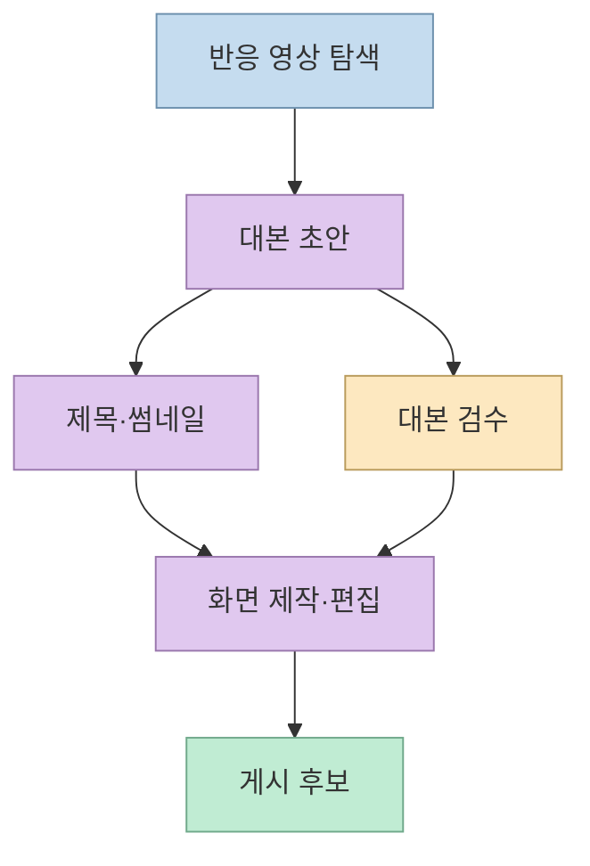
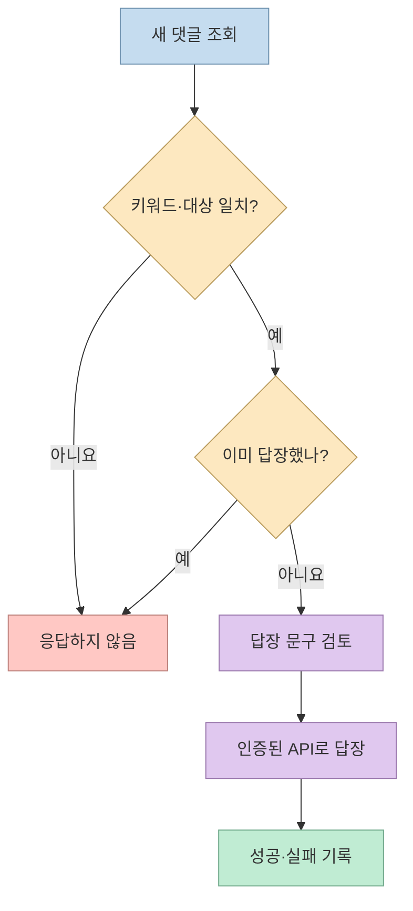

[이 유튜브 쇼츠](https://www.youtube.com/shorts/oxRD_YX2vEQ)의 화자는 클로드가 자신의 유튜브 채널 제작을 맡으며, 하나의 스킬이 아니라 다섯 개가 팀처럼 일한다고 말한다. 영상에 나온 것은 **작업 역할과 자동 답장 주장** 이다. 실제 스킬 파일, 실행 화면, 성과 지표는 제시되지 않으므로 이를 재현 가능한 완성형 시스템으로 받아들이기보다, 제작 파이프라인의 설계 아이디어로 읽는 편이 정확하다.

<!--more-->

## Sources

- [원본 쇼츠](https://www.youtube.com/shorts/oxRD_YX2vEQ) — 영상 자막은 `youtube-transcript-api`로 확인했다. YouTube 전용 MCP가 연결되지 않아 대체 경로를 사용했다.
- [YouTube Data API 댓글 구현 안내](https://developers.google.com/youtube/v3/guides/implementation/comments), [댓글 답장 API](https://developers.google.com/youtube/data/reference/rest/v3/comments/insert) — 댓글 조회·답장에 쓰이는 공식 인터페이스와 인증 조건.
- [YouTube 스팸 정책](https://support.google.com/youtube/answer/2801973) — 반복적·기만적 댓글과 대량 자동 생성 콘텐츠에 관한 플랫폼 정책.

## 다섯 스킬의 역할은 제작 단계별 분업이다

영상은 다섯 역할을 빠르게 나열한다. 첫째는 반응이 좋은 영상을 찾고, 둘째는 대본을 쓰며, 셋째는 제목과 썸네일을 만들고, 넷째는 대본을 검수하고, 다섯째는 화면을 그려 편집한다. 이는 영상 화자가 설명한 작업 구분일 뿐, 각 스킬이 어떤 데이터·모델·편집 도구를 쓰는지는 영상만으로 확인할 수 없다. [영상 4~14초](https://youtu.be/oxRD_YX2vEQ?t=4)

이 구조의 장점은 "영상 하나 만들어 줘"라는 단일 요청을 **탐색, 작성, 포장, 검수, 편집** 으로 분리한다는 데 있다. 다만 영상은 실제 검수 기준이나 사람의 승인 단계를 설명하지 않는다. 게시 전 사실관계, 저작권, 썸네일의 과장 여부, 화면과 대본의 일치 여부를 확인하는 게이트는 이 사례를 실무에 적용할 때 추가로 설계해야 할 항목이다. [영상 4~14초](https://youtu.be/oxRD_YX2vEQ?t=4)

## 댓글 자동 답장은 별도의 운영 시스템이다

화자는 특정 키워드를 댓글로 남기면 자신이 자는 동안에도 **한 시간 안에 자동 답장** 이 간다고 말한다. 하지만 영상에는 댓글을 어떻게 감지하고, 중복 답장을 막고, 실패를 재시도하는지 나타나지 않는다. 또한 한 시간이라는 수치는 화자의 주장이지 이 글에서 측정하거나 보증한 서비스 수준이 아니다. [영상 15~27초](https://youtu.be/oxRD_YX2vEQ?t=15)

YouTube Data API에는 영상의 댓글 스레드를 읽는 `commentThreads.list`와 기존 댓글에 답하는 `comments.insert`가 있다. 답장 쓰기에는 사용자 인증이 필요하다. 따라서 공식 API로 구현한다면 "댓글 조회 → 키워드 판정 → 중복 확인 → 답장 요청 → 결과 기록"이 하나의 가능한 흐름이다. **이 흐름은 공식 API를 바탕으로 한 설계 예시이며, 영상 제작자가 실제로 이 API를 썼다는 뜻은 아니다.** [댓글 구현 안내](https://developers.google.com/youtube/v3/guides/implementation/comments), [댓글 답장 API](https://developers.google.com/youtube/data/reference/rest/v3/comments/insert)

운영할 때는 같은 댓글에 여러 번 답하지 않도록 댓글 ID와 처리 상태를 저장하고, 인증 실패나 답장 제한을 정상 성공으로 기록하지 않아야 한다. 스팸성 댓글이나 개인정보가 담긴 댓글을 무조건 키워드만 보고 처리하는 것도 피해야 한다. YouTube는 반복적·기만적 댓글과 대량의 유사 콘텐츠를 스팸 정책 대상으로 명시한다. 이는 자동화 자체가 곧 위반이라는 뜻은 아니지만, **빈도와 문맥을 고려한 검토** 가 필요하다는 뜻이다. [YouTube 스팸 정책](https://support.google.com/youtube/answer/2801973)

## 이 영상만으로는 성과를 판단할 수 없다

영상은 "지금 보는 영상도" 해당 방식으로 만들었다고 주장하고, 다섯 스킬 구성을 공유하겠다고 안내한다. 하지만 자막에는 각 스킬의 프롬프트, 실행 결과, 제작 시간, 조회수 비교, 자동 답장 성공률이 없다. 따라서 이 사례에서 확인할 수 있는 것은 **역할 구성과 화자의 운영 주장** 까지다. 조회수 증가나 제작비 절감의 근거로 확장해서는 안 된다. [영상 0~4초](https://youtu.be/oxRD_YX2vEQ?t=0), [영상 21~27초](https://youtu.be/oxRD_YX2vEQ?t=21)

## 실전 적용 포인트

1. 다섯 역할을 도입한다면 단계마다 입력과 산출물을 먼저 정의한다. 특히 "대본 검수"가 무엇을 통과·반려할지 명시한다.
2. 키워드 답장은 본문 제작과 별개로 설계한다. 중복 방지, 답장 실패 기록, 수동 중지, 인증 범위를 갖추지 않은 자동화는 운영 위험이 크다. [댓글 구현 안내](https://developers.google.com/youtube/v3/guides/implementation/comments)
3. "한 시간 내 응답"이나 콘텐츠 성과는 실제 로그로 측정하기 전에는 화자의 주장으로만 취급한다. [영상 17~21초](https://youtu.be/oxRD_YX2vEQ?t=17)
4. 자동 댓글과 유사한 영상의 대량 생산은 플랫폼 정책의 스팸·기만 기준을 함께 검토한다. [YouTube 스팸 정책](https://support.google.com/youtube/answer/2801973)

## 핵심 요약

- 영상의 핵심은 클로드 스킬 다섯 개에 **탐색·대본·제목/썸네일·검수·편집** 역할을 나눈다는 주장이다.
- 댓글 자동 답장은 별도 감지·중복 방지·인증·기록 흐름이 필요하지만, 영상은 구현 방식을 공개하지 않는다.
- 제작 속도나 조회수 향상, 한 시간 내 답장 성공률은 영상만으로 검증할 수 없다.

## 결론

이 쇼츠는 AI를 한 명의 만능 제작자가 아니라 여러 단계의 작업자로 배치하는 아이디어를 보여준다. 실제로 쓸 만한 시스템이 되려면 스킬의 역할 분리보다 **검수 기준, 게시 승인, 댓글 운영 로그와 정책 준수** 를 먼저 구체화해야 한다.
