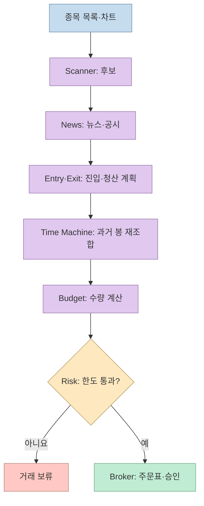
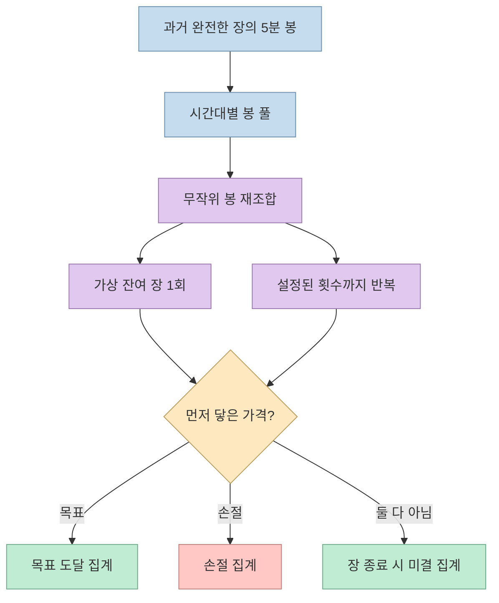
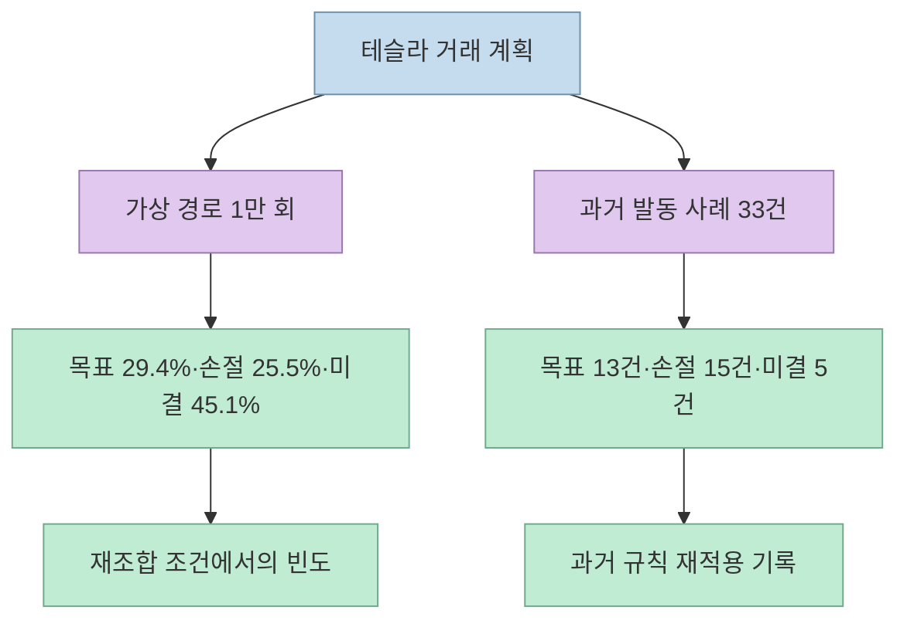
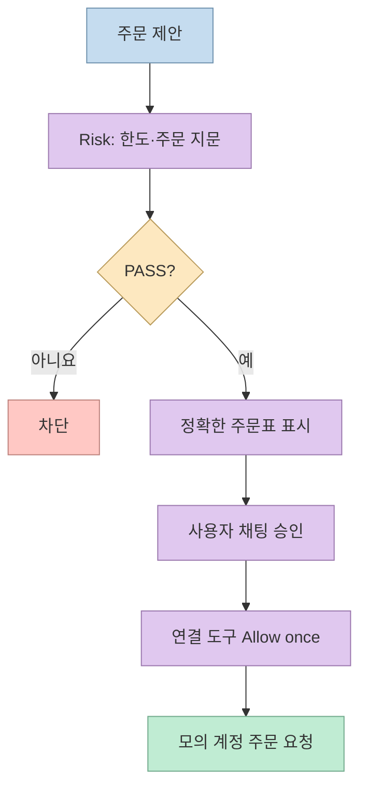

[이 쇼츠](https://youtube.com/shorts/EJDHuFTV4ug?si=TjP7ZKbYszyzBd5W)는 클로드 스킬 11개가 미국 주식 후보 탐색부터 주문 직전의 위험 검사까지 돕고, 이른바 "타임머신"으로 남은 장을 1만 번 돌려본다고 소개한다. 원 개발자의 [Day Trader Skill 저장소](https://github.com/Jakeschincariol/day-trader-skill)를 대조하면 핵심은 미래를 맞히는 AI가 아니라 **과거 5분 봉을 재조합한 시뮬레이션과 주문 전 체크리스트** 다. 이 글은 소프트웨어 구조 분석이며 투자 조언이 아니다.

<!--more-->

## Sources

- [원본 유튜브 쇼츠](https://youtube.com/shorts/EJDHuFTV4ug?si=TjP7ZKbYszyzBd5W) — `youtube-transcript-api`로 0~55초 자막을 확인했다. YouTube 전용 MCP가 연결되지 않아 대체 경로를 사용했다. 자막의 첫 문장과 마지막 문장은 인식 오류 가능성이 있어 분석에서 제외했다.
- [Jake Schincariol의 Day Trader Skill 저장소](https://github.com/Jakeschincariol/day-trader-skill), [Time Machine 스킬](https://github.com/Jakeschincariol/day-trader-skill/blob/main/trader-timemachine/SKILL.md), [Risk 스킬](https://github.com/Jakeschincariol/day-trader-skill/blob/main/trader-risk/SKILL.md), [Broker 스킬](https://github.com/Jakeschincariol/day-trader-skill/blob/main/trader-broker/SKILL.md) — 역할, 계산 방식, 주문 승인 설명의 1차 출처.
- [Alpaca 모의투자 문서](https://docs.alpaca.markets/us/docs/paper-trading), [Alpaca 주문 유형 문서](https://docs.alpaca.markets/us/docs/orders-at-alpaca) — 모의 체결과 손절 주문의 한계를 확인할 공식 자료.

## 11개 스킬은 한 번의 거래를 여러 단계로 나눈다

영상은 미국 주식 약 5,900개를 훑고, 움직이기 시작한 종목의 뉴스·공시를 모은 뒤 진입·손절·목표 가격을 정한다고 압축한다. 원 저장소에서는 이 기능을 `trader-scanner`, `trader-news`, `trader-entry`, `trader-exit` 등으로 분리하고, 이어 `trader-timemachine`, `trader-budget`, `trader-risk`, `trader-broker`가 차례로 산출물을 읽는다. 나머지 `trader-alerts`, `trader-analyst`, `trader-pelosi`는 알림·실적·의회 거래 공시를 보조한다. "11개"는 각각 독립적으로 수익을 창출하는 에이전트 수가 아니라 **기능별 스킬 폴더 수** 다. [영상 5~19초](https://youtu.be/EJDHuFTV4ug?t=5), [원 저장소](https://github.com/Jakeschincariol/day-trader-skill)

저장소의 `scan.py universe` 설명에 나온 약 5,900개는 **전체 후보군 규모** 다. 저장소의 테슬라 시연에서는 별도로 231개 차트를 스캔했다고 적는다. 따라서 영상의 "5,900개를 훑는다"는 기능 범위를 가리키며, 제시된 테슬라 사례에서 5,900개 종목을 모두 실시간으로 분석했다는 뜻으로 읽으면 안 된다. 무료 Yahoo Finance 차트와 Nasdaq Trader 종목 목록 등 공개 데이터에 의존한다는 원 개발자의 설명도 데이터 지연·접속 제한을 고려하게 한다. [영상 10~15초](https://youtu.be/EJDHuFTV4ug?t=10), [원 저장소](https://github.com/Jakeschincariol/day-trader-skill)

## ‘타임머신’의 1만 번은 1만 건의 검증 거래가 아니다

영상은 지난 60일의 5분 차트로 오늘 남은 장을 1만 번 돌려본다고 말한다. 원 개발자의 [Time Machine 설명](https://github.com/Jakeschincariol/day-trader-skill/blob/main/trader-timemachine/SKILL.md)에 따르면, 먼저 계획일 이전의 완전한 장에서 시간대별 5분 봉을 모은다. 각 가상 경로는 같은 시간대 부근의 과거 봉을 무작위로 골라 현재 가격에 비율로 연결한다. 이후 손절가와 목표가 중 어느 쪽에 먼저 닿는지 계산한다. 시드값을 고정해 같은 입력으로 재현할 수 있지만, 1만 회를 실행해도 과거 약 60거래일의 정보 범위를 넘는 새 관측치가 생기는 것은 아니다. [영상 19~25초](https://youtu.be/EJDHuFTV4ug?t=19), [Time Machine 스킬](https://github.com/Jakeschincariol/day-trader-skill/blob/main/trader-timemachine/SKILL.md)

여기서 나오는 비율은 **해당 재조합 규칙과 선택한 과거 구간을 조건으로 한 시뮬레이션 빈도** 다. 뉴스, 거래 정지, 급격한 변동성 변화처럼 과거 봉에 없던 사건을 예측하지 못한다. 동일 봉이 목표와 손절을 모두 건드리면 구현상 손절을 먼저 집계하고, 갭으로 손절가를 넘어가도 계산상 손실을 일정하게 취급한다는 제한도 원 스킬에 적혀 있다. 수치가 정밀해 보여도 미래의 승률이나 최악 손실 보증으로 바꿔 읽을 수 없다. [Time Machine 스킬](https://github.com/Jakeschincariol/day-trader-skill/blob/main/trader-timemachine/SKILL.md)

## 테슬라 예시: 두 종류의 숫자를 섞지 않는다

영상은 제작자가 제시한 테슬라 판정이 "동전 던지기에 가깝다"고 전한다. 원 저장소의 2026년 10월 19일 예시는 1만 회 가상 경로에서 **목표 먼저 29.4%, 손절 먼저 25.5%, 장 종료까지 미결 45.1%** 를 보고한다. 별도로 같은 진입 규칙이 과거 세션에서 발동한 **33건 중 목표 13건, 손절 15건, 어느 쪽도 아닌 경우 5건** 을 제시한다. 영상의 13·15라는 숫자는 1만 회 결과가 아니라 과거 33건의 재적용 결과다. 두 실험은 표본과 질문이 다르므로 서로 합쳐 승률처럼 계산하면 안 된다. [영상 25~35초](https://youtu.be/EJDHuFTV4ug?t=25), [원 저장소의 테슬라 예시](https://github.com/Jakeschincariol/day-trader-skill)

이 결과만으로 기대수익이나 실제 체결 확률을 판단할 수 없다. 예를 들어 미결 45.1%는 손익이 0이라는 뜻이 아니며, 실제 손절 주문은 지정한 가격에 반드시 체결되지 않는다. Alpaca도 손절 주문이 시장가 주문으로 바뀐 뒤 체결 가격을 보장하지 않는다고 설명한다. [Time Machine 스킬](https://github.com/Jakeschincariol/day-trader-skill/blob/main/trader-timemachine/SKILL.md), [Alpaca 주문 유형](https://docs.alpaca.markets/us/docs/orders-at-alpaca)

## ‘혼자 주문하지 않는다’는 설정에 의존한다

영상은 기본이 모의투자이고 실제 주문까지 손실 한도 검사, 채팅 확인, 허용 버튼의 세 단계를 거친다고 설명한다. 원 저장소의 `trader-broker` 스킬도 위험 판정이 난 **정확한 주문** 의 지문을 확인하고, 채팅의 명시적 승인과 Claude의 도구 권한 카드에서 다시 허용하도록 안내한다. 다만 `ticket.py` 자체는 브로커에 주문을 보내는 코드가 아니라 주문표와 승인 기록을 만드는 코드다. 실제 주문은 연결된 브로커 도구가 맡으며, "Needs approval" 권한 설정을 지켜야 두 번째 사용자 확인이 나타난다. [영상 36~43초](https://youtu.be/EJDHuFTV4ug?t=36), [Broker 스킬](https://github.com/Jakeschincariol/day-trader-skill/blob/main/trader-broker/SKILL.md)

따라서 "절대 혼자 주문할 수 없다"는 표현을 모든 환경에 대한 기술적 보증으로 받아들여서는 안 된다. 승인 과정은 스킬 지시와 도구 권한 설정에 의존하고, 브로커 도구에 다른 경로로 접근할 가능성까지 이 스킬만으로 배제할 수 없다. 실거래 키를 에이전트 환경에 넣지 않고 모의투자 키·엔드포인트를 따로 쓰는 편이 더 분명한 경계다. Alpaca의 모의투자는 주문을 실제 거래소로 보내지 않지만, 시장 충격·지연 슬리피지·호가 대기열 등을 완전히 재현하지는 않는다. [Broker 스킬](https://github.com/Jakeschincariol/day-trader-skill/blob/main/trader-broker/SKILL.md), [Alpaca 모의투자](https://docs.alpaca.markets/us/docs/paper-trading)

## 실전 적용 포인트

1. **먼저 소스와 데이터 경계를 확인한다.** 5,900개 전체 후보군, 실제 스캔 수, 뉴스·차트 데이터의 시각을 구분한다. 비공식 무료 데이터는 브로커 자료와 다를 수 있다. [원 저장소](https://github.com/Jakeschincariol/day-trader-skill)
2. **1만 회를 승률로 부르지 않는다.** 재조합한 과거 봉의 빈도, 과거 규칙 발동 사례, 앞으로의 체결 결과를 서로 다른 수치로 기록한다. [Time Machine 스킬](https://github.com/Jakeschincariol/day-trader-skill/blob/main/trader-timemachine/SKILL.md)
3. **위험 한도와 승인 경로를 테스트한다.** `PASS` 판정의 주문 지문이 바뀌면 다시 검사하고, 연결 도구가 항상 사용자 승인을 요구하는지 확인한다. 가능하면 실거래 자격 증명은 아예 노출하지 않는다. [Risk 스킬](https://github.com/Jakeschincariol/day-trader-skill/blob/main/trader-risk/SKILL.md), [Broker 스킬](https://github.com/Jakeschincariol/day-trader-skill/blob/main/trader-broker/SKILL.md)
4. **모의 손익을 실거래 기대수익으로 해석하지 않는다.** 손절 가격과 체결 가격은 다를 수 있고, 모의 환경에는 실제 시장 비용과 미체결 조건의 일부가 빠진다. [Alpaca 주문 유형](https://docs.alpaca.markets/us/docs/orders-at-alpaca), [Alpaca 모의투자](https://docs.alpaca.markets/us/docs/paper-trading)

## 핵심 요약

- Day Trader Skill은 11개 스킬을 이어 후보 탐색부터 모의 주문 승인까지 흐름을 구성한다.
- "타임머신 1만 번"은 과거 5분 봉 재조합이며, 테슬라의 과거 발동 사례 33건과 다른 실험이다.
- 테슬라 예시의 "동전 던지기에 가까움"은 수익을 보장하지 않는다는 경고에 가깝다.
- 주문 전 세 단계는 유용한 운영 규칙이지만, 스킬 지시만으로 모든 브로커 접근을 강제 차단하는 보안 경계는 아니다.

## 결론

이 쇼츠의 흥미로운 점은 AI가 단타의 정답을 찾았다는 데 있지 않다. 탐색, 계획, 과거 자료 재생, 수량 계산, 위험 판정, 사용자 승인을 **서로 다른 단계로 보이게 만든 것** 이다. 그 단계마다 데이터의 시점과 실패 동작을 검증하고, 실제 자금과 모의 환경을 분리해야 비로소 안전한 연구 도구로 다룰 수 있다.
