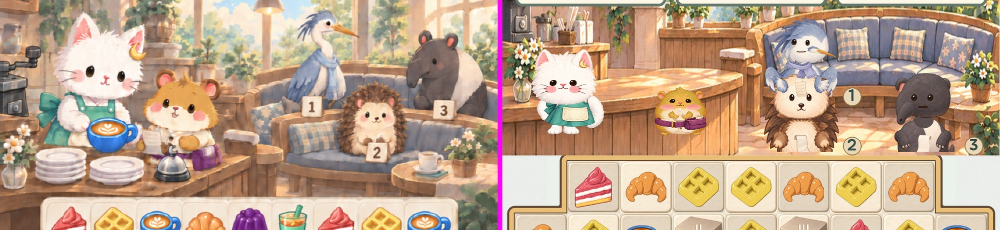
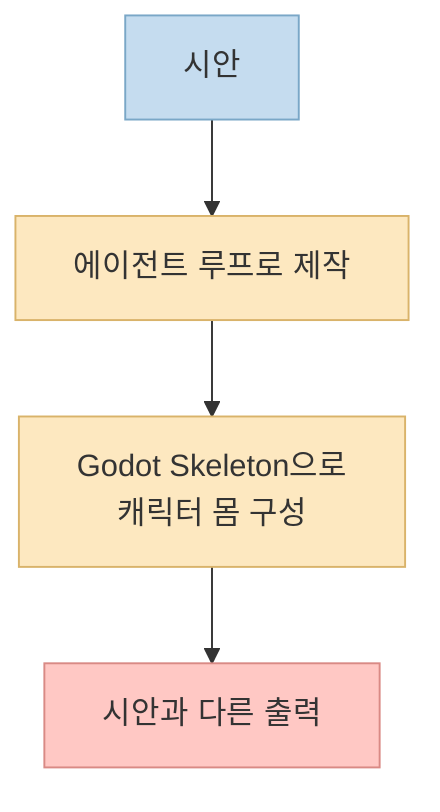
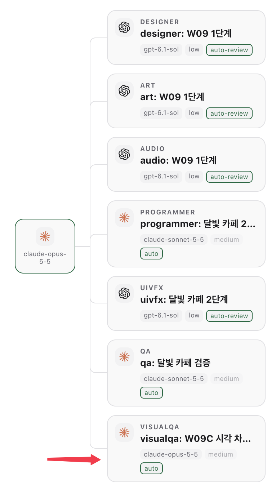
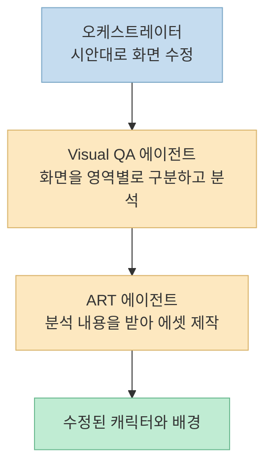
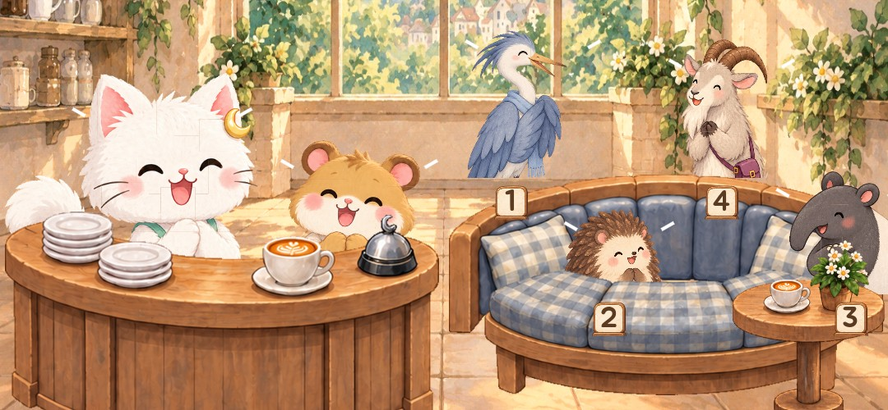

시안 속 고양이는 분명 귀여웠습니다. 그런데 게임 화면에는 어딘가 이상한 몸을 한 무언가가 서 있었죠.

설명해서 고치자니 막막해서, 설명을 대신해 줄 에이전트를 팀에 하나 더 뽑았습니다. 제가 직접 만들어 쓰는 Paseo의 Agent Team 플러그인으로 겪은 일입니다.

<!--more-->

## 직접 만든 플러그인, Agent Team

먼저 도구 소개부터 하겠습니다. 플러그인 페이지는 여기입니다.

https://paseo.sh/plugins/gyuha/agent-team

설치는 딱 한 줄입니다.

```bash
paseo plugin add gyuha/agent-team
```

이 플러그인으로 팀을 꾸려서 게임을 만들고 있었습니다. 그러다 문제가 터졌습니다.

## 시안은 이랬는데, 결과물은 이랬습니다

그래픽 구현이 시안과 너무 달랐습니다. 왼쪽이 시안, 오른쪽이 실제로 만들어진 화면입니다. 같은 게임 맞습니다.



범인은 Skeleton이었습니다. 캐릭터 애니메이션을 구현하려고 Godot의 Skeleton으로 몸을 구성했는데, 에이전트가 루프로 작업하면 번번이 이런 결과가 나왔습니다.



문제는 이걸 하나하나 말로 설명해서 고치기가 너무 막막하다는 점이었습니다. 어디가 어떻게 다른지 글로 풀어 쓰는 것부터가 일이었죠.

## 에라 모르겠다, QA 에이전트를 뽑자

그래서 에라 모르겠다는 심정으로 Visual QA 에이전트를 하나 추가했습니다. 시안과 다르게 나온 화면을 검증해서 알려 주는 역할입니다. 만드는 방법도 간단했습니다. Agent Team 플러그인에 "이런 에이전트를 만들어 줘"라고 요청했더니 아래와 같이 팀에 추가되었습니다.



그다음 오케스트레이터에게 한마디 했습니다.

> 시안대로 게임 화면을 수정해 줘.

그랬더니 일이 달라졌습니다.

## 에이전트들이 일하는 방식

Visual QA 에이전트가 화면을 아래처럼 영역별로 나눠서 분석하기 시작했습니다. 그리고 분석한 내용을 ART 에이전트에게 넘겼습니다. 제가 말로 설명하던 일을 QA 에이전트가 대신 해 준 셈입니다.




## 결과는?

에이전트들이 한참을 일하더니, 아래처럼 정상적인 모습의 캐릭터가 나왔습니다.



아직 완벽하지는 않습니다. 그래도 캐릭터의 이상한 몸 비율은 사라졌고, 배경 에셋도 다시 만들어졌습니다. 그리고 캐릭터 애니메이션도 정상적으로 동작했습니다.

## 정리

제가 한 일은 "검증만 하는 역할"을 팀에 하나 추가하고 오케스트레이터에게 다시 시킨 것뿐입니다. 시안과 결과물의 차이를 사람이 일일이 설명하는 대신, 그 차이를 찾아내는 일을 에이전트에게 맡겼더니 풀렸습니다.
