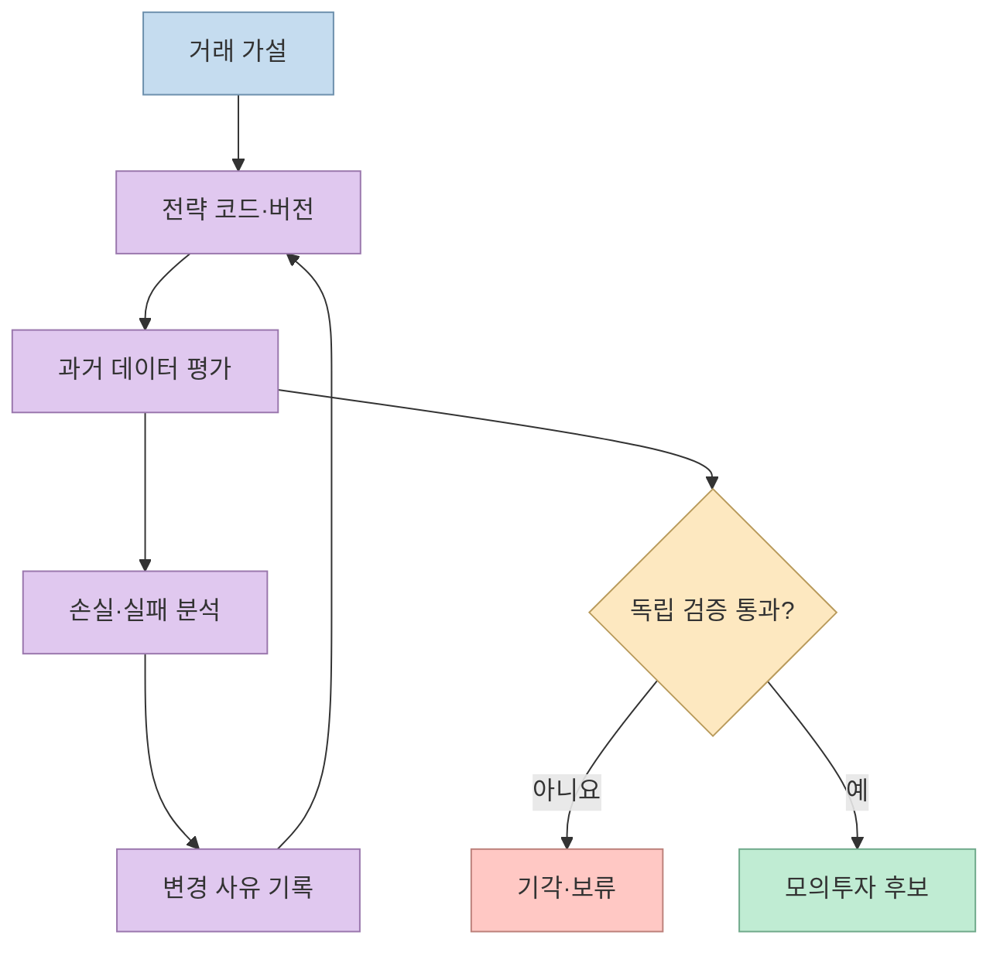
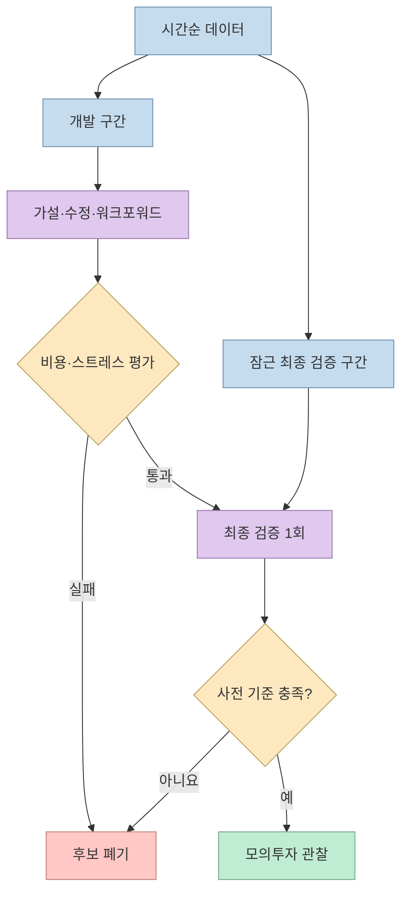
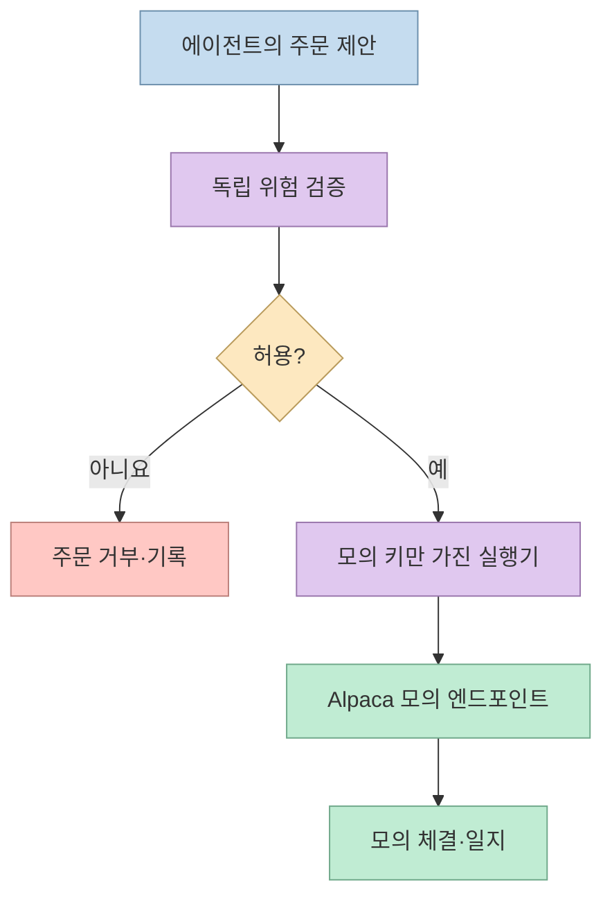
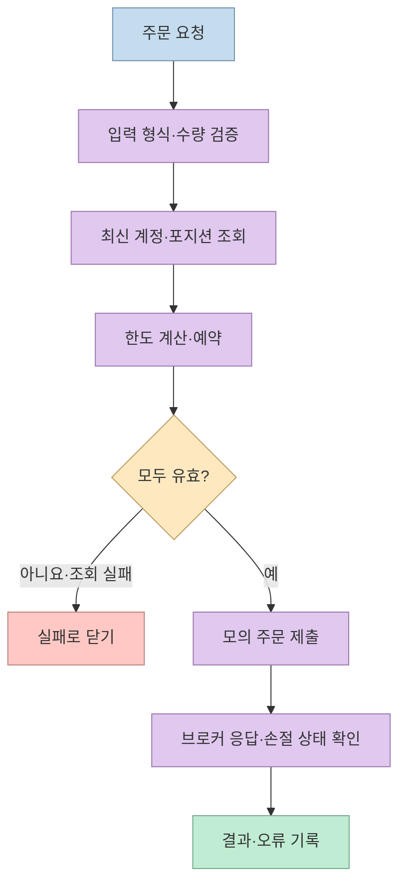
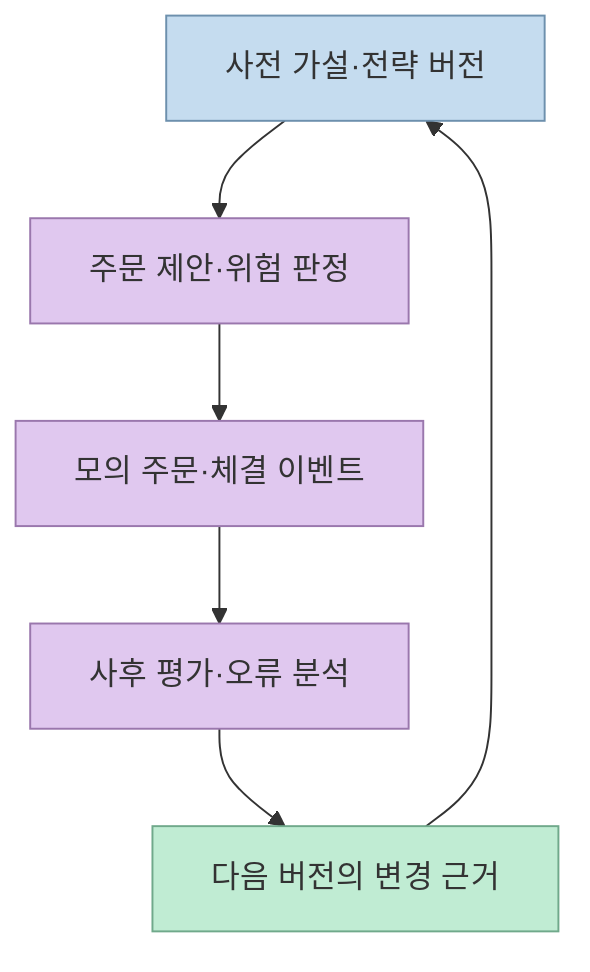

[게으른 빌더의 가이드](https://lazyowen.com/guides/self-improving-ai-trading-loop)는 Claude Code가 거래 아이디어를 코드로 만들고, 백테스트의 손실을 분석해 전략을 고친 뒤, Alpaca 모의투자와 거래 일지로 다시 평가하는 루프를 제안한다. 여기서 **자기 개선** 은 모델이 스스로 학습해 수익성이 보장된다는 뜻이 아니다. 에이전트가 전략 코드와 규칙을 반복 수정한다는 뜻이며, 수정의 유효성은 독립된 데이터와 주문 안전장치로 따로 검증해야 한다. 이 글은 시스템 설계의 검토이며 투자 권유가 아니다.

<!--more-->

## Sources

- [원문: 돈 잃을 때마다 자기 코드를 다시 짜는 AI 트레이딩 시스템 만드는 법](https://lazyowen.com/guides/self-improving-ai-trading-loop) — 프로젝트 구성, 백테스트, 위험 한도, 모의투자, SQLite 거래 일지의 제안. 공개 본문을 `scrapling-get` 방식으로 확인했다.
- [Alpaca Python SDK: TradingClient](https://alpaca.markets/sdks/python/api_reference/trading/trading-client.html), [거래 API 예시](https://alpaca.markets/sdks/python/trading.html) — `paper` 인자와 거래 클라이언트의 동작.
- [Alpaca 모의투자 문서](https://docs.alpaca.markets/us/docs/paper-trading), [API 키 보안](https://alpaca.markets/learn/api-key-security-best-practices-for-alpaca-builders) — 모의/실거래 자격 증명, 엔드포인트, 시뮬레이션의 한계.
- [Alpaca 주문 요청 명세](https://alpaca.markets/sdks/python/api_reference/trading/requests.html), [주문 처리 설명](https://docs.alpaca.markets/us/docs/working-with-orders) — 브래킷 주문과 브로커 측 손절 지정.
- [Alpaca 시장 데이터 안내](https://docs.alpaca.markets/us/docs/about-market-data-api), [FINRA의 백테스트 주의사항](https://syndication.finra.org/content/smart-questions-ask-about-smart-beta-products-part-2), [다중 전략 검증 연구](https://www.nber.org/papers/w21329.pdf) — 데이터 범위, 가상 성과와 선택 편향의 배경.

## 루프의 실제 단위는 모델 학습이 아니라 전략 버전이다

원문은 가상환경과 `alpaca-py`를 준비하고 `research/`, `strategies/`, `backtests/`, `journal/`, `memory/`, `config/`, `data/` 같은 작업 공간을 나눈다. 아이디어를 전략으로 옮긴 뒤 과거 데이터에서 평가하고, 실패 거래를 기록하며, 변경된 전략을 다시 시험한다. 손실 원인을 설명하는 문장이 생겼다는 사실과 **다음 데이터에서도 성과가 좋아졌다는 사실은 다르다**. 따라서 전략 코드, 입력 데이터 구간, 비용 가정, 결과를 하나의 변경 이력으로 묶어야 한다. [원문](https://lazyowen.com/guides/self-improving-ai-trading-loop)

에이전트에게 "진 거래만 고쳐라"라고 지시하면 원인을 좁히는 데는 편할 수 있지만, 이긴 거래의 위험 노출이나 우연한 수익을 놓칠 수 있다. 개별 손실을 없애려는 수정은 과거 거래에만 맞춘 예외 규칙을 늘릴 수도 있다. 이 부분은 원문의 수정 루프에서 도출되는 설계상 위험이지, 원문이 성과 향상을 입증했다는 뜻이 아니다.

## 백테스트: 많이 고칠수록 검증 자료를 더 엄격히 분리한다

원문은 먼저 예측을 적고, 일부 데이터를 마지막 검증용으로 남기며, 시간 순서를 지키는 워크포워드 평가와 거래비용 확대 시험을 권한다. 이는 방향이 맞다. 다만 같은 홀드아웃을 보고 여러 번 전략을 고치면 그 구간도 사실상 학습 자료가 된다. 수정 횟수와 탈락한 후보를 함께 남기고, 한 번 열어본 최종 검증 구간을 재사용하지 않는 절차가 필요하다. FINRA는 백테스트가 **가상의 과거 성과** 이며 미래 성과를 예측하지 못한다고 주의한다. 여러 신호를 탐색한 뒤 가장 좋아 보이는 것만 고르면 선택 편향이 커진다는 연구도 있다. [원문](https://lazyowen.com/guides/self-improving-ai-trading-loop), [FINRA](https://syndication.finra.org/content/smart-questions-ask-about-smart-beta-products-part-2), [NBER](https://www.nber.org/papers/w21329.pdf)

검증 기준에는 수익률 하나만 두지 않는다. 데이터 누출 여부, 종목 생존 편향, 거래 수, 최대 낙폭, 수수료·스프레드·슬리피지 가정, 주문을 체결할 수 있는 거래량을 함께 본다. 원문은 비용을 더 높여 보거나 나쁜 기간을 다시 시험하라고 제안하지만, **비용을 두 배로 가정했다는 사실만으로 실제 체결을 재현한 것은 아니다**. 이런 점검 항목은 모의투자 문서가 열거하는 시장 충격·대기열·지연 등의 누락과도 연결된다. [원문](https://lazyowen.com/guides/self-improving-ai-trading-loop), [Alpaca 모의투자](https://docs.alpaca.markets/us/docs/paper-trading)

## 모의투자의 경계는 `paper=True` 한 줄보다 넓다

Alpaca Python SDK의 `TradingClient`는 `paper` 인자의 기본값을 `True`로 문서화한다. 그러나 실제 안전 경계는 이 값 하나가 아니라 **모의투자 전용 API 키와 모의투자 엔드포인트** 의 조합이다. Alpaca는 모의/실거래 키와 URL을 분리하며, 모의 키를 실거래 엔드포인트에 쓰면 인증에 실패한다고 설명한다. 또한 SDK에는 URL을 재정의할 수 있는 인자가 있으므로, 실행 환경의 자격 증명과 목적지를 함께 점검해야 한다. [SDK 명세](https://alpaca.markets/sdks/python/api_reference/trading/trading-client.html), [Alpaca 모의투자](https://docs.alpaca.markets/us/docs/paper-trading), [API 키 보안](https://alpaca.markets/learn/api-key-security-best-practices-for-alpaca-builders)

모의 주문은 거래소로 실제 전송되지 않는다. Alpaca 문서는 모의 체결에 시장 충격, 정보 누출, 지연에 따른 슬리피지, 호가 대기열 위치, 일부 비용과 배당 효과 등이 반영되지 않는다고 명시한다. 무료 데이터 플랜의 실시간 미국 주식 범위도 IEX 기반이며 전체 거래소 데이터를 뜻하지 않는다. 그러므로 모의 수익은 시스템 흐름을 검증하는 증거일 수 있어도, 실거래 수익의 증거는 아니다. [Alpaca 모의투자](https://docs.alpaca.markets/us/docs/paper-trading), [시장 데이터 플랜](https://docs.alpaca.markets/us/docs/about-market-data-api)

## 위험 한도: 예시 숫자와 강제 장치를 혼동하지 않는다

원문은 일일 손실, 최대 낙폭, 주문당 금액, 보유 포지션 수, 손절 비율에 한도를 두는 `risk.py`와 설정 파일을 제안한다. 가이드에 나온 2%, 8%, 10%, 5개, 5% 같은 값은 **저자의 예시 설정** 이지 보편적으로 안전한 투자 기준이 아니다. 한도가 실제로 작동하려면 주문 전 상태를 신뢰 가능한 계정·포지션 데이터에서 새로 가져와야 하며, 누락·오래된 값·동시 주문·음수나 비정상 입력은 거부 쪽으로 처리해야 한다. 원문 코드 예시의 호출자가 전달하는 `daily_loss_pct`, `drawdown_pct`, `equity`, `open_positions`만 믿는 방식은 호출 경로가 잘못되면 경계를 약하게 만든다. [원문](https://lazyowen.com/guides/self-improving-ai-trading-loop)

특히 주문 딕셔너리에 `stop_loss_pct`라는 필드가 **존재하는지 검사** 하는 것과 브로커에 실제 손절 주문이 **접수·유지되는지 확인** 하는 것은 별개다. Alpaca의 브로커 측 브래킷 주문은 주문 클래스와 손절 가격을 지정하는 `StopLossRequest` 등을 사용한다. 따라서 주문 요청과 응답, 부분 체결 및 손절 주문의 상태를 확인하지 않은 채 내부 필드 하나로 "손절이 걸렸다"고 말할 수 없다. [원문](https://lazyowen.com/guides/self-improving-ai-trading-loop), [Alpaca 주문 요청 명세](https://alpaca.markets/sdks/python/api_reference/trading/requests.html), [주문 처리 설명](https://docs.alpaca.markets/us/docs/working-with-orders)

또한 원문의 `chmod 444 risk.py config/risk.json`은 실수로 파일을 덮어쓰는 일을 줄일 수 있지만, 같은 사용자 권한으로 실행하는 에이전트에게 **변경 불가능한 보안 경계** 가 되지는 않는다. 파일 권한을 되돌리거나 위험 검사를 건너뛰는 호출 경로가 남을 수 있다. 이는 Unix 권한 모델과 예시 구조에서 도출되는 분석이다. 더 강한 경계가 필요하다면 위험 검증과 주문 실행을 에이전트와 별도 권한의 서비스에 두고, 실거래 키를 에이전트 환경에 제공하지 않아야 한다.

## 거래 일지는 다음 수정을 위한 감사 기록이다

원문은 SQLite 장부에 거래, 전략 버전, 예측과 사후 분석을 남겨 같은 실수를 다시 살펴보게 한다. 여기에는 성공·실패 거래를 모두 포함하고, **주문 제안 시점의 가설과 실제 관찰 결과** 를 분리하는 편이 좋다. 체결 실패, 위험 한도 거부, 데이터 조회 오류까지 기록해야 "거래하지 않은 이유"도 설명할 수 있다. 이는 원문의 일지 설계를 운영 감사에 맞게 확장한 제안이다. [원문](https://lazyowen.com/guides/self-improving-ai-trading-loop)

## 실전 적용 포인트

1. **연결 전에 권한을 고정한다.** 실거래 키를 개발 환경에 넣지 않고, 모의 키·엔드포인트를 실행 시 확인한다. `paper=True`만을 안전장치로 취급하지 않는다. [Alpaca 모의투자](https://docs.alpaca.markets/us/docs/paper-trading)
2. **전략 변경 기록을 검증 기록과 묶는다.** 각 버전의 가설, 사용 데이터, 비용 가정, 수정 횟수, 탈락 사유를 남긴다. 최종 검증 구간은 반복 탐색에 쓰지 않는다. [FINRA](https://syndication.finra.org/content/smart-questions-ask-about-smart-beta-products-part-2), [NBER](https://www.nber.org/papers/w21329.pdf)
3. **위험 검사는 주문 경로 밖으로 빼지 않는다.** 모든 주문이 같은 검증기를 통과하게 하고, 최신 계정 조회 실패나 손절 주문 상태 불명은 성공으로 간주하지 않는다. 이는 원문 예시를 보완하는 설계 권고다.
4. **모의 성과의 해석 범위를 제한한다.** 주문 흐름과 기록 체계가 동작한다는 증거와 수익성이 입증됐다는 주장을 구분한다. [Alpaca 모의투자](https://docs.alpaca.markets/us/docs/paper-trading)

## 핵심 요약

- 원문의 루프는 **전략 코드의 반복 수정** 이지, 수익을 자동 보장하는 학습 시스템이 아니다.
- 백테스트는 수정 횟수가 늘수록 선택 편향을 경계하고 최종 검증 데이터를 격리해야 한다.
- `paper=True`, 내부 `stop_loss_pct`, 읽기 전용 파일 권한은 각각 다른 수준의 장치이며, 어느 하나도 완전한 주문 안전 경계가 아니다.
- 거래 일지는 성공 사례뿐 아니라 실패 주문·거부·데이터 오류까지 남겨야 다음 변경을 감사할 수 있다.

## 결론

이 가이드의 가치는 AI에게 매매를 맡기는 데보다 **가설→코드→검증→모의 실행→사후 기록** 을 반복 가능한 절차로 만드는 데 있다. 손실 뒤 전략을 고치는 속도보다 더 중요한 것은, 그 수정이 새 데이터에서도 통하는지 확인하고 잘못된 주문이 실행 경계를 넘지 못하게 하는 일이다.
