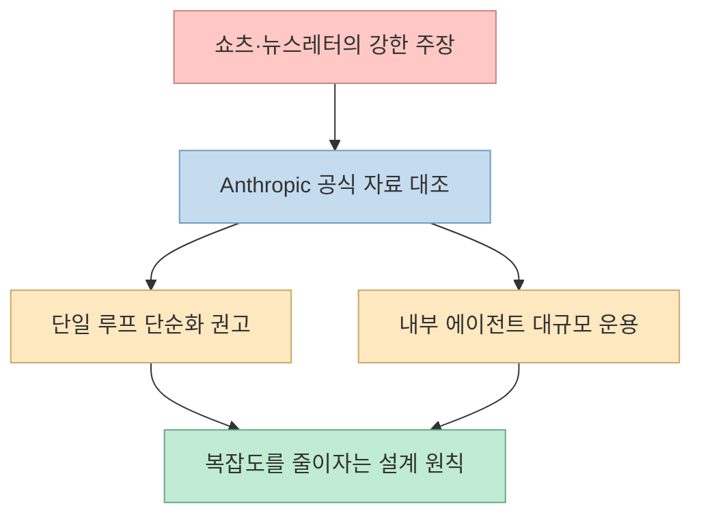
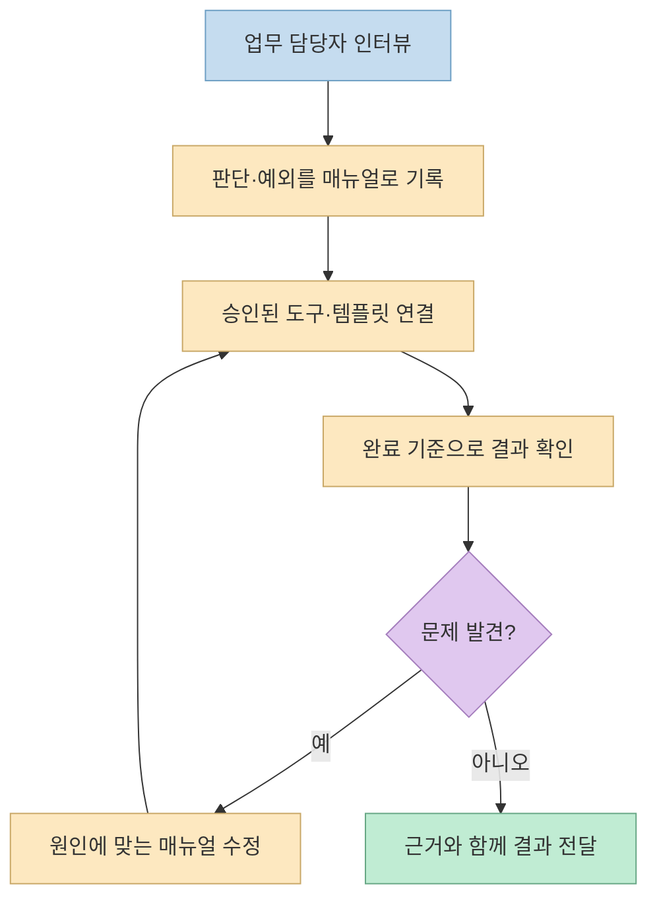
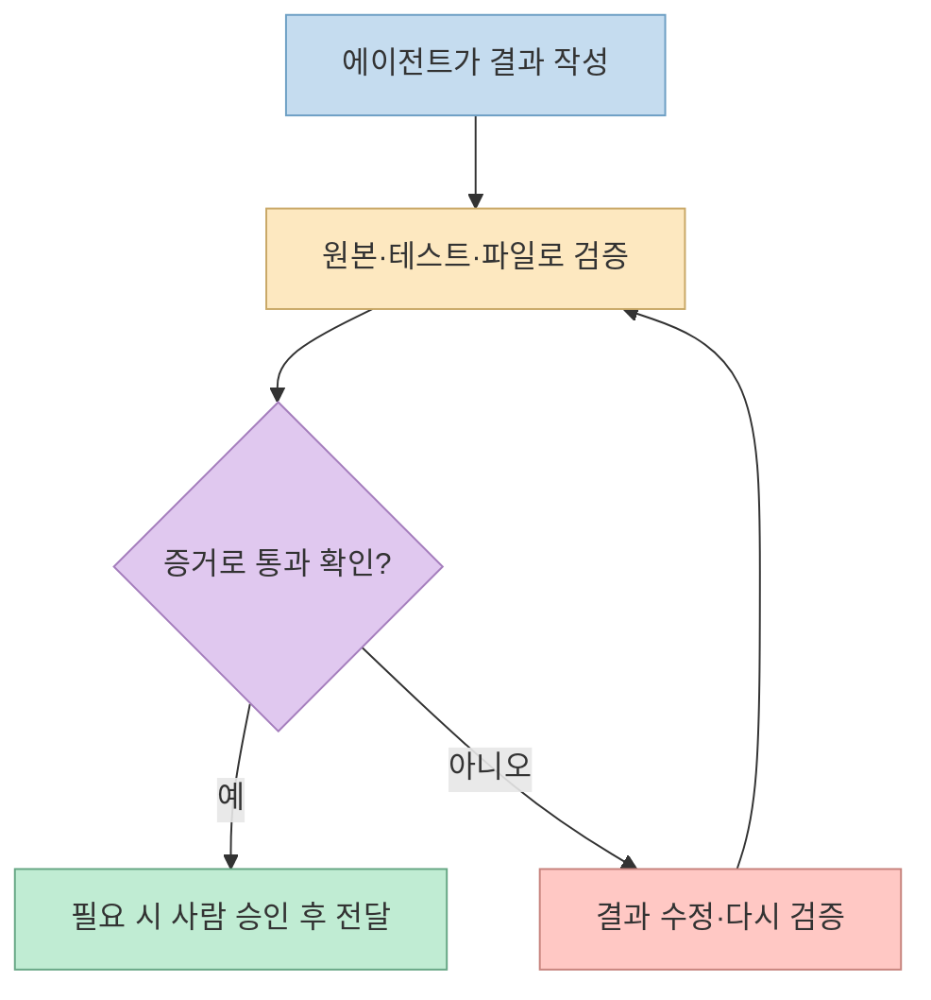

[“이제 AI 에이전트는 만들지 마세요”라는 쇼츠](https://youtube.com/shorts/b557YVr4mrc?si=ij6ZauQP2pndUNI8)는 작업마다 에이전트를 만드는 대신 **하나의 에이전트에 작업별 매뉴얼을 주자** 고 제안한다. 프로세스·툴박스·검증 기준을 파일로 남기고 오류가 생기면 매뉴얼을 고치는 방법이다. 다만 영상의 “Anthropic 엔지니어들도 에이전트를 만드는 걸 멈췄다”는 도입부는 공식 자료와 대조해야 한다.

<!--more-->

## Sources

- [원본 YouTube Shorts](https://youtube.com/shorts/b557YVr4mrc?si=ij6ZauQP2pndUNI8) — 한국어 자동 생성 자막의 구간을 확인했다. YouTube MCP가 제공되지 않아 자막 API를 대체 경로로 사용했다.
- [The Actionable AI: Stop Building AI Agents (The AI Delegation Loop)](https://the-actionable-ai.beehiiv.com/p/stop-building-ai-agents-the-ai-delegation-loop) — 영상의 핵심 구도와 네 단계가 일치하는 원문 뉴스레터.
- [Anthropic: 효과적인 에이전트 만들기](https://www.anthropic.com/research/building-effective-agents) · [Agent Skills 설명](https://www.anthropic.com/research/equipping-agents-for-the-real-world-with-agent-skills) — 단순한 구조부터 시작하는 원칙과 스킬 구조.
- [Claude: 서브에이전트를 메인 루프로 접을 때](https://claude.com/resources/articles/building-agents-when-to-fold-subagents-into-your-main-agent-loop) · [Anthropic: 내부 에이전트 운용 측정](https://www.anthropic.com/institute/measuring-pace-of-ai-development) — 단일·다중 구조의 실제 적용 범위.
- [기존 상세 글: AI 위임 루프](https://gyuha.com/post/2026/10/2026-10-02-ai-delegation-loop-playbook-process-toolbox-proof/) — 매뉴얼 폴더 구성과 주간 고객 업데이트 예시. 이 글은 그 내용을 반복하기보다 영상의 주장 검증에 집중한다.

## 1. ‘Anthropic이 에이전트 제작을 멈췄다’는 사실인가

쇼츠는 [0~9초](https://youtu.be/b557YVr4mrc?t=0)에 Anthropic 엔지니어들이 몇 달 전부터 에이전트를 만드는 일을 멈췄다고 단정한다. 같은 주장은 [The Actionable AI 뉴스레터](https://the-actionable-ai.beehiiv.com/p/stop-building-ai-agents-the-ai-delegation-loop)에도 등장한다. 하지만 뉴스레터는 이 회사 전체의 중단을 입증할 내부 정책이나 자료를 제시하지 않는다. 오히려 [Anthropic의 공식 발표](https://www.anthropic.com/institute/measuring-pace-of-ai-development)는 **2026년 8월 기준** 가장 많이 쓰는 내부 플랫폼 하나에서 연구·엔지니어링 에이전트 약 3만 개가 동시에 활동했다고 밝혔다. 따라서 “Anthropic은 더 이상 에이전트를 만들거나 쓰지 않는다”는 해석은 공식 자료와 맞지 않는다.

공식 권고는 **에이전트를 없애라** 가 아니라 **필요한 만큼만 복잡하게 만들라** 에 가깝다. [Anthropic의 에이전트 설계 글](https://www.anthropic.com/research/building-effective-agents)은 가장 단순한 해법부터 시작하고 필요할 때만 복잡도를 높이라고 한다. 더 최근의 [Claude 글](https://claude.com/resources/articles/building-agents-when-to-fold-subagents-into-your-main-agent-loop)은 일부 서브에이전트 역할을 하나의 메인 루프와 점진적으로 불러오는 스킬·도구로 옮길 수 있다고 설명하면서도, 독립 연구 경로나 경계가 분명한 작업에는 서브에이전트를 유효한 선택지로 남긴다.

## 2. 쇼츠가 제안하는 ‘AI 위임 루프’ 네 단계

영상은 [29~34초](https://youtu.be/b557YVr4mrc?t=29)에 하나의 에이전트와 작업별 매뉴얼을 제안한다. 이어 **① 인터뷰로 업무 프로세스 파악**([36초](https://youtu.be/b557YVr4mrc?t=36)), **② 승인된 스크립트·템플릿을 툴박스에 저장**([43초](https://youtu.be/b557YVr4mrc?t=43)), **③ 완료 기준을 매뉴얼에 명시**([55초](https://youtu.be/b557YVr4mrc?t=55)), **④ 실패하면 채팅만 고치지 말고 매뉴얼을 수정**([66초](https://youtu.be/b557YVr4mrc?t=66))하라고 설명한다. 이 네 단계는 [뉴스레터](https://the-actionable-ai.beehiiv.com/p/stop-building-ai-agents-the-ai-delegation-loop)의 process·toolbox·proof·loop와 대응한다. **‘AI Delegation Loop’는 해당 글 작성자가 제안한 방법의 이름** 이지 Anthropic의 공식 제도명은 아니다.

[Anthropic의 Agent Skills 설명](https://www.anthropic.com/research/equipping-agents-for-the-real-world-with-agent-skills)은 지침·스크립트·자료를 폴더에 묶고 필요할 때 불러오는 방식을 소개한다. 이것이 영상의 “매뉴얼+툴박스”와 접점이 있다. 다만 영상처럼 인터뷰 한 번으로 “나 없이도 전부 돌아간다”고 가정하면 안 된다. 업무의 예외, 권한, 변경되는 데이터와 사람의 승인 범위를 문서화한 뒤 실제 사례에서 반복 검증해야 한다.

## 3. 검증 기준은 자기 평가보다 외부 증거여야 한다

영상은 [55~65초](https://youtu.be/b557YVr4mrc?t=55)에 완료 정의를 매뉴얼에 넣어 에이전트가 결과를 내기 전에 스스로 검사하게 하라고 권한다. 좋은 출발점이지만 **에이전트의 “확인했습니다”라는 말 자체가 검증 증거는 아니다.** 원본 수치와 결과 수치를 대조하거나, 파일 생성 여부를 읽거나, 테스트·링크 검사처럼 결과와 독립된 증거가 필요하다. 고위험 작업에서는 외부 검사나 사람의 승인 절차도 유지해야 한다. [Claude의 단일 루프 설계 글](https://claude.com/resources/articles/building-agents-when-to-fold-subagents-into-your-main-agent-loop)은 검증·승인 게이트를 도구와 하네스에 둘 수 있다고 설명한다.

오류를 매뉴얼에 남기는 원칙도 **검증된 규칙만** 축적해야 효과가 있다. 한 번의 예외를 모든 작업에 적용하는 규칙으로 만들면 매뉴얼이 오히려 잘못된 행동을 강제한다. 실패한 사례, 수정 이유, 적용 범위, 재현 테스트를 함께 남기는 편이 안전하다.

## 4. 단일 에이전트와 다중 에이전트는 언제 갈리는가

영상의 [18~32초](https://youtu.be/b557YVr4mrc?t=18)는 업무마다 에이전트를 따로 만들고 연결하면 시스템이 복잡해진다고 지적한다. 이는 특히 서로 같은 파일과 맥락을 읽으면서 역할 이름만 다른 에이전트들이 반복적으로 내용을 전달하는 구조에 해당한다. [Claude의 공식 글](https://claude.com/resources/articles/building-agents-when-to-fold-subagents-into-your-main-agent-loop)은 이런 핸드오프에서 정보가 손실될 수 있고, 일부 고객 사례에서는 단일 루프가 더 빨랐다고 설명한다. 하지만 그 사례의 속도 개선을 모든 업무에 일반화할 수는 없다.

반대로 **독립적으로 조사할 수 있는 주제, 인터페이스가 분명한 별도 컴포넌트, 블랙박스 검증** 처럼 작업 경계가 명확하면 서브에이전트가 유용할 수 있다. 하나의 에이전트에 매뉴얼을 몰아넣는 것도 문맥 과부하를 만들 수 있으므로, [Anthropic이 설명하는 점진적 공개](https://www.anthropic.com/research/equipping-agents-for-the-real-world-with-agent-skills)처럼 필요한 스킬만 불러오도록 설계해야 한다. 결론은 **항상 하나** 도 **항상 여러 개** 도 아니다. 먼저 단순한 구조에서 품질·시간·비용을 측정하고, 분리가 이득인 경우에만 늘리는 것이다.

## 실전 적용 포인트

1. 반복 업무 하나를 고르고 입력·판단·예외·완료 상태를 인터뷰로 적는다. 이미 작성한 [위임 루프 상세 글](https://gyuha.com/post/2026/10/2026-10-02-ai-delegation-loop-playbook-process-toolbox-proof/)의 매뉴얼 구조를 참고할 수 있다.
2. 승인된 스크립트·템플릿만 연결하고, 비밀번호나 고객 비밀값을 매뉴얼 파일에 복사하지 않는다.
3. 결과를 원천 자료와 대조할 수 있는 검사 항목을 만든다. 확인하지 못한 항목은 통과로 표기하지 않는다.
4. 몇 차례 실행해 실제로 막힌 규칙만 수정한다. 수정 전후의 성공률·수정 횟수·비용을 기록한다.
5. 독립 작업을 병렬로 돌려야 하거나 별도 검증자가 필요할 때만 다중 에이전트 구조를 비교 시험한다.

## 핵심 요약

- ‘Anthropic이 에이전트 제작을 멈췄다’는 영상·뉴스레터의 강한 주장은 공식 자료로 뒷받침되지 않으며, Anthropic은 내부 에이전트 운용을 공개했다.
- 실용적인 제안은 **작업별 매뉴얼, 재사용 도구, 확인 가능한 완료 기준, 실패 후 매뉴얼 수정** 이다.
- 단일 에이전트가 출발점이 될 수 있지만, 독립된 맥락과 명확한 경계가 있으면 다중 에이전트도 여전히 유효하다.

## 결론

“에이전트를 만들지 말라”는 자극적인 표현보다 **업무 지식을 재사용 가능한 절차로 만들고, 외부 증거로 결과를 검증하라** 는 조언이 오래간다. 에이전트 수는 그 다음 문제다. 먼저 한 작업을 단순한 루프로 안정화하고, 실제 측정 결과가 필요성을 보여 줄 때만 구조를 확장하자.
