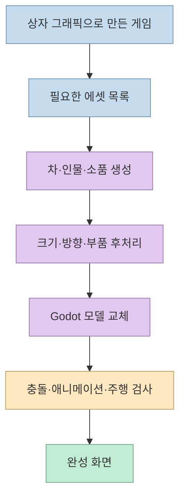
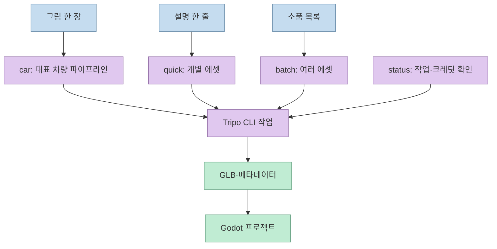
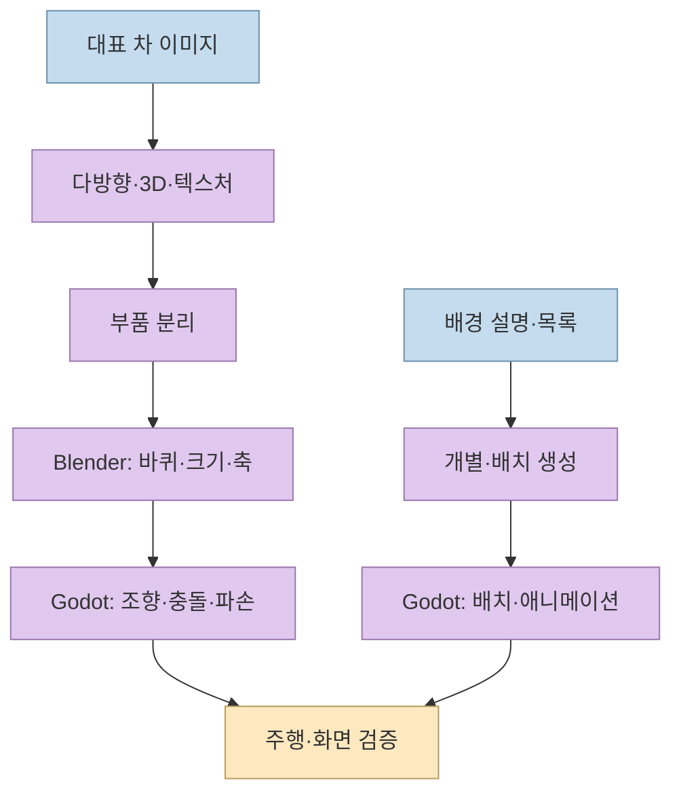

[M.G.D의 쇼츠](https://youtube.com/shorts/rhIkJIXx7Gs?si=-TxIjbSNLrVksdBi)는 테슬라 로드스터 시연에서 착안한 주차 게임의 상자 그래픽을 Tripo로 만든 3D 에셋으로 교체한 과정을 보여준다. 영상 설명에는 **Tripo의 제작비·크레딧 지원을 받은 광고** 라고 표시되어 있다. 영상의 주장과 별개로, 제작자가 공개한 [게임·툴킷 저장소](https://github.com/mgd-midnightgamedevs/ai-game-asset-kit)를 읽으면 실제 파일 구조, 네 가지 명령, 비용이 드는 단계와 재사용 제한을 확인할 수 있다.

<!--more-->

## Sources

- [원본 유튜브 쇼츠](https://youtube.com/shorts/rhIkJIXx7Gs?si=-TxIjbSNLrVksdBi) — `youtube-transcript-api`로 자막을 확인했다. YouTube 전용 MCP가 연결되지 않아 대체 경로를 사용했다. 영상 설명의 광고 표시와 저장소 링크도 확인했다.
- [제작자 공개 저장소](https://github.com/mgd-midnightgamedevs/ai-game-asset-kit), [실제 에이전트 요청 기록](https://github.com/mgd-midnightgamedevs/ai-game-asset-kit/blob/main/docs/prompts.md), [툴킷 코드](https://github.com/mgd-midnightgamedevs/ai-game-asset-kit/blob/main/game/tools/tripo_kit.py) — Godot 게임, 생성 명령, 중단 후 재개, 라이선스의 1차 자료.
- [Tripo CLI 공식 문서](https://developers.tripo3d.com/en/docs/cli), [Tripo API 크레딧 안내](https://developers.tripo3d.ai/en/pricing) — 로그인·문서 출력·배치 작업·크레딧 사용의 공식 설명.

## 상자 게임에 필요한 것은 모델 하나가 아니라 에셋 파이프라인이다

영상의 출발점은 흡착 팬과 추진기를 써서 앞차보다 먼저 주차 칸을 차지하는 게임이다. 제작자는 AI로 기본 플레이를 만들었지만 차·주차 차량·인물이 상자처럼 보였고, 이를 실제 3D 에셋으로 바꾸려 했다고 설명한다. 공개 저장소에는 **Godot 4.7 게임** 과 `game/tools/tripo_kit.py`가 함께 들어 있다. 툴킷은 Tripo CLI를 호출해 에셋을 만들고, 게임 폴더에 맞는 모델·메타데이터로 후처리한다. 이는 "프롬프트 한 줄로 완성된 게임"이 아니라 **기존 게임의 대체 가능한 그래픽 자산을 제작한 사례** 다. [영상 0~20초](https://youtu.be/rhIkJIXx7Gs?t=0), [공개 저장소](https://github.com/mgd-midnightgamedevs/ai-game-asset-kit)

제작자는 영상에서 총 23개 에셋을 만들었다고 말한다. 저장소 README는 브라우저 체험판과 Godot 프로젝트를 공개하지만, 웹 판은 전체 게임이 아닌 일부 단계만 담았고 PC 키보드를 전제로 한다. 따라서 "영상 속 완성본을 어떤 기기에서나 동일하게 플레이할 수 있다"고 확대 해석할 수 없다. [영상 73~90초](https://youtu.be/rhIkJIXx7Gs?t=73), [공개 저장소 README](https://github.com/mgd-midnightgamedevs/ai-game-asset-kit)

## AI가 만든 것은 Tripo 자체가 아니라 그 위의 얇은 툴킷이다

영상은 Tripo CLI를 터미널용 도구로 소개하고, AI가 문서를 읽은 뒤 게임 에셋용 툴킷을 작성했다고 설명한다. 실제 요청 기록에는 먼저 `tripo docs --llm`과 게임 에셋 예시 문서를 읽고, 하나의 Python 파일에 `car`, `quick`, `batch`, `status` 네 명령을 만들도록 지시한 내용이 있다. 공식 Tripo CLI도 에이전트가 사용할 수 있는 문서 출력, 생성, 배치, 잔액 확인 명령을 제공한다. 즉 **AI가 3D 모델 생성 엔진을 새로 만든 것이 아니라**, 기존 CLI와 Godot 사이의 반복 작업을 자동화하는 래퍼를 짠 것이다. [영상 20~46초](https://youtu.be/rhIkJIXx7Gs?t=20), [실제 요청 기록](https://github.com/mgd-midnightgamedevs/ai-game-asset-kit/blob/main/docs/prompts.md), [Tripo CLI 문서](https://developers.tripo3d.com/en/docs/cli)

- `car`: 대표 차량의 콘셉트 이미지를 여러 방향 이미지·3D 모델·텍스처·분리된 부품으로 처리하고 Blender에서 크기·축·바퀴 위치를 맞춘다.
- `quick`: 텍스트 설명으로 주차 차량, 인물, 소품 등을 개별 생성한다. 인물에는 리깅과 동작을 추가할 수 있다.
- `batch`: 목록 파일의 여러 소품을 배치 작업으로 처리한다.
- `status`: 만들어진 자산과 크레딧 상태를 확인한다.

네 명령의 의미는 [툴킷 README](https://github.com/mgd-midnightgamedevs/ai-game-asset-kit)와 [실제 요청 기록](https://github.com/mgd-midnightgamedevs/ai-game-asset-kit/blob/main/docs/prompts.md)에 근거한다. 자막의 `퀵클` 같은 표기는 음성 인식 오류로 보이며, 실제 명령 이름은 `quick`이다. 영상은 작성 당시 툴킷을 894줄이라고 말하지만, 확인한 공개 파일은 **899줄** 이었다. 줄 수는 파일이 바뀌면 달라지는 스냅샷 숫자이며 기능의 품질 지표는 아니다. [영상 31~45초](https://youtu.be/rhIkJIXx7Gs?t=31), [툴킷 코드](https://github.com/mgd-midnightgamedevs/ai-game-asset-kit/blob/main/game/tools/tripo_kit.py)

## 대표 차량과 배경 자산은 후처리의 깊이가 다르다

영상의 대표 차량은 바퀴가 따로 회전하고, 충돌하면 범퍼와 미러가 떨어지며, 부품마다 색을 바꿀 수 있어야 했다. 공개 요청 기록에는 그림에서 네 방향 이미지를 만들고 3D 형태와 텍스처를 생성한 뒤, 메시를 나누고 Blender에서 바퀴·크기·방향을 맞추는 단계가 적혀 있다. 이어 Godot의 기존 상자 차량을 모델로 교체하고, 충돌 모양·서스펜션 위치·주차 칸 크기를 함께 조정하도록 했다. **3D 생성 성공과 게임에서 정상적으로 달리는 것은 다른 검증 단계** 다. [영상 47~63초](https://youtu.be/rhIkJIXx7Gs?t=47), [실제 요청 기록](https://github.com/mgd-midnightgamedevs/ai-game-asset-kit/blob/main/docs/prompts.md)

반면 길가의 자동차·인물은 텍스트 설명으로, 가로등과 벤치는 목록으로 생성했다. 인물에는 걷기·화내기 동작을 붙이는 별도 리깅·애니메이션 작업이 포함된다. 영상의 "글 한 줄이면 3D가 나온다"는 말은 **입력 인터페이스가 짧다**는 뜻이지, 게임 엔진에 알맞은 크기·충돌·애니메이션이 항상 자동으로 맞는다는 보증은 아니다. 제작자는 실제로 대표 차량 모델의 바퀴와 크기를 맞추고 게임 테스트를 요구했다. [영상 63~83초](https://youtu.be/rhIkJIXx7Gs?t=63), [실제 요청 기록](https://github.com/mgd-midnightgamedevs/ai-game-asset-kit/blob/main/docs/prompts.md)

## ‘크레딧 없이 테스트’와 실제 생성 비용을 구분한다

영상은 AI가 크레딧을 쓰지 않고 시험하며 버그를 고쳤다고 말한다. 이는 **툴킷 코드의 일부 검사** 와 실제 Tripo 생성 작업을 구분해서 읽어야 한다. 공개 README는 Tripo 계정이 필요하고, 에셋 생성 단계에 API 크레딧이 든다고 적는다. 저장소가 공개한 프로젝트 전체 에셋의 사용량은 약 1,200크레딧이지만, 이는 그 프로젝트의 기록일 뿐 다른 환경의 예상 청구액이 아니다. Tripo 공식 문서도 `--dry-run`으로 작업 계획을 확인하는 것과 실제 생성 과금을 구별한다. [영상 31~40초](https://youtu.be/rhIkJIXx7Gs?t=31), [공개 저장소 README](https://github.com/mgd-midnightgamedevs/ai-game-asset-kit), [Tripo CLI 문서](https://developers.tripo3d.com/en/docs/cli)

툴킷은 이미 완료한 유료 단계를 상태 파일에 남겨 같은 입력으로 재실행할 때 건너뛰고, 중단된 작업은 작업 ID를 이용해 이어서 기다리도록 설계됐다. 이 장치는 불필요한 재생성을 줄이지만 모든 네트워크 실패에서 중복 청구가 불가능하다는 보증은 아니다. 공식 문서는 생성 요청 직후 네트워크 오류나 시간 초과가 나면 서버 작업이 이미 만들어졌을 수 있으므로, 곧바로 다시 제출하지 말고 계정과 작업 상태를 확인하라고 안내한다. [툴킷 코드](https://github.com/mgd-midnightgamedevs/ai-game-asset-kit/blob/main/game/tools/tripo_kit.py), [Tripo CLI 문서](https://developers.tripo3d.com/en/docs/cli)

## 공개 저장소라고 모델까지 자유롭게 재사용할 수는 없다

제작자 저장소는 게임 코드와 툴킷을 MIT로 공개하지만, **Tripo로 만든 3D 모델은 그 라이선스 범위에 포함하지 않는다** 고 명시한다. 저장소에 포함된 모델을 다른 프로젝트에 가져다 쓰는 대신 툴킷으로 직접 다시 만들라고 안내한다. 또한 영상 설명에는 제작비와 크레딧 지원 사실, 가입·충전 혜택 링크가 있다. 이 글은 할인이나 크레딧 수량을 권하지 않으며, 혜택은 조건이 바뀔 수 있으므로 가입·결제 전 공식 약관과 현재 가격을 확인해야 한다. [공개 저장소 README](https://github.com/mgd-midnightgamedevs/ai-game-asset-kit), [원본 영상](https://youtube.com/shorts/rhIkJIXx7Gs?si=-TxIjbSNLrVksdBi), [Tripo 가격표](https://developers.tripo3d.ai/en/pricing)

## 실전 적용 포인트

1. **게임에서 필요한 역할부터 나눈다.** 대표 차량처럼 바퀴·파손·조향이 필요한 자산과 정적인 거리 소품은 서로 다른 파이프라인으로 계획한다. [실제 요청 기록](https://github.com/mgd-midnightgamedevs/ai-game-asset-kit/blob/main/docs/prompts.md)
2. **생성 전 비용을 확인한다.** `status`나 Tripo 잔액 확인으로 남은 크레딧을 보고, 중단된 작업은 먼저 상태를 조회한다. API 키는 코드·채팅·Git에 넣지 않는다. [공개 저장소 README](https://github.com/mgd-midnightgamedevs/ai-game-asset-kit), [Tripo CLI 문서](https://developers.tripo3d.com/en/docs/cli)
3. **생성물과 게임 동작을 별도로 검증한다.** GLB가 만들어졌어도 모델 축·크기·바퀴·충돌·애니메이션·성능을 Godot에서 확인한다. [실제 요청 기록](https://github.com/mgd-midnightgamedevs/ai-game-asset-kit/blob/main/docs/prompts.md)
4. **코드와 3D 모델의 권리를 구분한다.** 저장소의 MIT 코드 라이선스를 모델 재배포 허가로 확대 해석하지 않는다. [공개 저장소 README](https://github.com/mgd-midnightgamedevs/ai-game-asset-kit)

## 핵심 요약

- 쇼츠는 Tripo 제작 지원을 받은 광고이며, 공개 저장소에서 Godot 게임과 `tripo_kit.py`를 확인할 수 있다.
- 네 명령 `car`, `quick`, `batch`, `status`는 Tripo CLI를 게임 에셋 제작 흐름에 맞게 묶은 래퍼다.
- 대표 차량은 이미지 생성 뒤에도 부품 분리·Blender 후처리·Godot 물리 검사가 필요했다.
- 툴킷 테스트가 무과금일 수 있어도 실제 3D 생성은 API 크레딧을 사용한다.
- 공개 코드의 MIT 라이선스가 포함된 Tripo 모델의 재사용권까지 뜻하지는 않는다.

## 결론

이 사례의 재현 가능한 교훈은 "AI가 3D를 만든다"보다 **생성 서비스, 후처리, 게임 통합, 비용·권리 검증을 하나의 반복 가능한 흐름으로 묶었다** 는 점이다. 처음에는 상자 그래픽으로 플레이를 확인하고, 필요한 자산부터 단계적으로 교체하는 접근이 가장 분명하게 드러난다.
