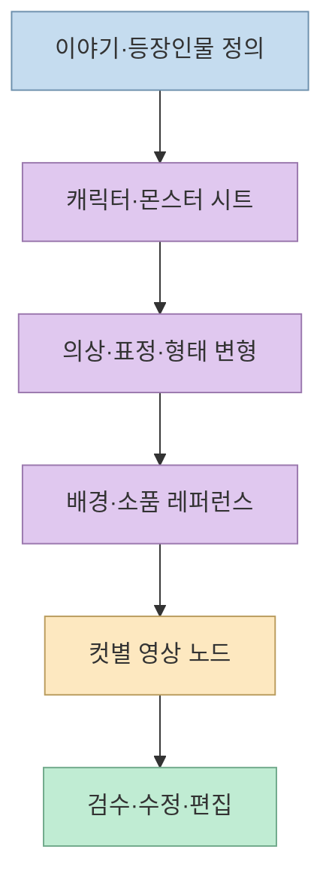
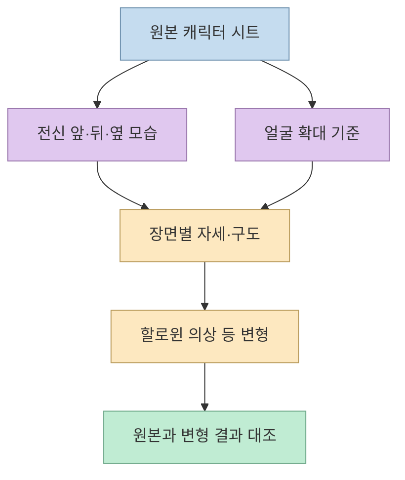
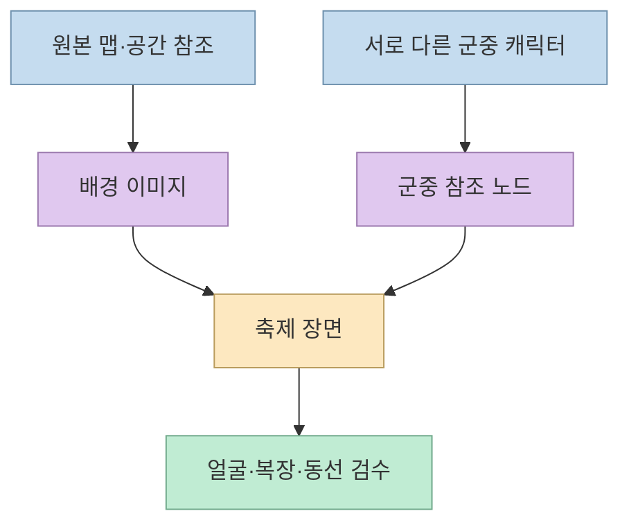
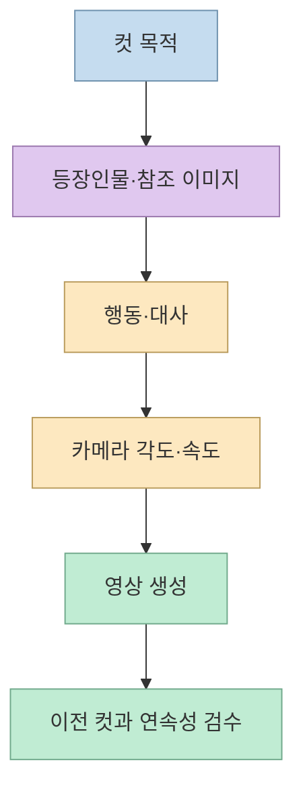
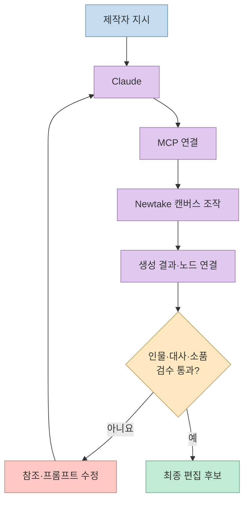

[성공지식백과의 영상](https://youtu.be/EXFD2VzpXso?si=O2WZ_2iSQSy47WC8)은 게임풍 할로윈 AI 드라마를 예로 들어, **캐릭터 시트 → 변형 이미지 → 배경·소품 → 컷별 영상 → Claude 연동** 과정을 보여준다. 핵심은 한 번의 프롬프트로 완성 영상을 만드는 것이 아니라, 각 장면이 참조할 자료와 연결 관계를 캔버스에 남기는 데 있다. 발표자는 약 30시간의 시행착오를 겪었다고 말한다. 이는 제작자의 경험담이지, 같은 결과를 내는 데 필요한 표준 작업 시간은 아니다. [영상 00:51](https://youtu.be/EXFD2VzpXso?t=51), [영상 01:08](https://youtu.be/EXFD2VzpXso?t=68)

<!--more-->

## Sources

- [원본 영상: AI 드라마 제작, 클로드가 짜준 자동화 워크플로우](https://youtu.be/EXFD2VzpXso?si=O2WZ_2iSQSy47WC8) — 한국어 자동 생성 자막을 `youtube-transcript-api`로 확인하고 장면별 시간표를 대조했다. 자동 자막에서 모델명·인물명 일부가 불명확하므로 확정하지 않았다.
- [Newtake 공식 사이트](https://www.newtake.ai/) — 이미지·영상·오디오·편집 도구와 통합 기능의 공개 소개. 영상 속 특정 모델, 요금·할인율, 연결 UI가 현재도 동일하다는 근거로 사용하지 않았다.
- [Anthropic의 MCP 설명](https://claude.com/resources/articles/what-is-model-context-protocol) — Claude가 외부 도구에 연결되는 일반적 구조의 배경 자료. 영상의 Newtake 연결이 실제로 제공하는 모든 기능을 보증하는 문서는 아니다.

## 캔버스는 ‘생성 버튼’보다 자료 흐름을 관리한다

영상에서 발표자는 캔버스의 노드와 연결선을 이용해 인물·몬스터의 원본 이미지, 변형 결과, 영상 컷을 한 공간에서 확인한다. 어떤 영상 노드가 어떤 이미지를 참조했는지 시각적으로 따라갈 수 있다는 점을 장점으로 설명한다. **자동화 대상** 은 이미지·영상 모델 자체뿐 아니라 노드 생성, 참조 연결, 결과 업로드 같은 반복 작업이다. 따라서 캔버스를 작업 이력의 지도로 이해하는 편이 정확하다. [영상 01:39](https://youtu.be/EXFD2VzpXso?t=99), [영상 03:12](https://youtu.be/EXFD2VzpXso?t=192), [Newtake 공식 사이트](https://www.newtake.ai/)

이 연결 구조가 유용한 이유는 수정의 출처를 잃지 않기 때문이다. 발표자는 해골 기사 캐릭터의 망토가 어색하자 Claude에 수정을 요청하고, 수정 이미지가 캔버스에서 기존 참조와 함께 보이는 과정을 보여준다. 그러나 **연결선이 있다는 사실과 화면 속 일관성이 보장된다는 사실은 다르다**. 수정된 시트가 이전 컷의 인물과 어긋나면 그 컷도 다시 확인해야 한다. 뒤 문장은 영상의 작업 방식에서 도출한 검수상의 함의다. [영상 06:11](https://youtu.be/EXFD2VzpXso?t=371), [영상 06:34](https://youtu.be/EXFD2VzpXso?t=394)

## 캐릭터 시트: ‘같은 인물’을 여러 컷에 넘기는 기준

발표자는 주인공과 몬스터를 만들 때 **앞모습·뒷모습·얼굴 확대**처럼 서로 다른 시점을 한 시트에 담고, 영상 생성 시 여러 카메라 각도에서 일관된 외형을 얻으려 한다. 초록 버섯 몬스터에는 앞모습·옆모습·확대 모습을 준비하고, 그 원본을 참조해 할로윈 미라 복장으로 변형한다. 같은 원본에서 복장만 바뀌게 하려는 방식이다. 영상의 자동 자막에서는 이미지 모델명이 명료하게 인식되지 않으므로 특정 모델이 필수라고 단정하지 않는다. [영상 02:22](https://youtu.be/EXFD2VzpXso?t=142), [영상 02:50](https://youtu.be/EXFD2VzpXso?t=170), [영상 03:02](https://youtu.be/EXFD2VzpXso?t=182)

얼굴 참조가 두 군데에 있으면 생성 모델이 전신 이미지의 작은 얼굴과 확대 이미지의 얼굴 중 어느 것을 기준으로 삼을지 혼동할 수 있다고 발표자는 설명한다. 그의 해결책은 전신 얼굴에 빗금을 치거나 얼굴 부분을 비워 두고, 확대 이미지를 얼굴의 기준으로 쓰는 것이다. 이 빗금은 이미지 모델에게 다시 그리라고 하기보다, **기존 이미지를 내려받아 코드로 표시한 뒤 업로드**하는 방식으로 Claude Code에 맡겼다고 한다. 이는 영상 제작자가 사용한 실무 팁이지, 모든 이미지 모델에서 입증된 일반 규칙은 아니다. [영상 03:49](https://youtu.be/EXFD2VzpXso?t=229), [영상 04:23](https://youtu.be/EXFD2VzpXso?t=263), [영상 04:34](https://youtu.be/EXFD2VzpXso?t=274)

캐릭터의 재질감도 의도적으로 나눴다. 발표자는 게임풍 NPC와 몬스터가 실사 인물처럼 보이지 않도록 **CG 같은 크리처**라는 방향을 프롬프트에 넣었다고 설명한다. 해골 기사 캐릭터는 기존 몬스터 참조에서 체형·망토를 수정해 주인공 역할에 맞게 바꿨다. 이름이나 원본 캐릭터의 세부 식별은 자동 자막이 불명확한 구간이 있으므로 여기서는 제작 방식만 다룬다. 게임 원작 이미지와 캐릭터를 실제 콘텐츠에 사용하는 경우에는 별도로 권리·이용 조건을 확인해야 한다. [영상 05:06](https://youtu.be/EXFD2VzpXso?t=306), [영상 05:39](https://youtu.be/EXFD2VzpXso?t=339), [영상 06:11](https://youtu.be/EXFD2VzpXso?t=371)

## 배경과 군중: 생성 모델의 빈칸을 레퍼런스로 줄인다

배경은 막연히 ‘게임 마을 같은 장면’이라고 요청하는 대신, 발표자가 말하는 **원본 게임 맵을 먼저 참조**하고 이를 바탕으로 실사풍 배경을 만든다. 그는 이 방식이 의도한 마을 분위기를 살렸다고 평가한다. 또한 마을 축제의 군중을 한 번에 생성하면 비슷한 얼굴이 반복되는 경험을 했기 때문에, 여러 인물을 담은 별도 노드를 만들어 축제 영상에서 참조하도록 했다. 이는 발표자의 사례에서 관찰된 개선 시도이며, 모든 생성 결과가 고유한 얼굴을 갖는다는 보장은 아니다. [영상 07:04](https://youtu.be/EXFD2VzpXso?t=424), [영상 08:52](https://youtu.be/EXFD2VzpXso?t=532)

소품과 글자도 영상 모델의 즉흥적 생성에만 맡기지 않는다. 발표자는 영상 속 글자가 깨지는 문제를 줄이려고 **글자가 들어간 이미지를 먼저 만들고** 이를 영상의 참조 재료로 사용했다고 설명한다. 다만 최종 영상에서 모든 프레임의 글자가 정확한지는 별도로 확인해야 한다. 이처럼 사전에 만든 자료는 생성의 자유도를 좁히는 동시에, 준비·수정해야 할 자산 수를 늘린다. [영상 09:29](https://youtu.be/EXFD2VzpXso?t=569), [영상 09:44](https://youtu.be/EXFD2VzpXso?t=584)

## 컷별 프롬프트: 등장인물·동작·카메라를 분리한다

이미지 자료를 준비한 다음에는 컷마다 **누가 등장하는지, 무슨 행동을 하는지, 카메라가 어디서 보는지**를 구분해 적는다. 영상은 축제 마을에서 슬라임이 지나가고, 지붕 뒤 캐릭터가 보이며, 주인공이 거리를 지나가는 컷들을 예로 든다. 발표자는 같은 이야기 안에서도 올려다보는 시점 등 카메라 각도를 명시해야 한다고 강조한다. 단일 장면의 설명만이 아니라 컷 간 연속성을 설계하는 단계다. [영상 09:49](https://youtu.be/EXFD2VzpXso?t=589), [영상 10:03](https://youtu.be/EXFD2VzpXso?t=603), [영상 10:19](https://youtu.be/EXFD2VzpXso?t=619)

한국어 대사는 화자별로 **한 줄씩** 명시했다고 한다. 발표자는 생성된 음성의 발음이 뭉개질 수 있다고 지적하고, 영상에 보이는 자막은 **후편집으로 따로 넣었다**고 밝힌다. 따라서 장면의 한국어 음성과 화면 자막을 하나의 자동 생성 결과로 이해하면 안 된다. 대사 검수에는 화자 배정·발음·자막 일치 여부가 각각 필요하다. [영상 10:31](https://youtu.be/EXFD2VzpXso?t=631), [영상 10:44](https://youtu.be/EXFD2VzpXso?t=644), [영상 10:53](https://youtu.be/EXFD2VzpXso?t=653)

전투 컷에는 더 구체적인 참조가 들어간다. 발표자는 ‘더블샷’이라는 기술명만 적으면 효과를 임의로 그릴 수 있어 **화살 두 개의 효과를 별도 자료로 제공**했고, 몬스터를 잡은 뒤 떨어질 사탕도 소품으로 만들었다고 설명한다. 두 화살이 나란히 움직이는 장면에는 슬로모션을 명시했다. 이를 일반화하면 중요한 동작일수록 **이름만 쓰지 말고 관찰 가능한 결과를 지정**해야 한다는 제작 원칙이다. 단, 결과가 매번 정확히 재현된다는 보장은 영상에서 입증되지 않았다. [영상 11:02](https://youtu.be/EXFD2VzpXso?t=662), [영상 11:21](https://youtu.be/EXFD2VzpXso?t=681), [영상 11:40](https://youtu.be/EXFD2VzpXso?t=700)

## Claude 연결: 반복 조작을 줄이되 검수는 남는다

발표자는 노드를 일일이 만들고 업로드한 것이 아니라 Claude와 Newtake를 연결해 작업을 시켰다고 설명한다. 영상 속 연결 경로는 Newtake의 플러그인 화면에서 **MCP 주소를 복사**하고, Claude의 **커스텀 커넥터**에 붙여 넣는 방식이다. MCP는 외부 도구를 AI 클라이언트에 연결하는 공통 구조지만, 이 영상만으로 Newtake의 현재 권한 범위, 자동화 가능한 모든 명령, 최신 연결 UI를 확정할 수는 없다. 실제 연결 전에는 서비스의 최신 안내와 부여되는 접근 권한을 확인해야 한다. [영상 12:00](https://youtu.be/EXFD2VzpXso?t=720), [영상 12:38](https://youtu.be/EXFD2VzpXso?t=758), [Anthropic의 MCP 설명](https://claude.com/resources/articles/what-is-model-context-protocol)

영상 후반에는 유료 플랜과 연간 할인도 권한다. 이는 **발표자의 구매 권유** 이지, 이 글에서 검증한 현재 가격·할인 조건이나 필요한 최소 요금제를 뜻하지 않는다. 영상이 다룬 생성량, 화질, 저장 공간이 독자에게도 필요한지와 실제 비용은 공식 요금 화면에서 따로 확인해야 한다. 무료 또는 낮은 요금제에서 동일한 전체 워크플로우가 불가능하다고 단정할 근거도 영상만으로는 충분하지 않다. [영상 12:53](https://youtu.be/EXFD2VzpXso?t=773), [영상 13:10](https://youtu.be/EXFD2VzpXso?t=790)

## 실전 적용 포인트

직접 실험한다면 전체 드라마보다 **두 인물이 등장하는 짧은 두 컷**부터 시작하는 편이 검증에 유리하다. 첫 컷에서는 얼굴·복장·배경을 고정하고, 둘째 컷에서 카메라 각도와 대사만 바꾼다. 원본 시트, 변형 시트, 배경, 대사, 영상 노드를 분리해 두면 어느 단계에서 일관성이 깨졌는지 추적하기 쉽다. 이 소규모 시험 절차는 영상의 워크플로우를 검증 가능하게 재구성한 제안이며, 발표자가 제시한 필수 순서는 아니다. [영상 02:22](https://youtu.be/EXFD2VzpXso?t=142), [영상 09:49](https://youtu.be/EXFD2VzpXso?t=589), [영상 12:00](https://youtu.be/EXFD2VzpXso?t=720)

검수는 **인물 동일성, 소품 수와 위치, 컷 사이 배경 연속성, 음성 발음, 별도 자막, 원본 자료의 이용 권한** 순으로 기록하면 된다. 특히 생성 영상이 성공한 한 컷만으로 전 과정이 자동화됐다고 평가하지 않는 것이 중요하다. 영상 자체도 망토 수정과 발음·글자 문제를 사례로 보여주므로, 자동화의 성과는 ‘수작업이 사라졌다’가 아니라 ‘반복 조작을 줄이고 수정 이력을 남겼다’는 범위에서 판단할 수 있다. [영상 06:11](https://youtu.be/EXFD2VzpXso?t=371), [영상 09:29](https://youtu.be/EXFD2VzpXso?t=569), [영상 10:53](https://youtu.be/EXFD2VzpXso?t=653)

## 핵심 요약

- 원본·변형·영상 노드를 연결하면 각 컷의 참조 자료와 수정 경로를 추적하기 쉽다. [영상 01:39](https://youtu.be/EXFD2VzpXso?t=99)
- 여러 시점의 캐릭터 시트와 별도 얼굴 기준은 인물 일관성을 위한 발표자의 방법이다. 모든 모델에서의 효과를 보증하지는 않는다. [영상 02:22](https://youtu.be/EXFD2VzpXso?t=142), [영상 03:49](https://youtu.be/EXFD2VzpXso?t=229)
- 컷별로 인물·행동·카메라·대사를 지정하고, 글자와 핵심 효과는 미리 만든 참조 자료로 제공한다. [영상 10:03](https://youtu.be/EXFD2VzpXso?t=603), [영상 11:21](https://youtu.be/EXFD2VzpXso?t=681)
- Claude-MCP 연결은 노드 작업의 자동화를 돕지만, 결과물의 정확성·비용·권리 검토까지 대신하지 않는다. [영상 12:00](https://youtu.be/EXFD2VzpXso?t=720)

## 결론

이 영상의 실용적인 메시지는 **한 번에 긴 영상을 생성하기보다, 재사용할 레퍼런스를 만들고 컷 단위로 연결·검수하라**는 것이다. Claude는 그 과정의 반복 조작을 줄일 수 있지만, 어떤 화면과 이야기가 맞는지 결정하는 일은 제작자에게 남는다.
