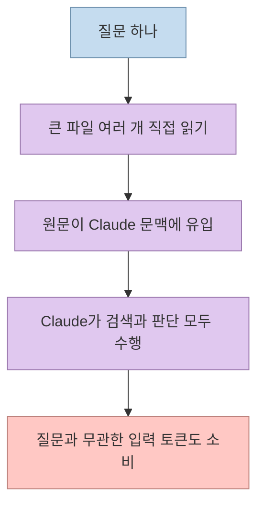
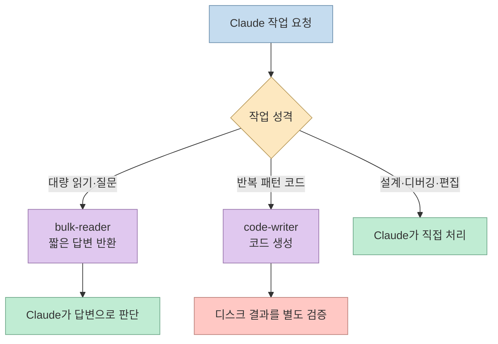
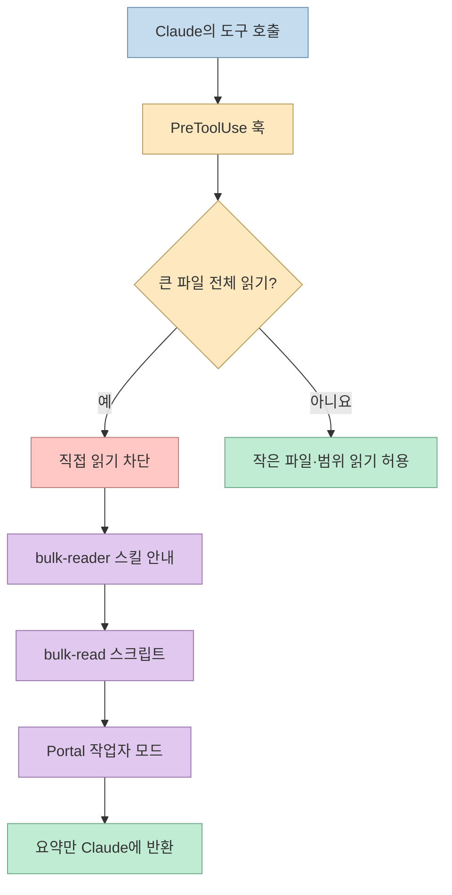
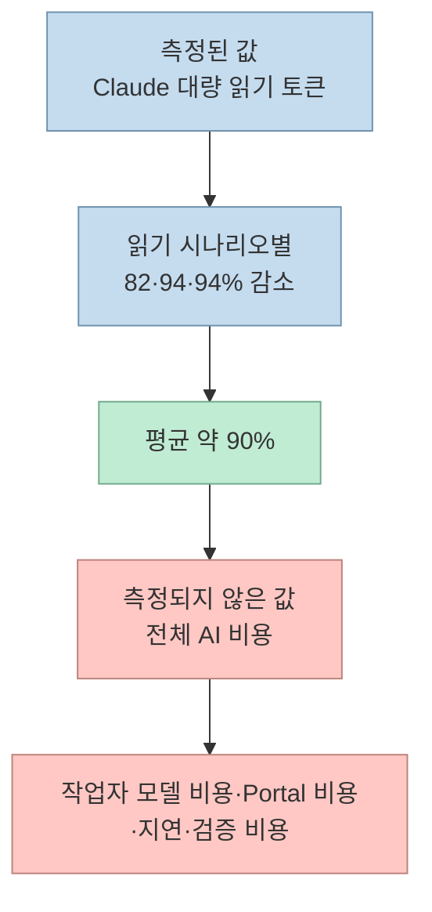
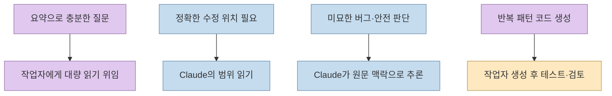

[제이슨의 AI 이야기 영상](https://youtu.be/NGtNf2O4dw0?si=w0N7D255-z5kWYov)은 Spotify의 Claude Code 토큰 절약 사례를 다룬다. 눈길을 끄는 숫자는 **90%**지만, 이를 ‘모든 코딩 작업의 AI 비용이 90% 감소했다’고 읽으면 틀린다. [Spotify 원문](https://portal.spotify.com/blog/portal-by-spotify-cut-my-claude-code-token-usage-by-90)과 [Shunt 저장소](https://github.com/spotify/portal-ai-plugins/blob/main/plugins/shunt/README.md)가 제시한 범위는 **대량 파일 읽기 시나리오에서 Claude가 직접 소비하던 토큰**이다. 핵심은 싼 모델 하나를 고르는 것이 아니라, 읽기·정형 코드 생성과 판단·편집의 경계를 정하고 일부는 훅으로 강제한 설계다. [영상 00:19](https://youtu.be/NGtNf2O4dw0?t=19), [영상 05:40](https://youtu.be/NGtNf2O4dw0?t=340)

<!--more-->

## Sources

- [원본 영상: 스포티파이는 어떻게 클로드 코드 토큰을 90% 줄였나?](https://youtu.be/NGtNf2O4dw0?si=w0N7D255-z5kWYov) — 한국어 자막을 `youtube-transcript-api`로 확인했다. 아래의 영상 주장에는 시간 이동 링크를 붙였다.
- [Spotify Portal 원문: Portal by Spotify cut my Claude Code token usage by 90%](https://portal.spotify.com/blog/portal-by-spotify-cut-my-claude-code-token-usage-by-90) — 작성자의 모드 설정, 라우팅, 측정 범위와 한계.
- [Spotify 공식 Shunt README](https://github.com/spotify/portal-ai-plugins/blob/main/plugins/shunt/README.md) — 훅·스크립트·스킬의 실제 구조, 기본 문턱값, 벤치마크 수치와 설치 전제.

## 문제 정의: 추론이 아니라 입출력이 문맥을 채운다

Spotify 글의 작성자는 메서드 하나를 이해하려고 큰 파일 여러 개를 읽고, 주변 테스트와 형식이 같은 파일을 만드는 일에 최상위 모델의 토큰을 쓰는 상황을 문제로 제시한다. 영상은 이를 ‘판단할 사람에게 서류를 모두 넘겨 읽히는’ 상황에 비유한다. 파일 원문 전체가 주 모델의 문맥에 들어가면, 질문에 필요한 부분이 적어도 읽은 분량만큼 토큰이 소모된다. 따라서 최적화 대상은 **모든 모델 호출**이 아니라 **주 모델로 흘러 들어가는 대량 입력과 정형 출력**이다. [영상 00:45](https://youtu.be/NGtNf2O4dw0?t=45), [영상 01:26](https://youtu.be/NGtNf2O4dw0?t=86), [Spotify 원문](https://portal.spotify.com/blog/portal-by-spotify-cut-my-claude-code-token-usage-by-90)

하지만 ‘읽기’가 언제나 저렴한 모델로 옮겨도 되는 단순 작업은 아니다. 질문이 정확한 수정 위치나 미묘한 동시성 버그를 요구하면, 요약 과정에서 빠진 문맥이 결론을 바꿀 수 있다. Spotify는 바로 그 이유로 편집·디버깅·설계 판단을 위임 대상에서 제외한다. 이 제약을 먼저 이해해야 90%라는 숫자를 오용하지 않는다. [영상 06:44](https://youtu.be/NGtNf2O4dw0?t=404), [Spotify 원문](https://portal.spotify.com/blog/portal-by-spotify-cut-my-claude-code-token-usage-by-90)

## 두 작업자 모드: bulk-reader와 code-writer

Spotify Portal의 **AiKA mode**는 지시문, 모델, 온도, 사용 도구를 설정해 호출하는 작업자다. 원문 사례에서는 두 모드에 Gemini 2.5 Flash와 낮은 온도 설정을 사용했지만, 특정 모델이 구조의 필수 요소는 아니다. Portal에 설정된 다른 모델로 바꿀 수 있다. 영상이 모드를 ‘에이전트판 AWS Lambda’에 비유한 이유는 호출할 때 실행하는 형태를 설명하기 위해서이지, 두 제품의 기능이 같다는 뜻이 아니다. [영상 01:11](https://youtu.be/NGtNf2O4dw0?t=111), [영상 02:38](https://youtu.be/NGtNf2O4dw0?t=158), [Spotify 원문](https://portal.spotify.com/blog/portal-by-spotify-cut-my-claude-code-token-usage-by-90)

**bulk-reader**는 파일과 구체적인 질문을 받아 짧은 구조화 답변을 돌려준다. 파일 원문을 Claude에게 다시 전달하지 않는 것이 설계의 핵심이다. **code-writer**는 명세와 기존 참고 파일을 받아 테스트·설정 뼈대·타입 정의 같은 패턴이 뚜렷한 코드를 생성한다. 출력은 설명이나 Markdown 울타리 없이 코드만 받도록 지시하고, 스크립트는 이를 디스크에 바로 쓸 수 있다. 이는 주 모델의 출력 토큰도 줄일 수 있지만, 동시에 주 모델이 생성된 코드를 **보지 않은 채** 다음 단계로 넘어갈 위험을 만든다. [영상 02:20](https://youtu.be/NGtNf2O4dw0?t=140), [영상 02:50](https://youtu.be/NGtNf2O4dw0?t=170), [영상 04:53](https://youtu.be/NGtNf2O4dw0?t=293), [Spotify 원문](https://portal.spotify.com/blog/portal-by-spotify-cut-my-claude-code-token-usage-by-90)

두 모드의 차이는 **입력을 요약해 주 모델로 돌아오는 경로**와 **출력을 파일로 넘기는 경로**에 있다. 후자는 저장된 결과가 기존 코드와 맞는지 테스트·정적 검사·차이 검토를 하지 않으면 토큰 절약이 품질 저하로 바뀔 수 있다. 이 검증 절차는 원문의 ‘Claude가 코드를 보지 않는다’는 구조에서 도출한 운영상 권고이지, 원문이 특정 검증 도구의 효과를 측정했다는 의미는 아니다. [영상 07:34](https://youtu.be/NGtNf2O4dw0?t=454), [Shunt README](https://github.com/spotify/portal-ai-plugins/blob/main/plugins/shunt/README.md)

## Shunt의 세 겹: 문서 권고에서 실행 전 차단으로

작성자는 처음에는 프로젝트의 `CLAUDE.md`에 위임 규칙을 적었다. 어느 정도 작동했지만 Claude가 규칙을 무시할 수 있고, 저장소마다 같은 지침을 복사해야 했다. 이를 보완한 **Shunt** 플러그인은 **훅 → 스크립트 → 스킬**의 세 겹으로 구성된다. 훅은 위험한 대량 읽기를 실행 전에 막고, 스크립트는 Portal 호출 형식과 응답 처리를 맡으며, 스킬은 언제 어떤 스크립트를 쓸지 설명한다. 스킬을 읽지 않아도 훅 자체는 대량 읽기를 막는다는 점이 단순 문서 규칙과 다르다. [영상 03:25](https://youtu.be/NGtNf2O4dw0?t=205), [영상 03:54](https://youtu.be/NGtNf2O4dw0?t=234), [Spotify 원문](https://portal.spotify.com/blog/portal-by-spotify-cut-my-claude-code-token-usage-by-90)

구체적으로 `Read` 훅은 기본값 **350줄 초과 파일의 전체 읽기**를 막되, `offset`·`limit`이 있는 범위 읽기는 허용한다. 터미널 훅은 큰 파일을 화면에 쏟는 `cat`, `head`, `tail`, `less`, `more` 등을 감지하며, 필터링된 파이프는 허용한다. 문턱값은 `SHUNT_MIN_LINES`로 바꿀 수 있다. 350줄은 모든 저장소에 적합한 최적값이 아니라 이 플러그인의 기본 설정이다. [영상 04:03](https://youtu.be/NGtNf2O4dw0?t=243), [영상 04:10](https://youtu.be/NGtNf2O4dw0?t=250), [Shunt README](https://github.com/spotify/portal-ai-plugins/blob/main/plugins/shunt/README.md)

`bulk-read`는 파일마다 경계를 붙이고 질문과 함께 Portal의 작업자에게 보낸다. 호출은 일회성이므로 후속 질문에서는 파일을 다시 보내지만, 그 원문은 Claude의 문맥에 들어가지 않는다. 반면 `code-write`는 참고 파일을 바탕으로 코드를 생성해 대상 경로에 쓸 수 있다. **중요한 비대칭**은 README 기준으로 `code-writer`를 강제하는 훅이 없다는 것이다. 대량 읽기만 하드 게이트를 통과하고, 정형 코드 작성의 위임은 스킬 설명에 의존한다. 따라서 ‘모든 위임 경계가 강제된다’는 표현도 부정확하다. [영상 04:36](https://youtu.be/NGtNf2O4dw0?t=276), [영상 05:31](https://youtu.be/NGtNf2O4dw0?t=331), [Shunt README](https://github.com/spotify/portal-ai-plugins/blob/main/plugins/shunt/README.md)

## 90%라는 수치의 분모를 확인한다

[Shunt README의 벤치마크](https://github.com/spotify/portal-ai-plugins/blob/main/plugins/shunt/README.md)는 **16만 2천 줄 규모 자바 모노레포**에서 네 가지 시나리오를 시험했다고 적는다. 그중 대량 읽기 세 가지는 Claude가 직접 읽을 때와 작업자 요약만 받을 때를 비교해 **82%, 94%, 94%**의 Claude 토큰 감소를 기록했고, 평균을 약 90%로 제시한다. 네 번째 코드 작성 시나리오는 생성 코드가 디스크로 바로 가므로 같은 방식의 토큰 절감률을 제시하지 않는다. 영상도 이를 대량 읽기에서의 수치로 제한한다. [영상 05:45](https://youtu.be/NGtNf2O4dw0?t=345), [영상 06:00](https://youtu.be/NGtNf2O4dw0?t=360), [Shunt README](https://github.com/spotify/portal-ai-plugins/blob/main/plugins/shunt/README.md)

따라서 총비용을 보려면 `주 모델 비용 + 작업자 모델 비용 + Portal 운영·사용 비용 + 추가 검증 비용`을 따로 계산해야 한다. 호출 대기 시간도 작업 처리량에 영향을 준다. 원문과 영상에는 이 항목을 합친 **전체 비용 90% 절감** 결과가 없다. 또한 벤치마크는 한 자바 저장소에 한정되므로, 자신의 저장소에서 큰 파일을 얼마나 자주 읽는지에 따라 효과가 달라진다. [영상 06:18](https://youtu.be/NGtNf2O4dw0?t=378), [영상 06:35](https://youtu.be/NGtNf2O4dw0?t=395), [Spotify 원문](https://portal.spotify.com/blog/portal-by-spotify-cut-my-claude-code-token-usage-by-90)

## 위임하면 안 되는 일과 운영상 절충

Spotify 작성자는 작업자 요약의 줄 번호가 편집에 필요한 만큼 믿을 만하지 않았다고 적는다. 따라서 수정할 곳은 Claude가 해당 범위를 직접 읽어야 한다. 또 시험에서 작업자 모델은 미묘한 스레드 안전성 버그를 놓쳤지만, Claude는 필요한 문맥을 받은 뒤 이를 발견했다고 설명한다. 이 사례는 **이해를 돕는 요약과 정확한 편집·추론을 위한 원문 확인은 다른 작업**임을 보여준다. 디버깅, 아키텍처 판단, 안전이 중요한 코드는 위임 대상에서 빠진다. [영상 06:47](https://youtu.be/NGtNf2O4dw0?t=407), [영상 07:02](https://youtu.be/NGtNf2O4dw0?t=422), [Spotify 원문](https://portal.spotify.com/blog/portal-by-spotify-cut-my-claude-code-token-usage-by-90)

위임은 왕복 지연도 만든다. Spotify 원문은 보통 **10~30초**가 걸리고, 글에서 다룬 Portal 호출은 **30초 제한**이라고 설명한다. 반면 현재 Shunt README는 플러그인 측 `SHUNT_TIMEOUT_SECONDS` 기본값을 **180초**로 제시한다. 두 숫자는 서로 다른 층의 제한이므로 하나를 다른 하나의 최신 대체값으로 단정하지 말아야 한다. 실제 연결 환경의 서비스 제한을 확인해야 한다. 작은 파일은 위임 오버헤드가 이득을 지울 수 있어 문턱값이 필요하다. [영상 07:17](https://youtu.be/NGtNf2O4dw0?t=437), [Spotify 원문](https://portal.spotify.com/blog/portal-by-spotify-cut-my-claude-code-token-usage-by-90), [Shunt README](https://github.com/spotify/portal-ai-plugins/blob/main/plugins/shunt/README.md)

마지막으로, 원문 파일을 Claude 대신 **다른 작업자 모델과 Portal 경로로 보내는 것**은 토큰 흐름만 바꾸는 일이 아니다. 비밀 정보가 들어 있는 저장소라면 전송 범위·접근 권한·보존 정책을 확인해야 한다. 이는 플러그인의 성능 실험에서 입증한 결과가 아니라, 위임 구조를 실제 조직에 적용할 때 필요한 별도 보안 검토다. [Shunt README](https://github.com/spotify/portal-ai-plugins/blob/main/plugins/shunt/README.md)

## 실전 적용 포인트

자기 팀에 도입하려면 먼저 작업 로그에서 **큰 파일 전체 읽기의 빈도와 토큰 비중**을 재야 한다. 다음으로 읽기·반복 코드 생성·편집·추론을 분리하고, 전체 읽기만 강제로 막을지, 코드 작성에도 검증 게이트를 둘지 정한다. 문턱값은 토큰 절감량과 위임 지연을 함께 보고 결정한다. 마지막으로 직접 처리한 경로와 위임한 경로를 같은 작업에서 비교하되 **품질, 전체 비용, 완료 시간**을 같이 기록해야 한다. 이는 영상의 결론을 측정 가능한 실험으로 바꾼 제안이다. [영상 08:40](https://youtu.be/NGtNf2O4dw0?t=520), [영상 08:52](https://youtu.be/NGtNf2O4dw0?t=532), [Spotify 원문](https://portal.spotify.com/blog/portal-by-spotify-cut-my-claude-code-token-usage-by-90)

Shunt를 그대로 쓰려면 공식 README가 요구하는 **Portal 인스턴스, Portal CLI 인증, AiKA 모드**가 전제다. 공개 저장소에 플러그인이 있다는 사실만으로 독립 실행형 무료 토큰 절약 도구가 되는 것은 아니다. 따라서 자신의 환경에 맞는 라우터를 설계할 때는 ‘어떤 모델이 더 싼가’보다 ‘어떤 작업에 원문과 판단이 꼭 필요한가’를 먼저 정해야 한다. [영상 08:32](https://youtu.be/NGtNf2O4dw0?t=512), [Shunt README](https://github.com/spotify/portal-ai-plugins/blob/main/plugins/shunt/README.md)

## 핵심 요약

- Spotify의 약 **90%**는 한 자바 모노레포에서 측정한 **Claude 대량 읽기 토큰의 평균 감소**다. 전체 AI 비용이나 모든 작업의 절감률이 아니다. [영상 06:00](https://youtu.be/NGtNf2O4dw0?t=360)
- `bulk-reader`는 큰 파일을 대신 읽어 요약하고, `code-writer`는 반복 패턴의 코드를 생성한다. [영상 02:20](https://youtu.be/NGtNf2O4dw0?t=140), [영상 02:50](https://youtu.be/NGtNf2O4dw0?t=170)
- Shunt는 **훅·스크립트·스킬**로 동작한다. 전체 파일 읽기는 기본 350줄 문턱에서 훅으로 막지만, 코드 작성 위임은 같은 방식으로 강제하지 않는다. [영상 03:54](https://youtu.be/NGtNf2O4dw0?t=234), [영상 05:31](https://youtu.be/NGtNf2O4dw0?t=331)
- 정확한 편집, 미묘한 디버깅, 설계·안전 판단은 주 모델의 직접 확인과 추론이 필요하다. 위임 결과에는 별도 검증이 따라야 한다. [영상 06:44](https://youtu.be/NGtNf2O4dw0?t=404)

## 결론

이 사례의 핵심은 ‘비싼 모델을 무조건 덜 쓰자’가 아니다. **대량 입출력과 판단을 분리하고, 절약해도 되는 경계만 장치로 지키는 것**이다. 절감률은 자신의 저장소에서 전체 비용·지연·품질을 함께 재야 비로소 의미가 있다.
