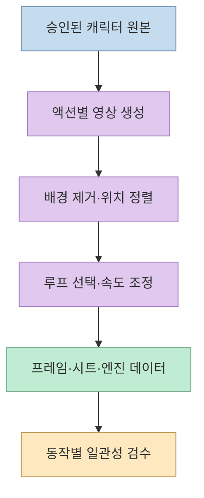
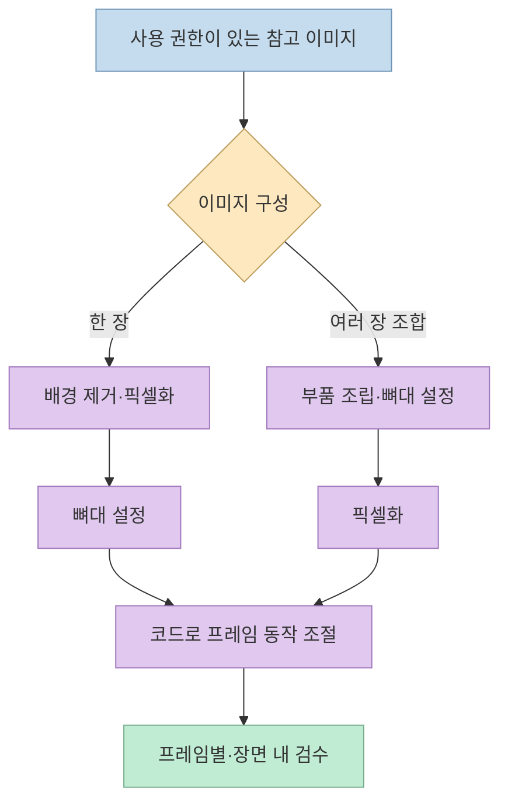
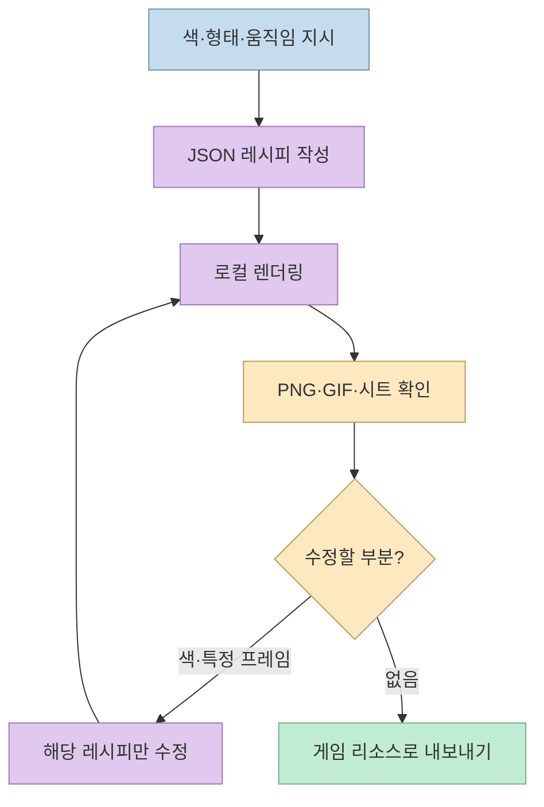
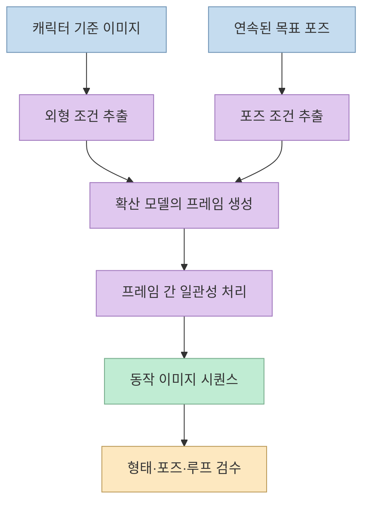
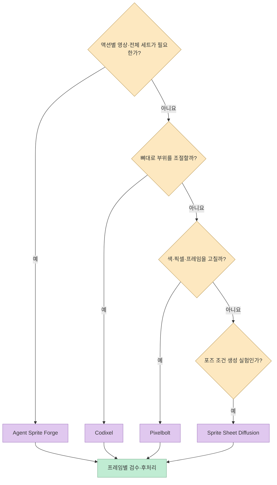

[오늘코딩의 영상 2편](https://youtu.be/ZN019l8wGBg?t=0) 은 앞선 1편에 이어 게임 리소스 제작 도구 네 가지를 더 소개한다. 이번 네 가지도 같은 종류의 "AI 이미지 생성기"가 아니다. **영상에서 동작을 추출하는 에이전트 파이프라인**, **참고 이미지를 코드로 가공하는 픽셀아트 스킬**, **텍스트 설계도를 픽셀로 렌더링하는 도구**, **참고 이미지와 포즈에 조건화된 연구용 확산 모델** 로 나뉜다.

<!--more-->

## Sources

- [원본 영상: AI 게임 리소스 제작에 사용할 수 있는 오픈소스 8가지 | 2편](https://youtube.com/shorts/ZN019l8wGBg?si=J_IdOPdRaf-b6p_q)
- [Agent Sprite Forge 공식 저장소](https://github.com/0x0funky/agent-sprite-forge)
- [Codixel 공식 저장소](https://github.com/mankidev/codixel)
- [Pixelbolt 공식 저장소](https://github.com/skulitom/Pixelbolt)
- [Sprite Sheet Diffusion 공식 저장소](https://github.com/chenganhsieh/Sprite-Sheet-Diffusion)
- [Sprite Sheet Diffusion 원 논문](https://arxiv.org/abs/2412.03685)

영상의 한국어 자동 자막을 시간대별로 확인했다. 도구명은 자막의 발음 표기가 아니라 공식 프로젝트 이름을 사용한다. 기능·제약은 각 저장소와 논문에서 확인했고, 아래의 도구 조합은 별도 검증된 통합 제품이 아닌 **선택을 돕기 위한 적용 제안** 이다.

## 1. Agent Sprite Forge: 기준 캐릭터에서 여러 액션을 묶어 내보내기

[첫 번째 도구](https://youtu.be/ZN019l8wGBg?t=4) 의 정확한 이름은 [Agent Sprite Forge](https://github.com/0x0funky/agent-sprite-forge) 다. 영상은 기준 캐릭터 이미지를 정한 뒤 대기·걷기·달리기·공격 같은 동작을 각각 영상으로 만들고, 배경 제거와 프레임 선별을 거쳐 애니메이션으로 정리한다고 설명한다. 캐릭터 외에 맵과 타일 리소스도 지원한다. [영상 00:04–00:27](https://youtu.be/ZN019l8wGBg?t=4)

공식 문서의 0.4 흐름은 **승인된 마스터 이미지 한 장 → 액션별 이미지-투-비디오 클립 → 배경 키잉·정렬·반복 구간 선정·속도 조정 → 게임 엔진용 패키지** 다. Claude Code용 플러그인과 Codex용 에이전트 스킬을 제공하고, 투명 PNG 프레임·아틀라스·애니메이션 메타데이터 등을 만든다. 맵 제작용 경로도 별도로 있다. 다만 영상 생성에는 사용 가능한 모델·서비스 경로가 필요하다. 저장소가 공개되어 있다는 사실이 외부 이미지·영상 생성 비용까지 없다는 뜻은 아니다. [영상 00:12–00:25](https://youtu.be/ZN019l8wGBg?t=12) · [공식 저장소](https://github.com/0x0funky/agent-sprite-forge)

이 도구의 이점은 한 캐릭터의 여러 동작을 **같은 기준 이미지와 색·크기 규칙 아래** 다루려는 데 있다. 그러나 영상 기반 생성물에서는 프레임별 외형 변화, 발 위치 흔들림, 배경 제거 가장자리, 루프의 끊김을 확인해야 한다. 자동 검사와 패키징이 있어도 최종 게임 화면에서 직접 재생하는 검수는 별개다. [영상 00:04–00:27](https://youtu.be/ZN019l8wGBg?t=4) · [공식 저장소](https://github.com/0x0funky/agent-sprite-forge)

## 2. Codixel: 참고 이미지를 가공하고 뼈대로 움직이기

[두 번째 도구](https://youtu.be/ZN019l8wGBg?t=27) 는 자동 자막의 "코디셀"이 아니라 [Codixel](https://github.com/mankidev/codixel) 이다. 제작자는 Claude Code가 화가처럼 완성 그림을 직접 그리는 대신 **코드를 작성해 참고 이미지를 픽셀화하고 부품을 움직인다** 고 설명한다. 영상의 용 예시도 참고 이미지를 도트 이미지로 바꾼 뒤 몸통과 꼬리의 움직임을 뼈대와 코드로 다루는 흐름이다. [영상 00:27–00:52](https://youtu.be/ZN019l8wGBg?t=27) · [공식 저장소](https://github.com/mankidev/codixel)

공식 README는 두 경우의 순서까지 구분한다. **한 장의 이미지** 는 배경을 제거하고 픽셀화한 뒤 뼈대를 더한다. **여러 이미지를 조합한 캐릭터** 는 먼저 부품을 조립하고 뼈대를 만든 뒤 픽셀화한다. 이후 프레임을 한 장씩 확인하고 게임 장면 안에서도 어울리는지 봐야 한다. 이는 생성 모델이 프레임마다 캐릭터를 다시 그리는 방식과 다르므로, 특정 부위의 이동이나 형태를 코드에서 조정하는 데 유리하다. 그렇다고 모든 동작이 자동으로 자연스럽게 만들어진다는 뜻은 아니다. [영상 00:35–00:52](https://youtu.be/ZN019l8wGBg?t=35) · [공식 README](https://github.com/mankidev/codixel)

참고 이미지를 사용하는 만큼 **원본의 사용 권한** 을 확인해야 한다. 프로젝트 코드의 라이선스와 입력 이미지의 저작권은 같은 문제가 아니다. 제작자도 직접 만든 이미지나 사용이 허용된 이미지를 쓰라고 안내한다. [Codixel 공식 README](https://github.com/mankidev/codixel)

## 3. Pixelbolt: 편집 가능한 JSON 설계도를 픽셀 결과로

[세 번째 도구](https://youtu.be/ZN019l8wGBg?t=52) 는 [Pixelbolt](https://github.com/skulitom/Pixelbolt) 다. 영상에서 말한 "색과 모양, 움직임을 글자로 적은 설계도"는 공식 문서의 **편집 가능한 JSON 레시피** 로 이해할 수 있다. 에이전트가 CLI 또는 MCP로 레시피를 만들고 수정한 뒤 이를 픽셀아트로 렌더링한다. 스프라이트·타일·아이콘·이펙트·짧은 애니메이션을 PNG 시트, GIF, APNG, 아틀라스 등으로 내보낼 수 있다. [영상 00:52–01:17](https://youtu.be/ZN019l8wGBg?t=52) · [공식 저장소](https://github.com/skulitom/Pixelbolt)

중요한 차이는 **결과 이미지가 아니라 레시피를 수정한다** 는 점이다. 색 하나나 특정 프레임만 바꾸고 다시 렌더링할 수 있어, 전체 그림을 새로 생성하는 방식보다 변경 범위가 명확하다. 공식 문서 역시 이 도구를 이미지 생성 모델이 아닌 로컬의 코드·데이터 기반 픽셀아트 도구로 설명한다. 따라서 페인팅·사진 같은 스타일이나 긴 고해상도 애니메이션에는 맞지 않는다. [영상 01:01–01:17](https://youtu.be/ZN019l8wGBg?t=61) · [공식 저장소](https://github.com/skulitom/Pixelbolt)

## 4. Sprite Sheet Diffusion: 참고 이미지와 포즈를 조건으로 프레임 생성

[네 번째 도구](https://youtu.be/ZN019l8wGBg?t=77) 는 [Sprite Sheet Diffusion](https://github.com/chenganhsieh/Sprite-Sheet-Diffusion) 이다. 영상처럼 **캐릭터 기준 이미지와 포즈 시퀀스** 를 입력으로 사용해 해당 동작의 프레임을 생성한다. 이는 뼈대로 기존 픽셀을 움직이는 Codixel이나 JSON을 렌더링하는 Pixelbolt와 다르다. 모델이 포즈에 맞춰 캐릭터 모습을 새로 생성하므로, 포즈 정합성과 프레임 간 외형 일관성을 함께 확인해야 한다. [영상 01:17–01:32](https://youtu.be/ZN019l8wGBg?t=77) · [원 논문](https://arxiv.org/abs/2412.03685)

원 논문은 참고 이미지가 외형을, 포즈 시퀀스가 원하는 동작을 지정하는 과제로 정의한다. 제안한 방식에는 외형을 읽는 ReferenceNet, 포즈 정보를 반영하는 Pose Guider, 프레임 사이의 일관성을 다루는 Motion Module이 있다. 학습도 먼저 포즈에 맞는 단일 이미지를 만들고, 다음 단계에서 시간적 일관성을 학습하는 구조다. 이는 **연구 방법의 설명** 이며, 영상의 짧은 소개만으로 모든 캐릭터와 포즈에서 동일한 품질을 보장할 수는 없다. [영상 01:22–01:32](https://youtu.be/ZN019l8wGBg?t=82) · [원 논문](https://arxiv.org/html/2412.03685v2)

영상은 개인 PC에서 모델을 돌리는 방식과 GPU 사양에 따른 속도 차이를 언급한다. 공식 저장소 역시 Conda 환경과 별도 사전 학습 가중치 설정을 안내한다. 다만 README의 실행 예시는 저장소 구조의 하위 `ModelTraining/` 디렉터리에 있는 파일을 가리키므로, 이를 **설치만 하면 바로 작동하는 원클릭 도구** 로 소개하는 것은 부정확하다. 또한 논문에 나온 큰 GPU 메모리 수치는 **학습 실험 환경** 에 관한 것이지 모든 추론 실행의 최소 요구 사양으로 옮겨 적을 수 없다. [영상 01:17–01:37](https://youtu.be/ZN019l8wGBg?t=77) · [공식 저장소](https://github.com/chenganhsieh/Sprite-Sheet-Diffusion) · [원 논문](https://arxiv.org/html/2412.03685v2)

## 실전 적용 포인트

도구 선택은 **원하는 수정 단위** 에서 시작하면 된다. 여러 동작을 한 캐릭터에 묶어 영상 생성부터 엔진 패키징까지 다루려면 Agent Sprite Forge, 참고 이미지를 바탕으로 뼈대와 픽셀 동작을 손보고 싶다면 Codixel, 한 픽셀·색·프레임을 레시피에서 반복 수정하려면 Pixelbolt, 참고 이미지와 포즈에 조건화된 생성 모델을 직접 실험하려면 Sprite Sheet Diffusion을 검토할 수 있다. 이는 기능을 토대로 한 선택 기준이지 네 도구의 품질·속도 우열을 측정한 결과가 아니다. [영상 00:04–01:37](https://youtu.be/ZN019l8wGBg?t=4) · [각 프로젝트의 공식 문서](https://github.com/0x0funky/agent-sprite-forge)

영상의 [마지막 경고](https://youtu.be/ZN019l8wGBg?t=97) 처럼 생성한 리소스를 그대로 넣기보다 **어색한 동작, 프레임별 형태 변화, 색상·팔레트, 투명 가장자리, 발 위치, 루프 연결** 을 확인해야 한다. 파일의 크기와 시트 형식도 게임 엔진에 맞춰 최적화한다. 입력 이미지와 모델 가중치의 사용 권한은 프로젝트 코드의 오픈소스 라이선스와 별도로 확인해야 한다. [영상 01:37–01:54](https://youtu.be/ZN019l8wGBg?t=97) · [Codixel 공식 문서](https://github.com/mankidev/codixel)

## 핵심 요약

- **Agent Sprite Forge** 는 승인된 캐릭터 이미지에서 액션별 영상을 만들고 프레임·시트로 정리한다. 맵·타일 경로도 있다. [영상 00:04](https://youtu.be/ZN019l8wGBg?t=4) · [공식 저장소](https://github.com/0x0funky/agent-sprite-forge)
- **Codixel** 은 참고 이미지를 코드로 가공하고 뼈대 기반으로 부위를 움직이는 Claude Code 스킬이다. [영상 00:27](https://youtu.be/ZN019l8wGBg?t=27) · [공식 저장소](https://github.com/mankidev/codixel)
- **Pixelbolt** 는 편집 가능한 JSON 레시피를 PNG·GIF·시트 등으로 렌더링한다. [영상 00:52](https://youtu.be/ZN019l8wGBg?t=52) · [공식 저장소](https://github.com/skulitom/Pixelbolt)
- **Sprite Sheet Diffusion** 은 기준 이미지와 포즈를 조건으로 동작 프레임을 생성하는 연구용 모델이다. [영상 01:17](https://youtu.be/ZN019l8wGBg?t=77) · [원 논문](https://arxiv.org/abs/2412.03685)

## 결론

2편의 네 도구는 모두 게임 리소스를 다루지만, **영상 생성·코드 기반 뼈대·레시피 렌더링·포즈 조건 확산** 으로 작동 원리가 다르다. 결과물의 편집 가능성과 필요한 실행 환경을 먼저 비교해야 한다. 어떤 도구를 택하든 영상이 강조한 후보정과 엔진 내 검증은 생략할 수 없다. [영상 01:37–01:54](https://youtu.be/ZN019l8wGBg?t=97)
