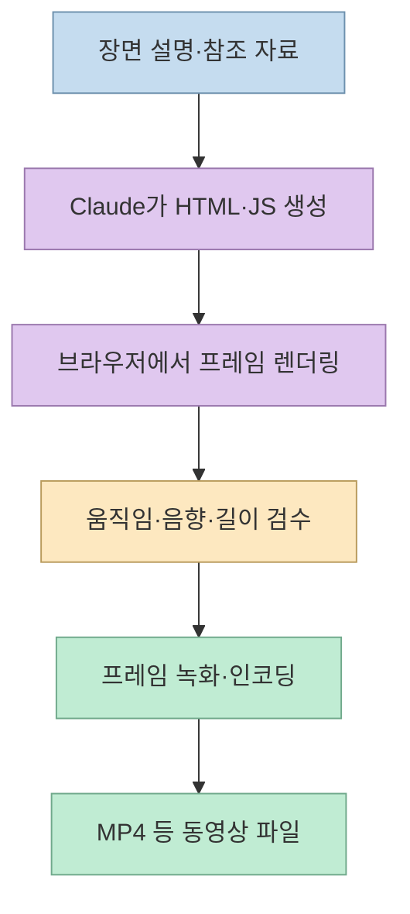
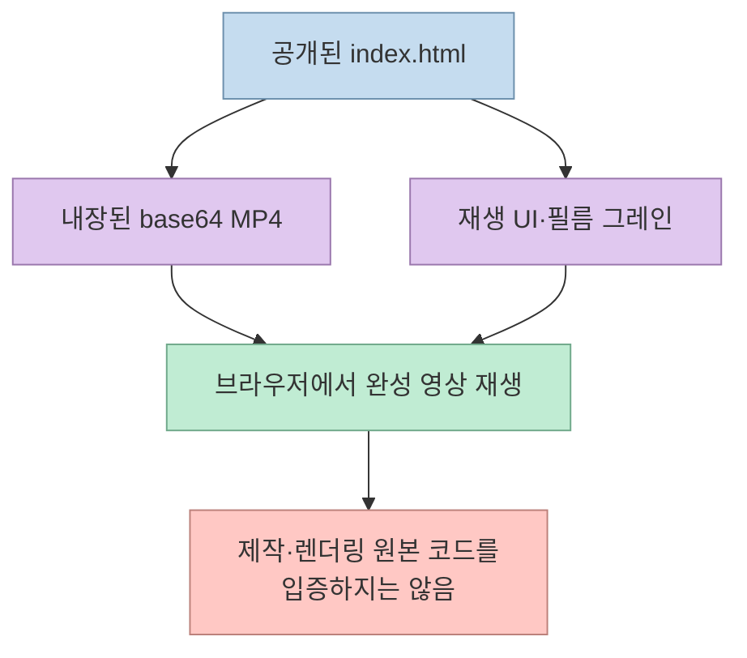
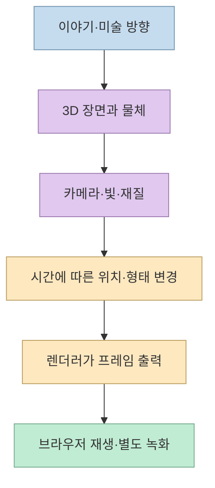
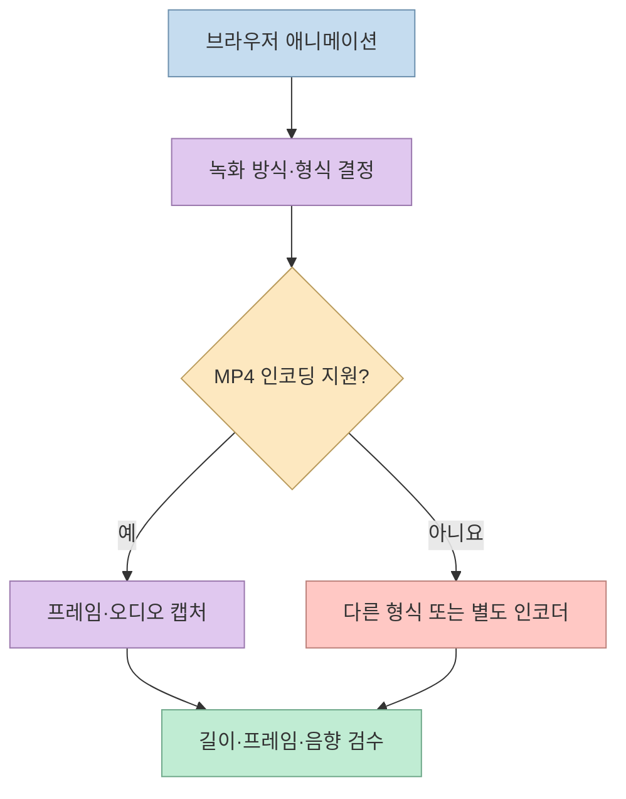

[원카AI의 영상](https://youtu.be/VXssLbMGr0w?si=m4UfWwN7mhYOUT35)은 Claude에 장면을 설명해 HTML 애니메이션을 만들고, Three.js를 더해 다른 분위기의 결과를 얻는 과정을 보여준다. **영상 생성 모델로 픽셀을 직접 만드는 방식**과 **코드가 장면을 그리도록 만드는 방식**을 비교하는 점이 흥미롭다. 다만 영상의 근거로 제시된 *The Moss Keeper* 저장소는 제작 소스가 아니라 **완성 MP4를 HTML 안에 내장한 재생 페이지**라고 스스로 설명한다. 따라서 원작의 생성 과정과 영상의 재현 가능성을 같은 것으로 취급해서는 안 된다. [영상 02:12](https://youtu.be/VXssLbMGr0w?t=212), [Moss Keeper 저장소](https://github.com/ChetasLua/moss-keeper)

<!--more-->

## Sources

- [원본 영상: 99%는 모르는 클로드 영상 제작법](https://youtu.be/VXssLbMGr0w?si=m4UfWwN7mhYOUT35) — 한국어 자동 생성 자막을 `youtube-transcript-api`로 확인했다. 아래 영상 근거에는 시간 이동 링크를 붙였다.
- [ChetasLua의 The Moss Keeper 저장소](https://github.com/ChetasLua/moss-keeper) — 공개 `index.html`의 구조에 대한 원작자 설명. 모델·제작 과정의 독립 검증 자료는 아니다.
- [Anthropic 공식 모델 목록](https://platform.claude.com/docs/en/models/overview), [Opus 5.5 문서](https://platform.claude.com/docs/en/models/opus-5-5/overview) — 공개 모델과 모델 ID 확인.
- [Three.js의 장면 만들기 안내](https://threejs.org/manual/pages/creating-a-scene.html) — 장면·카메라·렌더러·애니메이션 루프의 역할.
- [MDN: MediaRecorder 형식 지원 확인](https://developer.mozilla.org/en-US/docs/Web/API/MediaRecorder/isTypeSupported_static) — 브라우저에서 MP4 녹화 가능 여부가 환경에 따라 달라지는 이유.

## ‘코드로 만든 영상’이 뜻하는 두 가지

영상 속 시연은 Claude에 장면 설명과 참조 프롬프트를 주고, 브라우저에서 움직이는 HTML 결과물을 만든 뒤 MP4로 내려받게 요청하는 흐름이다. 발표자는 비 오는 밤의 노면전차가 달을 향해 움직이는 장면을 예로 들며, 기존 결과를 수정하거나 Three.js로 다시 만드는 장면도 보여준다. 여기서 **브라우저에서 움직이는 장면**과 **배포 가능한 MP4 파일**은 다른 산출물이다. 전자는 브라우저가 매 프레임 코드를 실행해 그리는 것이고, 후자는 그 프레임을 녹화·인코딩한 파일이다. [영상 05:43](https://youtu.be/VXssLbMGr0w?t=343), [영상 07:55](https://youtu.be/VXssLbMGr0w?t=475), [Three.js 안내](https://threejs.org/manual/pages/creating-a-scene.html)

이 방식은 카메라 위치, 물체 크기, 움직임 속도처럼 **코드로 드러난 값**을 바꿔 다시 실행할 수 있다는 장점이 있다. 영상은 이를 ‘영상 모델은 대리석을 깎고, 코드는 레고를 다시 조립한다’고 비유한다. 그러나 코드 생성에도 모델 사용량, 디버깅 시간, 브라우저 렌더링, 파일 인코딩이 필요하다. ‘영상 모델의 초당 크레딧을 쓰지 않는다’와 ‘비용 없이 5분 만에 완성된다’는 서로 다른 주장이다. 영상만으로 모든 주제·길이에서 제작 시간과 총비용을 일반화할 수 없다. [영상 04:25](https://youtu.be/VXssLbMGr0w?t=265), [영상 04:59](https://youtu.be/VXssLbMGr0w?t=299)

## Moss Keeper 저장소는 무엇을 공개했나

영상은 *The Moss Keeper*를 ‘이미지·영상 모델 없이 HTML 파일 하나에 담은 코드 제작 사례’로 소개하고, 저장소의 `index.html`을 참조 자료로 가져오도록 안내한다. 하지만 [원작 저장소 README](https://github.com/ChetasLua/moss-keeper)는 해당 HTML이 **base64로 인코딩한 완성 MP4를 품고**, 페이지를 열 때 이를 `Blob`으로 만들어 재생한다고 명시한다. 페이지의 재생·일시정지·탐색·음소거 기능과 필름 그레인 `canvas` 효과는 공개돼 있지만, 그것은 **완성 영상을 재생하는 코드**다. 원본 애니메이션의 프레임·음악을 어떻게 생성했는지 재현할 생성 소스나 단계별 명세와는 구별해야 한다. [영상 03:32](https://youtu.be/VXssLbMGr0w?t=212), [영상 06:05](https://youtu.be/VXssLbMGr0w?t=365), [Moss Keeper 저장소](https://github.com/ChetasLua/moss-keeper)

따라서 `index.html`을 Claude에 첨부하면 **플레이어 구현과 완성 영상의 포장 방식**은 참고할 수 있지만, 그것만으로 원작의 동작·그림체를 만든 프롬프트나 렌더링 파이프라인을 알 수는 없다. README에는 원작자가 Fable 5.5로 만들었다고 적었으나, 저장소만으로 실제 사용 모델이나 ‘이미지·영상 모델을 한 번도 사용하지 않았다’는 제작 이력을 독립 확인할 수 없다. 이는 창작자의 주장을 부정한다는 뜻이 아니라, 공개 산출물이 뒷받침하는 범위를 정확히 한정하는 것이다. [영상 03:34](https://youtu.be/VXssLbMGr0w?t=214), [Moss Keeper 저장소](https://github.com/ChetasLua/moss-keeper)

## 모델명과 결과 비교는 어떻게 읽어야 하나

영상은 원작자가 **Fable 5.5**로 만들었다고 말하면서 아직 공식 선택 가능한 모델은 아니라고 덧붙인다. [Anthropic의 현재 공개 모델 목록](https://platform.claude.com/docs/en/models/overview)에는 **Fable 5.1**과 **Opus 5.5**가 확인되지만 Fable 5.5는 표시되지 않는다. 그러므로 ‘원작자가 Fable 5.5를 사용했다’는 말은 공개 문서로 검증한 사실이 아니라 원작자·영상의 귀속 주장으로 남는다. 반면 Opus 5.5의 존재와 모델 ID는 [공식 문서](https://platform.claude.com/docs/en/models/opus-5-5/overview)로 확인된다. 공개되지 않은 모델의 비공개 시험 여부까지 단정할 근거는 없다. [영상 02:59](https://youtu.be/VXssLbMGr0w?t=179), [영상 03:09](https://youtu.be/VXssLbMGr0w?t=189)

영상은 Opus 5.5로 만든 예시가 Fable 5.1 예시보다 보기 좋고 생성도 빠르다고 평가한다. 이는 **서로 다른 장면과 프롬프트를 사용한 시연자의 관찰**이며, 통제된 모델 성능 비교는 아니다. 품질은 프롬프트, 수정 횟수, 사용하는 코드·라이브러리, 평가 기준에 따라 달라진다. 영상에서 보여준 한두 결과만으로 특정 모델의 일반적인 영상 제작 성능·비용 우위를 결론 낼 수 없다. [영상 08:14](https://youtu.be/VXssLbMGr0w?t=494), [영상 09:39](https://youtu.be/VXssLbMGr0w?t=579)

## Three.js는 무엇을 추가하고, 무엇을 해결하지 못하나

영상 후반에서 발표자는 같은 구상을 더 입체적으로 표현하려고 **Three.js**를 요청한다. 자동 자막의 ‘3JS’는 이 웹 3D 라이브러리를 가리킨다. [공식 안내](https://threejs.org/manual/pages/creating-a-scene.html)에 따르면 Three.js 장면을 표시하려면 최소한 **scene, camera, renderer**가 필요하고, 움직임은 렌더링 루프에서 시간에 따라 속성을 갱신해 만든다. 따라서 ‘Three.js를 써 달라’는 요청은 이름만 붙이는 장식이 아니라, 평면 요소의 움직임을 3D 장면 구성으로 바꾸라는 제작 방향이다. [영상 10:11](https://youtu.be/VXssLbMGr0w?t=611), [영상 11:11](https://youtu.be/VXssLbMGr0w?t=711)

발표자는 Three.js를 추가한 뒤의 결과가 더 좋아 보인다고 평가한다. 그러나 그 전에도 낭떠러지 형태와 로봇 외형을 수정해 달라고 요청했으므로, **화질 차이를 라이브러리 이름 한 단어의 효과로만 돌릴 수 없다**. Three.js는 3D 구도와 재질을 제어할 도구를 제공하지만, 미술 방향·모델링·카메라 경로·음향·성능 문제를 자동으로 해결하지는 않는다. 원작의 손그림풍 2D 애니메이션과도 표현 방식이 다르다. [영상 11:32](https://youtu.be/VXssLbMGr0w?t=692), [영상 11:51](https://youtu.be/VXssLbMGr0w?t=711), [영상 13:05](https://youtu.be/VXssLbMGr0w?t=785)

## HTML 미리보기에서 MP4까지는 별도 검증이 필요하다

영상에서는 결과를 **MP4로 다운로드해 달라**고 추가로 요청한다. 하지만 HTML 애니메이션이 돌아간다는 사실만으로 MP4 파일이 자동으로 생기지는 않는다. 브라우저 캔버스를 캡처하거나 프레임을 렌더링해 인코딩해야 하고, 음향이 있다면 동기화도 확인해야 한다. 예를 들어 브라우저 녹화는 [`MediaRecorder.isTypeSupported()`](https://developer.mozilla.org/en-US/docs/Web/API/MediaRecorder/isTypeSupported_static)로 원하는 `video/mp4` 형식 지원 여부를 먼저 확인해야 하며, 지원한다고 해도 자원 부족 등으로 녹화가 실패할 수 있다. 영상은 시연 결과를 보여주지만 모든 브라우저와 환경에서 같은 내보내기 경로가 동작한다는 보증은 아니다. [영상 07:55](https://youtu.be/VXssLbMGr0w?t=475), [영상 08:05](https://youtu.be/VXssLbMGr0w?t=485)

발표자는 자신의 코드 기반 결과가 약 **1분 2초**라고 말하고 특정 영상 모델의 길이와 비교한다. 이 수치는 **시연한 결과의 길이**이지 Claude나 Three.js의 최대 출력 길이를 뜻하지 않는다. 반대로 긴 결과가 곧 안정적 품질을 의미하지도 않는다. 실제로는 장면 연속성, 프레임 누락, 렌더링 시간, 파일 크기까지 함께 평가해야 한다. 영상의 다른 제품별 최대 길이·버전 비교는 출시·요금제·설정에 따라 바뀌므로 여기서는 일반 규칙으로 옮기지 않는다. [영상 13:16](https://youtu.be/VXssLbMGr0w?t=796), [영상 13:31](https://youtu.be/VXssLbMGr0w?t=811)

## 실전 적용 포인트

재현 실험을 한다면 먼저 **10초짜리 한 장면**을 정해 물체, 카메라, 움직임, 색감, 소리를 따로 명시하는 편이 좋다. HTML 미리보기가 돌아가면 숫자 하나를 바꿔 의도한 부분만 달라지는지 확인하고, 그 다음에 MP4 인코딩과 음향을 검증한다. Three.js 버전은 같은 장면·같은 평가 기준으로 다시 만들어 비교해야 ‘3D 도구가 도움이 됐는지’를 판단할 수 있다. 이는 영상의 흐름을 측정 가능하게 재구성한 제안이다. [영상 04:59](https://youtu.be/VXssLbMGr0w?t=299), [영상 10:11](https://youtu.be/VXssLbMGr0w?t=611), [Three.js 안내](https://threejs.org/manual/pages/creating-a-scene.html)

원작 저장소는 **결과물 재생의 참고자료**로 활용하되, 이를 생성 프롬프트나 렌더링 소스라고 소개하지 않는 것이 정확하다. 다른 창작물의 영상·음악·코드를 재사용할 때는 저장소의 허용 표현만으로 상업적 권리까지 가정하지 말고 이용 조건을 별도로 확인해야 한다. [Moss Keeper 저장소](https://github.com/ChetasLua/moss-keeper)

## 핵심 요약

- 코드 기반 애니메이션은 브라우저에서 장면을 그리는 방식이다. **HTML 미리보기와 MP4 내보내기는 별도 단계**다. [영상 07:55](https://youtu.be/VXssLbMGr0w?t=475)
- 공개된 *The Moss Keeper* `index.html`은 완성 MP4가 내장된 재생 페이지다. 이것만으로 제작 과정이나 사용 모델을 검증할 수 없다. [Moss Keeper 저장소](https://github.com/ChetasLua/moss-keeper)
- Anthropic 공개 모델 목록에는 Opus 5.5와 Fable 5.1이 있지만, 영상이 언급한 Fable 5.5는 공식 목록에서 확인되지 않는다. [공식 모델 목록](https://platform.claude.com/docs/en/models/overview)
- Three.js는 장면·카메라·렌더러를 통해 3D 움직임을 제어할 수 있게 하지만, ‘한 단어만 추가하면 품질이 향상된다’는 일반 법칙은 아니다. [영상 11:51](https://youtu.be/VXssLbMGr0w?t=711), [Three.js 안내](https://threejs.org/manual/pages/creating-a-scene.html)

## 결론

영상의 유용한 아이디어는 **생성형 영상 외에도 코드로 장면을 설계·수정하는 경로가 있다**는 것이다. 다만 원작의 재생용 HTML, 실제 생성 소스, 모델명, MP4 출력 과정을 분리해 보아야 재현 가능한 제작법으로 이어진다.
