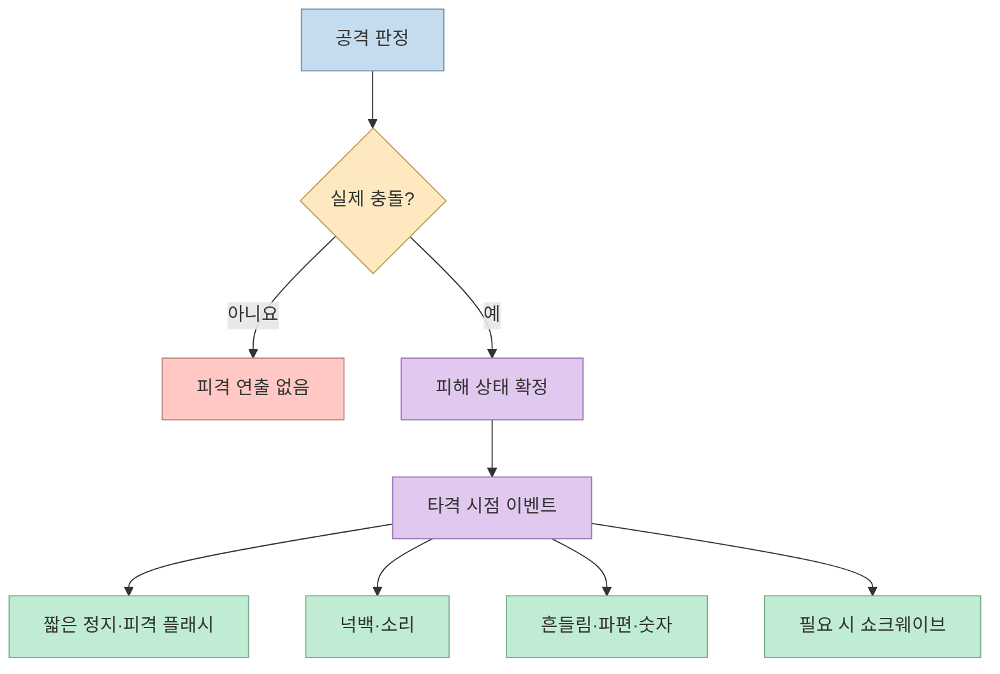
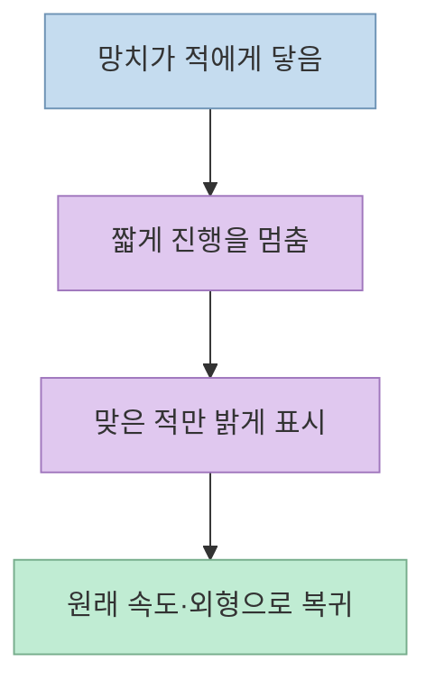
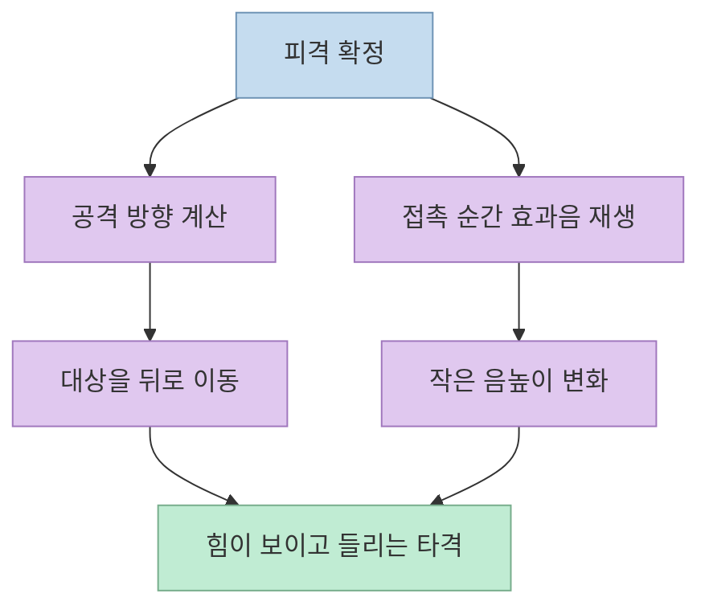
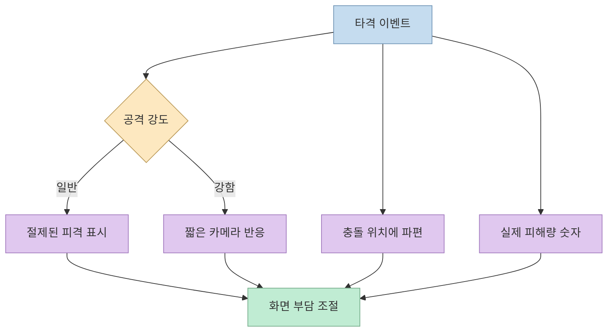
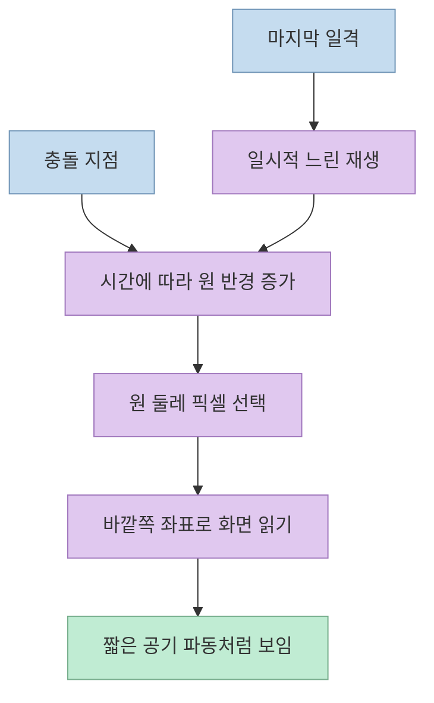

적의 체력은 줄어드는데 망치로 때린 느낌은 약할 수 있다. [밥따뚜의 게임 주스 시연](https://youtu.be/ToSc-hfQ7fM?t=0) 은 같은 공격 장면에 피드백을 하나씩 더하며 타격감이 어떻게 달라지는지 보여준다. 핵심은 효과의 개수보다 **충돌 순간에 시각·소리·움직임이 같은 사건을 말하도록 맞추는 것** 이다.

<!--more-->

## Sources

- [원본 영상: 때리는 맛 없는 게임, 이것만 켜 보세요 | 히트 스톱 · 넉백 · 쇼크웨이브](https://youtube.com/shorts/ToSc-hfQ7fM?si=6gDVbgZKc1Zpf58u)
- [Godot 공식 문서: 화면 읽기 셰이더](https://docs.godotengine.org/en/stable/tutorials/shaders/screen-reading_shaders.html)
- [Unity 공식 문서: Cinemachine Impulse](https://docs.unity3d.com/Packages/com.unity.cinemachine@2.6/manual/CinemachineImpulse.html)
- [Unity 공식 문서: AudioSource.pitch](https://docs.unity3d.com/ScriptReference/AudioSource-pitch.html)

이 글은 영상의 한국어 자동 자막에 나온 연출을 기준으로 한다. 엔진을 특정하지 않은 설계 예시는 **시연의 구조를 설명하기 위한 제안** 이며, 영상 제작자의 실제 코드라고 주장하지 않는다.

## 1. 체력 감소와 타격감은 다른 신호다

[영상 첫 장면](https://youtu.be/ToSc-hfQ7fM?t=7) 에서 팔라딘의 공격은 오크의 체력을 줄이지만 충격은 잘 느껴지지 않는다. 체력 값은 게임 상태의 변화를 알려준다. 반면 타격감은 **충돌이 발생했다는 시간적 신호**, **힘이 전달됐다는 공간적 신호**, **피해가 생겼다는 결과 신호** 를 함께 전달해야 살아난다. 여기서 흔히 말하는 게임 주스는 판정 규칙을 바꾸기보다 그 결과를 감각적으로 읽히게 하는 연출을 가리킨다. [영상 00:00–00:15](https://youtu.be/ToSc-hfQ7fM?t=0)

이 효과들을 별도의 타이머에서 제각각 재생하면 서로 어긋날 수 있다. 아래는 영상의 순서를 **타격 확정 이벤트 하나에 연결해 보는 설계 예시** 다. 실제 엔진에서는 피해 판정과 연출 재생을 구분하고, 빗나간 공격에 피격 피드백이 뜨지 않도록 해야 한다. [영상 00:15–01:04](https://youtu.be/ToSc-hfQ7fM?t=15)

## 2. 충돌 순간을 강조하는 히트 스톱과 피격 플래시

[첫 번째 효과는 히트 스톱](https://youtu.be/ToSc-hfQ7fM?t=15) 이다. 망치가 닿는 순간 진행을 아주 잠깐 멈추면 공격이 상대에게 걸린 듯한 무게가 생긴다. 자동 자막에는 멈춤 길이가 "0.1초쯤 1초쯤"으로 불분명하게 전사된다. 맥락상 **아주 짧은 정지** 가 요점이며, 정확한 권장 시간을 이 영상만으로 확정하지 않겠다. 너무 오래 멈추면 오히려 입력이 끊긴 것처럼 느껴진다는 주의도 영상 후반에 나온다. [영상 00:15–00:25](https://youtu.be/ToSc-hfQ7fM?t=15) · [영상 01:28–01:35](https://youtu.be/ToSc-hfQ7fM?t=88)

[두 번째 효과는 피격 대상의 흰색 플래시](https://youtu.be/ToSc-hfQ7fM?t=25) 다. 공격이 실제로 닿았다는 사실을 한눈에 알려준다. 히트 스톱이 시간의 강조라면 플래시는 대상을 강조한다. 구현할 때는 피해를 받은 대상만 잠깐 밝게 보이게 하고 원래 외형으로 돌아오도록 구성할 수 있다. 이 구현 방식은 영상에 나온 효과를 옮기기 위한 일반적인 설계 예시다. [영상 00:25–00:32](https://youtu.be/ToSc-hfQ7fM?t=25)

## 3. 힘의 방향을 보여주는 넉백과 소리

[세 번째 효과는 넉백](https://youtu.be/ToSc-hfQ7fM?t=32) 이다. 적이 뒤로 살짝 밀리면 힘이 어느 방향으로 전달됐는지가 보인다. 넉백의 방향은 공격 지점과 피격 대상의 위치 관계를 반영해야 읽기 쉽다. 다만 이동 거리나 물리 계산 방식은 영상에서 제시하지 않으므로 고정값을 권장하지 않는다. [영상 00:32–00:36](https://youtu.be/ToSc-hfQ7fM?t=32)

[네 번째는 효과음](https://youtu.be/ToSc-hfQ7fM?t=36) 이다. 영상은 소리가 망치가 닿는 순간보다 조금만 늦어도 분리되어 들리고, 동일한 소리를 계속 반복하면 단조로우므로 높낮이를 약간 바꿀 수 있다고 말한다. 구현할 때도 소리를 공격 버튼을 누른 때가 아니라 **실제 충돌이 확정된 때** 에 재생하는 편이 이 시연의 의도에 맞는다. 예를 들어 Unity의 `AudioSource.pitch`는 재생 소리의 높낮이를 바꾸는 속성이다. 그러나 음높이 변화의 정확한 범위는 영상에서 제시하지 않는다. [영상 00:36–00:49](https://youtu.be/ToSc-hfQ7fM?t=36) · [Unity 공식 문서](https://docs.unity3d.com/ScriptReference/AudioSource-pitch.html)

## 4. 카메라 흔들림, 파편, 데미지 숫자의 역할

[다섯 번째 효과인 화면 흔들림](https://youtu.be/ToSc-hfQ7fM?t=49) 은 타격이 화면 전체에 전달된 것처럼 느끼게 한다. 영상은 매 타격마다 크게 흔들지 말고 **강한 공격에만 짧게** 사용하라고 경고한다. Unity의 Cinemachine Impulse처럼 충돌 이벤트에 따라 카메라 반응을 일으키는 도구를 사용할 수 있지만, 어떤 엔진에서든 흔들림의 강도와 빈도를 조절해야 한다. 시각적 흔들림이 불편한 플레이어를 위해 강도 축소 또는 끄기 설정을 고려하는 것도 실무적인 확장 제안이다. [영상 00:49–00:55](https://youtu.be/ToSc-hfQ7fM?t=49) · [Unity 공식 문서](https://docs.unity3d.com/Packages/com.unity.cinemachine@2.6/manual/CinemachineImpulse.html)

[여섯 번째는 충돌 지점의 파편과 데미지 숫자](https://youtu.be/ToSc-hfQ7fM?t=55) 다. 파편은 **어디에서 충돌했는지**, 숫자는 **피해 결과가 무엇인지** 전달한다. 영상은 두 요소를 더했을 때 세게 때린 정도가 보인다고 설명한다. 따라서 효과를 화면 아무 곳에 띄우기보다 실제 충돌 위치와 피해 판정에 연결하는 것이 논리적이다. 이는 시연을 구현으로 옮긴 판단이며, 특정 파티클 수나 숫자 표시 시간은 영상에 없다. [영상 00:55–01:01](https://youtu.be/ToSc-hfQ7fM?t=55)

## 5. 쇼크웨이브는 원의 가장자리에서만 화면을 왜곡한다

[마지막 효과는 쇼크웨이브](https://youtu.be/ToSc-hfQ7fM?t=60) 다. 피격 지점에서 원형 물결이 퍼지며 화면이 잠깐 일렁인다. 영상은 이를 셰이더로 구현한다고 설명한다. 개념적으로는 피격 지점에서 현재 픽셀까지의 거리를 구하고, **커지는 원의 둘레 근처** 에 있는 픽셀을 바깥 방향으로 조금 옮겨 읽으면 된다. 원 안쪽 전체를 균일하게 밀어내는 것과 달리 가장자리에 국소적인 파동이 생긴다. 실제 화면 텍스처를 읽어 왜곡하는 구현은 엔진별 렌더링 규칙을 따라야 한다. Godot의 화면 읽기 셰이더 문서는 화면 텍스처와 `SCREEN_UV` 사용 방식을 설명한다. [영상 01:00–01:17](https://youtu.be/ToSc-hfQ7fM?t=60) · [Godot 공식 문서](https://docs.godotengine.org/en/stable/tutorials/shaders/screen-reading_shaders.html)

[영상은 마지막 일격](https://youtu.be/ToSc-hfQ7fM?t=77) 에 잠깐 느린 재생과 더 큰 쇼크웨이브를 함께 보여준다. 모든 타격에 최대 강도의 화면 왜곡을 넣기보다 **마무리 공격에 대비를 집중** 하는 방식이다. 다음 도식은 영상의 설명을 개념 수준에서 풀어 쓴 것이며, 완성된 셰이더 코드나 성능 수치를 뜻하지 않는다. [영상 01:17–01:22](https://youtu.be/ToSc-hfQ7fM?t=77)

## 실전 적용 포인트

이 영상에서 가장 유용한 실험 방법은 **같은 공격을 유지한 채 효과를 하나씩 켜고 끄는 것** 이다. 먼저 체력 감소만 있는 기준 장면을 확보한다. 다음으로 히트 스톱, 플래시, 넉백, 소리, 카메라, 파편·숫자, 쇼크웨이브를 차례로 더해 어떤 신호가 개선되는지 직접 플레이하며 확인한다. 영상 제작자는 자동 전후 비교와 직접 때려볼 수 있는 시연을 만들었다고 말하지만, 자동 자막에는 데모 사이트의 주소가 없어 이 글에서 특정 URL을 추측해 제시하지 않는다. [영상 01:22–01:58](https://youtu.be/ToSc-hfQ7fM?t=82)

효과를 전부 강하게 켜는 것은 목표가 아니다. 긴 히트 스톱은 끊김으로, 잦은 화면 흔들림은 피로감으로 받아들여질 수 있다. **일반 타격과 강한 타격의 차이를 남기고**, 소리·빛·움직임이 같은 접촉 순간을 가리키는지 확인해야 한다. 이처럼 연출의 이름을 구분해 두면 AI 코딩 도구에도 "히트 스톱을 추가해 줘"보다 **어느 판정 시점에, 어떤 효과를, 어떻게 비교할지** 더 구체적으로 요청할 수 있다. [영상 01:28–01:48](https://youtu.be/ToSc-hfQ7fM?t=88)

## 핵심 요약

- **히트 스톱과 플래시** 는 충돌의 시간과 피격 대상을 강조한다. 히트 스톱의 정확한 길이는 자동 자막만으로 확정할 수 없다. [영상 00:15–00:32](https://youtu.be/ToSc-hfQ7fM?t=15)
- **넉백과 효과음** 은 힘의 방향과 접촉 순간을 전달한다. 소리가 충돌과 어긋나면 효과가 분리되어 느껴진다. [영상 00:32–00:49](https://youtu.be/ToSc-hfQ7fM?t=32)
- **카메라 흔들림, 파편, 데미지 숫자** 는 강도·위치·결과를 보여주되 화면 부담을 조절해야 한다. [영상 00:49–01:00](https://youtu.be/ToSc-hfQ7fM?t=49)
- **쇼크웨이브** 는 커지는 원의 둘레를 따라 화면을 잠깐 왜곡하고, 마지막 일격에 더 크게 활용할 수 있다. [영상 01:00–01:22](https://youtu.be/ToSc-hfQ7fM?t=60)

## 결론

같은 그림과 공격이라도 피드백의 타이밍과 강도가 달라지면 타격감은 크게 달라진다. 이 영상의 실천적 메시지는 효과를 무조건 쌓으라는 것이 아니라, **하나씩 켜고 직접 때려보며 필요한 정도를 찾으라** 는 것이다. 구현에서도 판정 이벤트를 기준으로 효과를 연결하고, 과한 정지나 흔들림은 줄이는 편이 좋다. [영상 01:22–01:40](https://youtu.be/ToSc-hfQ7fM?t=82)
