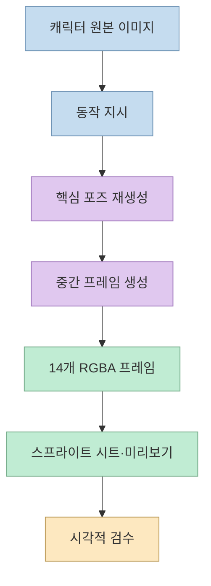
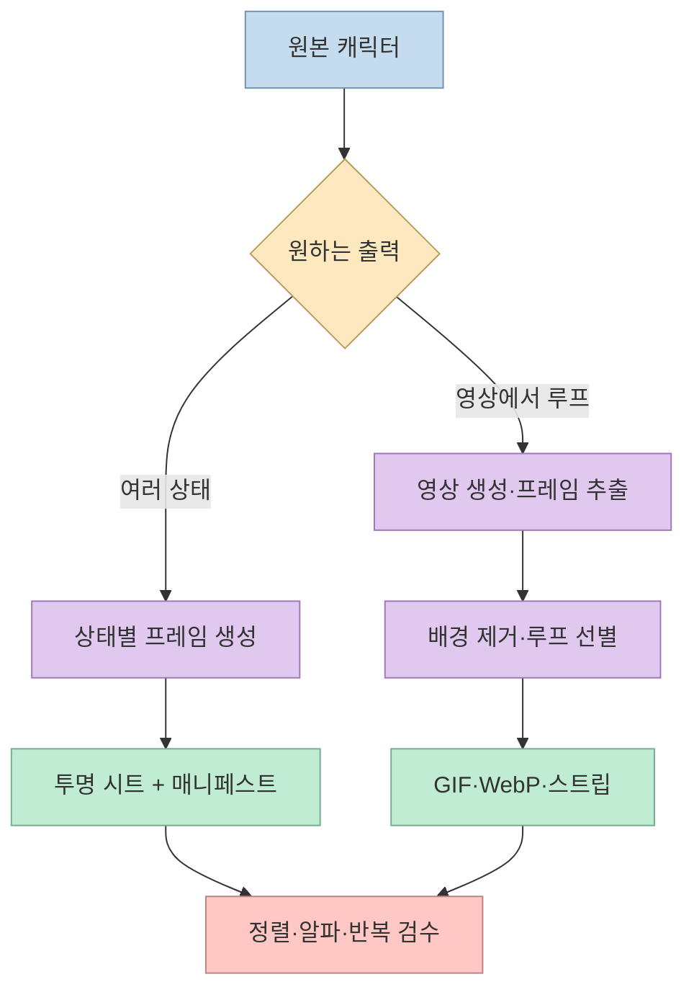
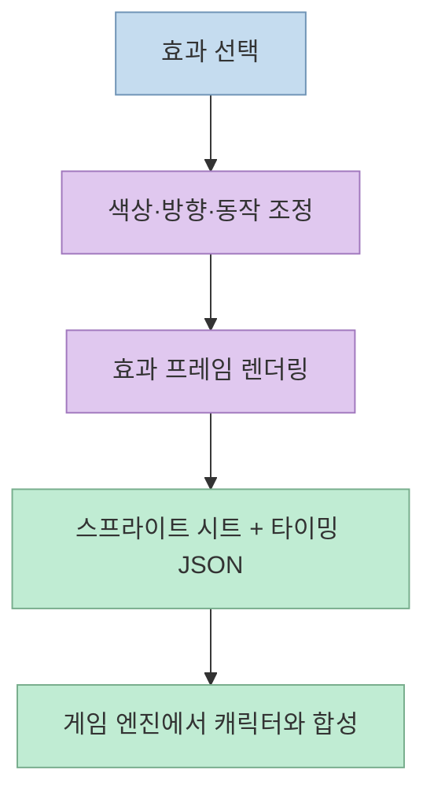
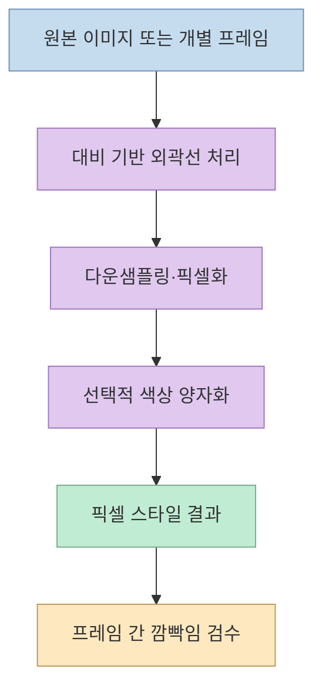
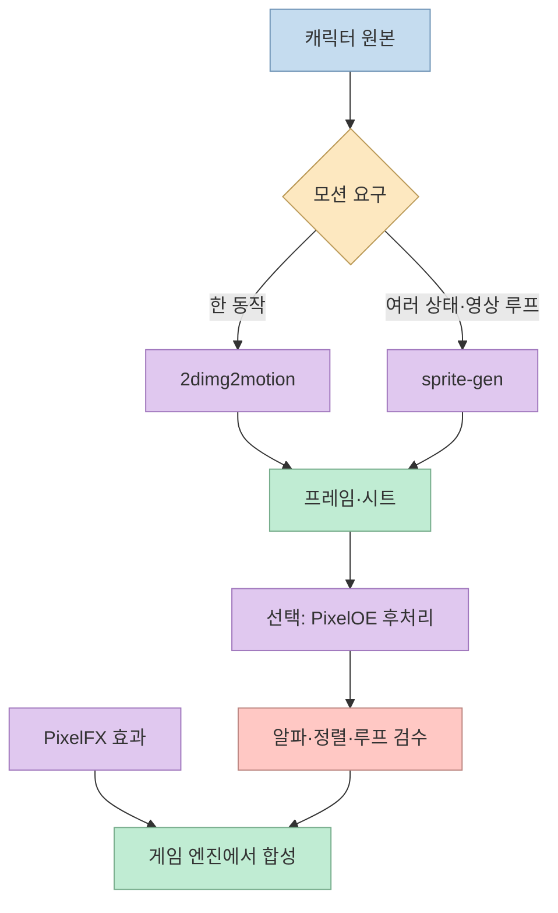

한 장의 캐릭터 이미지에서 애니메이션을 만들고, 게임에 넣을 스프라이트 시트와 이펙트를 준비하려면 어떤 도구가 필요할까? [오늘코딩의 숏폼](https://youtu.be/_U5wuMhZXI0?t=0) 은 오픈소스 게임 리소스 도구를 소개한다. 제목은 "8가지"지만 **이 영상은 1편이며 실제로 다루는 도구는 네 가지** 다. 네 도구는 같은 일을 반복하지 않는다. 모션 생성, 애니메이션 패키징, 효과 제작, 픽셀 스타일 후처리로 역할이 갈린다.

<!--more-->

## Sources

- [원본 영상: AI 게임 리소스 제작에 사용할 수 있는 오픈소스 8가지 | 1편](https://youtube.com/shorts/_U5wuMhZXI0?si=RdR290JS0qXR5h22)
- [2dimg2motion 공식 저장소](https://github.com/WU-HAOTIAN34/2dimg2motion)
- [sprite-gen 공식 저장소](https://github.com/aldegad/sprite-gen)
- [PixelFX 공식 저장소](https://github.com/patch-gg/pixelfx)
- [PixelOE 공식 저장소](https://github.com/KohakuBlueleaf/PixelOE)

이 글은 영상의 한국어 자동 자막을 시간대별로 확인하고, 기능·출력물·제약은 각 프로젝트의 공식 문서와 대조해 작성했다. 아래의 통합 작업 흐름은 네 프로젝트에 내장된 단일 기능이 아니라 **각 도구를 어떻게 조합할 수 있는지에 대한 제안** 이다.

## 1. 2dimg2motion: 정지 캐릭터를 14프레임 동작으로

[영상의 첫 번째 소개](https://youtu.be/_U5wuMhZXI0?t=13) 는 정지 캐릭터 이미지와 동작 지시에서 주요 포즈와 중간 프레임을 만들고, 투명 PNG와 스프라이트 시트로 내보내는 방식이다. 영상 속 "2D Image Motion"에 대응하는 저장소 이름은 [2dimg2motion](https://github.com/WU-HAOTIAN34/2dimg2motion) 이다.

이 프로젝트의 핵심은 단순한 이미지 변형 필터가 아니라 에이전트용 스킬이 이미지 생성 모델을 이용해 **동작의 핵심 포즈를 다시 그리고**, 그 사이 프레임을 채우는 흐름이다. 공식 문서의 기본 결과물은 `00`부터 `13`까지의 **14개 RGBA 프레임**, 가로형 `spritesheet.png`, 전체 프레임을 살펴보는 `contact-sheet.png`, 미리보기 GIF와 매니페스트다. 정해진 프레임 개수와 파일명, 투명도, 프레임 크기, 루프의 처음·끝 같은 구조적 조건을 검사할 수 있지만, 캐릭터의 형태나 움직임이 자연스러운지는 사람이 별도로 확인해야 한다. [영상 00:13–00:35](https://youtu.be/_U5wuMhZXI0?t=13) · [공식 저장소](https://github.com/WU-HAOTIAN34/2dimg2motion)

**적합한 경우:** 한 캐릭터의 특정 동작을 프레임 시퀀스와 시트로 빠르게 시도할 때. 다만 원본과 재생성 포즈의 복장·실루엣·손발 형태가 일관적인지, 루프 연결이 튀지 않는지 확인해야 한다. 구조 검사 통과가 곧 게임 투입 가능 품질을 의미하지는 않는다. [영상 00:13–00:35](https://youtu.be/_U5wuMhZXI0?t=13) · [공식 저장소](https://github.com/WU-HAOTIAN34/2dimg2motion)

## 2. sprite-gen: 여러 상태의 시트 또는 영상 기반 루프

[두 번째 소개](https://youtu.be/_U5wuMhZXI0?t=37) 는 정지 이미지에서 여러 동작 상태를 만들거나, 생성한 영상에서 프레임을 추출해 배경을 제거하고 반복 구간을 고른 뒤 게임용 애니메이션으로 정리하는 도구다. 해당 프로젝트는 이름이 비슷한 별도 서비스가 아닌 [aldegad/sprite-gen](https://github.com/aldegad/sprite-gen) 저장소다.

공식 문서상 경로는 크게 둘이다. **정지 이미지·상태 지정 경로** 는 여러 상태의 프레임을 만들고 투명 시트와 프레임 좌표·FPS·반복 설정을 담은 `manifest.json`을 내보낸다. **영상 기반 경로** 는 이미지에서 만든 AI 영상을 프레임으로 분해하고, 배경 제거·프레임 선별·루프 정리 후 GIF, WebP 또는 스트립으로 패키징한다. 영상 생성 경로에는 별도 생성 서비스 설정이나 비용이 따를 수 있으므로, 저장소가 공개되어 있다는 사실과 생성 과정 전체가 무료라는 주장은 구분해야 한다. [영상 00:37–00:56](https://youtu.be/_U5wuMhZXI0?t=37) · [공식 저장소](https://github.com/aldegad/sprite-gen)

**2dimg2motion과의 선택 기준:** 고정된 한 동작의 14프레임 결과를 원한다면 전자를, 여러 상태의 아틀라스나 영상에서 추출한 루프를 다루려면 sprite-gen을 먼저 검토할 만하다. 어느 쪽이든 프레임마다 캐릭터의 기준점이 흔들리면 게임 화면에서 튀어 보일 수 있어, 동일 캔버스·발 위치·투명 가장자리·반복 연결을 눈으로 검사해야 한다. 이는 두 저장소의 출력 구조를 비교한 적용 판단이지 영상이 제공하는 성능 비교 결과는 아니다. [영상 00:13–00:56](https://youtu.be/_U5wuMhZXI0?t=13) · [2dimg2motion](https://github.com/WU-HAOTIAN34/2dimg2motion) · [sprite-gen](https://github.com/aldegad/sprite-gen)

## 3. PixelFX: 캐릭터가 아니라 효과를 만드는 코드 기반 라이브러리

[세 번째 도구 PixelFX](https://youtu.be/_U5wuMhZXI0?t=59) 는 불, 폭발, 마법, 날씨, UI 같은 **픽셀아트 이펙트** 에 초점을 맞춘다. 공식 저장소는 244개 코드 기반 효과를 제시하며 색상 변경, 좌우 반전, 스프라이트 시트 및 타이밍 JSON 내보내기 등을 지원한다. 따라서 캐릭터 원본을 애니메이션으로 바꾸는 앞의 두 도구와는 출력물의 역할이 다르다. [영상 00:59–01:22](https://youtu.be/_U5wuMhZXI0?t=59) · [공식 저장소](https://github.com/patch-gg/pixelfx)

공식 문서에는 코드와 효과 자산의 라이선스 외에 **번들 글꼴의 라이선스 예외** 도 적혀 있다. 게임에 포함할 때는 효과 코드의 사용 조건과 함께 폰트 등 동봉 자산의 조건도 각각 확인하는 편이 안전하다. [PixelFX 공식 저장소](https://github.com/patch-gg/pixelfx)

## 4. PixelOE: 완성 이미지의 픽셀 스타일 후처리

[네 번째 도구 PixelOE](https://youtu.be/_U5wuMhZXI0?t=84) 는 이미지를 픽셀 스타일로 정리하는 쪽이다. 영상은 픽셀화, 외곽선 확장, 색상 양자화를 언급한다. 공식 저장소에 따르면 대비를 고려한 외곽선 확장과 다운샘플링을 중심으로 한 **고전적 이미지 처리 도구** 이며, 신경망이나 생성형 AI가 필수인 도구는 아니다. 따라서 입력 이미지를 새 동작으로 애니메이션화하는 도구로 분류하면 안 된다. [영상 01:24–01:46](https://youtu.be/_U5wuMhZXI0?t=84) · [공식 저장소](https://github.com/KohakuBlueleaf/PixelOE)

애니메이션 프레임 전체에 적용한다면 픽셀 크기, 팔레트, 캔버스 기준을 통일해야 한다. 그렇지 않으면 프레임마다 윤곽과 색이 달라져 깜빡이는 결과가 나올 수 있다. **이는 정지 이미지 처리 도구를 애니메이션에 확장해 쓸 때의 실무적 주의사항** 이며, PixelOE가 자동으로 시간축 일관성을 보장한다는 뜻은 아니다. [영상 01:24–01:46](https://youtu.be/_U5wuMhZXI0?t=84) · [공식 저장소](https://github.com/KohakuBlueleaf/PixelOE)

## 실전 적용 포인트

네 도구를 한 파이프라인으로 묶는다면 **캐릭터 모션은 2dimg2motion 또는 sprite-gen 중 목적에 맞게 선택** 하고, 필요할 때 프레임을 PixelOE로 후처리하며, PixelFX 이펙트는 별도 레이어로 얹는 구성이 합리적이다. 하지만 이는 공식적으로 검증된 원클릭 연동이 아닌 작업 설계 예시다. 영상도 결과물을 게임에 쓰기 전 후처리와 최적화가 필요하다고 짚는다. [영상 01:47–01:54](https://youtu.be/_U5wuMhZXI0?t=107) · [각 저장소의 출력 형식](https://github.com/aldegad/sprite-gen)

확인 순서는 **입력 이미지와 생성 서비스의 이용 조건 → 프레임 크기·투명도·기준점 → 반복 구간 → 시트 좌표와 재생 속도 → 엔진 내 실제 재생** 이다. 특히 저장소의 오픈소스 라이선스만으로 입력 이미지, 외부 생성 모델의 산출물, 동봉 에셋까지 모두 같은 조건으로 쓸 수 있다고 가정해서는 안 된다. [2dimg2motion](https://github.com/WU-HAOTIAN34/2dimg2motion) · [sprite-gen](https://github.com/aldegad/sprite-gen) · [PixelFX](https://github.com/patch-gg/pixelfx)

## 핵심 요약

- **2dimg2motion:** 정지 캐릭터에서 한 동작의 14프레임과 시트를 만드는 경로. [영상 00:13](https://youtu.be/_U5wuMhZXI0?t=13) · [공식 저장소](https://github.com/WU-HAOTIAN34/2dimg2motion)
- **sprite-gen:** 상태별 아틀라스 또는 영상 추출 기반 루프를 패키징하는 경로. [영상 00:37](https://youtu.be/_U5wuMhZXI0?t=37) · [공식 저장소](https://github.com/aldegad/sprite-gen)
- **PixelFX:** 캐릭터 모션이 아닌 코드 기반 픽셀 이펙트와 시트·타이밍 데이터. [영상 00:59](https://youtu.be/_U5wuMhZXI0?t=59) · [공식 저장소](https://github.com/patch-gg/pixelfx)
- **PixelOE:** 생성형 모션 도구가 아닌 픽셀 스타일 이미지 후처리. [영상 01:24](https://youtu.be/_U5wuMhZXI0?t=84) · [공식 저장소](https://github.com/KohakuBlueleaf/PixelOE)

## 결론

이 영상의 "8가지"를 한꺼번에 소개한 것으로 읽기보다, **1편의 네 도구가 제작 공정의 서로 다른 단계를 맡는다** 고 이해하는 편이 정확하다. 생성된 시트는 끝이 아니라 시작점이다. 투명도와 프레임 정렬, 루프, 색상 일관성, 라이선스, 실제 엔진 재생까지 확인해야 게임 리소스가 된다. [영상 00:00](https://youtu.be/_U5wuMhZXI0?t=0) · [영상 01:47](https://youtu.be/_U5wuMhZXI0?t=107)
