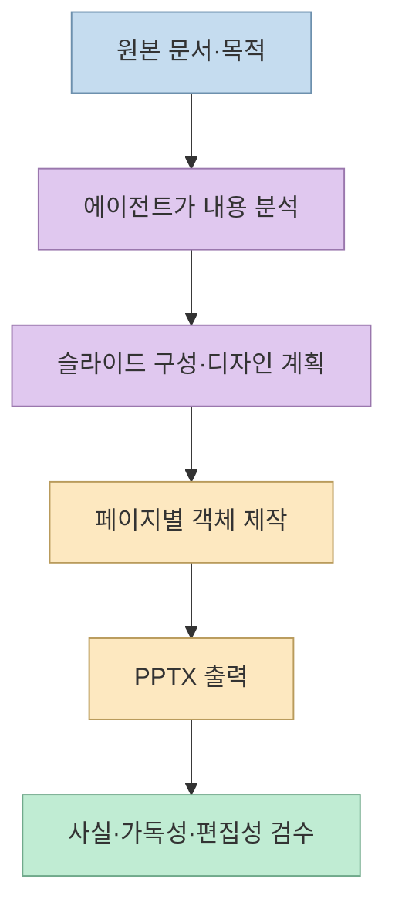
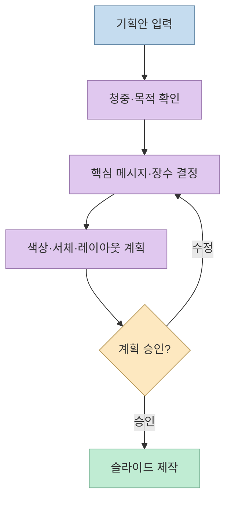
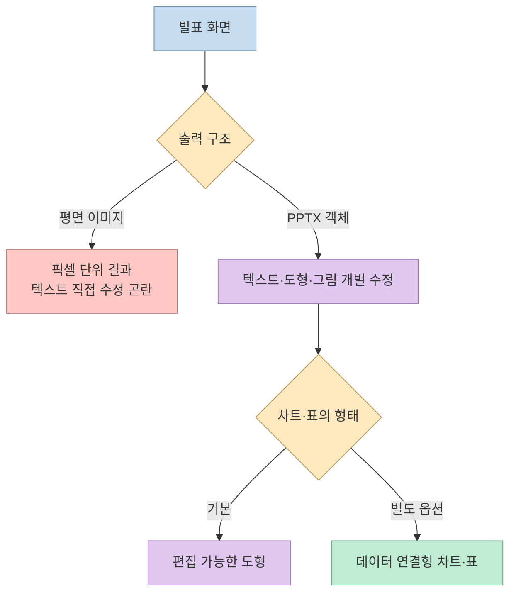
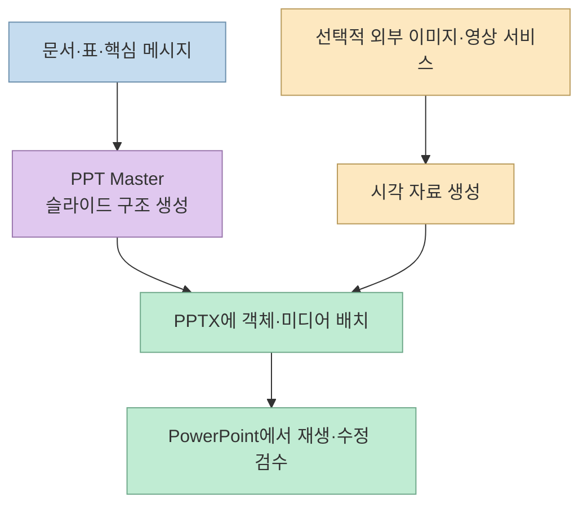

[성공지식백과의 영상](https://youtu.be/FIH_ZAxtQtU?si=iSOsGhmd92FRQELQ)은 문서를 넣어 **PowerPoint에서 고칠 수 있는 PPTX**를 만드는 오픈소스 스킬 **PPT Master**를 시연한다. 사례는 마케팅 팀 워크숍 기획안을 발표 자료로 바꾸고, 이미지·짧은 영상을 추가하는 흐름이다. 중요한 차이는 슬라이드 한 장을 이미지로 굳히는 방식이 아니라 텍스트·도형 등 **편집 가능한 객체**를 내보내려 한다는 점이다. 다만 공식 저장소도 완성도 높은 자료를 한 번에 보장하지 않으며, 사람이 내용을 다듬어야 한다고 명시한다. [영상 00:23](https://youtu.be/FIH_ZAxtQtU?t=23), [영상 08:49](https://youtu.be/FIH_ZAxtQtU?t=529), [PPT Master 공식 README](https://github.com/hugohe3/ppt-master)

<!--more-->

## Sources

- [원본 영상: 직장인 야근 탈출 치트키? PPT 뼈대 제대로 만들어주는 미친 오픈소스](https://youtu.be/FIH_ZAxtQtU?si=iSOsGhmd92FRQELQ) — 한국어 자동 생성 자막을 `youtube-transcript-api`로 확인했다. 영상의 주장에는 시간 이동 링크를 붙였다.
- [PPT Master 공식 저장소](https://github.com/hugohe3/ppt-master), [공식 스킬 정의](https://github.com/hugohe3/ppt-master/blob/main/skills/ppt-master/SKILL.md) — 지원 기능, 설치 전제, 출력 구조와 한계.

## PPT Master는 ‘PPT를 만드는 앱’보다 에이전트 워크플로우에 가깝다

영상은 PPT Master를 Claude Code·Codex·Gemini 계열 에이전트에서 사용하는 스킬로 소개한다. [공식 스킬 정의](https://github.com/hugohe3/ppt-master/blob/main/skills/ppt-master/SKILL.md)도 이를 발표 자료 생성, 기존 PPTX 편집, 템플릿 제작 등의 경로를 선택하는 **워크플로우**로 설명한다. 에이전트가 파일을 읽고 명령을 실행하며 계획과 페이지 제작을 진행한다. 따라서 ‘문서 하나만 주면 서비스가 자동으로 끝낸다’보다 **에이전트가 여러 작업 단계를 실행하도록 정해 둔 절차**라고 이해해야 한다. [영상 01:48](https://youtu.be/FIH_ZAxtQtU?t=108), [공식 스킬 정의](https://github.com/hugohe3/ppt-master/blob/main/skills/ppt-master/SKILL.md)

공식 README는 PDF·DOCX·웹 페이지·붙여 넣은 텍스트처럼 여러 형태의 자료를 바탕으로 PPTX를 만들 수 있다고 안내한다. 실행에는 **Python과 파일 작업이 가능한 에이전트 환경**이 필요하다. 저장소 자체는 무료·오픈소스이지만, 이를 구동하는 AI 모델의 사용량은 별개다. 검색·이미지·음성 서비스를 선택하면 그 경로의 비용과 데이터 전송도 별도로 고려해야 한다. 영상 역시 AI 모델과 선택적 이미지·영상 크레딧을 분리해 말한다. [영상 01:57](https://youtu.be/FIH_ZAxtQtU?t=117), [영상 02:15](https://youtu.be/FIH_ZAxtQtU?t=135), [PPT Master 공식 README](https://github.com/hugohe3/ppt-master)

## 기획서에서 슬라이드로: 먼저 청중과 메시지를 확정한다

발표자는 **2026년 하반기 마케팅 팀 워크숍 기획안**을 프로젝트 폴더에 넣고, Claude Code에 이를 PPT로 만들어 달라고 요청한다. 에이전트는 곧바로 그림부터 그리기보다 **누구에게, 어떤 목적으로 보여 주는지**, 화면 비율, 장수, 디자인 방향, 이미지 제공 방식, 발표자 노트 여부 등을 확인한다. 영상에서 보이는 ‘시놉시스’와 디자인 확인 화면은 발표 자료를 만들기 전의 **계획 승인 단계**다. 문서를 단순히 페이지별로 잘라 넣는 작업과 다르게, 발표 순서와 핵심 메시지를 먼저 정하려는 것이다. [영상 03:08](https://youtu.be/FIH_ZAxtQtU?t=188), [영상 03:48](https://youtu.be/FIH_ZAxtQtU?t=228), [영상 04:38](https://youtu.be/FIH_ZAxtQtU?t=278)

계획을 AI가 먼저 채워 줄 수 있어도, **승인 책임까지 사라지는 것은 아니다**. 워크숍 일정, 참가 대상, 예산, 장소처럼 원본에 없는 사실을 모델이 그럴듯하게 채우면 발표 자료가 틀릴 수 있다. 영상도 원본 자료가 비어 있을 때 에이전트가 내용을 채우는 경우가 있어 사람이 반드시 검수해야 한다고 경고한다. 발표자가 확인한 내용을 자료에 반영하지 않으면, 슬라이드가 아무리 깔끔해도 의사결정에 쓰기 어렵다. [영상 04:35](https://youtu.be/FIH_ZAxtQtU?t=275), [영상 09:05](https://youtu.be/FIH_ZAxtQtU?t=545)

## ‘편집 가능’의 정확한 뜻: 객체와 데이터 구조를 구별한다

영상은 결과의 글자·숫자·도형을 PowerPoint에서 직접 고칠 수 있는 점을 강조한다. [공식 README](https://github.com/hugohe3/ppt-master)는 일반적인 출력이 편집 가능한 DrawingML 객체를 갖는 PPTX이며, 텍스트·도형·연결선·그림 효과 등을 PowerPoint 객체로 다룬다고 설명한다. 이것은 한 장의 슬라이드를 **통짜 이미지**로 내보내는 방식과 다른 이점이다. 발표자의 미리보기에서 텍스트를 직접 바꾸는 장면도 이 특징을 보여준다. [영상 00:46](https://youtu.be/FIH_ZAxtQtU?t=46), [영상 05:34](https://youtu.be/FIH_ZAxtQtU?t=334), [PPT Master 공식 README](https://github.com/hugohe3/ppt-master)

다만 **도형을 클릭해 수정할 수 있음**과 **원본 데이터가 연결된 PowerPoint 차트·표임**은 다르다. 공식 README 기준으로 기본 차트·표는 편집 가능한 도형이며, ‘데이터 편집’이 가능한 네이티브 차트·표는 `--native-charts-and-tables` 옵션으로 별도 출력한다. 따라서 영상에서 ‘차트와 표도 수정된다’는 설명을 모든 출력에 원본 데이터 시트가 들어 있다는 뜻으로 확대하면 안 된다. 슬라이드 마스터도 특정 템플릿·구조화 경로에서 제공된다고 설명하므로, 모든 결과물이 동일한 마스터 상속 구조를 갖는다고 단정할 수 없다. [영상 00:58](https://youtu.be/FIH_ZAxtQtU?t=58), [PPT Master 공식 README](https://github.com/hugohe3/ppt-master)

## 이미지·영상은 선택적 확장이지 기본 PPT 생성의 필수 조건이 아니다

영상은 PPT의 배경과 분위기를 위해 별도 이미지·영상 생성 서비스를 연결한다. 발표자는 외부 서비스의 MCP 주소를 Claude에 등록해 워크숍 이미지와 짧은 영상 컷을 만든 뒤 슬라이드에 넣는 흐름을 보여준다. 이는 **PPT Master 자체의 PPTX 작성 기능**과 **외부 서비스의 시각 자료 생성 기능**을 합친 사례다. MCP 연결만으로 PPT Master에 영상 생성 모델이 내장되는 것은 아니다. 외부 계정의 크레딧, 생성 결과의 사용 조건, 슬라이드 안에서의 재생 호환성은 각각 확인해야 한다. [영상 06:30](https://youtu.be/FIH_ZAxtQtU?t=390), [영상 06:49](https://youtu.be/FIH_ZAxtQtU?t=409), [영상 07:38](https://youtu.be/FIH_ZAxtQtU?t=458)

공식 README도 이미지 확보를 **선택 기능**으로 분리한다. 사용자가 가진 자료를 넣거나, 에이전트의 이미지 도구를 쓰거나, 검색을 활용할 수 있다. 즉 영상에 등장한 특정 이미지·영상 서비스는 한 가지 시연 경로다. 강의실 이동 컷이나 오프닝 B-roll을 넣으면 발표가 풍부해질 수 있지만, 정보를 전달하는 데 불필요한 영상은 오히려 주의를 분산시킬 수 있다. 마지막 판단은 슬라이드의 목적과 청중을 기준으로 해야 한다. [영상 07:50](https://youtu.be/FIH_ZAxtQtU?t=470), [영상 08:14](https://youtu.be/FIH_ZAxtQtU?t=494), [PPT Master 공식 README](https://github.com/hugohe3/ppt-master)

## 무료 오픈소스와 실제 작업 비용은 다르다

PPT Master 저장소는 MIT 라이선스의 오픈소스이며, 공식 README는 별도의 PPT 서비스 구독료 없이 로컬에서 파이프라인을 실행한다고 설명한다. 동시에 **AI 모델 토큰 사용량이 많을 수 있다**고 명시한다. 영상에서도 모델 사용료와 선택적 이미지·영상 크레딧을 따로 언급한다. 그러므로 ‘스킬 자체가 무료’는 맞지만, **완성 발표 자료의 총비용이 0원**이라는 뜻은 아니다. 파일 준비, 디자인 승인, 결과 검수에 드는 시간도 계산에 넣어야 한다. [영상 02:15](https://youtu.be/FIH_ZAxtQtU?t=135), [PPT Master 공식 README](https://github.com/hugohe3/ppt-master)

설치도 ‘저장소 링크를 붙여 넣는 한 문장’만으로 일반화하기 어렵다. 영상에서는 Claude Code에 GitHub 주소를 주고 설치를 요청하지만, 공식 README에는 **Python 3.10~3.14와 프로젝트 의존성 설치**가 전제로 나온다. 실제 사용 전에는 최신 공식 설치 안내를 확인하고, 외부 저장소 코드를 실행해도 되는 환경인지 살펴야 한다. 공개 자료를 입력할 때와 달리 회사 내부 기획안을 다룰 때는 연결된 모델·검색·이미지 서비스로 어떤 내용이 전송되는지도 점검해야 한다. [영상 02:51](https://youtu.be/FIH_ZAxtQtU?t=171), [PPT Master 공식 README](https://github.com/hugohe3/ppt-master)

## 실전 적용 포인트

처음 시험할 때는 기밀 자료가 아닌 **짧은 문서 한 개**로 시작해, 청중·목적·슬라이드 수·화면 비율·원본에 없는 사실을 채우지 말라는 조건을 명시하면 좋다. 시각 자료는 첫 실험에서 제외하고, 핵심 메시지와 PPTX 객체의 편집성을 먼저 확인한다. 이후 필요한 이미지나 B-roll만 추가하면, 내용 오류와 외부 생성 비용을 분리해 평가할 수 있다. 이는 영상과 공식 문서의 절차를 검증 가능한 작은 실험으로 재구성한 제안이다. [영상 03:48](https://youtu.be/FIH_ZAxtQtU?t=228), [영상 05:34](https://youtu.be/FIH_ZAxtQtU?t=334), [PPT Master 공식 README](https://github.com/hugohe3/ppt-master)

최종 검수에서는 **원문 대비 숫자·날짜·결론**, 슬라이드별 한 가지 메시지, 텍스트 넘침, 표의 읽기 쉬움, 실제 PowerPoint에서 객체가 선택되는지, 미디어가 재생되는지를 각각 확인해야 한다. 데이터 연결 차트가 필요하면 기본 도형 차트와 구별해 별도 옵션의 산출물을 확인한다. 발표자 본인도 PPT Master를 ‘처음부터 끝까지 다 해 주는 도구’가 아니라 뼈대와 레이아웃을 잡는 도구로 정리한다. [영상 08:49](https://youtu.be/FIH_ZAxtQtU?t=529), [영상 09:05](https://youtu.be/FIH_ZAxtQtU?t=545), [PPT Master 공식 README](https://github.com/hugohe3/ppt-master)

## 핵심 요약

- PPT Master는 에이전트가 자료를 분석하고 계획·페이지 제작·PPTX 출력을 수행하는 **스킬 기반 워크플로우**다. [영상 01:48](https://youtu.be/FIH_ZAxtQtU?t=108)
- 결과 PPTX는 편집 가능한 객체를 목표로 한다. 다만 기본 차트·표와 데이터 연결형 네이티브 차트·표는 **출력 옵션이 다르다**. [영상 00:58](https://youtu.be/FIH_ZAxtQtU?t=58), [공식 README](https://github.com/hugohe3/ppt-master)
- 영상의 이미지·영상 생성은 외부 서비스 연결을 사용한 선택적 확장이다. 모델·미디어 비용은 오픈소스 사용료와 별개다. [영상 06:49](https://youtu.be/FIH_ZAxtQtU?t=409)
- 일정·예산·수치와 디자인 완성도는 사람이 검수해야 한다. [영상 09:05](https://youtu.be/FIH_ZAxtQtU?t=545)

## 결론

PPT Master의 가치는 **발표 자료의 구조와 편집 가능한 초안을 빠르게 만드는 데** 있다. 자동화가 줄여 주는 수작업은 크지만, 메시지의 정확성과 최종 발표 품질을 책임지는 검수까지 대신하지는 않는다.
