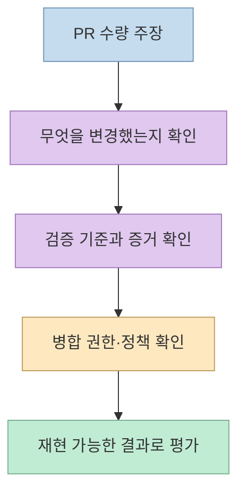
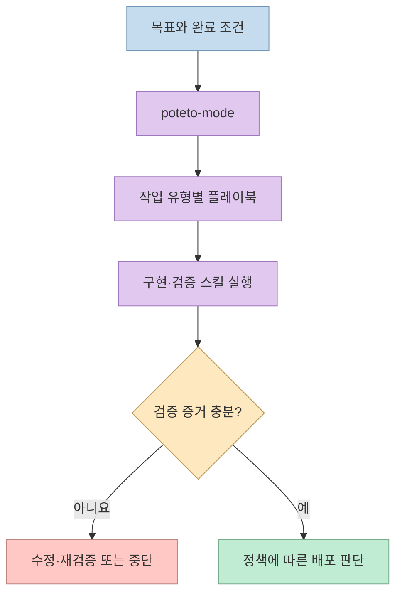
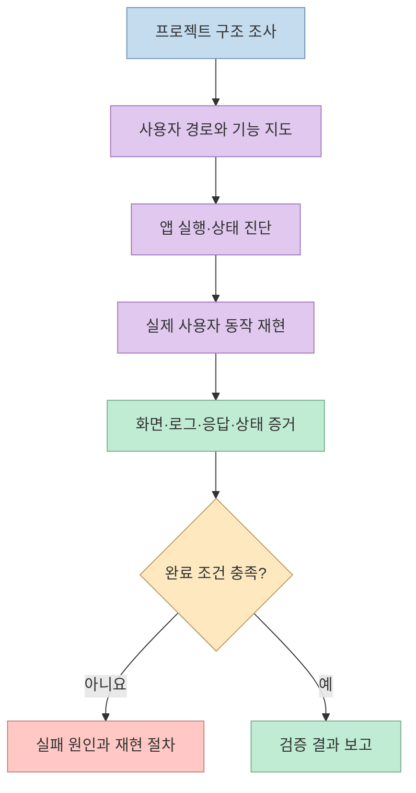
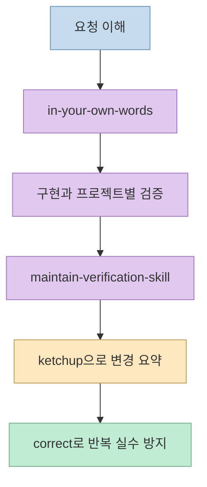

"한 달에 2,500건의 PR을 배포했고 AI가 검토·병합했다"는 이야기는 강렬하다. [ZeroCho TV의 Pstack 소개 영상](https://youtu.be/z6srjDQwY6w?t=0) 은 이 사례를 시작으로, 에이전트가 만든 코드를 **어떤 기준과 증거로 확인할 것인가** 에 초점을 맞춘다. 숫자 자체는 당사자의 발표에서 나온 자기 보고이며, 모든 팀이 사람의 승인 없이 같은 방식을 적용할 수 있다는 증명은 아니다.

<!--more-->

## Sources

- [원본 영상: 사람 검토 없이 한달 2500건 기능 배포? Pstack 알아보기](https://youtube.com/shorts/z6srjDQwY6w?si=GZgEsqgBPCv3MLEJ)
- [Pstack 공식 저장소](https://github.com/cursor/plugins/tree/main/pstack)
- [Pstack 설치와 시작 가이드](https://github.com/cursor/plugins/blob/main/pstack/docs/guide/01-setup.md)
- [프로젝트 검증 스킬 공식 문서](https://github.com/cursor/plugins/blob/main/pstack/skills/create-verification-skill/SKILL.md)
- [검증과 배포 가이드](https://github.com/cursor/plugins/blob/main/pstack/docs/guide/06-verify-and-ship.md)
- [야간 자율 작업 가이드](https://github.com/cursor/plugins/blob/main/pstack/docs/guide/07-overnight.md)

영상은 한국어 자동 자막을 기준으로 시간대를 확인했다. 아래에서 **영상 진행자의 경험**, **Pstack 문서가 실제로 설명하는 기능**, **실무 적용을 위한 제안** 을 구분한다.

## 1. 2,500건이라는 숫자를 어떻게 읽어야 하나

[영상 초반](https://youtu.be/z6srjDQwY6w?t=0) 은 Lauren Tan의 한 달 약 2,000~2,500건 PR 배포 사례와 AI 검토·병합을 소개한다. 그러나 영상에서 전하는 숫자는 당사자가 발표한 사례이지, 독립적으로 검증된 생산성 실험이나 "2,500개 기능"을 뜻하지 않는다. 더 중요한 질문은 PR 개수가 아니라 **어떤 변경을 어떤 조건에서 자동으로 통과시켰고, 실패했을 때 어떻게 멈췄는가** 다. [영상 00:00–00:22](https://youtu.be/z6srjDQwY6w?t=0) · [Pstack 공식 저장소](https://github.com/cursor/plugins/tree/main/pstack)

공식 README 역시 코드 생산량을 목표로 내세우지 않는다. 더 적은 코드로 검증 가능한 작업을 만들고, 이를 바탕으로 병렬 작업을 신뢰할 수 있게 하려는 접근이다. 따라서 "사람이 리뷰하지 않아도 된다"를 Pstack 설치만으로 달성되는 기본 기능으로 해석하면 위험하다. 자동 병합 여부는 프로젝트의 검증 체계, 저장소 보호 규칙, 조직의 승인 정책과 별개로 결정해야 한다. [영상 00:15–00:35](https://youtu.be/z6srjDQwY6w?t=15) · [Pstack 공식 README](https://github.com/cursor/plugins/tree/main/pstack)

## 2. poteto-mode는 스킬 목록이 아니라 작업 라우터

[영상은 Pstack을 Cursor 플러그인으로 소개](https://youtu.be/z6srjDQwY6w?t=22) 하고, 진행자는 Codex에서도 일부 스킬을 사용해 봤다고 말한다. 공식 문서에서 지원 방법이 구체적으로 적힌 환경은 Cursor와 Claude Code다. **"Codex에서도 사용했다"는 진행자의 경험담** 이며, Cursor 전용 기능까지 Codex에서 같은 방식으로 동작한다는 공식 보장은 아니다. 공식 문서도 다른 도구가 Agent Skills 형식의 파일을 읽을 수는 있지만, 서브에이전트·Custom Modes·반복 실행처럼 호스트 기능에 의존하는 단계는 그대로 재현되지 않을 수 있다고 구분한다. [영상 00:22–00:29](https://youtu.be/z6srjDQwY6w?t=22) · [공식 도움말](https://github.com/cursor/plugins/blob/main/pstack/skills/poteto-help/SKILL.md)

`/poteto-mode`는 요청을 읽어 작업 유형에 맞는 플레이북을 고르고, 필요한 다른 스킬을 단계별로 호출하는 중심 진입점이다. [영상의 "자러 가니 아침까지 작업해 달라"는 예시](https://youtu.be/z6srjDQwY6w?t=40) 는 **이미 신뢰할 만한 검증 루프가 갖춰진 경우** 를 전제로 읽어야 한다. 공식 야간 작업 가이드는 완료 조건, 분리된 작업 공간, 의사결정 기록, 막혔을 때 중단하는 조건을 명시한다. 무조건 밤새 병합을 계속하라는 지침이 아니다. [영상 00:40–00:52](https://youtu.be/z6srjDQwY6w?t=40) · [poteto-mode 가이드](https://github.com/cursor/plugins/blob/main/pstack/docs/guide/02-poteto-mode.md) · [야간 작업 가이드](https://github.com/cursor/plugins/blob/main/pstack/docs/guide/07-overnight.md)

## 3. 프로젝트별 검증 스킬이 리뷰의 빈자리를 메운다

[영상에서 가장 실용적인 장면](https://youtu.be/z6srjDQwY6w?t=59) 은 진행자 자신의 웹 서비스에 검증 스킬을 적용한 부분이다. 진행자에 따르면 버튼 작동, 화면 넘침, 폰트 로딩, 네트워크·자바스크립트 오류 등을 검사하도록 체크리스트가 작성되고, 스크린샷과 JSON 형태의 증거도 남았다. 이것은 **해당 서비스에 대한 진행자의 시연 결과** 다. Pstack이 설치만 되면 모든 서비스에서 같은 항목을 자동으로 검사한다는 뜻은 아니다. [영상 01:43–02:08](https://youtu.be/z6srjDQwY6w?t=103)

공식 `/create-verification-skill` 문서는 먼저 프로젝트 코드를 읽고 실제 사용자 표면, 실행 방법, 조작 도구, 관찰 가능한 증거, 실행 환경의 격리 가능성을 파악하라고 요구한다. 그다음 프로젝트 전용 `verify-<app>` 스킬과 기능 지도를 만들고, **한 기능을 실제로 실행해 증거를 캡처한 뒤 정리 단계에서도 증거가 남는지** 확인한다. 검증 스킬이 곧 "테스트 목록"인 것이 아니다. 사용자의 실제 경로를 재현하고 결과를 관찰할 수 있는 절차가 되어야 한다. [영상 01:01–01:28](https://youtu.be/z6srjDQwY6w?t=61) · [공식 검증 스킬 문서](https://github.com/cursor/plugins/blob/main/pstack/skills/create-verification-skill/SKILL.md)

영상은 변경된 기획에 맞춰 체크리스트를 갱신하는 스킬도 언급한다. 공식 저장소의 `/maintain-verification-skill`은 기능 지도가 현재 코드와 어긋났는지 소스와 실제 실행을 통해 확인하고, 검증 절차의 변경만 다룬다. **검증 문서가 오래되면 "통과"라는 표시도 신뢰하기 어렵다** 는 점에서 유지보수는 별도 단계다. [영상 01:08–01:13](https://youtu.be/z6srjDQwY6w?t=68) · [공식 유지보수 스킬](https://github.com/cursor/plugins/blob/main/pstack/skills/maintain-verification-skill/SKILL.md)

## 4. 영상 속 스킬명과 공식 저장소의 실제 이름

자동 자막에는 스킬 이름이 음차되거나 다르게 들리는 부분이 있다. [요청을 다시 설명하는 장면](https://youtu.be/z6srjDQwY6w?t=53) 의 스킬은 현재 저장소에서 `/in-your-own-words`다. 사용자의 목표와 풀려는 문제를 에이전트 자신의 말로 되짚어, 구현 전에 오해를 드러내는 짧은 절차다. 영상 속 "온즈"라는 표기를 그대로 명령어로 입력하지 않는 편이 좋다. [영상 00:53–01:00](https://youtu.be/z6srjDQwY6w?t=53) · [공식 스킬](https://github.com/cursor/plugins/blob/main/pstack/skills/in-your-own-words/SKILL.md)

[밤사이 작업을 요약받는 부분](https://youtu.be/z6srjDQwY6w?t=74) 에 대응하는 현재 스킬명은 `/ketchup`이다. 마지막 사용자 메시지 이후 변경된 내용과 사용자 판단이 필요한 항목을 짧게 정리한다. `/correct`는 반복되는 에이전트 실수를 찾아 문서화만 하는 대신 구조, 타입, 린트, 테스트 등 가능한 높은 수준에서 재발을 막는 방향을 제시한다. `/unslop`은 AI 특유의 장황하고 모호한 문장을 덜어내는 글쓰기 스킬이다. 이들은 검증 스킬과 역할이 다르다. [영상 01:14–01:31](https://youtu.be/z6srjDQwY6w?t=74) · [ketchup](https://github.com/cursor/plugins/blob/main/pstack/skills/ketchup/SKILL.md) · [correct](https://github.com/cursor/plugins/blob/main/pstack/skills/correct/SKILL.md) · [unslop](https://github.com/cursor/plugins/blob/main/pstack/skills/unslop/SKILL.md)

## 실전 적용 포인트

처음부터 자동 병합을 켜기보다 **하나의 작고 되돌릴 수 있는 변경** 으로 시작하는 편이 안전하다. 먼저 사용자 관점의 완료 조건을 적고, 프로젝트에 맞는 검증 절차를 만들고, 실패를 의도적으로 재현해 검사기가 이를 잡는지 확인한다. 이후 실제 변경에서 스크린샷·로그·테스트 결과처럼 판단 가능한 증거를 남긴다. 이것은 영상의 검증 중심 접근과 공식 문서를 토대로 한 적용 순서이며, 특정 팀의 보안·승인 규정을 대체하지 않는다. [영상 00:30–00:36](https://youtu.be/z6srjDQwY6w?t=30) · [검증과 배포 가이드](https://github.com/cursor/plugins/blob/main/pstack/docs/guide/06-verify-and-ship.md)

검증 대상이 결제, 권한, 데이터 삭제처럼 사고 비용이 큰 경로라면 브라우저 체크만으로 충분하다고 가정하지 말아야 한다. 테스트가 놓치기 쉬운 불변식이나 재시도·동시성 문제에는 공식 문서가 별도의 형식 검증 스킬도 제시한다. 또한 조직에서 AI 도구 사용이 제한된다면 승인되지 않은 코드·데이터를 외부 모델에 보내서는 안 된다. 영상 진행자도 기업별 사용 제한과 무인 검토에 대한 자신의 의문을 함께 말한다. [영상 02:08–02:49](https://youtu.be/z6srjDQwY6w?t=128) · [형식 검증 스킬](https://github.com/cursor/plugins/blob/main/pstack/skills/create-formal-verification-skill/SKILL.md)

## 핵심 요약

- 2,500건은 발표자의 **자기 보고 사례** 다. 품질과 재현 가능성을 판단하려면 PR 개수보다 검증 증거와 병합 정책을 봐야 한다. [영상 00:00](https://youtu.be/z6srjDQwY6w?t=0) · [공식 README](https://github.com/cursor/plugins/tree/main/pstack)
- `/poteto-mode`는 작업을 플레이북과 스킬로 연결한다. 밤새 자율 실행하는 경우에도 완료·중단 조건과 격리가 필요하다. [영상 00:40](https://youtu.be/z6srjDQwY6w?t=40) · [야간 작업 가이드](https://github.com/cursor/plugins/blob/main/pstack/docs/guide/07-overnight.md)
- 핵심 품질 장치는 프로젝트에 맞춘 `/create-verification-skill`과 **실제 사용자 경로에서 수집한 증거** 다. [영상 01:01](https://youtu.be/z6srjDQwY6w?t=61) · [공식 스킬](https://github.com/cursor/plugins/blob/main/pstack/skills/create-verification-skill/SKILL.md)
- 영상의 음차를 명령어로 옮기지 말고 현재 저장소의 `/in-your-own-words`, `/ketchup`, `/correct` 등 정확한 이름을 확인해야 한다. [영상 00:53](https://youtu.be/z6srjDQwY6w?t=53) · [공식 스킬 목록](https://github.com/cursor/plugins/tree/main/pstack/skills)

## 결론

Pstack에서 배울 점은 "AI가 사람 대신 전부 병합한다"는 구호보다, **에이전트가 결과를 스스로 입증할 수 있게 프로젝트별 검증 절차를 만든다** 는 설계다. 검증이 빈약한 상태에서 병렬 작업과 자동 병합만 늘리면 확인되지 않은 변경도 함께 늘어난다. 먼저 작은 변경에서 증거를 남기는 루프를 만들고, 신뢰가 쌓인 범위에만 자율성을 넓혀야 한다. [영상 00:30](https://youtu.be/z6srjDQwY6w?t=30) · [검증과 배포 가이드](https://github.com/cursor/plugins/blob/main/pstack/docs/guide/06-verify-and-ship.md)
