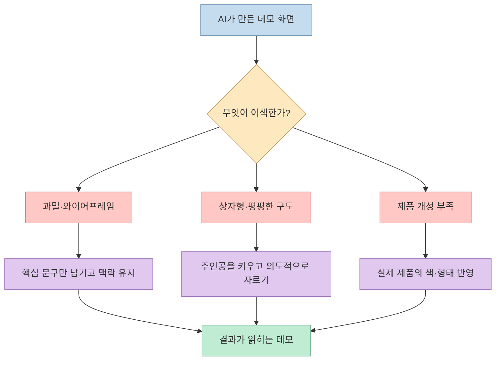
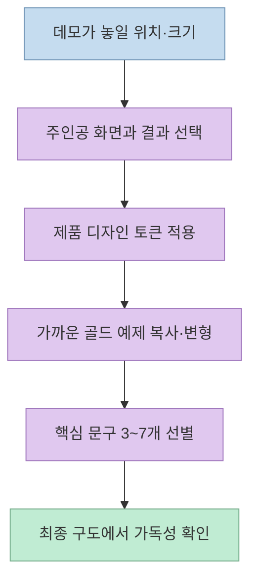
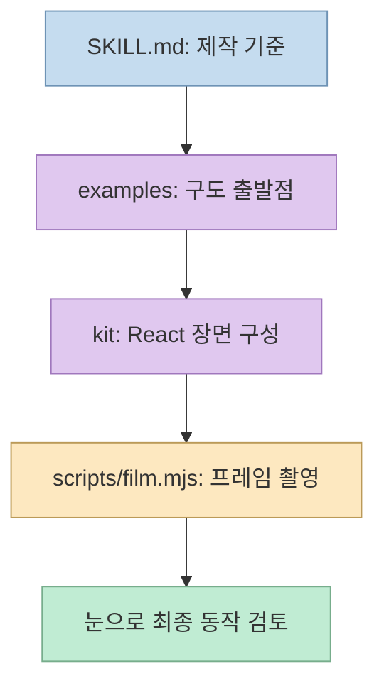
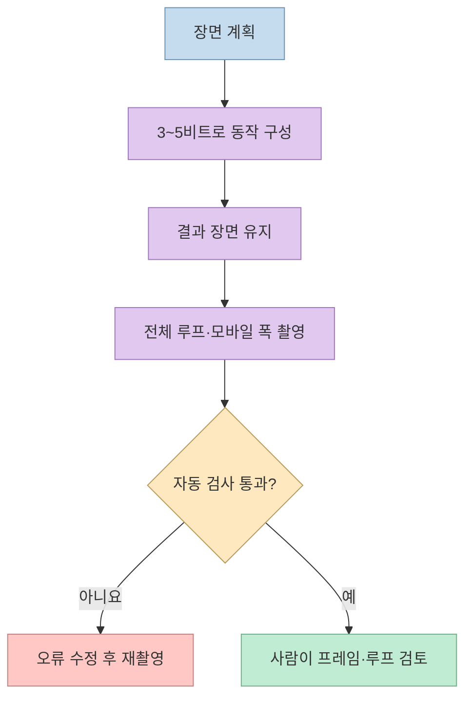

AI가 만든 제품 데모는 요소가 많아도 실제 제품처럼 보이지 않을 때가 있다. [찐AI의 Stageshow 소개 영상](https://youtu.be/dfkCiMHS5f8?t=0) 은 이 문제를 화면의 정보량, 구도, 움직임을 설계하는 방식으로 풀어낸다. Stageshow는 앱의 실제 동작을 녹화하는 도구가 아니라, **제품을 닮은 UI 일러스트와 짧은 애니메이션을 만드는 에이전트 스킬과 React 키트** 다.

<!--more-->

## Sources

- [원본 영상: AI가 만든 가짜 UI, 진짜 제품처럼! Stageshow 스킬](https://youtube.com/shorts/dfkCiMHS5f8?si=pOQAaoSE25rB5Qb9)
- [Stageshow 제작자 소개 페이지](https://benji.org/stageshow)
- [Stageshow 공식 저장소와 README](https://github.com/benjitaylor/skills/blob/main/stageshow/README.md)
- [Stageshow 공식 SKILL.md](https://github.com/benjitaylor/skills/blob/main/stageshow/SKILL.md)

영상의 한국어 자동 자막을 시간대별로 확인하고 공식 문서와 대조했다. 아래에서 영상의 시연 결과와 스킬의 설계 지침을 구분한다.

## 1. 가짜처럼 보이는 화면의 다섯 가지 실패

[영상은 실패 유형을 다섯 가지로 정리](https://youtu.be/dfkCiMHS5f8?t=7) 한다. **Too much** 는 숫자와 실제 문구를 모든 칸에 채워 과밀해진 화면이다. **Wireframe** 은 회색 덩어리와 버튼 몇 개만 남아 제품으로 읽히지 않는 화면이다. **Boxed** 는 창 전체를 작은 카드 안에 가둬 스크린샷을 붙인 것처럼 보이는 구도다. **Flat** 은 모든 요소의 시각적 무게가 같아 시선이 머물 곳이 없는 상태다. **Bland** 는 요청한 제품의 색과 성격이 빠진 무난한 회색 UI다. 이 분류는 제작자의 [공식 SKILL.md](https://github.com/benjitaylor/skills/blob/main/stageshow/SKILL.md) 에도 명시되어 있다. [영상 00:07–00:14](https://youtu.be/dfkCiMHS5f8?t=7)

해법은 요소를 무작정 삭제하는 것이 아니다. 문서의 핵심 원칙은 **실제 제품으로 읽히되, 보는 사람이 필요한 부분만 남기고, 의도적으로 화면을 잡으며, 모든 움직임에 원인을 두는 것** 이다. 이야기의 중심이 되는 부분에는 알아볼 수 있는 실제 문구를 쓰고 주변은 간략화한다. 화면의 바탕과 창 구조까지 지워버리면 다시 와이어프레임이 된다. [영상 00:14–00:27](https://youtu.be/dfkCiMHS5f8?t=14) · [공식 SKILL.md](https://github.com/benjitaylor/skills/blob/main/stageshow/SKILL.md)

## 2. 같은 요청의 전후 비교는 무엇을 보여주나

[영상은 분석 대시보드, 팀 채팅 앱, 벤토 그리드 예시](https://youtu.be/dfkCiMHS5f8?t=27) 를 스킬 적용 전후로 보여준다. 진행자의 설명은 숫자가 빽빽한 화면보다 중심 정보가 살아 있는 화면이 더 제품처럼 보인다는 것이다. 이는 영상의 **시각적 시연** 이지, 사용성 점수나 전환율을 측정한 실험은 아니다. 세 예시의 정확한 코드나 입력 프롬프트가 영상 자막에 모두 공개된 것은 아니므로 재현 성능까지 단정할 수 없다. [영상 00:27–00:42](https://youtu.be/dfkCiMHS5f8?t=27)

공식 스킬은 데모가 놓일 매체와 크기부터 정하고, **주인공이 되는 창 또는 기기, 보여줄 한 가지 동작, 결과 장면, 생략 가능한 요소** 를 먼저 계획하도록 한다. 이어 제품의 디자인 토큰을 키트에 맞추고, 가장 가까운 완성 예제를 출발점으로 삼아 구도와 화면의 밀도를 비교한다. 한 화면에 실제로 읽히는 문구는 대체로 **3~7개** 만 두도록 권한다. 이것은 모든 UI 요소가 3~7개여야 한다는 뜻이 아니라, 독자의 시선을 붙잡는 **실제 텍스트의 예산** 이다. [영상 00:21–00:27](https://youtu.be/dfkCiMHS5f8?t=21) · [공식 SKILL.md](https://github.com/benjitaylor/skills/blob/main/stageshow/SKILL.md)

## 3. 스킬·React 키트·예제·검사 스크립트의 역할

[영상은 스킬과 React 키트, 여러 골드 예제, 프레임 검사 스크립트](https://youtu.be/dfkCiMHS5f8?t=42) 를 함께 소개한다. 공식 저장소에서도 `SKILL.md`는 제작 판단과 순서를 가르치고, `kit/`은 `Stage`, `Window` 같은 재사용 가능한 React 구성 요소와 스타일을 제공한다. `examples/`는 완성도 기준이 되는 장면을, `teaching/`은 잘못된 구성과 교정된 구성을 보여준다. `scripts/film.mjs`는 화면을 촬영해 접촉 시트와 검증 결과를 만드는 도구다. [영상 00:42–00:48](https://youtu.be/dfkCiMHS5f8?t=42) · [공식 README](https://github.com/benjitaylor/skills/blob/main/stageshow/README.md)

중요한 경계가 있다. 키트의 커서 동작은 **실제 앱의 버튼을 자동으로 누르는 브라우저 테스트가 아니다**. 예제에서 클릭은 커서가 누르는 모습을 그리고, 상태 변경은 연출된 장면을 바꾼다. 따라서 마케팅용 제품 일러스트·설명 애니메이션에는 적합하지만, 실제 서비스가 정상 작동한다는 증거로 사용하면 안 된다. 그런 증거가 필요하다면 별도로 실제 앱을 실행·조작·기록해야 한다. [공식 README](https://github.com/benjitaylor/skills/blob/main/stageshow/README.md) · [공식 SKILL.md](https://github.com/benjitaylor/skills/blob/main/stageshow/SKILL.md)

## 4. 짧은 데모의 비트와 프레임 검증

[영상 마지막](https://youtu.be/dfkCiMHS5f8?t=48) 은 `npx skills add` 설치 방식과 Claude Code·Codex·Gemini에서의 사용, **3~5비트·10~16초** 구성 지침을 언급한다. 제작자 페이지의 정확한 설치 명령은 `npx skills add benjitaylor/skills --skill stageshow`다. 이는 스킬을 추가하는 명령이지, 앱의 기존 UI를 자동으로 분석해 완성 영상을 내보내는 단일 명령은 아니다. 호스트별 스킬 로딩 방식과 실행 환경도 확인해야 한다. [영상 00:48–00:58](https://youtu.be/dfkCiMHS5f8?t=48) · [제작자 페이지](https://benji.org/stageshow)

공식 지침은 짧은 이야기에서 **동작마다 원인이 보이도록** 한다. 커서가 무엇을 눌렀는지, 그 결과 어떤 패널이나 값이 달라졌는지, 결과를 읽을 시간이 있는지 점검한다. 애니메이션을 만들었다면 정지 장면만 확인하지 말고 전체 루프와 모바일 폭을 촬영해야 한다. `film.mjs`의 `--gate`는 프레임 검사와 접촉 시트를 제공하지만, 공식 문서도 자동 검사를 통과한 결과를 사람이 직접 다시 보라고 한다. [영상 00:54–00:58](https://youtu.be/dfkCiMHS5f8?t=54) · [공식 SKILL.md](https://github.com/benjitaylor/skills/blob/main/stageshow/SKILL.md) · [공식 README](https://github.com/benjitaylor/skills/blob/main/stageshow/README.md)

## 실전 적용 포인트

작은 기능 카드 하나로 시작한다면, **실제로 전달할 제품 특징 한 가지** 를 고른 뒤 최종 표시 크기와 핵심 문구를 정한다. 가까운 골드 예제를 복사해 제품의 색·글꼴·아이콘으로 바꾸고, 결과가 보이는 정지 프레임을 먼저 완성한다. 움직임은 그다음에 추가하며, 클릭과 상태 변화의 인과관계가 보이는지 확인한다. 이는 공식 스킬의 제작 순서를 작은 작업으로 압축한 적용 제안이다. [공식 SKILL.md](https://github.com/benjitaylor/skills/blob/main/stageshow/SKILL.md) · [영상 00:14–00:27](https://youtu.be/dfkCiMHS5f8?t=14)

최종 검수에서는 **데스크톱과 좁은 폭, 정지 프레임과 루프, 자동 검사와 육안 검토** 를 각각 확인한다. 원본 제품과 닮은 시각 자료를 만들더라도, 실제 동작을 보여줘야 하는 데모라면 연출된 UI와 실서비스 화면을 혼동하지 않도록 표시해야 한다. [공식 README](https://github.com/benjitaylor/skills/blob/main/stageshow/README.md) · [영상 00:42–00:58](https://youtu.be/dfkCiMHS5f8?t=42)

## 핵심 요약

- Stageshow는 제품을 닮은 **연출용 UI** 를 만드는 스킬과 React 키트다. 실제 앱 자동 조작이나 기능 테스트 도구는 아니다. [영상 00:00](https://youtu.be/dfkCiMHS5f8?t=0) · [공식 README](https://github.com/benjitaylor/skills/blob/main/stageshow/README.md)
- 실패 유형은 과밀, 와이어프레임, 상자형 구도, 평평한 계층, 제품 개성 부족의 다섯 가지다. [영상 00:07](https://youtu.be/dfkCiMHS5f8?t=7) · [공식 SKILL.md](https://github.com/benjitaylor/skills/blob/main/stageshow/SKILL.md)
- 스킬은 대체로 **3~7개의 실제 문구**, 애니메이션은 **3~5비트·10~16초** 를 가이드한다. 절대적인 UI 요소 수 제한이나 성과 보장은 아니다. [영상 00:21](https://youtu.be/dfkCiMHS5f8?t=21) · [영상 00:54](https://youtu.be/dfkCiMHS5f8?t=54)
- 예제에서 시작해 프레임을 촬영·검사하고, 마지막에는 사람이 화면과 움직임을 직접 확인한다. [영상 00:42](https://youtu.be/dfkCiMHS5f8?t=42) · [공식 README](https://github.com/benjitaylor/skills/blob/main/stageshow/README.md)

## 결론

Stageshow가 줄이려는 "가짜 티"는 단순히 그림의 해상도 문제가 아니다. **무엇을 보여줄지, 어떤 크기로 자를지, 클릭 뒤 무엇이 바뀌어야 하는지** 를 정하지 않은 데모가 어색해진다. 공식 예제와 검사 스크립트는 그 판단을 돕지만, 마지막 품질 판단과 실제 제품 동작의 검증까지 대신하지는 않는다. [영상 00:00–00:58](https://youtu.be/dfkCiMHS5f8?t=0) · [공식 SKILL.md](https://github.com/benjitaylor/skills/blob/main/stageshow/SKILL.md)
