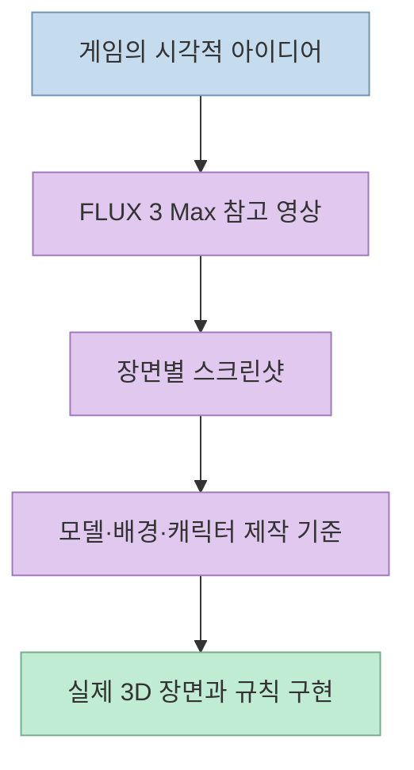
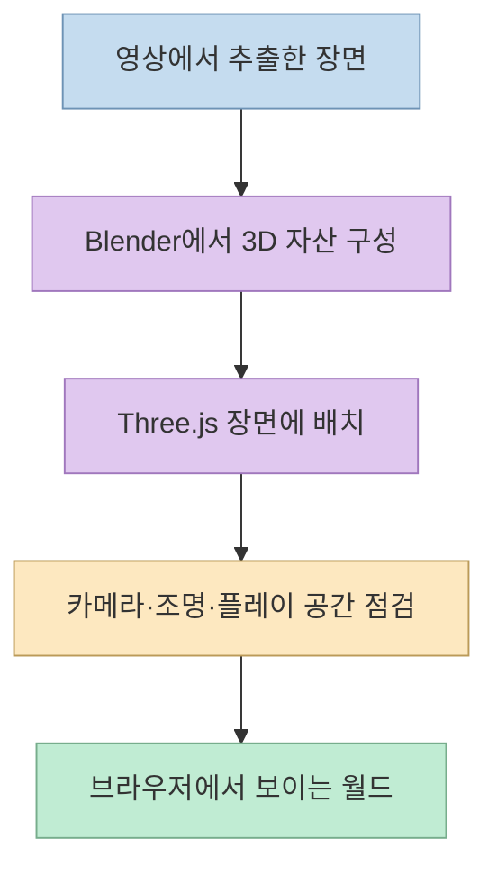
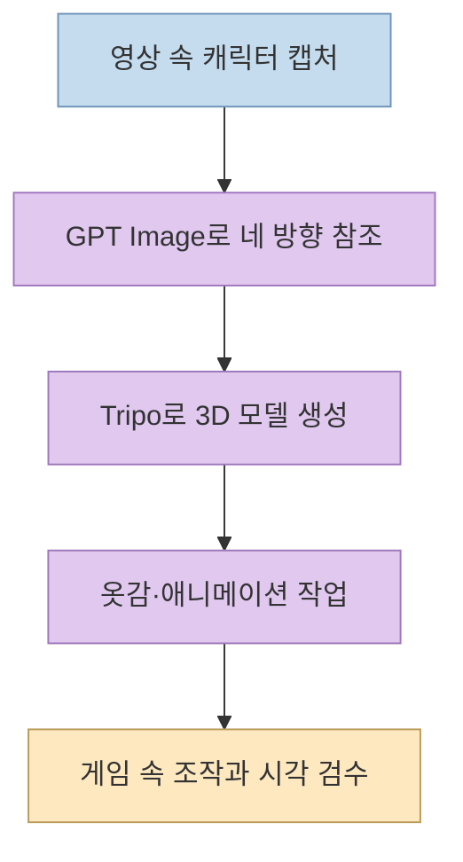
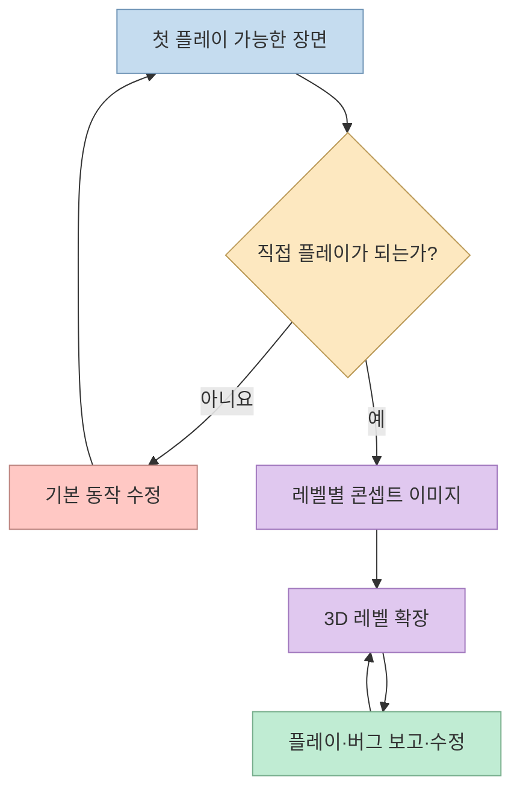

Shikhar는 [X 스레드](https://x.com/xikhar/status/2117776295534997818) 에서 AI 도구를 사용해 24시간 안에 오리지널 게임 **Sumiro**를 만들었다고 밝혔다. 흥미로운 점은 영상 생성 모델이 게임을 한 번에 만들어 준 것이 아니라, **원하는 게임의 영상을 먼저 레퍼런스로 만들고 그것을 다시 3D 자산과 플레이 가능한 장면으로 재구성했다** 는 제작 순서다. 24시간과 "완전한 게임"은 작성자의 자체 설명이며, 외부의 독립적인 제작 시간 검증이나 상용 출시를 뜻하지 않는다.

<!--more-->

## Sources

- [원본 X 스레드: Shikhar의 24시간 AI 게임 제작 기록](https://x.com/xikhar/status/2117776295534997818)
- [작성자가 공개한 Sumiro 데모](https://xikhar.github.io/sumiro/)
- [fal의 FLUX 3 Max 소개](https://fal.ai/blog/introducing-flux-3-max-by-fal)
- [Tripo 공식 문서: 이미지에서 3D 모델 만들기](https://www.tripo3d.ai/help/features/how-to-use-the-image-to-3d-feature)
- [Blender 공식 기능 안내: 애니메이션과 리깅](https://www.blender.org/features/animation/)
- [Three.js 공식 문서: 장면 만들기](https://threejs.org/manual/pages/creating-a-scene.html)

원본 게시물과 이어진 대화는 X의 공개 임베드·게시물 데이터와 읽기 전용 페이지 추출을 대조해 확인했다. 스레드의 여섯 단계는 작성자의 작업 기록이며, 서비스 문서는 각 도구의 **가능한 역할** 만 교차 확인한다. 실제 작업 시간, 모든 생성물의 독창성, 게임의 완성도까지 독립 검증한 자료는 아니다.

## 1. 영상은 결과물이 아니라 세계관 레퍼런스였다

작성자는 첫 단계에서 fal의 **FLUX 3 Max** 로 영상을 만들고, 그것을 게임의 외형·세계·캐릭터를 위한 공통 레퍼런스로 사용했다고 설명한다. FLUX 3 Max가 영상 생성 모델이라는 점은 [fal의 공식 발표](https://fal.ai/blog/introducing-flux-3-max-by-fal) 로도 확인된다. 하지만 **영상 파일을 입력하자 자동으로 3D 게임이 완성된 것** 은 아니다. 다음 단계에서 영상의 스크린샷을 뽑아 자산을 다시 만드는 별도 작업이 이어졌다. [작성자의 1~2단계 설명](https://x.com/xikhar/status/2117776295534997818)

한 영상으로 시각적 목표를 먼저 고정하면 캐릭터, 배경, 레벨이 서로 다른 방향으로 만들어지는 일을 줄일 수 있다. 다만 이는 이 사례에서 읽을 수 있는 **작업 설계상의 해석** 이다. 영상이 실제 플레이 규칙, 충돌 판정, 카메라 동작을 명세하지는 않으므로 이를 게임 코드로 옮기는 과정은 따로 필요하다. [작성자의 작업 스레드](https://x.com/xikhar/status/2117776295534997818)

## 2. Blender와 Three.js로 장면을 다시 만들었다

두 번째 단계에서 작성자는 **영상 스크린샷을 참고해 Blender에서 자산을 다시 만들고 Three.js 장면에 배치** 했다고 한다. Claude Code에서는 여러 에이전트가 제작과 확인을 병렬로 수행했다고 설명한다. 여기서 Blender는 3D 자산 제작·수정에, Three.js는 브라우저에서 장면을 구성하고 렌더링하는 데 쓰인 것으로 읽힌다. Three.js 공식 문서도 장면·카메라·렌더러를 별도 구성 요소로 설명한다. 병렬 에이전트의 구체적인 수와 비용, 성공률은 스레드에 제시되지 않았다. [작성자의 2단계 설명](https://x.com/xikhar/status/2117776295534997818) · [Three.js 공식 문서](https://threejs.org/manual/pages/creating-a-scene.html)

이 단계는 **이미지를 그대로 3D 공간에 붙여 놓는 것** 과 다르다. 화면에 보이는 물체를 모델로 구성하고, 플레이어가 움직일 수 있도록 위치와 크기를 잡으며, 카메라에서 읽히는 장면으로 배치해야 한다. 다만 작성자가 각 소품을 어떤 방식으로 모델링했는지는 공개된 짧은 스레드만으로 전부 재현할 수 없다. 아래 도식은 그 역할 분리를 설명하는 개념도다. [작성자의 2단계 설명](https://x.com/xikhar/status/2117776295534997818)

## 3. 캐릭터는 이미지·3D 변환·애니메이션을 나눠 제작

세 번째 단계에서는 참고 영상에서 캐릭터를 캡처하고, **GPT Image로 네 방향의 모습을 만든 뒤 Tripo에서 3D 모델로 변환** 했다고 한다. 이후 Opus를 이용해 옷감 물리와 애니메이션을 더했다고 설명한다. Tripo가 이미지 입력으로 3D 모델을 생성하는 기능을 제공한다는 사실은 [공식 도움말](https://www.tripo3d.ai/help/features/how-to-use-the-image-to-3d-feature) 에서 확인된다. 반면 이 게임에 사용된 구체적인 모델 버전, 리깅 설정, 옷감 시뮬레이션 파라미터는 스레드에 없다. [작성자의 3단계 설명](https://x.com/xikhar/status/2117776295534997818)

중요한 것은 **외형 참조와 움직이는 캐릭터가 별도 산출물** 이라는 점이다. 여러 방향의 이미지는 3D 형태의 기준이 될 수 있지만, 플레이어가 조작하는 캐릭터에는 애니메이션과 게임 내 동작 연결이 필요하다. Blender도 리깅·애니메이션 기능을 제공하지만, 작성자의 모든 애니메이션이 Blender에서 처리됐다고까지 단정하지 않는다. [작성자의 3단계 설명](https://x.com/xikhar/status/2117776295534997818) · [Blender 공식 기능 안내](https://www.blender.org/features/animation/)

## 4. 레벨을 늘리기 전에 플레이 가능한 프로토타입부터

작성자의 네 번째 단계는 화려한 자산을 더 만드는 일이 아니라 **첫 프로토타입을 직접 플레이해 작동 여부를 확인하는 것** 이다. 그다음에야 기존 미술 스타일을 바탕으로 GPT Image가 레벨별 콘셉트 이미지를 만들었다고 한다. 작성자는 한 레벨에 최대 8장의 이미지를 사용했다고 설명하지만, 이 숫자는 이 프로젝트의 사례이지 다른 게임의 일반적인 권장량이 아니다. [작성자의 4~5단계 설명](https://x.com/xikhar/status/2117776295534997818)

이 순서는 병렬 에이전트 작업에서 특히 중요하다. 이동·카메라·충돌·목표 같은 기본 규칙이 깨진 상태로 여러 레벨을 확장하면 같은 결함을 모든 장면에 복제할 수 있다. 따라서 **한 레벨에서 조작 가능한 경로를 검증한 뒤** 콘셉트 이미지를 바탕으로 나머지를 확장하는 것이 이 스레드의 핵심 운영 원칙으로 읽힌다. 이는 작성자가 설명한 작업 순서로부터 도출한 해석이며, 특정 테스트 프레임워크를 사용했다는 주장은 아니다. [작성자의 4~6단계 설명](https://x.com/xikhar/status/2117776295534997818)

## 5. 공개 데모와 남아 있는 한계

작성자는 여섯 번째 단계에서 **각 콘셉트를 플레이 가능한 3D 레벨로 만들고**, 직접 플레이하며 버그를 보고하면 에이전트가 수정·개선하는 루프를 반복했다고 말한다. 후속 설명에서는 퍼즐, 파쿠르, 플랫폼 이동을 핵심 조작으로 꼽고, 진행하면서 전투도 등장한다고 덧붙였다. [Sumiro 공개 페이지](https://xikhar.github.io/sumiro/) 의 존재는 확인했지만, 이 글을 위해 전체 레벨을 끝까지 플레이하거나 제작 시간을 독립 검증하지는 않았다. [원본 스레드와 작성자의 후속 설명](https://x.com/xikhar/status/2117776295534997818)

작성자는 게시물의 시연 영상도 Claude가 직접 플레이하면서 녹화했기 때문에 움직임이 다소 뻣뻣하게 보일 수 있다고 설명했다. 음악의 완성도에도 아쉬움을 인정하며 24시간 제약 안에서는 별도 음악 제작 작업을 충분히 하지 못했다고 했다. 이 발언은 **AI가 제작 과정의 여러 일을 처리해도 오디오 품질과 실제 플레이 감각은 따로 검수해야 한다** 는 한계를 보여준다. [작성자의 후속 설명](https://x.com/xikhar/status/2117776295534997818)

"누구나 게임을 만들 수 있다"는 문장은 접근성에 대한 작성자의 평가로 읽어야 한다. 이 사례에는 여러 유료 가능성이 있는 생성 서비스와 3D 제작 도구, 반복 플레이·버그 보고가 포함된다. 결과물의 상업적 사용 권한이나 비용은 사용한 각 서비스의 조건과 생성 자산의 출처를 따로 확인해야 한다. **24시간 안에 플레이 가능한 개인 실험을 만들었다는 주장** 과 **출시 가능한 완성 게임을 검증했다는 주장** 은 같지 않다. [원본 스레드](https://x.com/xikhar/status/2117776295534997818) · [Tripo 공식 도움말](https://www.tripo3d.ai/help/features/how-to-use-the-image-to-3d-feature)

## 실전 적용 포인트

이 사례를 따라 해 본다면 먼저 **참고 영상이 담당할 일과 게임 엔진이 담당할 일** 을 분리해야 한다. 영상은 세계관·색·카메라 분위기의 기준이고, 3D 자산·조작·충돌·레벨 구성은 별도 구현이다. 한 장면만 플레이 가능하게 만든 뒤 이동과 상호작용을 검증하고, 그 다음에 여러 레벨의 콘셉트와 자산 제작을 병렬화한다. 이는 작성자의 여섯 단계를 재사용 가능한 작업 순서로 재구성한 제안이다. [작성자의 작업 스레드](https://x.com/xikhar/status/2117776295534997818)

검수 기준도 단계마다 다르게 둔다. **참고 영상** 은 시각적 일관성, **3D 모델** 은 실루엣과 애니메이션, **첫 프로토타입** 은 조작 가능성, **확장 레벨** 은 진행과 버그, **최종 데모** 는 실제 플레이 감각과 소리를 본다. 원본 스레드에는 재현 가능한 전체 프롬프트, 비용 명세, 자동화 스크립트가 텍스트로 모두 제공되지 않으므로 이 글에서 임의로 보충하지 않았다. [원본 스레드](https://x.com/xikhar/status/2117776295534997818)

## 핵심 요약

- **24시간 제작** 은 작성자의 자체 보고다. 공개 데모는 있지만 상용 출시 수준이나 제작 시간을 독립 검증한 근거는 아니다. [원본 게시물](https://x.com/xikhar/status/2117776295534997818) · [데모](https://xikhar.github.io/sumiro/)
- **FLUX 3 Max 영상** 은 게임의 시각적 레퍼런스였고, 스크린샷을 참고해 Blender 자산과 Three.js 장면을 다시 만들었다. [원본 스레드](https://x.com/xikhar/status/2117776295534997818) · [fal 공식 소개](https://fal.ai/blog/introducing-flux-3-max-by-fal)
- **캐릭터** 는 GPT Image의 네 방향 이미지, Tripo의 3D 변환, 별도의 물리·애니메이션 작업으로 나뉘었다. [원본 스레드](https://x.com/xikhar/status/2117776295534997818) · [Tripo 공식 도움말](https://www.tripo3d.ai/help/features/how-to-use-the-image-to-3d-feature)
- **첫 프로토타입을 플레이한 후 레벨을 확장** 하고, 플레이·버그 보고·에이전트 수정을 반복했다. [원본 스레드](https://x.com/xikhar/status/2117776295534997818)

## 결론

Sumiro 사례가 보여주는 것은 "영상 하나가 곧 게임이 된다"는 마법이 아니다. **레퍼런스 영상으로 방향을 정하고, 3D로 다시 만들고, 일찍 플레이해 실패를 찾고, 수정하며 확장하는 제작 루프** 다. AI가 자산과 코드를 빠르게 만들 수 있어도 무엇을 플레이 가능하다고 볼지 결정하고 확인하는 단계는 남는다. [원본 스레드](https://x.com/xikhar/status/2117776295534997818)
