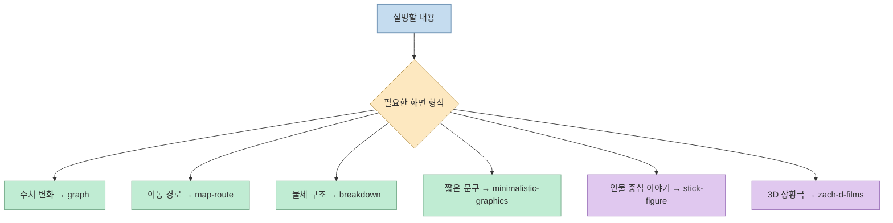
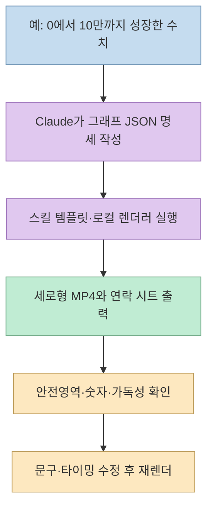
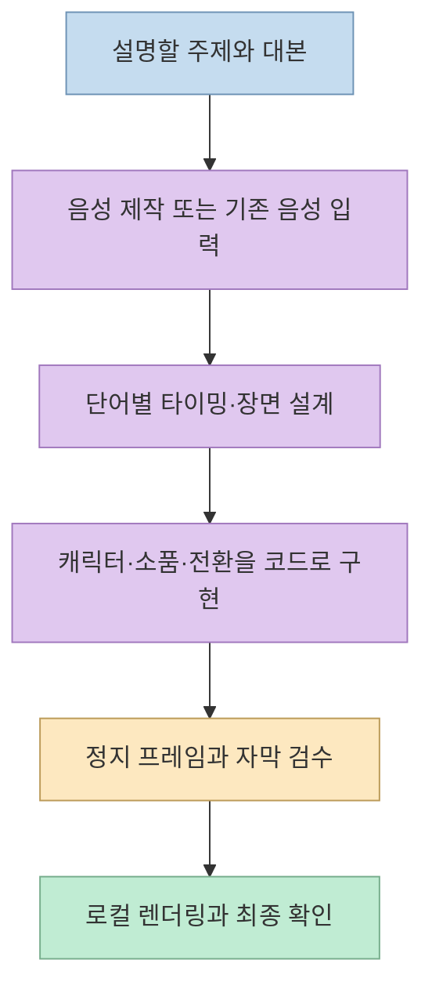
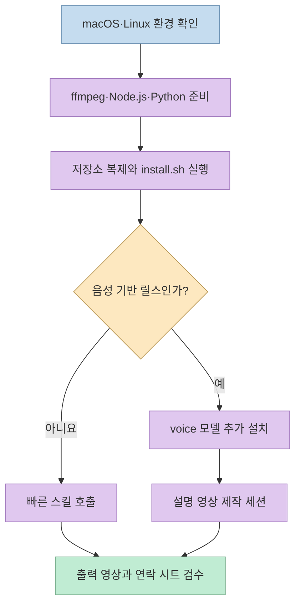

[동영 김의 Threads 글](https://www.threads.com/share/BAa69dKH68) 은 혼자 설명용 릴스를 만드는 사람을 위해 Claude Code용 영상 스킬 여섯 가지를 소개한다. 링크된 [공식 저장소](https://github.com/artemnovitckii/claude-animation-skills) 의 핵심은 AI가 완성된 영상 파일을 바로 생성하는 것이 아니라, **장면 명세와 애니메이션 코드를 만들고 로컬에서 렌더링·검수하는 제작 흐름** 이다.

<!--more-->

## Sources

- [원본 Threads 게시물](https://www.threads.com/share/BAa69dKH68)
- [claude-animation-skills 공식 저장소와 README](https://github.com/artemnovitckii/claude-animation-skills)
- [공식 설치 스크립트](https://github.com/artemnovitckii/claude-animation-skills/blob/main/install.sh)

Threads의 기능 요약은 저장소 README와 대조했다. 출력 속도와 사용성은 프로젝트 작성자의 설명이며, 이 글에서 별도의 영상 품질·성능 시험을 한 것은 아니다.

## 1. 여섯 스킬은 같은 영상 템플릿이 아니다

공식 README는 스킬을 결과물에 따라 여섯 가지로 구분한다. `/graph`는 선 그래프와 숫자 변화, `/map-route`는 도시 지도 위 이동 경로, `/breakdown`은 제품의 3D 분해도, `/minimalistic-graphics`는 흑백 선·점 그래픽을 만든다. 이 네 가지는 **짧은 명세로 구동하는 빠른 스킬** 이다. [공식 README의 스킬 목록](https://github.com/artemnovitckii/claude-animation-skills)

반면 `/stick-figure`는 막대 인물과 전환·음향을 활용한 설명 릴스, `/zach-d-films`는 3D 캐릭터·소품·효과를 활용한 설명 릴스를 목표로 한다. 이 둘은 단순한 그래프 수치 교체가 아니라 대본, 음성, 장면별 연출을 다루는 **제작 엔진** 에 가깝다. 이름이 특정 영상 스타일을 떠올리게 하더라도 공식 README는 `/zach-d-films`가 Zack D. Films와 제휴한 프로젝트는 아니라고 명시한다. [공식 README](https://github.com/artemnovitckii/claude-animation-skills)

## 2. 네 가지 빠른 스킬은 '명세 → 렌더 → 안전영역 검토' 흐름이다

빠른 스킬에서는 Claude Code가 요청을 작은 JSON 명세로 정리하고, 스킬의 `build.py`가 HTML 템플릿과 렌더러를 이용해 영상을 만든다. 공식 README가 밝힌 출력 규격은 **1080×1920 세로 MP4, 30fps** 이며, 프레임을 모은 연락 시트(`sheet.jpg`)에는 인스타그램 안전영역 표시가 들어간다. 따라서 Threads 글의 '안전영역 검토 이미지'는 자동으로 업로드 성공을 보장하는 검증서가 아니라, 텍스트·주요 요소가 가려지는지 제작자가 확인할 수 있는 **시각적 검수 자료** 로 이해하는 편이 정확하다. [공식 README의 사용법·구현 구조](https://github.com/artemnovitckii/claude-animation-skills)

README는 2D 빠른 스킬의 렌더링을 약 10초, 3D 빠른 스킬을 약 1분 30초로 소개한다. 이는 프로젝트의 안내값이지 사용자의 컴퓨터에서 보장되는 시간이 아니다. 영상 품질도 입력 데이터와 문구의 길이, 화면 배치, 렌더 환경에 따라 별도로 확인해야 한다. [공식 README](https://github.com/artemnovitckii/claude-animation-skills)

## 3. 인물 설명 영상 두 가지는 한 번의 명령으로 끝나지 않는다

`/stick-figure`와 `/zach-d-films`는 예제 프로젝트를 바탕으로 대본을 짜고, 음성을 만들거나 준비된 음성을 받아 단어별 타이밍을 맞춘 뒤, 장면을 코드로 제작한다. 중간 프레임을 점검하고 마지막에 영상을 렌더링하는 흐름이다. 공식 README는 이 두 가지를 **작업 세션을 잡고 진행할 것** 으로 안내하며, 빠른 스킬처럼 명세 하나로 즉시 완성된다고 설명하지 않는다. [공식 README의 Use·How it's built](https://github.com/artemnovitckii/claude-animation-skills)

기본 엔진과 렌더러는 로컬에서 동작한다. 음성과 단어 타이밍 기능을 쓰려면 설치 시 `--voice` 옵션으로 관련 모델을 별도 준비해야 하며, README는 첫 다운로드 분량을 약 1GB로 소개한다. 'API 키가 필요 없다'는 것은 이 공식 기본 경로에 관한 설명이지, 사용자가 연결할 수 있는 모든 외부 서비스까지 무료라는 뜻은 아니다. [공식 README의 설치 안내](https://github.com/artemnovitckii/claude-animation-skills)

## 4. 설치 전에 확인할 환경과 호출 방식

공식 README 기준 지원 환경은 **macOS 또는 Linux**, 필요 도구는 **ffmpeg, Node.js 18 이상, Python 3.9 이상** 이다. 저장소를 복제해 `./install.sh`를 실행하면 스킬 폴더를 `~/.claude/skills/`에 연결하고, 렌더링에 필요한 일회성 설정을 진행한다. 설치 스크립트는 같은 이름의 경로가 이미 일반 파일·디렉터리로 존재하면 덮어쓰지 않고 건너뛰도록 작성되어 있다. 기존 스킬이 있다면 설치 출력부터 확인해야 한다. [공식 README](https://github.com/artemnovitckii/claude-animation-skills) · [설치 스크립트](https://github.com/artemnovitckii/claude-animation-skills/blob/main/install.sh)

설치 후에는 Claude Code에서 `/graph ...`처럼 호출할 수 있다. 공식 README에는 플러그인 설치 경로도 소개되지만, 플러그인 스킬 명령은 `/animation-skills:graph`처럼 이름 공간이 붙는다. 작성자가 끝까지 시험했다고 밝힌 방식은 저장소 복제 경로이므로, 처음 따라 할 때는 두 설치 방식을 섞지 않는 편이 혼동을 줄인다. [공식 README의 Install·Use](https://github.com/artemnovitckii/claude-animation-skills)

## 실전 적용 포인트

1. **첫 시험은 `/graph`처럼 데이터가 명확한 스킬로 시작한다.** 수치와 문구가 정확히 표시되는지, 1080×1920 화면에서 작은 글씨가 읽히는지 확인하기 좋다.
2. **장면 유형에 맞는 스킬을 고른다.** 경로 설명은 `/map-route`, 제품 구조는 `/breakdown`, 서사가 필요한 설명은 인물형 엔진이 더 자연스럽다. 이 선택은 공식 기능 목록을 바탕으로 한 활용 제안이다.
3. **연락 시트를 끝까지 검수한다.** 안전영역뿐 아니라 숫자, 오탈자, 자막 길이, 전환 타이밍을 확인한다. 자동 렌더링과 콘텐츠 정확성은 별개다.
4. **음성형 릴스는 시간을 따로 잡는다.** 음성 준비와 단어 타이밍, 컷별 연출 수정이 필요하므로 빠른 스킬의 소요 시간을 그대로 기대하지 않는다.

## 핵심 요약

- 여섯 스킬 중 **네 가지는 JSON 명세 기반 빠른 렌더링**, 두 가지는 대본·음성·장면을 다루는 설명 영상 엔진이다.
- 빠른 스킬은 **1080×1920·30fps MP4** 와 안전영역 표시 연락 시트를 출력한다.
- 설치에는 로컬 개발 도구가 필요하고, 음성형 스킬에는 추가 모델 다운로드가 필요하다.
- 완성도는 자동 출력만으로 보장되지 않으므로 **숫자·자막·안전영역을 사람이 확인** 해야 한다.

## 결론

이 프로젝트는 릴스 제작을 '프롬프트 한 줄로 영상 생성'보다 **주제에 맞는 스킬 선택 → 명세·코드 제작 → 로컬 렌더링 → 프레임 검수** 의 반복 작업으로 다룬다. 혼자 설명 영상을 만드는 사람에게 유용한 출발점이지만, 짧은 그래프 영상과 음성·서사가 들어간 설명 릴스의 작업량은 구분해서 기대해야 한다.
