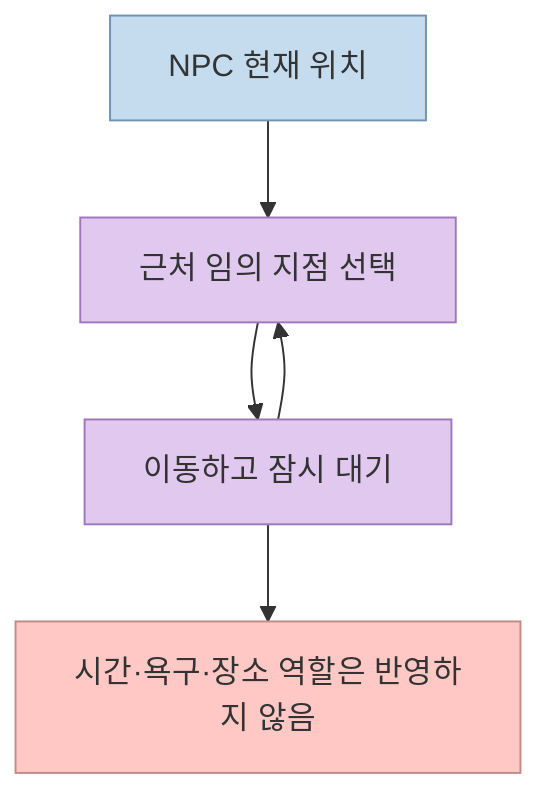
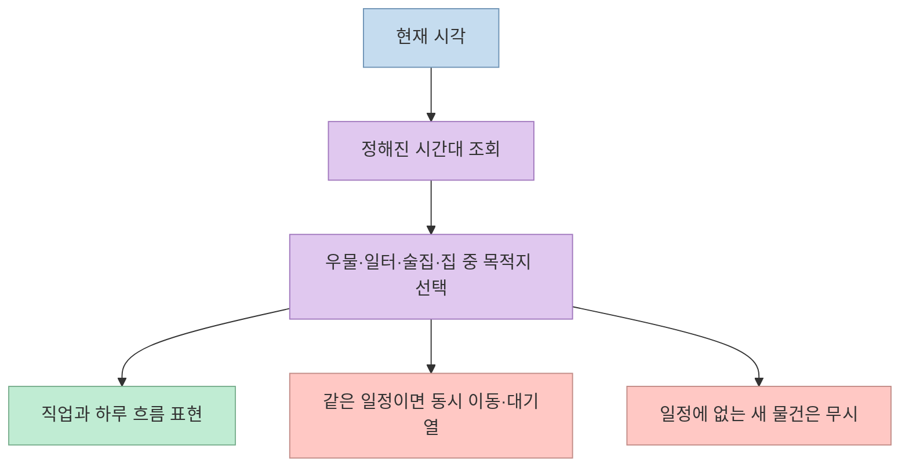
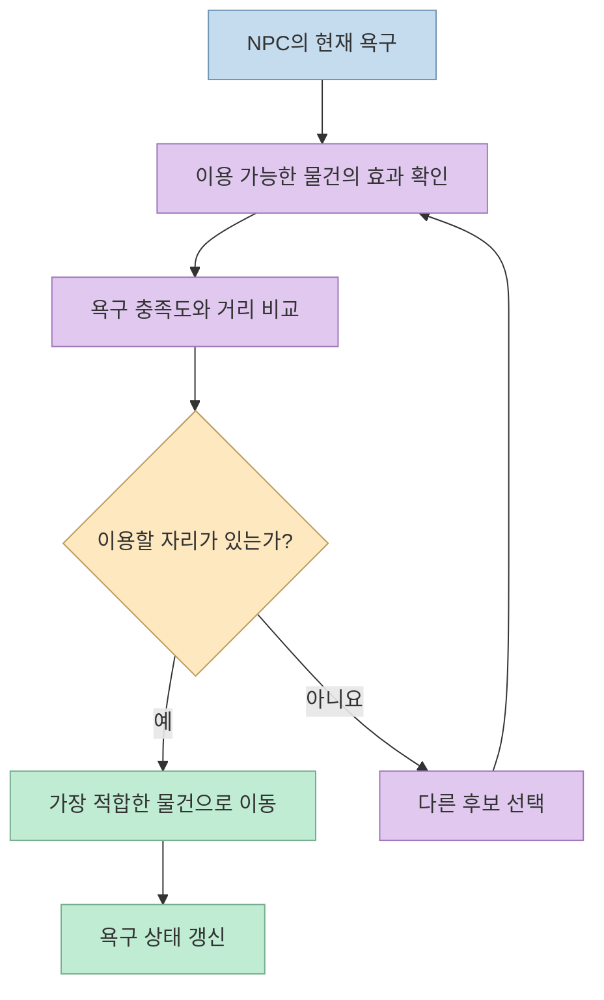
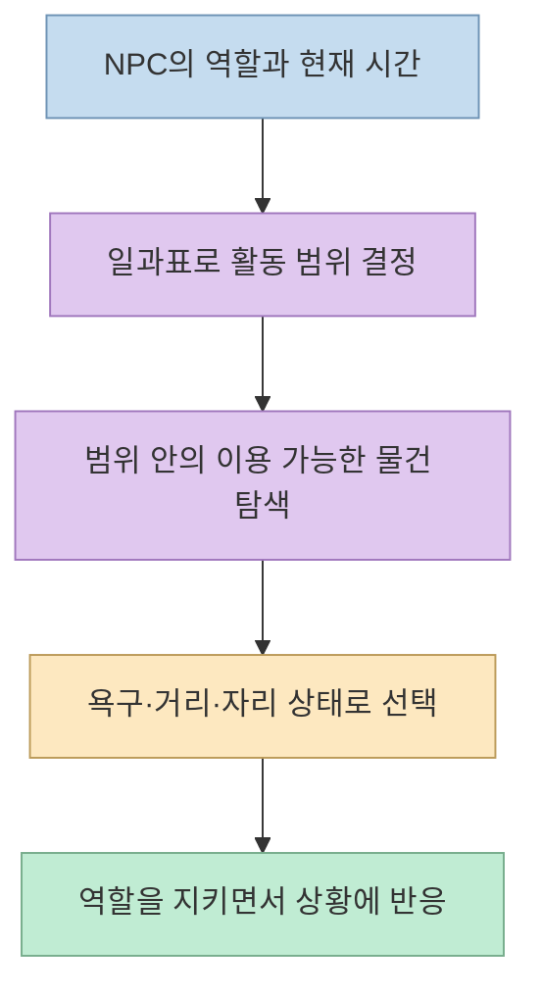

게임 속 NPC가 밤에도 목적 없이 돌아다니거나, 새로 놓은 벤치를 전혀 사용하지 않는 이유는 무엇일까? [밥따뚜의 짧은 영상](https://youtube.com/shorts/W3c1qVYbgD0?si=lh-pIDfsfaABazH7) 은 여덟 명이 사는 작은 마을을 예로 들어 **랜덤 배회, 시간별 일과표, 스마트 오브젝트** 세 방식을 비교한다. 핵심은 NPC마다 모든 행동을 미리 쓰는 대신, **어떤 장소와 물건이 현재 욕구를 해결할 수 있는지** 를 행동 결정에 반영하는 것이다. [영상 0:02–0:16](https://youtu.be/W3c1qVYbgD0?t=2)

<!--more-->

## Sources

- [원본 YouTube Shorts](https://youtube.com/shorts/W3c1qVYbgD0?si=lh-pIDfsfaABazH7)
- [제작자의 직접 체험 페이지](https://game.bobthief.com/smart-object)

아래 설명은 한국어 자동 자막의 시점별 발화와 제작자가 제공한 영상 설명을 대조해 정리했다. 자동 자막의 몇몇 단어는 잘못 인식되어 있어 문맥과 설명란을 기준으로 해석했다. 체험 페이지는 접속 가능 여부를 확인했지만, 이 글의 비교 결과를 독립적으로 재측정한 것은 아니다.

## 1. 랜덤 배회: 움직임은 생기지만 하루의 목적은 없다

가장 단순한 방식은 근처의 임의 지점을 고르고, 걸어가서 잠시 멈춘 다음 다른 지점을 고르는 것이다. 화면이 잠깐 지나가는 배경 NPC라면 움직임만으로 충분할 수 있다. 그러나 계속 관찰하면 **선택한 장소에 이유가 없다는 점** 이 드러난다. 영상 속 예시에서는 밤이 되어도 집에 가지 않고 계속 마을을 돌아다닌다. [영상 0:17–0:30](https://youtu.be/W3c1qVYbgD0?t=17) · [영상 1:59–2:04](https://youtu.be/W3c1qVYbgD0?t=119)

이 방식의 장점은 구현과 수정이 간단하다는 것이다. 단점은 '마을 주민처럼 산다'는 기대를 충족하기 어렵다는 점이다. 따라서 랜덤 배회를 잘못된 방식으로 보기보다, **관찰 시간이 짧고 역할이 없는 NPC에 알맞은 최소 구현** 으로 이해할 수 있다. 이는 영상의 사용처 구분을 바탕으로 한 설계 해석이다. [영상 1:59–2:09](https://youtu.be/W3c1qVYbgD0?t=119)

## 2. 일과표: 역할은 생기지만 변화에 둔감하다

다음 단계는 시간대별 목적지를 정하는 것이다. 영상에서는 아침에 우물, 낮에 일터, 저녁에 술집, 밤에 집으로 이동하도록 한다. 대장장이는 대장간에서, 상인은 시장에서 일하므로 NPC의 **직업과 시간 흐름** 이 화면에 드러난다. 퀘스트를 주는 인물이 특정 시간에 꼭 한 장소에 있어야 한다면 이 예측 가능성이 유용하다. [영상 0:31–0:44](https://youtu.be/W3c1qVYbgD0?t=31) · [영상 2:01–2:06](https://youtu.be/W3c1qVYbgD0?t=121)

하지만 모두 같은 일과표를 따르면 같은 시각에 우물이나 술집으로 몰린다. 출발 시각을 조금씩 어긋나게 하면 줄은 줄일 수 있지만, NPC와 상황이 늘수록 사람이 일정을 더 설계해야 한다. 또 새 벤치를 놓아도 기존 일과표에 '벤치 이용'이 없으면 아무도 앉지 않는다. **환경이 바뀌어도 행동 규칙이 자동으로 확장되지 않는 것** 이 이 예시의 한계다. [영상 0:45–1:01](https://youtu.be/W3c1qVYbgD0?t=45)

## 3. 스마트 오브젝트: 물건이 가능한 행동을 알린다

영상이 제시하는 반전은 NPC 코드에 모든 목적지를 적는 대신, **우물·벤치 같은 물건이 자신을 사용하면 어떤 욕구가 채워지는지 알리게 하는 것** 이다. NPC는 배고픔, 목마름, 잠, 어울림 같은 욕구를 가지고 있다. 후보 물건마다 현재 욕구를 얼마나 해결하는지와 이동 거리를 함께 고려해 점수를 매기고, 가장 적합한 곳으로 이동한다. 영상은 이를 유틸리티 AI의 점수 계산을 물건 쪽에 둔 방식으로 설명한다. 여기서 'AI'는 영상 속 행동 선택 로직을 가리키며, 거대언어모델을 NPC마다 호출한다는 뜻은 아니다. [영상 1:03–1:30](https://youtu.be/W3c1qVYbgD0?t=63)

NPC마다 욕구가 다르면 목적지도 달라진다. 물건의 자리가 모두 차면 더는 이용 가능하다고 알리지 않도록 해 한곳으로 몰리는 현상을 줄인다. 새 벤치를 놓았을 때도 벤치가 이용 효과를 알리므로, 영상의 시연 설정에서는 NPC의 행동 코드를 다시 쓰지 않아도 NPC가 그곳을 선택할 수 있다. 다만 **어떤 욕구를 얼마나 채우는지, 언제 이용할 수 있는지** 는 물건에 별도로 정의해야 한다. 영상은 구체적인 점수식이나 경로 탐색 알고리즘까지 공개하지 않으므로, 임의의 수식으로 구현을 단정할 수는 없다. [영상 1:30–1:43](https://youtu.be/W3c1qVYbgD0?t=90)

## 4. 실제 마을에서는 일과표와 스마트 오브젝트를 섞는다

욕구만으로 행동하면 자연스러운 변화는 생기지만, 대장장이가 퀘스트를 받아야 하는 시간에 술집에 가 있을 수도 있다. 영상은 이런 충돌을 피하려고 **일하는 시간 같은 큰 틀은 일과표로 잡고, 그 안에서 무엇을 할지는 스마트 오브젝트로 고르는 혼합 방식** 을 제안한다. 이는 '예측 가능성'과 '환경에 반응하는 행동'을 모두 얻기 위한 설계다. [영상 1:44–1:58](https://youtu.be/W3c1qVYbgD0?t=104)

영상 후반에는 AI 코딩 도구에 요청할 때도 'NPC가 자연스럽게 살게 해 줘'처럼 추상적으로 말하기보다, **NPC의 욕구, 물건의 충족 효과, 만석인 물건의 제외 조건** 을 명시하라고 권한다. 여기서 생성형 AI는 행동 시스템을 구현하도록 돕는 개발 도구이고, 실제 NPC의 매 순간 선택은 앞서 설명한 게임 로직이 담당한다. 제작자는 벤치·우물·모닥불을 놓아 세 방식을 비교할 수 있는 [체험 페이지](https://game.bobthief.com/smart-object)도 안내한다. [영상 2:11–2:35](https://youtu.be/W3c1qVYbgD0?t=131)

## 실전 적용 포인트

1. **배경 NPC부터 구분한다.** 잠깐 지나가는 인물은 랜덤 배회로도 충분하지만, 플레이어가 반복해서 만나는 인물에는 역할과 시간 규칙이 필요하다. [영상 1:59–2:09](https://youtu.be/W3c1qVYbgD0?t=119)
2. **고정 일정에는 예외를 설계한다.** 퀘스트 제공자처럼 반드시 있어야 하는 시간과 장소를 먼저 정하고, 자유 행동은 그 밖의 범위에서 허용한다. [영상 1:44–1:58](https://youtu.be/W3c1qVYbgD0?t=104)
3. **물건의 사용 조건을 데이터로 둔다.** 어떤 욕구를 얼마나 채우는지, 현재 이용 가능한 자리인지 정의해야 새 물건을 배치했을 때 행동 후보가 늘어난다. [영상 1:03–1:39](https://youtu.be/W3c1qVYbgD0?t=63)
4. **체험 장면에서 병목을 관찰한다.** 같은 시간에 몰리는지, 새 물건을 쓰는지, 밤에는 귀가하는지를 직접 확인한다. 제작자는 [비교 체험 페이지](https://game.bobthief.com/smart-object)를 공개했다.

## 핵심 요약

- **랜덤 배회** 는 구현이 간단하지만 시간·역할·욕구를 반영하지 않는다.
- **일과표** 는 역할을 분명히 하지만 동시 이동과 새 환경에 대한 둔감함이 생길 수 있다.
- **스마트 오브젝트** 는 물건의 효용과 이용 가능 상태를 기준으로 NPC의 선택지를 만든다.
- 중요한 NPC에는 **일과표로 책임을 보장하고, 스마트 오브젝트로 세부 행동을 선택** 하게 하는 혼합 방식이 유용하다.

## 결론

NPC를 '움직이게' 하는 것과 '살아 있는 것처럼 행동하게' 하는 것은 다른 문제다. 영상의 비교는 무작위 이동에서 시간 규칙으로, 다시 **욕구와 환경에 반응하는 선택** 으로 설계를 확장하는 과정을 보여 준다. 다만 실제 게임에서는 퀘스트처럼 반드시 지켜야 할 약속을 먼저 정한 뒤 자율 행동의 범위를 조절해야 한다.
