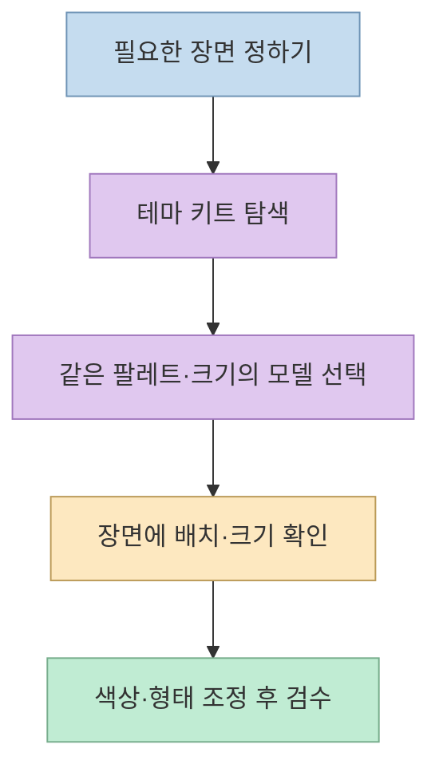
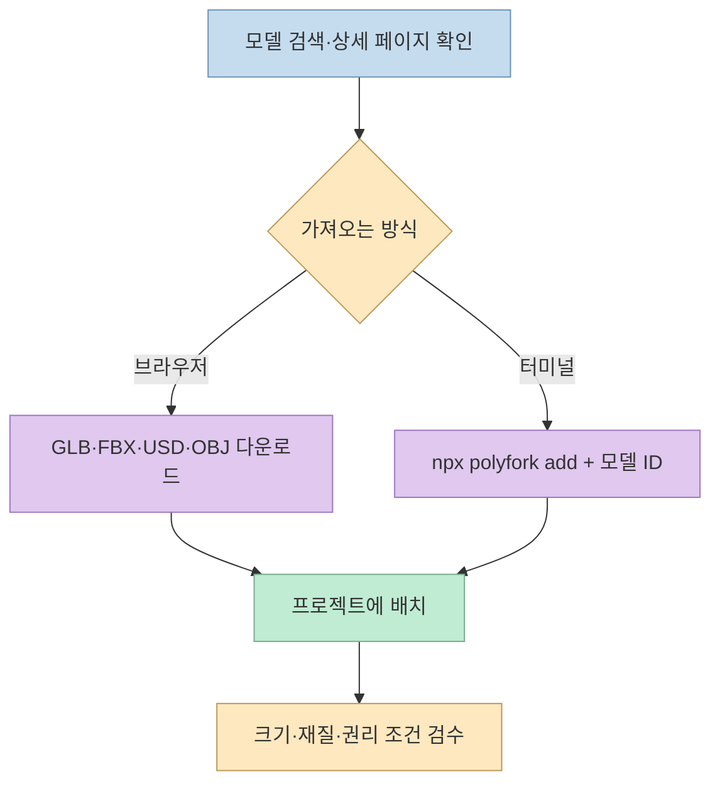
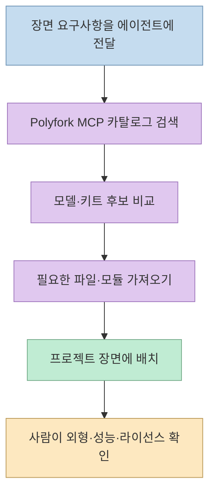
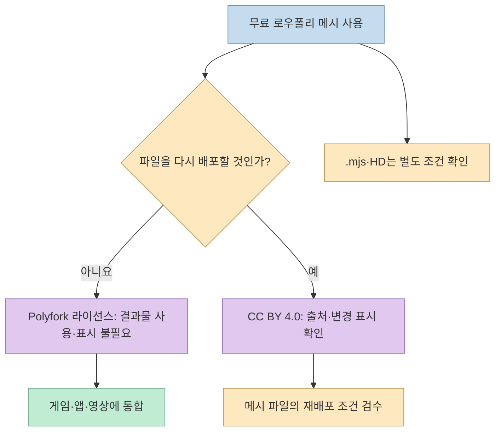

[오유상의 Threads 게시물](https://www.threads.com/share/BADHzD-anG) 은 게임·웹 장면에 쓸 수 있는 **Polyfork**의 3D 모델을 소개한다. 브라우저에서 파일을 받거나, CLI로 프로젝트에 넣거나, MCP를 연결해 코딩 에이전트가 에셋을 찾게 하는 세 경로가 핵심이다. 다만 **무료 이용, 출처 표시, 파일 재배포** 는 같은 조건이 아니므로 실제 프로젝트에 넣기 전 구분해야 한다.

<!--more-->

## Sources

- [원본 Threads 게시물과 작성자의 후속 설명](https://www.threads.com/share/BADHzD-anG)
- [Polyfork 공식 사이트](https://polyfork.dev/)
- [에이전트·CLI·MCP 연결 안내](https://polyfork.dev/agents)
- [테마 키트 목록](https://polyfork.dev/kits)
- [Polyfork 공식 라이선스](https://polyfork.dev/licensing)

Threads 원문과 후속 글은 공개 페이지의 Jina Reader 추출로 확인했고, 기능·가격·이용 조건은 Polyfork 공식 사이트와 대조했다. 카탈로그 수와 주간 증가량은 수시로 바뀌므로 **2026년 11월 7일 확인 당시의 표시값** 으로만 다룬다. 아래는 서비스 설명과 약관을 요약한 것이며 개별 프로젝트의 법률 판단은 아니다.

## 1. 개별 모델보다 '같은 모습의 키트'가 장면 제작에 유용하다

Polyfork는 로우폴리 3D 에셋을 제공한다. 농장·철도·해저·도시 같은 **테마 키트** 는 여러 모델을 같은 팔레트, 크기, 형태 언어로 묶는다. 이는 서로 다른 출처의 모델을 섞을 때 생기는 색감·비율 불일치를 줄이고, 장면을 빠르게 구성하기 위한 설계다. 공식 키트 페이지는 키트의 부품을 GLB와 three.js용 ES 모듈로 제공한다고 설명한다. [원본 Threads](https://www.threads.com/share/BADHzD-anG) · [공식 키트 목록](https://polyfork.dev/kits)

원문은 키트 **39개** 와 최근 일주일 사이 무료 모델 **340개 증가** 를 언급한다. 공식 사이트도 확인 시점에 '최근 7일 +340개 무료 에셋'을 표시했지만, 이 수치는 계속 변한다. 키트 개수 역시 신규 공개·정리로 달라질 수 있으므로, 실무에서는 고정된 총량보다 **필요한 테마와 모델의 실제 존재 여부** 를 확인하는 편이 안전하다. [원본 Threads](https://www.threads.com/share/BADHzD-anG) · [Polyfork 홈](https://polyfork.dev/)



## 2. 웹 다운로드와 CLI: 파일을 프로젝트로 가져온다

첫 번째 경로는 **사이트에서 직접 다운로드** 하는 것이다. 무료 로우폴리 모델의 메시는 GLB·FBX·USD·OBJ 등의 형식으로 제공된다. GLB는 glTF를 읽는 three.js·Godot·Blender 등에서, FBX는 Unity·Unreal 등에서 사용할 수 있다고 공식 사이트가 안내한다. 다만 엔진마다 머티리얼, 크기, 애니메이션 노드가 기대한 대로 들어오는지 실제 장면에서 확인해야 한다. `.mjs` 소스나 키트 ZIP 다운로드에는 무료 계정이 필요할 수 있지만, 무료 메시 파일 다운로드에는 계정이 필요 없다고 공식 문서는 구분한다. [공식 사이트](https://polyfork.dev/) · [공식 라이선스의 파일 형식·무료 에셋 안내](https://polyfork.dev/licensing)

두 번째 경로는 **터미널의 `npx` CLI** 다. 공식 에이전트 문서는 Node.js 18 이상 환경에서 `npx polyfork search <검색어>`로 모델을 찾고 `npx polyfork add <모델 ID>`로 GLB를 현재 프로젝트에 저장하는 예시를 제공한다. `npx`는 프로젝트에 CLI를 상시 설치하지 않고 실행할 수 있는 경로다. 따라서 '터미널 한 줄'은 **이미 정확한 모델 ID를 알고 있을 때 파일을 가져오는 단계** 를 뜻하며, 모델 선택과 라이선스 검토까지 자동으로 끝난다는 말은 아니다. [공식 CLI 안내](https://polyfork.dev/agents)



## 3. MCP: 에이전트가 카탈로그를 검색하고 후보를 고르게 한다

세 번째 경로는 Polyfork의 **원격 MCP 엔드포인트** 를 코딩 에이전트에 연결하는 것이다. 공식 사이트는 `https://polyfork.dev/mcp`를 제공하며, 에셋 검색·상세 조회·키트 조회 등의 도구를 노출한다고 설명한다. Claude Code에서는 다음처럼 등록할 수 있다. **명령은 Claude 앱의 일반 채팅창이 아니라 Claude Code를 실행하는 터미널** 에서 사용한다. 연결 후 Claude Code를 다시 시작하고 도구가 보이는지 확인하는 것이 실용적이다. [Threads 작성자의 후속 답변](https://www.threads.com/share/BADHzD-anG) · [Polyfork MCP 안내](https://polyfork.dev/agents)

```bash
claude mcp add --transport http polyfork https://polyfork.dev/mcp
```

공식 사이트에 따르면 **카탈로그 검색과 무료 에셋 조회에는 API 키가 필요 없다.** 무료 계정의 키를 설정하면 에이전트가 계정의 보유 항목을 파악하거나 유료 파일을 내려받는 흐름에 사용할 수 있다. 키 없이 검색이 가능하다는 말은 에이전트가 항상 적절한 모델을 골라 완성된 장면을 만든다는 보증이 아니다. 프롬프트에는 장면의 테마, 필요한 소품, 크기·폴리곤 예산, 목표 엔진을 구체적으로 주고 실제 배치를 검수해야 한다. [공식 에이전트 안내](https://polyfork.dev/agents)

three.js를 쓰는 경우 Polyfork는 개별 에셋의 ES 모듈을 import해 장면에 넣고, 일부 모델의 색상·비율 같은 매개변수를 코드로 조정하는 방식을 소개한다. 이는 **선택한 모델이 제공하는 조정 항목의 범위 안에서** 가능한 일이다. 모든 모델의 임의 부품을 자동으로 바꿀 수 있다는 뜻은 아니다. [공식 사이트의 import·remix 설명](https://polyfork.dev/) · [원본 Threads](https://www.threads.com/share/BADHzD-anG)



## 4. 무료 이용과 재배포는 서로 다른 허가다

공식 라이선스는 **무료 로우폴리 메시 파일** 에 두 선택지를 제시한다. Polyfork 라이선스를 택하면 게임·앱·영상 같은 결과물에 상업적으로 사용하고 출처를 표시하지 않아도 되지만, 모델 파일 자체를 별도 에셋 묶음·스토어로 재배포할 수는 없다. 반대로 해당 메시 파일을 **CC BY 4.0** 조건으로 사용하면 출처와 변경 사실을 표시하는 조건 아래 재배포·판매까지 가능하다고 명시한다. 두 경로를 섞어 **'출처 표시도 없이 원본 모델 파일을 다시 올려도 된다'** 고 이해하면 안 된다. [공식 라이선스](https://polyfork.dev/licensing)

이 선택은 무료 메시의 GLB·FBX·USD·OBJ에 관한 것이며, 조정 가능한 **`.mjs` 소스 모듈과 HD 에디션** 에 CC BY 허가가 자동으로 확대되는 것은 아니다. HD는 유료 Pro 혜택으로 안내되며, 2026년 11월 7일 공식 사이트 표시 가격은 월 **15달러** 였다. 가격과 대상 수량은 바뀔 수 있으므로 실제 결제·배포 전 공식 페이지를 다시 확인해야 한다. [공식 라이선스](https://polyfork.dev/licensing) · [Polyfork 홈](https://polyfork.dev/)



## 실전 적용 포인트

1. **키트부터 고른다.** 같은 장면에 필요한 모델을 한 키트에서 먼저 찾고, 실제 프로젝트에서 크기·팔레트·삼각형 수를 확인한다. [공식 키트 목록](https://polyfork.dev/kits)
2. **한두 개를 직접 가져와 흐름을 시험한다.** 웹 다운로드와 `npx polyfork add` 중 프로젝트에 맞는 방식을 택하고 엔진에서 재질과 축 방향을 확인한다. [공식 CLI 안내](https://polyfork.dev/agents)
3. **MCP는 검색·선택 보조로 쓴다.** 에이전트가 가져온 파일명과 출처, 조정한 매개변수, 장면 성능을 사람이 확인한다. [공식 에이전트 안내](https://polyfork.dev/agents)
4. **최종 배포 형태에 따라 라이선스를 고른다.** 게임에 통합하는 것과 모델 파일 자체를 에셋 팩으로 배포하는 것은 다른 사용이다. 특히 `.mjs`·HD 파일은 무료 메시의 CC BY 선택지가 적용되는지 추정하지 않는다. [공식 라이선스](https://polyfork.dev/licensing)

## 핵심 요약

- Polyfork의 강점은 무료 로우폴리 모델뿐 아니라 **같은 팔레트와 크기로 구성한 테마 키트** 다.
- 가져오는 경로는 **웹 다운로드, `npx` CLI, 원격 MCP** 로 나뉜다.
- MCP 검색에는 키가 없어도 되지만, 모델 선택과 장면 결과는 검수해야 한다.
- **상업적 결과물 사용** 과 **원본 파일 재배포** 는 라이선스 조건이 다르다.
- 주간 추가 수량·가격·제공 범위는 변하므로 실제 사용 시 공식 사이트를 다시 확인한다.

## 결론

Polyfork는 AI 코딩 에이전트가 3D 모델을 처음부터 매번 만들기보다, **기존 에셋을 검색하고 맞는 키트를 장면에 배치하는 작업** 에 활용할 만한 자료원이다. 가장 중요한 확인 사항은 모델 수보다 프로젝트의 엔진·성능·배포 방식에 맞는 파일과 라이선스를 선택했는지다.
