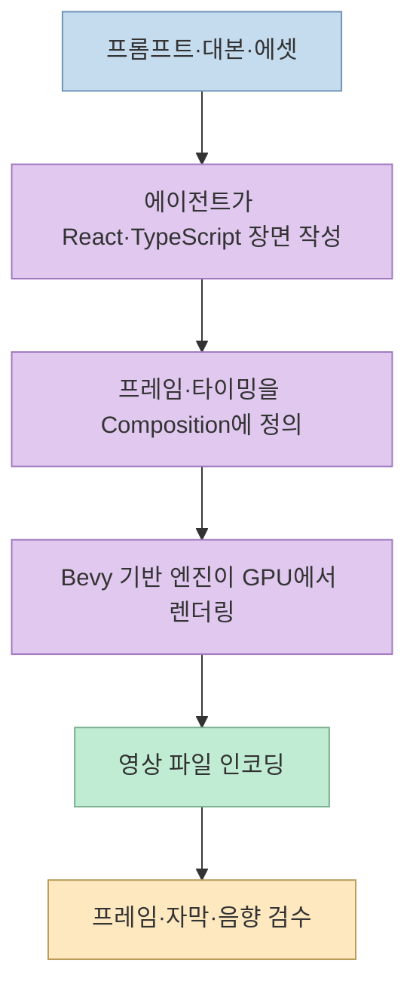
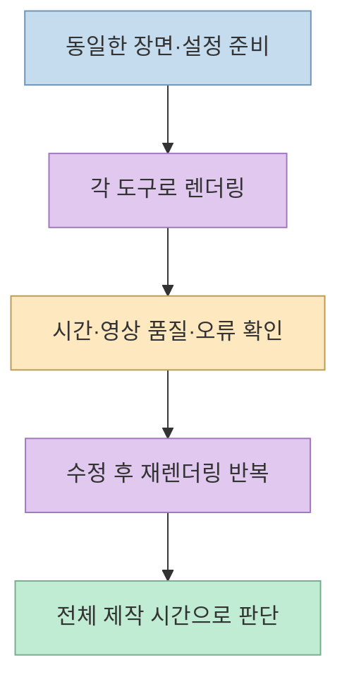
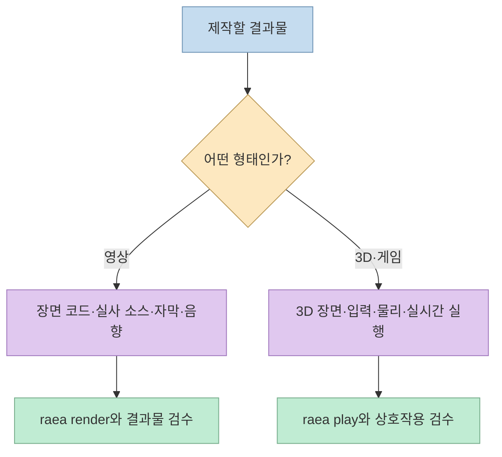
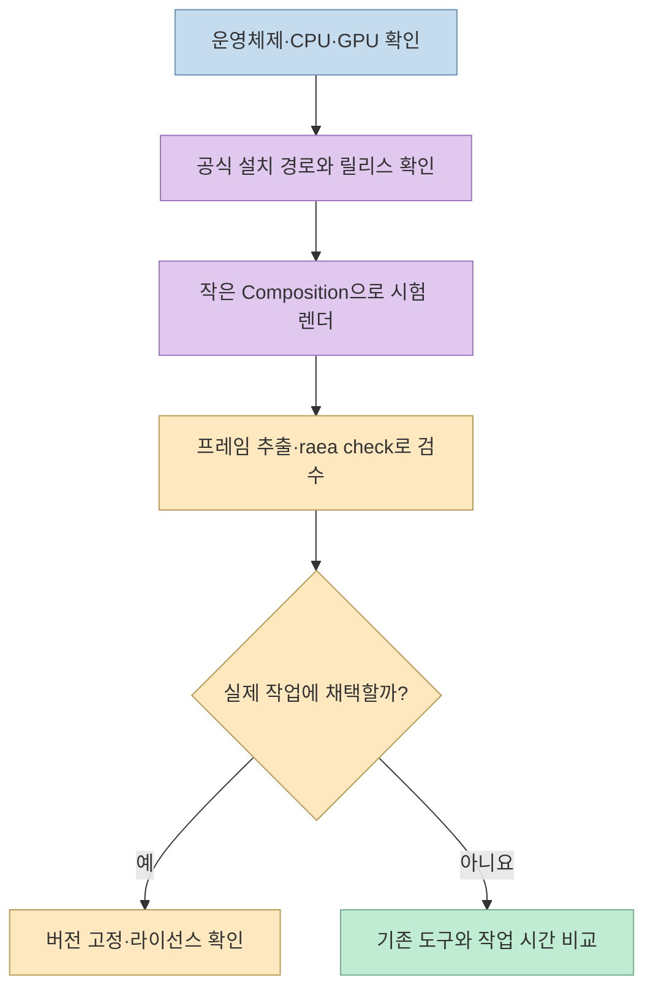

[찐AI의 짧은 영상](https://youtube.com/shorts/YTuusjFHduw?si=VhhZ5UpAI4pJ2G0P) 은 AI 코딩 도구가 만든 영상을 빠르게 렌더링하는 무료 엔진 **raea**를 소개한다. 흥미로운 지점은 영상 생성 모델에 장면을 맡기는 대신, 에이전트가 **React·TypeScript 코드로 장면을 작성하고 로컬 GPU에서 렌더링·검수** 한다는 방식이다. 다만 영상 제목의 '6배'는 특정 비교 사례의 수치이지 모든 프로젝트에 보장되는 성능은 아니다. [영상 0:00–0:07](https://youtu.be/YTuusjFHduw?t=0) · [raea 공식 README](https://github.com/shinyobjectz/raea)

<!--more-->

## Sources

- [원본 YouTube Shorts](https://youtube.com/shorts/YTuusjFHduw?si=VhhZ5UpAI4pJ2G0P)
- [raea 공식 저장소와 README](https://github.com/shinyobjectz/raea)
- [개발자의 설계 설명: Why raea](https://raea.io/why/)
- [raea 라이선스 원문](https://github.com/shinyobjectz/raea/blob/main/LICENSE)

영상의 한국어 자동 자막과 설명란을 대조했다. 영상이 제시한 벤치마크는 제작자의 주장으로 표시하고, 엔진 구조·지원 플랫폼·라이선스는 공식 저장소를 우선해 확인했다. 이 글에서 동일 환경으로 렌더링 속도를 다시 측정하지는 않았다.

## 1. 영상은 코드로 기술하고, 엔진은 GPU에서 프레임을 만든다

raea의 기본 단위는 **특정 시점의 화면을 그리는 React 컴포넌트** 다. 공식 README 예제에서는 `useCurrentFrame()`으로 현재 프레임을 얻고, `Composition`에 해상도·fps·전체 프레임 수를 지정한 뒤 `raea render`로 MP4를 만든다. 따라서 에이전트의 역할은 동영상 파일을 직접 '상상해서 출력'하는 것이 아니라 **화면·움직임·타이밍을 코드로 작성하는 것** 이다. [영상 0:29–0:33](https://youtu.be/YTuusjFHduw?t=29) · [공식 README의 Hello 예제](https://github.com/shinyobjectz/raea#hello)

영상은 브라우저 기반 도구가 각 프레임을 스크린샷으로 만들고, raea는 게임 엔진 **Bevy** 위에서 GPU로 직접 그린다고 대비한다. 공식 설계 문서도 React로 기술한 장면을 Bevy 기반 렌더링 파이프라인에서 합성·인코딩하는 것을 핵심 설계로 설명한다. 이것은 **왜 렌더링 경로가 다를 수 있는지** 를 보여 주지만, 다른 도구의 모든 렌더 방식이나 모든 장면에서의 우위를 입증하는 보편 법칙은 아니다. [영상 0:07–0:18](https://youtu.be/YTuusjFHduw?t=7) · [공식 설계 설명](https://raea.io/why/)

## 2. '6배 빠르다'는 특정 광고 영상 비교 수치다

제작자는 같은 광고 영상의 평균 렌더링 시간이 **raea 3.4초, HyperFrames 20.4초, Remotion 23.7초** 였다고 말한다. 20.4÷3.4는 정확히 6이므로 영상의 '6배'라는 표현은 **HyperFrames와의 해당 비교** 에 대응한다. Remotion과의 비교는 약 7배다. 하지만 영상과 설명란에는 하드웨어, 영상 길이·효과 구성, 인코딩 옵션, 반복 횟수 등 재현에 필요한 조건이 충분히 제시되지 않는다. 그러므로 이를 **제작자가 보고한 사례 측정치** 로 읽어야 한다. [영상 0:16–0:24](https://youtu.be/YTuusjFHduw?t=16)

속도를 평가할 때는 렌더링 시간만이 아니라 **장면 작성 시간, 시각 효과 호환성, 인코딩 품질, 반복 수정과 검수에 걸리는 시간** 을 함께 봐야 한다. 공식 설계 문서는 빠른 렌더가 에이전트의 '렌더 → 확인 → 수정' 반복을 더 자주 가능하게 한다는 목표를 설명한다. 이 목적 자체는 설계 논리이지만, 실제 작업에서의 이득은 만드는 영상과 컴퓨터 환경에 따라 달라질 수 있다. [공식 설계 설명](https://raea.io/why/)

## 3. 영상 밖으로 확장되지만, 생성형 영상 모델은 아니다

공식 README는 raea가 **모션 그래픽·영상, 3D 장면, 실시간 게임, 사운드** 를 다루는 엔진이라고 설명한다. 영상은 이 점을 3D 장면과 직접 플레이하는 게임, 음악·효과음까지 만들 수 있다고 소개한다. 프로젝트 문서에는 영상 렌더링용 `raea render` 외에 게임을 실행하는 `raea play`, 특정 프레임을 이미지로 뽑는 기능, 결과물의 잘린 글자·대비·안전영역 등을 점검하는 `raea check`가 나열돼 있다. [영상 0:24–0:33](https://youtu.be/YTuusjFHduw?t=24) · [공식 README의 기능 목록](https://github.com/shinyobjectz/raea#what-it-does)

여기서 'AI가 영상 제작'은 **AI 에이전트가 코드를 작성하는 작업 방식** 을 뜻한다. raea가 자체적으로 텍스트 프롬프트만 받아 실사 장면을 생성하는 범용 비디오 생성 모델이라는 뜻은 아니다. 공식 설계 문서는 촬영한 실사 소스를 편집하고, 타이포그래피·모션·게임 화면은 코드로 그리는 방향을 명시한다. 외부 모델을 별도로 쓰는 단계가 있더라도 그것은 엔진의 기본 렌더링과 구별해야 한다. [공식 설계 설명의 실사 영상 원칙](https://raea.io/why/) · [공식 README](https://github.com/shinyobjectz/raea)

## 4. 설치는 무료지만 카나리 상태와 라이선스를 확인해야 한다

영상은 무료·계정 불필요, macOS·Linux·Windows 지원, Claude Code용 스킬 자동 설치를 소개한다. 공식 README도 설치 스크립트가 `raea` 명령과 에이전트 스킬을 배치하고, 엔진 사용에 계정이 필요 없다고 설명한다. 현재 공개 릴리스는 **Apple Silicon macOS, x86_64 Linux, x86_64 Windows** 를 대상으로 하며, Windows는 새로 추가돼 시험이 가장 적은 플랫폼이라고 경고한다. 플랫폼별 조건을 무시하고 '모든 Mac·Linux·Windows에서 동일하게 된다'고 확대해서는 안 된다. [영상 0:33–0:43](https://youtu.be/YTuusjFHduw?t=33) · [공식 README의 설치·지원 플랫폼](https://github.com/shinyobjectz/raea#install)

README는 프로젝트를 **canary** 상태로 표시하며 API 변경, 거친 부분, 문서의 빈틈을 예상하라고 안내한다. 또 소스가 공개되어 있고 무료로 사용할 수 있어도 라이선스는 일반적인 무제한 오픈소스 라이선스가 아니라 **FSL-1.1-ALv2** 다. 이 라이선스는 경쟁 제품·서비스로 제공하는 용도를 제한하고, 각 버전이 공개된 지 2년 뒤 Apache-2.0으로 전환되도록 규정한다. 상용 도구에 통합하거나 재배포할 계획이라면 원문을 확인해야 한다. [공식 README의 canary·라이선스](https://github.com/shinyobjectz/raea) · [라이선스 원문](https://github.com/shinyobjectz/raea/blob/main/LICENSE)

## 실전 적용 포인트

1. **영상에 나온 숫자를 그대로 기대하지 않는다.** 자신의 컴퓨터에서 같은 해상도·길이·효과·코덱 조건으로 짧은 샘플을 비교한다. 영상의 3.4초·20.4초·23.7초는 제작자의 특정 사례다. [영상 0:16–0:24](https://youtu.be/YTuusjFHduw?t=16)
2. **가장 작은 장면부터 시작한다.** 공식 README의 `Composition` 예제로 텍스트·애니메이션·MP4 출력을 확인한 다음 실사 영상이나 3D를 추가한다. [공식 Hello 예제](https://github.com/shinyobjectz/raea#hello)
3. **에이전트의 검수를 결과물 품질과 혼동하지 않는다.** `raea check`가 표시하는 문제를 고치되, 컷의 의미·브랜드 톤·음악 사용 권리는 사람이 별도로 검토한다. [공식 기능 설명](https://github.com/shinyobjectz/raea#what-it-does)
4. **카나리 릴리스와 라이선스를 프로젝트 조건에 맞춰 점검한다.** 특히 지원 CPU 아키텍처와 Windows 안정성, 경쟁 서비스로의 재사용 제한은 도입 전에 확인한다. [공식 README](https://github.com/shinyobjectz/raea) · [라이선스](https://github.com/shinyobjectz/raea/blob/main/LICENSE)

## 핵심 요약

- raea는 **React·TypeScript로 작성한 영상 장면을 Bevy 기반 로컬 GPU 파이프라인에서 렌더링** 한다.
- '6배 빠름'은 영상 제작자가 제시한 **특정 광고 영상 비교** 이며 보편 성능 보장은 아니다.
- 영상·모션 그래픽 외에 3D·게임·사운드 기능도 지향하지만, 기본적으로 텍스트-투-비디오 생성 모델은 아니다.
- 무료·계정 불필요와 별개로 **카나리 상태, 지원 플랫폼, FSL 라이선스** 를 확인해야 한다.

## 결론

raea의 가치는 빠른 렌더 자체보다 **에이전트가 코드로 만들고, 프레임을 확인하고, 다시 고치는 짧은 반복 주기** 에 있다. 다만 프로젝트의 실제 이득은 직접 측정해야 하며, 카나리 릴리스와 라이선스 조건을 이해한 뒤 도입하는 것이 좋다. 영상 제작자도 마지막에 **이 소개 영상 자체는 raea가 아니라 HyperFrames로 만들었다** 고 밝힌다. [영상 0:41–0:46](https://youtu.be/YTuusjFHduw?t=41)
