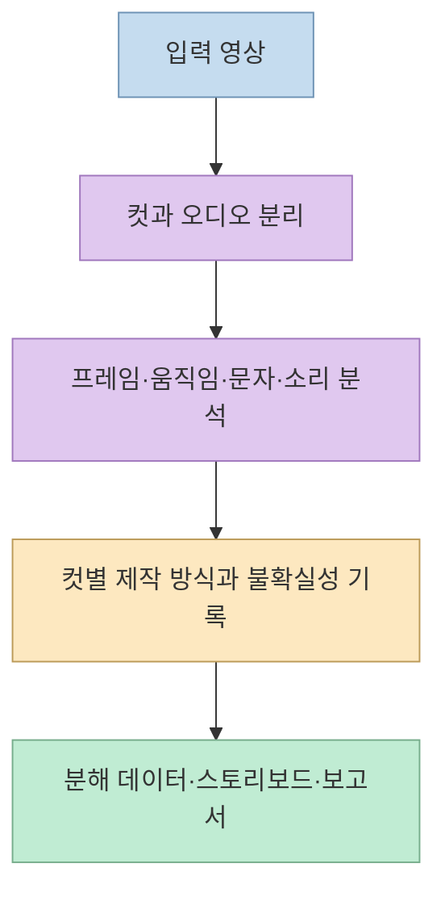
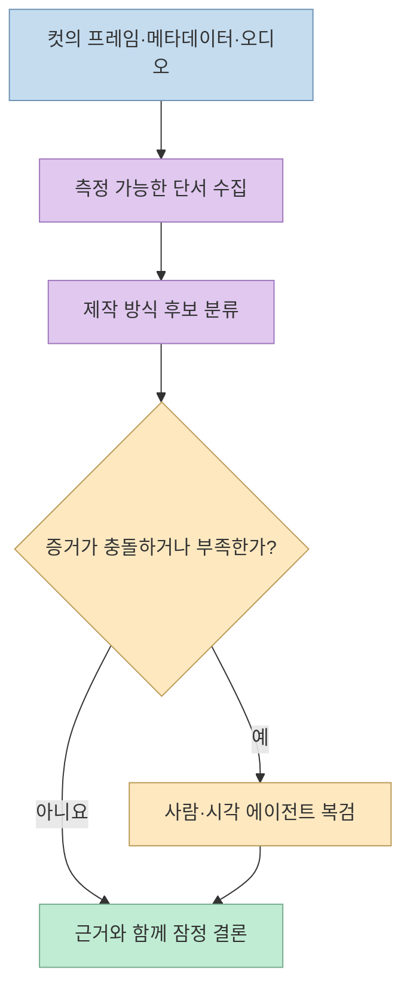
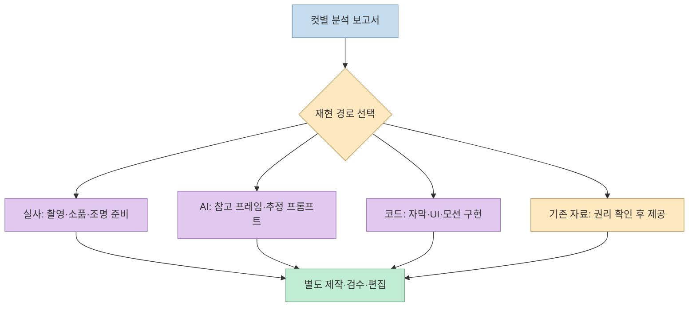
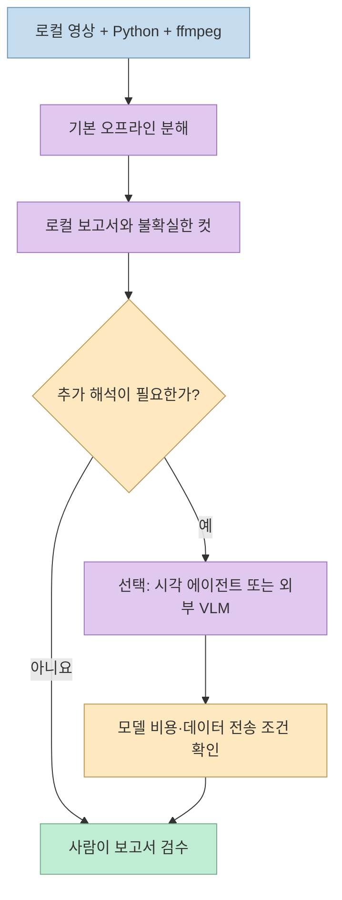

[CHOI의 Threads 게시물](https://www.threads.com/share/BAVOTdot8V) 은 완성 영상을 넣으면 장면별 제작 방식을 분석하고 재현 보고서를 만드는 오픈소스 **REA-Video**를 소개한다. 영상에서 컷, 카메라 움직임, 자막, 오디오를 읽어 **무엇을 촬영하고, 무엇을 생성하거나 코드로 만들지** 계획하는 도구다. 다만 분석 결과가 원래 제작자의 프롬프트나 실제 제작 과정을 그대로 복원한다는 뜻은 아니다.

<!--more-->

## Sources

- [원본 Threads 게시물](https://www.threads.com/share/BAVOTdot8V)
- [REA-Video 공식 저장소와 README](https://github.com/JuneYaooo/rea-video)
- [공식 CLI 문서: 실행 방법과 현재 구현 범위](https://github.com/JuneYaooo/rea-video/blob/main/docs/cli.md)
- [공식 분해 문서: 특징 추출·판정·산출물](https://github.com/JuneYaooo/rea-video/blob/main/docs/decompose.md)
- [프로젝트 자체 평가: 알려진 오분류와 한계](https://github.com/JuneYaooo/rea-video/blob/main/eval/RESULTS.md)

원본 Threads는 프로젝트 기능을 짧게 소개한 글이다. 아래의 세부 작동 방식과 제한은 프로젝트의 공식 문서에 근거한다. 정확도 수치나 사례는 개발자가 공개한 자체 평가이며, 독립적인 성능 검증으로 취급하지 않는다.

## 1. 영상을 '장면별 제작 명세'로 분해한다

REA-Video는 하나의 영상에 한 가지 제작 방식만 적용하지 않는다. 컷마다 실사, AI 생성 영상, 3D·애니메이션, 코드·템플릿 렌더링, 화면 녹화, 정지 이미지 등을 구분하려고 한다. 같은 광고에서도 인물은 실사, 제품 배경은 AI, 자막과 그래프는 코드 기반일 수 있으므로 **컷 단위 분해** 가 재현 계획의 출발점이다. [공식 README](https://github.com/JuneYaooo/rea-video#what-it-can-break-down)

분해 결과에는 컷의 시작·종료 시점과 대표 프레임뿐 아니라 화면 위의 자막·스티커·화면 속 화면, 컷 전환의 속도와 박자, 음성·배경음악·효과음의 단서도 포함된다. 자막은 타이밍을 가진 SRT·ASS 형태로 내보낼 수 있다. 이 정보를 모아 `breakdown.json`, 사람이 읽는 `report.html`·`report.md`, `storyboard.jpg`, 컷별 이미지 등을 만든다. [공식 분해 문서](https://github.com/JuneYaooo/rea-video/blob/main/docs/decompose.md) · [CLI 문서](https://github.com/JuneYaooo/rea-video/blob/main/docs/cli.md)

## 2. '실사인가 AI인가'는 증거를 조합한 추정이다

프로젝트는 파일 메타데이터의 촬영 장치·AIGC 표시, 프레임 반복과 움직임, 이미지 노이즈, 화면 속 문자나 물리적 움직임 등을 단서로 사용한다. 영상 이해 모델 또는 이미지를 볼 수 있는 에이전트를 추가하면 장면의 의미와 시각적 이상 징후를 복검할 수 있다. **결론은 이러한 단서를 합친 분류 결과** 이지, 제작 원본 파일을 확인한 판정이 아니다. [공식 분해 문서](https://github.com/JuneYaooo/rea-video/blob/main/docs/decompose.md)

특히 플랫폼이 영상을 다시 압축하면 원본의 메타데이터나 노이즈 특성이 사라질 수 있다. 프로젝트 README도 재압축한 예제 영상은 원본 플랫폼 다운로드와 다른 결과를 낼 수 있다고 경고한다. 자체 평가에는 오디오에서 효과음과 음성·음악의 순간적인 소리를 구분하기 어렵고, 평범한 영상의 AI 생성 배경음악을 신호만으로 판별하기 어렵다는 한계도 적혀 있다. 따라서 **'AI로 만들었다' 또는 '이 음악은 AI가 만들었다'를 감정 결과처럼 받아들이면 안 된다.** [공식 README](https://github.com/JuneYaooo/rea-video#examples) · [자체 평가와 알려진 한계](https://github.com/JuneYaooo/rea-video/blob/main/eval/RESULTS.md)

## 3. 보고서는 영상 파일이 아니라 '어떻게 다시 만들지'의 계획이다

`report.html`에는 컷별 프레임과 판단 근거, 촬영을 택할 때의 구도·카메라·조명 단서, 생성 영상에 사용할 수 있는 프롬프트 초안, 자막·오디오 분석과 전체 재현 계획이 정리된다. **프롬프트는 관찰한 화면을 바탕으로 새로 추정한 문장** 이다. 원래 제작자가 입력한 프롬프트를 파일에서 추출하거나 복구하는 기능은 아니다. 컷별 프롬프트와 더 정교한 시각 판정에는 영상 이해 모델이 도움이 되지만, 이는 선택적인 추가 단계다. [공식 README](https://github.com/JuneYaooo/rea-video) · [분해 문서의 산출물](https://github.com/JuneYaooo/rea-video/blob/main/docs/decompose.md)

재현 계획은 컷을 **직접 촬영할 것, AI로 생성할 것, 코드나 템플릿으로 렌더링할 것, 사용자가 직접 제공할 녹화·사진·제품 자료** 로 나눈다. 그러므로 REA-Video만 실행하면 모든 실사·코드·AI 컷이 자동으로 완성되는 '원클릭 복제기'는 아니다. 공식 CLI 문서에는 별도 `capsule-cinema` 연동으로 AI 컷을 생성하고 결과를 조립하는 기능이 있지만, 그 경로도 부분 구현이며 생성 모델 호출에는 비용이 들 수 있다고 명시되어 있다. [공식 CLI 문서의 작업 단계와 구현 상태](https://github.com/JuneYaooo/rea-video/blob/main/docs/cli.md)

## 4. '무료·로컬'의 범위는 어디까지인가

README의 빠른 시작 기준으로 실행에는 **Python 3.10 이상과 ffmpeg**가 필요하다. `rea-video decompose ref.mp4 -o out/ref`는 외부 영상 이해 모델 없이 실행하는 오프라인 분석 경로다. 더 풍부한 컷 해석을 원하면 모델 엔드포인트와 API 키를 설정해 `--vlm` 경로를 사용할 수 있고, 모델 사용료는 별개다. 이미지를 볼 수 있는 에이전트가 있다면 불확실한 컷을 `review`·`apply-review` 흐름으로 재검토할 수도 있다. [공식 README의 빠른 시작](https://github.com/JuneYaooo/rea-video#quick-start) · [공식 CLI 예시](https://github.com/JuneYaooo/rea-video/blob/main/docs/cli.md)

즉 Threads의 **'무료 오픈소스·로컬 영상 분석'** 은 기본 분석 경로를 설명하는 말로 읽는 편이 정확하다. 선택적 외부 모델이나 별도 재현 파이프라인까지 모두 무료·오프라인이라고 보장하는 말은 아니다. 또 외부 모델을 연결한다고 항상 판정이 좋아지는 것도 아니다. 프로젝트 자체 평가에는 시각 모델만 추가한 일부 실험에서 분류가 나빠진 사례가 있고, 복검과 단서 결합이 필요하다고 기록되어 있다. [프로젝트 자체 평가](https://github.com/JuneYaooo/rea-video/blob/main/eval/RESULTS.md)

## 실전 적용 포인트

1. **권리가 있는 짧은 영상으로 시험한다.** 직접 촬영한 광고나 사용 허락을 받은 샘플에서 컷 경계·자막 타이밍·음향 분석이 실제와 얼마나 맞는지 먼저 확인한다. 타인의 영상·음원·얼굴을 재사용할 권리까지 분석 도구가 제공하지는 않는다.
2. **오프라인 보고서를 먼저 확인한다.** `decompose` 결과의 컷별 프레임과 근거를 살피고, AI·실사 판단이 애매한 컷은 '확정'이 아니라 재검토 대상으로 남긴다. [공식 CLI 문서](https://github.com/JuneYaooo/rea-video/blob/main/docs/cli.md)
3. **추가 모델은 필요한 컷에만 적용한다.** 추정 프롬프트와 의미 분석이 꼭 필요한지, 외부 서비스로 영상이 전송되어도 되는지, 예상 비용을 따져 선택한다. [공식 README](https://github.com/JuneYaooo/rea-video)
4. **복사보다 제작 원리를 가져온다.** 컷 길이, 카메라 움직임, 자막 리듬 같은 기술을 참고하되, 새로운 제품·대본·촬영 소재로 다시 설계한다. 이는 보고서를 실무에 적용하기 위한 권장 절차다.

## 핵심 요약

- REA-Video의 핵심 산출물은 완성된 복제 영상이 아니라 **컷별 근거가 붙은 분석 보고서와 재현 계획** 이다.
- 실사·AI·3D·코드 렌더링 분류와 추정 프롬프트는 **원본 제작 정보의 복원이나 확정 판정이 아니다.**
- 기본 분석은 로컬에서 가능하지만, 선택적 영상 이해 모델과 재현용 생성 모델에는 별도 설정·비용이 따를 수 있다.
- 플랫폼 재압축, 혼합 편집, 효과음·음악 출처 추정은 오분류가 생기기 쉬워 **사람의 복검** 이 필요하다.

## 결론

REA-Video는 '이 영상을 그대로 만들어 줘'보다 **'이 영상은 어떤 컷과 기술로 구성되었고, 나는 무엇을 준비해야 하는가'** 에 답하는 도구에 가깝다. 보고서를 제작 체크리스트로 사용하되, 제작 방식과 프롬프트의 불확실성을 표시하고 영상·음원·인물의 권리를 따로 확인하는 것이 안전하다.
