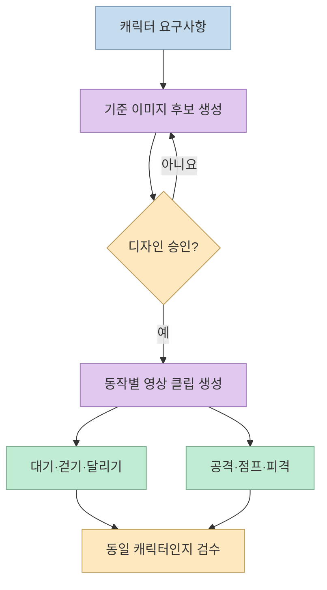
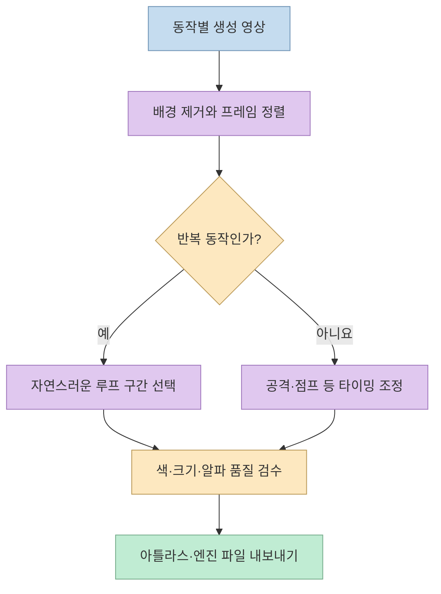
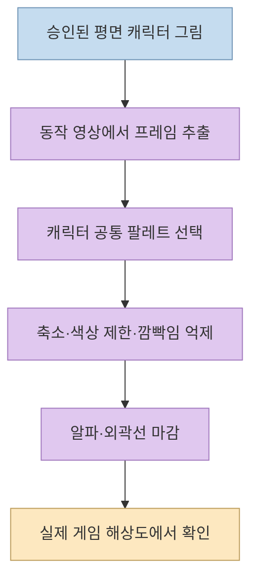
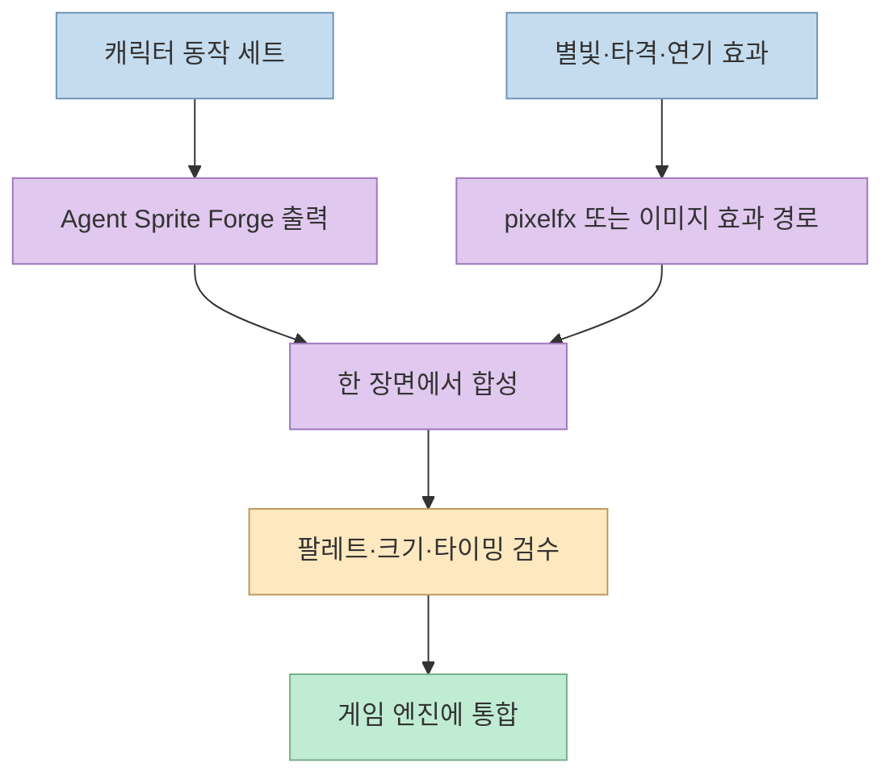
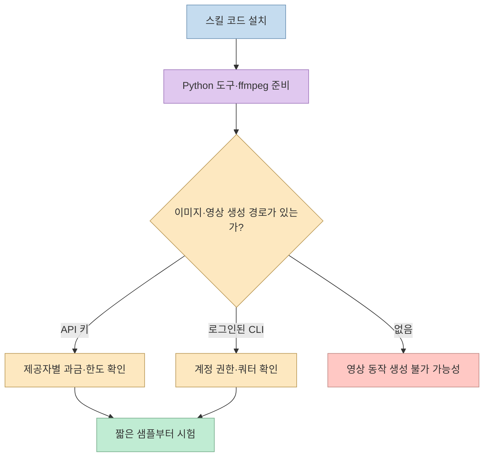

[찐AI의 YouTube Shorts](https://youtube.com/shorts/y0RG4fWcw7s?si=ax7pSLBrTWBr4Qqc) 는 캐릭터 한 장을 기준으로 게임용 애니메이션을 만드는 **Agent Sprite Forge** 를 소개한다. 이 영상에서 주목할 점은 캐릭터 스프라이트와 전투 이펙트를 같은 도구가 한 번에 만드는 것이 아니라, **캐릭터는 Sprite Forge, 이펙트는 별도 프로젝트 pixelfx** 가 맡는다는 역할 분리다. 이미 블로그에 [도구의 전체 파이프라인](/post/2026/10/2026-10-07-agent-sprite-forge-master-still-to-game-sprites/)과 [0.4 버전 주장 검증](/post/2026/11/2026-11-02-agent-sprite-forge-v04-threads-four-claims-check/)을 다룬 바 있어, 여기서는 쇼츠의 제작 흐름과 현재 README의 새 `hibit` 경로를 연결해 살펴본다. [영상 0:00–0:08](https://youtu.be/y0RG4fWcw7s?t=0) · [영상 0:39–0:49](https://youtu.be/y0RG4fWcw7s?t=39)

<!--more-->

## Sources

- [원본 YouTube Shorts](https://youtube.com/shorts/y0RG4fWcw7s?si=ax7pSLBrTWBr4Qqc)
- [Agent Sprite Forge 공식 저장소와 README](https://github.com/0x0funky/agent-sprite-forge)
- [pixelfx 공식 저장소](https://github.com/patch-gg/pixelfx)

영상의 한국어 자동 자막과 설명란을 대조했고, 구현·설치·측정값은 공식 README에서 확인했다. 자동 자막은 도구 이름 일부를 잘못 인식한다. 아래의 성능 수치와 데모 결과는 프로젝트가 공개한 자체 사례이며, 이 글에서 독립적으로 다시 측정하지 않았다.

## 1. '그림 한 장'은 승인된 기준 이미지이지 완성 스프라이트가 아니다

영상은 먼저 AI가 캐릭터 이미지를 만든 다음, 사용자가 마음에 드는 결과를 **승인** 한다고 설명한다. 공식 README의 핵심도 *승인된 기준 이미지(master still)* 하나에서 여러 동작을 만들겠다는 것이다. 승인 단계가 중요한 이유는 이후 모든 동작의 의상, 색, 방향, 체형을 같은 캐릭터로 유지해야 하기 때문이다. 첫 이미지의 디자인이 어긋나면 뒤의 여섯 동작을 모두 고쳐야 한다. [영상 0:09–0:18](https://youtu.be/y0RG4fWcw7s?t=9) · [공식 README의 기본 흐름](https://github.com/0x0funky/agent-sprite-forge)

승인 후에는 **동작마다 별도의 이미지-투-비디오 클립** 을 생성한다. 기본 예시의 여섯 동작은 대기·걷기·달리기·공격·점프·피격이다. 따라서 '그림 한 장으로 여섯 동작'은 한 장의 이미지를 단순히 여섯 번 복사한다는 뜻이 아니라, 그 이미지를 공통 참조로 삼아 **여섯 클립을 별도로 생성·검수** 하는 과정의 요약이다. [영상 0:16–0:28](https://youtu.be/y0RG4fWcw7s?t=16) · [공식 README의 0.4 파이프라인](https://github.com/0x0funky/agent-sprite-forge)

## 2. 영상 클립은 곧바로 게임 스프라이트가 아니다

동작 클립에는 배경, 카메라 흔들림, 프레임마다 변하는 위치와 크기, 반복했을 때 튀는 첫·마지막 프레임이 있을 수 있다. 영상은 Python 도구가 **배경 제거·정렬·루프 구간 선택** 을 거쳐 스프라이트로 바꾼다고 설명한다. 공식 README에는 여기에 생성 클립의 품질 검사, 단발 동작의 속도 재조정, 색상 고정, 엔진별 포장까지 포함돼 있다. 걷기·달리기·대기는 반복 재생이 자연스러워야 하고, 공격·점프·피격은 필요한 순간에 끝나는 단발 동작으로 다루는 것이 데모의 구분이다. [영상 0:18–0:28](https://youtu.be/y0RG4fWcw7s?t=18) · [공식 README의 파이프라인](https://github.com/0x0funky/agent-sprite-forge)

README는 결과물을 PNG 아틀라스, 애니메이션 데이터, Godot·Aseprite·웹용 형식 등으로 내보낼 수 있다고 한다. 그러나 **내보내기 가능** 과 **게임에서 바로 완성된 느낌으로 동작** 은 다르다. 충돌 판정, 발 위치, 공격 판정 시점, 이동 속도와 프레임 타이밍은 게임의 실제 조작에 맞춰 검수해야 한다. 마지막 문장은 출력 형식과 게임 구현의 역할 차이를 설명한 실무적 해석이다. [공식 README의 엔진 출력](https://github.com/0x0funky/agent-sprite-forge) · [영상 0:21–0:29](https://youtu.be/y0RG4fWcw7s?t=21)

## 3. 픽셀 아트는 생성 단계보다 '마감 단계'에서 결정된다

영상은 AI에 처음부터 거친 픽셀 아트를 그리라고 시키지 않고, **깨끗한 그림을 만든 뒤 픽셀 후처리** 를 적용한다고 강조한다. 소개된 '프레임당 색 600개 이상에서 20개 미만'은 공식 README의 0.4 버전 **48×64 여우 달리기 샘플** 에 해당한다. 이전 이미지 시트의 594–709색과 새 파이프라인의 16–19색을 비교한 값이며, 모든 입력·모든 캐릭터에서 똑같은 숫자가 나온다는 보장은 아니다. [영상 0:30–0:39](https://youtu.be/y0RG4fWcw7s?t=30) · [공식 README의 0.4 전후 측정](https://github.com/0x0funky/agent-sprite-forge)

현재 README에는 한 단계 더 나아간 **`hibit` 마감 경로** 도 있다. 먼저 윤곽선과 음영이 단순한 평면 일러스트를 만들고, 캐릭터 원본에서 색상 팔레트를 학습한 다음, 축소·색상 선택·깜빡임 억제·불투명도와 외곽선 처리로 픽셀 느낌을 낸다. 영상의 색상 수치는 0.4 데모에서 나온 것이고, `hibit` 설명은 이후 공식 README의 현재 경로이므로 둘을 **같은 시험의 결과** 로 합쳐 읽지 않아야 한다. [공식 README의 hibit 설명](https://github.com/0x0funky/agent-sprite-forge#new-hibit-real-pixel-art-from-flat-ai-art)

## 4. 캐릭터와 이펙트는 분리해서 만들고 맞춰 본다

영상의 데모 게임에서 **캐릭터는 Agent Sprite Forge**, 타격·별빛 같은 **이펙트는 pixelfx** 로 만든다고 제작자가 밝힌다. pixelfx는 별도 저장소의 코드 기반 픽셀 효과 라이브러리다. Agent Sprite Forge README도 `hibit` 스타일의 효과에 pixelfx를 권장하지만, 설치하지 않았거나 다른 그림체가 필요하면 이미지 생성 경로를 사용할 수 있다고 구분한다. 이 둘은 **서로 다른 프로젝트와 제작 경로** 이며, 한 도구의 MIT 라이선스가 자동으로 다른 도구의 모든 생성물·외부 모델 사용 조건을 대신하지는 않는다. [영상 0:39–0:49](https://youtu.be/y0RG4fWcw7s?t=39) · [Agent Sprite Forge의 효과 경로](https://github.com/0x0funky/agent-sprite-forge#fx-pixelfx-recommended-or-the-image-route) · [pixelfx 저장소](https://github.com/patch-gg/pixelfx)

실전에서는 캐릭터와 효과를 별도로 만든 뒤 **팔레트, 픽셀 크기, 재생 속도, 명중 시점** 이 맞는지 한 장면에서 확인해야 한다. 이 단계가 필요한 이유는 단독 GIF가 자연스러워도 게임 화면의 효과와 섞이면 크기·색상·박자가 달라 보일 수 있기 때문이다. 이는 두 프로젝트의 출력물을 합쳐 쓸 때의 검수 제안이지, 영상이 구체적인 합성 알고리즘을 공개했다는 뜻은 아니다. [공식 README의 데모·효과 설명](https://github.com/0x0funky/agent-sprite-forge#new-hibit-real-pixel-art-from-flat-ai-art)

## 5. 플러그인 설치와 생성 비용을 분리해야 한다

영상은 Claude Code 플러그인 설치와 MIT 라이선스를 언급하면서, 이미지·영상 생성에는 API 키 또는 로그인된 Codex·Grok 경로가 필요하다고 덧붙인다. 공식 README도 **스킬 코드의 설치** 와 **외부 생성 경로의 이용 자격·한도** 를 구분한다. API 키가 있으면 해당 제공자를 쓰고, 없을 때는 로그인된 CLI를 시도하며, 이미지의 마지막 대안으로 코드 그림을 사용할 수 있다. 그러나 영상 기반 동작 생성은 실제 비디오 생성 수단이 있어야 하므로 **'저장소가 MIT이니 여섯 동작을 무료로 무제한 생성한다'** 는 해석은 틀리다. [영상 0:49–0:57](https://youtu.be/y0RG4fWcw7s?t=49) · [공식 README의 경로·제공자](https://github.com/0x0funky/agent-sprite-forge#routes-and-providers)

공식 빠른 시작에는 Claude Code 플러그인 명령과 Python 의존성 설치가 별도로 적혀 있다. 영상 처리에는 `ffmpeg`도 필요하다. 이 글은 도구를 설치하거나 모델을 호출하지 않았으므로 특정 계정에서의 무료 한도·호환성·실제 생성 비용은 검증하지 않았다. [공식 README의 Quickstart](https://github.com/0x0funky/agent-sprite-forge#quickstart)

## 실전 적용 포인트

1. **기준 이미지 한 장부터 승인한다.** 캐릭터의 방향·색·소품을 먼저 고정하고 전체 동작 생성 전에 짧은 대기·걷기 샘플로 일관성을 확인한다. [영상 0:14–0:22](https://youtu.be/y0RG4fWcw7s?t=14)
2. **루프 동작과 단발 동작을 분리해 검수한다.** 대기·걷기·달리기는 연결이 끊기지 않는지, 공격·점프·피격은 행동의 시작과 끝이 게임 속 속도에 맞는지 확인한다. [공식 README](https://github.com/0x0funky/agent-sprite-forge)
3. **픽셀화 숫자를 품질 보증으로 보지 않는다.** 16–19색은 특정 여우 데모의 측정치이므로, 실제 크기에서 눈·무기·실루엣이 읽히는지를 우선 본다. [공식 0.4 측정](https://github.com/0x0funky/agent-sprite-forge)
4. **이펙트는 별도 경로로 합친다.** pixelfx의 코드 효과와 이미지 생성 효과 중 선택하고, 캐릭터의 팔레트·프레임 타이밍에 맞춰 최종 장면을 확인한다. [공식 효과 경로](https://github.com/0x0funky/agent-sprite-forge#fx-pixelfx-recommended-or-the-image-route)

## 핵심 요약

- '그림 한 장으로 여섯 동작'은 **기준 이미지 승인 → 동작별 영상 생성 → Python 후처리·검수** 의 축약 표현이다.
- 픽셀 아트는 처음부터 생성하기보다 **평면 그림을 만든 뒤 제한된 팔레트로 마감** 한다.
- 영상의 색상 수치는 **0.4 여우 샘플 자체 측정** 이고, 현재 `hibit` 경로는 별도 후속 흐름이다.
- **캐릭터와 이펙트는 다른 도구** 로 제작할 수 있으며, 게임 장면에서 시각적 일치를 다시 확인해야 한다.
- 스킬 코드의 MIT 라이선스와 **이미지·영상 생성 비용** 은 별개다.

## 결론

이 쇼츠는 캐릭터·이펙트 제작을 AI 에이전트 작업으로 묶는 모습을 잘 보여 준다. 그러나 최종 품질을 결정하는 것은 한 장의 입력 이미지보다 **승인, 동작별 클립 검수, 루프·색상 마감, 이펙트와의 합성 확인** 이다. 기존 글에서 전체 도구 기능을 살펴봤다면, 이번 영상은 그 결과를 실제 게임 화면에 맞추는 과정을 이해하는 자료로 활용할 만하다.
