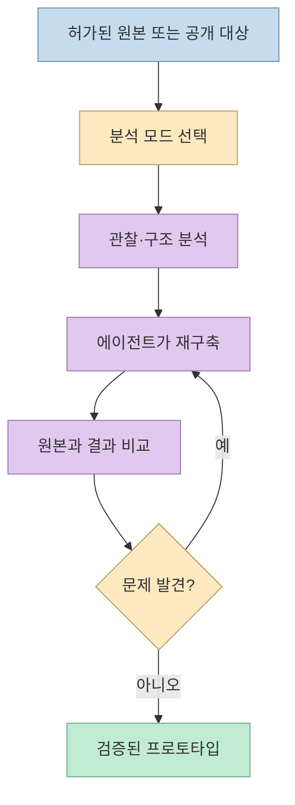
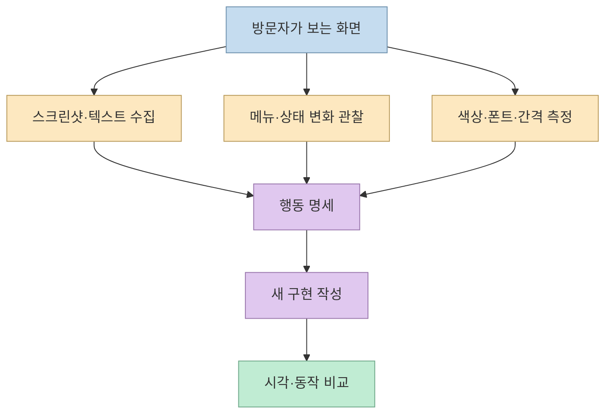
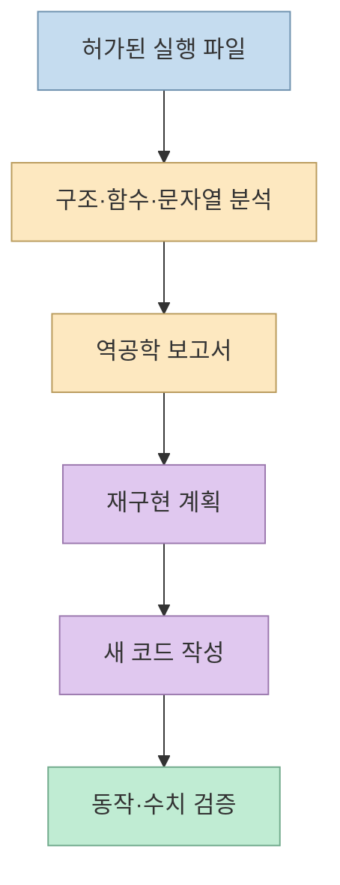
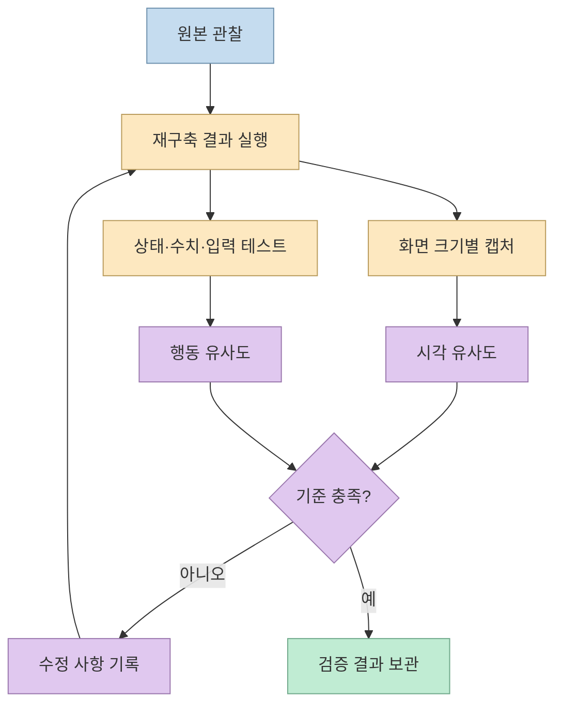

웹사이트나 앱의 동작을 보고 비슷한 결과물을 만드는 작업은 오래전부터 가능했지만, 관찰·분석·구현·검증을 하나의 루프로 묶기는 쉽지 않았다. 민둥이의 영상은 오픈소스 도구 **Craft Anything** 이 이 과정을 자동화한다고 소개한다. 다만 “무엇이든 복제”라는 제목을 그대로 받아들이기보다, **허가받은 소프트웨어를 이해하고 재구축하는 에이전트형 워크플로**로 보는 것이 정확하다. [영상 00:00](https://youtu.be/FW_H1YL9hgk?t=0), [Craft Anything 개요](https://craft.wiki/apps/craft-anything/overview/)

<!--more-->

## Sources

- [원본 영상: 개발자들 난리났던.. 이번엔 '뭐든 복제하는 AI' 공개](https://youtu.be/FW_H1YL9hgk?si=CatcMzajVKP2aBFN) — 민둥이 | 쉽게 배우는 AI. 한국어 자동 생성 자막을 확인하고, 주장별 시간 링크를 붙였다.
- [Craft Anything GitHub 저장소](https://github.com/storytold/craft-anything) — 공개 구현과 설치·지원 범위.
- [Craft Wiki: Clean room 또는 Deep](https://craft.wiki/apps/craft-anything/overview/) — 두 분석 모드의 공식 설명과 책임 범위.
- [NSA Ghidra](https://www.nsa.gov/serve-from-netstorage/ghidra/) — 딥 분석에서 연결할 수 있는 역공학 프레임워크의 공식 설명.

## 무엇을 복제하는 도구인가

영상의 사용 흐름은 단순하다. 프로그램을 설치하고, 따라 만들 웹사이트 주소나 프로그램 파일을 넣은 뒤 원하는 결과를 자연어로 설명한다. 대상은 웹사이트뿐 아니라 Windows·macOS 프로그램, Android 앱, Unity·Unreal 게임까지 포함될 수 있다고 소개된다. 원본이 없어도 Rust로 특정 게임을 만들라는 식의 요청이 가능하다는 예시도 나온다. 하지만 생성된 결과가 원본과 기능·자산·라이선스까지 동일하다는 뜻은 아니다. [영상 00:18](https://youtu.be/FW_H1YL9hgk?t=18), [영상 00:26](https://youtu.be/FW_H1YL9hgk?t=26), [GitHub 저장소](https://github.com/storytold/craft-anything)

## 클린룸 모드: 보이는 것만 명세로 바꾸기

클린룸은 원본 내부의 코드·파일·페이지 소스를 읽지 않고, 사용자가 볼 수 있는 정보로 재현하는 기본 모드다. 공식 설명에 따르면 웹사이트는 화면 캡처, 보이는 글자, 색상, 배치, 글꼴, 여백, 메뉴를 눌렀을 때의 변화 등을 관찰한다. 영상은 이를 포토샵 복제 사례와 연결한다. 즉 구현자는 원본 코드를 복사하는 것이 아니라 **관찰 가능한 요구사항을 새 코드로 번역**한다. [영상 01:00](https://youtu.be/FW_H1YL9hgk?t=60), [영상 01:11](https://youtu.be/FW_H1YL9hgk?t=71), [Craft Wiki](https://craft.wiki/apps/craft-anything/overview/)

클린룸의 장점은 원본 내부를 읽지 않는 경계를 설계하기 쉽다는 점이다. 반대로 보이지 않는 서버 규칙, 예외 처리, 성능 최적화, 접근성 상태는 화면 관찰만으로 완전히 알아내기 어렵다. 따라서 클린룸 결과물의 “닮음”은 화면과 주요 흐름에 대한 유사도이지, 원본의 내부 동작을 증명하는 지표가 아니다. [영상 01:20](https://youtu.be/FW_H1YL9hgk?t=80)

## 딥 모드: 파일과 바이너리까지 분석하기

딥 모드는 허가된 경우 프로그램 내부의 코드와 파일, 웹사이트의 JavaScript, 실행 파일 구조까지 분석한다. 영상은 340KB 규모의 Windows 프로그램에서 매우 짧은 시간에 수백 개의 함수를 찾아냈다는 제작사 기록을 소개하고, Ghidra가 설치돼 있으면 연결해 내부 구조를 살핀다고 설명한다. 이 수치는 영상 속 개발사 사례이지 모든 바이너리에서 재현되는 처리 시간이나 분석 정확도를 보장하지 않는다. [영상 01:40](https://youtu.be/FW_H1YL9hgk?t=100), [영상 01:49](https://youtu.be/FW_H1YL9hgk?t=109)

Ghidra는 NSA Research Directorate가 만든 소프트웨어 역공학 프레임워크로, 디스어셈블·디컴파일·그래프·스크립팅 같은 분석 기능을 제공한다. Craft Anything이 Ghidra를 연결할 수 있다는 것은 분석 파이프라인의 한 구성요소가 될 수 있다는 의미이지, 원본의 설계 의도나 저작권을 자동으로 획득한다는 뜻은 아니다. [NSA Ghidra 공식 설명](https://www.nsa.gov/serve-from-netstorage/ghidra/)

딥 모드는 강력한 만큼 위험도 크다. 실행 파일을 분석하는 에이전트가 현재 사용자 권한으로 파일을 읽고 명령을 실행할 수 있다면, 도구 자체의 “클린룸” 규칙과 컴퓨터 전체의 보안 경계는 별개다. Craft Wiki도 클린룸이 컴퓨터를 샌드박스화하지 않으며, 실행 중인 코딩 에이전트는 자신의 권한으로 행동한다고 경고한다. 분석 전에는 별도 계정·가상환경·복사본·네트워크 제한을 검토해야 한다. [Craft Wiki 안전 주의](https://craft.wiki/apps/craft-anything/overview/)

## 검증 루프가 복제의 핵심이다

영상은 분석 후 바로 끝내지 않고 원본과 결과를 비교한다고 설명한다. 웹사이트는 첫 페이지와 연결된 페이지를 여러 화면 크기로 캡처해 유사도 점수를 내고, 게임은 발견된 수치가 복제판에 반영됐는지, 캐릭터가 움직이는지, 화면이 제대로 표시되는지 확인한다. 문제가 발견되면 다시 수정하고 비교하는 반복 루프다. [영상 02:00](https://youtu.be/FW_H1YL9hgk?t=120), [영상 02:14](https://youtu.be/FW_H1YL9hgk?t=134)

이 루프는 “AI가 원본을 한 번에 복사한다”는 환상을 줄여준다. 유사도 점수는 어떤 화면·상태·입력 시나리오를 검사했는지에 따라 달라진다. 영상에서 언급한 웹사이트의 96% 유사도나 1분 30초, 데스크톱 앱의 9분 결과는 개발사가 공개한 사례로 보아야 하며, 복잡한 제품의 보편적인 시간표가 아니다. [영상 00:38](https://youtu.be/FW_H1YL9hgk?t=38), [영상 00:45](https://youtu.be/FW_H1YL9hgk?t=45)

## 법적·보안 경계: 복제보다 허가가 먼저다

공식 안내는 소유하거나 분석 허가를 받은 소프트웨어만 사용하라고 명시한다. DRM, 로그인, 치트 방지 장치를 우회하지 말고, 로고·사진·텍스트도 소유권이나 허가가 없는 한 복사하지 않도록 빌더에게 지시한다. 이는 기술적으로 가능한 범위와 법적으로 허용되는 범위가 다르다는 뜻이다. [영상 02:30](https://youtu.be/FW_H1YL9hgk?t=150), [Craft Wiki 안전 안내](https://craft.wiki/apps/craft-anything/overview/)

실무에서는 다음 경계를 문서로 남기는 것이 좋다.

- 분석 대상의 소유자와 허가 범위
- 읽어도 되는 파일·페이지·API와 금지된 영역
- 복제하지 않을 브랜드 자산과 사용자 데이터
- 실행 에이전트의 파일·네트워크 권한
- 원본과 새 구현의 라이선스·고지 방식

## 실전 적용 포인트

1. **먼저 클린룸으로 범위를 좁힌다.** 화면, 메뉴, 입력, 반응을 명세로 만들 수 있는지 확인한 뒤 내부 분석이 정말 필요한 경우에만 딥 모드를 검토한다. [영상 01:00](https://youtu.be/FW_H1YL9hgk?t=60)
2. **원본을 복사하지 말고 요구사항을 추출한다.** “어떤 색의 버튼인가”보다 “어떤 상태에서 어떤 결과로 바뀌는가”를 기록하면 독립 구현과 테스트가 쉬워진다. [영상 01:11](https://youtu.be/FW_H1YL9hgk?t=71)
3. **검증 시나리오를 먼저 만든다.** 화면 크기, 메뉴 경로, 입력값, 캐릭터 상태처럼 비교할 관찰 지점을 체크리스트로 고정한다. [영상 02:00](https://youtu.be/FW_H1YL9hgk?t=120)
4. **에이전트 권한을 최소화한다.** 분석용 복사본과 별도 계정을 사용하고, 필요하지 않은 네트워크·파일 접근은 차단한다. 클린룸이라는 이름만으로 샌드박스가 되지는 않는다. [Craft Wiki 안전 주의](https://craft.wiki/apps/craft-anything/overview/)
5. **수치와 시간을 재현 조건과 함께 기록한다.** “96% 유사도”보다 어떤 페이지·화면 크기·테스트 케이스에서 얻은 값인지가 중요하다. [영상 00:38](https://youtu.be/FW_H1YL9hgk?t=38)

## 핵심 요약

- Craft Anything은 대상 관찰, 내부 분석, 재구축, 비교 검증을 연결하는 에이전트형 워크플로다.
- 클린룸은 외부에서 보이는 화면과 상호작용을, 딥 모드는 허가된 내부 파일과 바이너리를 다룬다. [Craft Wiki](https://craft.wiki/apps/craft-anything/overview/)
- 영상의 유사도·처리 시간은 개발사 사례이지 모든 소프트웨어에 대한 보장이 아니다. [영상 00:38](https://youtu.be/FW_H1YL9hgk?t=38)
- 기술적 복제 가능성보다 소유권, 라이선스, DRM·로그인·치트 방지 우회 금지, 실행 권한 격리가 먼저다. [영상 02:30](https://youtu.be/FW_H1YL9hgk?t=150)

## 결론

Craft Anything의 핵심은 “무엇이든 훔쳐 복사한다”가 아니라, 허가된 소프트웨어를 관찰 가능한 명세와 자동 검증 루프로 재구축하는 데 있다. 클린룸으로 제품 경험을 독립 구현하고, 꼭 필요한 경우에만 격리된 환경에서 딥 분석을 사용한다면 이 도구는 레거시 마이그레이션, 호환성 프로토타입, 내부 도구 재구축에 유용할 수 있다. 반대로 소유권과 실행 권한을 확인하지 않은 채 복제 버튼만 누르는 것은 기술 데모가 아니라 법적·보안 리스크를 자동화하는 일이다.
