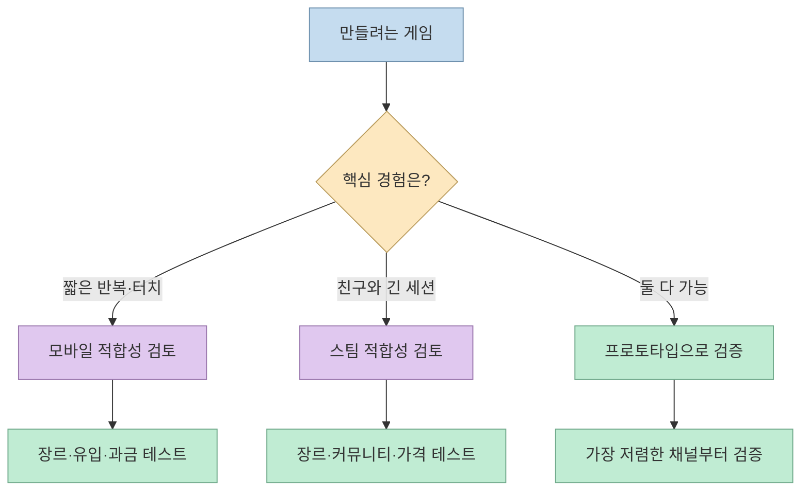
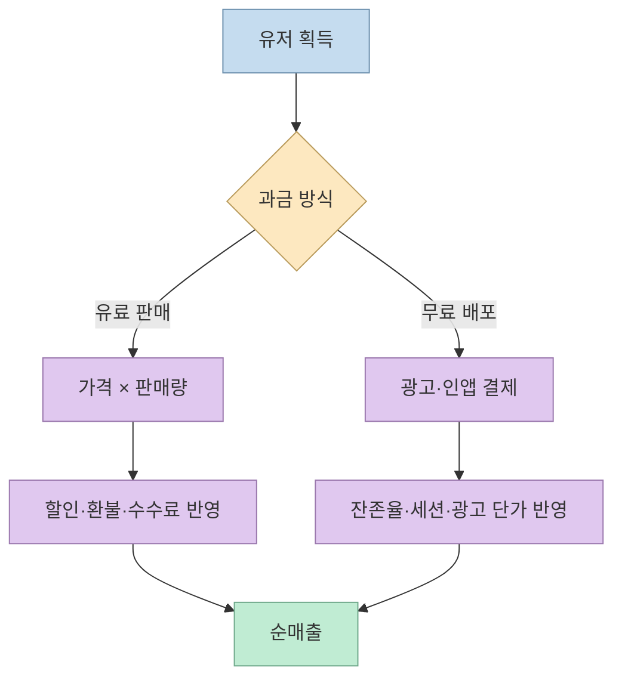
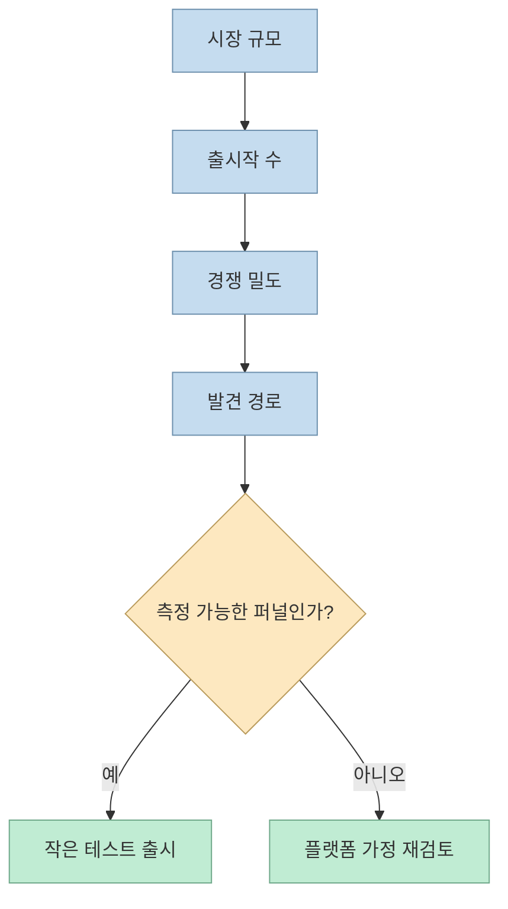
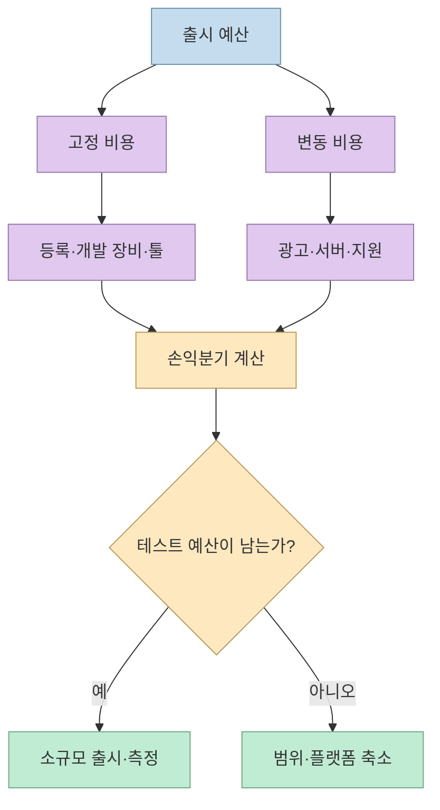

첫 게임을 만들 때 “스팀이냐 모바일이냐”는 취향보다 **게임의 장르와 수익 구조를 어디에 맞출지**의 문제다. MGD의 쇼츠는 두 플랫폼을 장르, 수익화, 성공 가능성, 비용이라는 네 가지 축으로 비교한 뒤, 제작하려는 게임의 성격에 맞춰 선택하라고 제안한다. 다만 영상 속 비율과 매출은 조사 시점·표본·정의가 모두 공개된 것은 아니므로, 사업계획서의 확정값이 아니라 의사결정의 질문 목록으로 읽는 편이 안전하다. [영상 00:00](https://youtu.be/oGKZwl6ZIeY?t=0)

<!--more-->

## Sources

- [원본 쇼츠: EP 29. 첫 게임이라면 스팀? 모바일?](https://youtube.com/shorts/oGKZwl6ZIeY?si=JPayy1braLg0Hr9u) — MGD - Midnight Game Devs. 한국어 자동 생성 자막을 확인했으며, 주장별 시간 링크를 붙였다.
- [Steamworks: Steam Direct Fee](https://partner.steamgames.com/doc/gettingstarted/appfee) — 앱별 등록비와 매출 발생 후 회수 조건.
- [Apple Developer Program](https://developer.apple.com/help/account/membership/program-enrollment/) — 애플 개발자 프로그램 연회비.
- [Google Play Console 시작하기](https://support.google.com/googleplay/android-developer/answer/6112435) — 구글 플레이 등록비.

## 1. 장르가 플랫폼 적합성을 먼저 결정한다

영상의 첫 번째 기준은 장르다. 쇼츠는 미국 앱스토어 매출 상위에서 퍼즐·캐주얼 비중이 높고, 스팀에서는 해당 장르가 평균보다 덜 뜨는 반면 친구와 함께하는 협동 게임이 평균보다 많이 노출된다는 조사 결과를 소개한다. 이 수치는 영상 제작자가 정리한 비교이며, “모바일에는 퍼즐만 성공한다”거나 “스팀에는 협동만 성공한다”는 규칙은 아니다. 장르별 구매 의도, 세션 길이, 친구 초대 가능성, 입력 방식이 플랫폼 사용자와 맞는지를 먼저 묻자는 뜻에 가깝다. [영상 00:06](https://youtu.be/oGKZwl6ZIeY?t=6), [영상 00:17](https://youtu.be/oGKZwl6ZIeY?t=17)

## 2. 무료 모바일과 유료 PC는 수익 엔진이 다르다

두 번째 기준은 돈을 받는 순간이다. 영상은 스팀은 게임 판매가 일반적이고, 모바일 다운로드의 대부분은 무료 게임이라고 설명한다. 무료 모바일 게임은 광고나 인앱 결제로 수익을 만들지만, 다운로드 수가 곧 매출은 아니다. 광고 노출 수, 잔존율, 세션 길이, 지역별 광고 단가가 함께 움직이기 때문이다. 반대로 스팀의 유료 게임은 가격과 판매량, 환불, 할인 정책, 플랫폼 수수료가 핵심 변수가 된다. [영상 00:21](https://youtu.be/oGKZwl6ZIeY?t=21), [영상 00:49](https://youtu.be/oGKZwl6ZIeY?t=49)

쇼츠는 *Balatro*를 스팀에서 먼저 알려진 뒤 모바일 유료 게임으로 확장한 사례로 들며, 작은 게임도 유료 모델로 성과를 낼 수 있다고 말한다. 그러나 특정 게임의 매출 추정치를 다른 팀의 기대 매출로 옮기면 안 된다. 장르, 출시 시기, 커뮤니티 규모, 플랫폼별 출시 순서가 모두 다르기 때문이다. 사례는 “유료 모바일은 불가능하다”는 반례일 뿐, 일반적인 성공 확률을 보장하지 않는다. [영상 00:32](https://youtu.be/oGKZwl6ZIeY?t=32), [영상 00:41](https://youtu.be/oGKZwl6ZIeY?t=41)

## 3. 큰 시장이 낮은 성공 확률을 뜻할 수도 있다

세 번째 기준은 시장 크기와 경쟁 밀도를 함께 보는 것이다. 영상은 모바일 시장이 스팀보다 크지만, 같은 기간 출시작 수도 훨씬 많다고 비교한다. 또 일정 매출을 넘긴 신작의 비율과 스팀 신작의 중위 매출, 모바일 결제 매출의 상위 집중도를 제시한다. 이 숫자들은 쇼츠 안에서 출처와 산식이 모두 설명되지는 않으므로, **영상 제작자의 조사 결과**로 표시해야 한다. 특히 “중위값 320달러”처럼 정의가 명확하지 않은 수치를 모든 스팀 게임의 기대값으로 사용하면 안 된다. [영상 01:03](https://youtu.be/oGKZwl6ZIeY?t=63), [영상 01:16](https://youtu.be/oGKZwl6ZIeY?t=76), [영상 01:24](https://youtu.be/oGKZwl6ZIeY?t=84)

실무에서는 플랫폼 전체의 크기보다 내 게임이 발견될 경로를 따져야 한다. 스팀이라면 위시리스트, 데모, 커뮤니티, 스트리머가 중요하고, 모바일이라면 광고 소재의 클릭률, 앱스토어 전환율, 첫날·첫 주 잔존율이 중요하다. 즉 “어느 시장이 더 큰가?”보다 “내 팀이 어느 퍼널을 측정하고 개선할 수 있는가?”가 더 유용한 질문이다. [영상 01:03](https://youtu.be/oGKZwl6ZIeY?t=63), [영상 01:29](https://youtu.be/oGKZwl6ZIeY?t=89)

## 4. 등록비보다 큰 비용은 유입과 개발 환경이다

네 번째 기준은 비용이다. 영상은 아이폰 설치의 상당 부분이 광고로 유입되고, 캐주얼 게임은 광고비를 써도 회수가 어렵다고 말한다. 이 역시 쇼츠의 조사 수치이므로 국가, 캠페인, 장르에 따라 달라진다. 모바일에서는 등록비만 계산하지 말고 광고 크리에이티브 제작, 어트리뷰션, 테스트 기기, 서버와 고객지원 비용을 함께 잡아야 한다. [영상 01:31](https://youtu.be/oGKZwl6ZIeY?t=91), [영상 01:39](https://youtu.be/oGKZwl6ZIeY?t=99)

반면 플랫폼 계정 등록비 자체는 공식 문서로 확인할 수 있다. Steam Direct는 앱마다 100달러를 내고, 해당 제품이 조정 총매출 1,000달러에 도달하면 회수되는 구조다. 애플 개발자 프로그램은 연 99달러이며, Google Play Console은 25달러의 일회성 등록비를 안내한다. 지역 세금, 계정 유형, 플랫폼 정책은 별도로 확인해야 한다. [Steamworks 공식 문서](https://partner.steamgames.com/doc/gettingstarted/appfee), [Apple 공식 문서](https://developer.apple.com/help/account/membership/program-enrollment/), [Google 공식 문서](https://support.google.com/googleplay/android-developer/answer/6112435)

## 실전 적용 포인트

1. **게임의 한 문장 약속을 쓴다.** “짧은 터치 퍼즐”인지 “친구와 30분 협동”인지 적고, 입력 방식과 세션 길이를 플랫폼에 대입한다. [영상 00:06](https://youtu.be/oGKZwl6ZIeY?t=6)
2. **수익 이벤트를 하나로 고정해 프로토타입을 만든다.** 유료 판매라면 가격·데모·위시리스트를, 무료 모델이라면 광고 위치·잔존율·인앱 상품을 먼저 측정한다. [영상 00:21](https://youtu.be/oGKZwl6ZIeY?t=21)
3. **시장 통계의 분모를 확인한다.** ‘상위 게임’이 매출인지 다운로드인지, 신작의 기준 기간이 무엇인지, 국가 범위가 어디인지 확인한 뒤 계획서에 기록한다. 영상의 수치를 그대로 기대 매출로 쓰지 않는다. [영상 01:03](https://youtu.be/oGKZwl6ZIeY?t=63)
4. **등록비와 유입비를 분리한다.** 계정 비용은 공식 문서로 확인하고, 광고·서버·장비·고객지원은 팀의 실제 견적으로 계산한다. [영상 01:31](https://youtu.be/oGKZwl6ZIeY?t=91)
5. **작은 테스트를 먼저 배포한다.** 플랫폼을 영구히 결정하기 전에 데모, 제한된 지역 테스트, 친구 초대 테스트 중 가장 싼 방법으로 핵심 지표를 얻는다. [영상 01:58](https://youtu.be/oGKZwl6ZIeY?t=118)

## 핵심 요약

- 스팀과 모바일 중 하나가 항상 우월한 것이 아니라, 게임의 장르·세션·입력·수익 구조가 선택을 좌우한다. [영상 01:58](https://youtu.be/oGKZwl6ZIeY?t=118)
- 영상의 시장·매출·성공률 수치는 유용한 출발점이지만 출처와 산식이 충분히 공개되지 않았으므로 가설로 다뤄야 한다.
- 플랫폼 등록비는 전체 사업비의 일부다. 광고 유입, 잔존율, 서버, 테스트 기기와 개발 시간까지 합쳐 손익을 계산해야 한다.

## 결론

첫 게임의 플랫폼은 시장 규모만 보고 고르기보다 **내 게임이 어떤 경험을 주고, 어떻게 돈을 벌며, 어떤 퍼널을 측정할 수 있는지**로 결정해야 한다. 스팀과 모바일 양쪽이 열려 있다면 가장 작은 프로토타입으로 사용자 반응을 확인한 뒤, 데이터가 쌓이는 쪽에 개발 자원을 집중하는 것이 안전하다.
