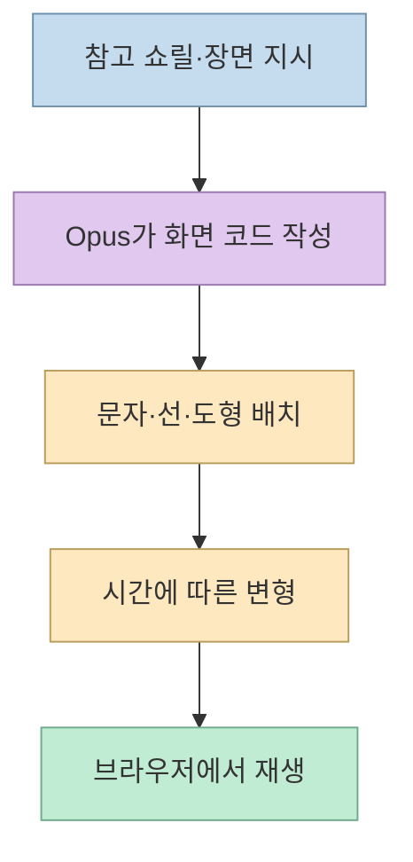
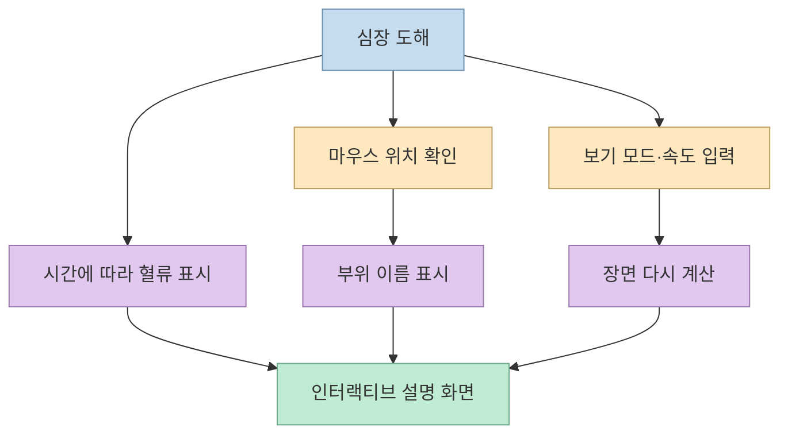
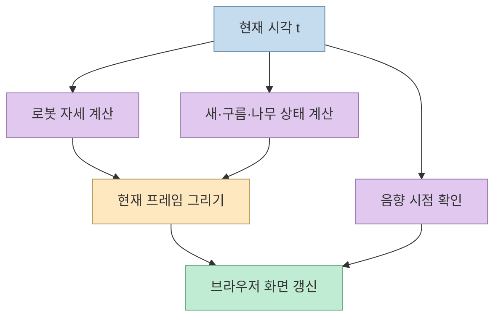

영상 생성 모델에 장면을 맡기지 않고, AI가 작성한 코드를 브라우저에서 실행해 움직이는 화면을 만들 수 있을까? 찐AI의 시연은 **모션그래픽 쇼릴**, **조작 가능한 심장 그림**, **손그림풍 로봇 애니메이션**으로 이 질문을 시험한다. 핵심은 Opus 5.5가 동영상 파일을 직접 생성했다는 뜻이 아니라, 장면을 그릴 HTML·JavaScript 코드를 작성했다는 점이다. [영상 00:13](https://youtu.be/RHKolUChaiE?t=13), [영상 00:35](https://youtu.be/RHKolUChaiE?t=35)

<!--more-->

## Sources

- [원본 영상: Opus 5.5 코드만으로 영상 뽑는 미친 방법, 어디까지 될까?](https://youtu.be/RHKolUChaiE?si=FUM-hq78M02oUWcJ) — 찐AI. 한국어 자동 생성 자막을 확인했으며, 아래의 시연 내용에는 시간 이동 링크를 붙였다.
- [MDN: `requestAnimationFrame()`](https://developer.mozilla.org/en-US/docs/Web/API/Window/requestAnimationFrame) — 브라우저 애니메이션의 프레임 호출과 화면 주사율을 설명하는 보조 자료. 영상의 실제 코드가 이 API를 사용했다는 증거는 아니다.

## 첫 실험: 문자와 도형이 움직이는 쇼릴

제작자는 약 30초 분량의 모션 디자이너 쇼릴을 참고 자료로 주고, 원하는 움직임을 상세히 설명해 Opus 5.5에 구현을 요청한다. 시연 결과에는 문자가 선·도형·육각형·대시보드 같은 그래픽으로 바뀌는 장면이 등장한다. 제작자도 원본과 **동일한 복제**라고 주장하지 않고, 비슷한 시각적 흐름을 코드로 구현한 결과로 소개한다. 공개된 영상만으로 프롬프트 전문, 코드 전체, 수정 횟수를 확인할 수는 없다. [영상 00:55](https://youtu.be/RHKolUChaiE?t=55), [영상 01:19](https://youtu.be/RHKolUChaiE?t=79)

이런 작업에서 코드의 이점은 **문구·숫자·위치·속도를 지정하고 다시 수정하기 쉽다**는 것이다. 제작자는 영상 생성 서비스에서 글자나 숫자, 박자 맞추기가 어려웠던 경험과 대비한다. 다만 이는 시연자의 평가이지 모든 생성 모델·모든 프롬프트에 대한 성능 비교 실험은 아니다. 코드로도 보기 좋은 타이포그래피와 리듬을 만들려면 설계와 검수가 필요하다. [영상 01:31](https://youtu.be/RHKolUChaiE?t=91), [영상 07:15](https://youtu.be/RHKolUChaiE?t=435)

## 두 번째 실험: 보는 영상에서 조작하는 설명 자료로

심장 사례는 단순히 움직이는 클립이 아니다. 시연에서는 혈류를 보여주고, 마우스를 올리면 부위 이름이 나타나며, 외부·내부·분해 보기를 전환하고 심박 속도도 조절한다. 같은 장면을 코드로 구성하면 **영상처럼 재생하면서 사용자 입력에도 반응하는 설명 자료**가 될 수 있다는 점을 보여준다. 단, 화면에 묘사된 해부학적 구조나 혈류의 의학적 정확성을 이 영상만으로 검증할 수는 없다. [영상 01:57](https://youtu.be/RHKolUChaiE?t=117), [영상 02:14](https://youtu.be/RHKolUChaiE?t=134)

## 세 번째 실험: 로봇 애니메이션을 시간의 함수로 만들기

손그림 느낌의 2D 숲속 로봇 애니메이션에서는 제작자가 3D나 일반적인 웹 애니메이션처럼 보이지 않도록 스타일 조건을 준다. 영상의 설명에 따르면 로봇의 팔·다리, 새, 구름, 나무 같은 요소를 JavaScript 함수로 정의하고, 각 시점의 상태를 계산해 그린다. 제작자는 `t=14`, `t=20`, `t=26`처럼 시각을 바꿔 장면의 다른 지점을 살펴보는 방식도 보여준다. 음악·효과음 역시 시간에 맞춰 배치했다고 설명한다. 이는 **완성 프레임을 모델이 한 번에 뽑는 방식**과 다르다. [영상 02:37](https://youtu.be/RHKolUChaiE?t=157), [영상 03:27](https://youtu.be/RHKolUChaiE?t=207), [영상 04:13](https://youtu.be/RHKolUChaiE?t=253)

제작자는 브라우저가 초당 60번 그린다고 설명하지만, **항상 60fps로 출력된다는 보장은 없다**. 브라우저의 프레임 호출은 보통 디스플레이 주사율에 맞춰 이뤄지고, 백그라운드 탭에서는 멈추거나 줄어들 수 있다. 시간값을 기준으로 위치를 계산해야 화면 주사율이 달라도 애니메이션 속도를 일정하게 유지하기 쉽다. 이는 일반적인 웹 애니메이션 구현 원리이며, 시연 코드의 내부 구현을 확인한 진술은 아니다. [영상 04:39](https://youtu.be/RHKolUChaiE?t=279), [MDN `requestAnimationFrame()`](https://developer.mozilla.org/en-US/docs/Web/API/Window/requestAnimationFrame)

## 어디까지가 코드의 강점인가

제작자는 AI가 코드를 작성하고 실행 결과를 눈으로 확인한 뒤 수정하는 흐름을 설명한다. 이 방식은 숫자 하나를 바꿔 즉시 장면을 조정할 수 있어, 텍스트 중심 쇼릴이나 구조를 설명하는 그래픽에 잘 맞는다. 그러나 제작자의 “최근에는 거의 수정이 필요 없었다”는 평가는 이 시연의 개인적 경험이다. 다른 장면에서도 인체 표현, 글자 깨짐, 타이밍, 음향 동기화가 자동으로 통과한다는 뜻은 아니다. [영상 05:15](https://youtu.be/RHKolUChaiE?t=315), [영상 07:15](https://youtu.be/RHKolUChaiE?t=435)

반면 영상은 역광 속에서 달리는 사람, 머리카락, 개, 나무처럼 사실적인 복잡한 장면을 코드로 요청했을 때 결과가 기계적으로 보였다고 보여준다. 따라서 **이 시연의 코드만으로는 실사에 가까운 자연스러움을 얻기 어려웠다**고 읽는 편이 정확하다. 원리적으로 코드 기반 3D·시뮬레이션으로 그런 장면을 절대 만들 수 없다는 증거는 아니다. 제작자의 결론도 영상 생성 서비스를 대체한다는 것이 아니라, 그래픽형 장면과 실사형 장면에 서로 다른 도구를 쓰자는 것이다. [영상 05:52](https://youtu.be/RHKolUChaiE?t=352), [영상 06:27](https://youtu.be/RHKolUChaiE?t=387), [영상 06:49](https://youtu.be/RHKolUChaiE?t=409)

또 하나 구분할 것은 **브라우저에서 움직이는 HTML 결과물**과 **배포할 MP4 파일**이다. 이 영상은 코드로 장면이 동작하는 모습을 보여주지만, 특정 렌더러·녹화 방식·인코딩 설정까지 제시해 MP4 출력 과정을 검증하지는 않는다. 영상 파일이 목적이라면 화면을 정해진 크기와 프레임률로 렌더링하고 녹화·인코딩한 뒤 결과를 별도로 확인해야 한다. 이는 영상의 시연 범위를 바탕으로 한 제작상 판단이다. [영상 00:25](https://youtu.be/RHKolUChaiE?t=25), [영상 03:27](https://youtu.be/RHKolUChaiE?t=207)

## 실전 적용 포인트

1. **먼저 장면 유형을 고른다.** 정확한 문구·수치·도형·호버 반응이 중요하면 코드 기반 프로토타입부터 검토한다. 사람의 자연스러운 동작이나 실사 질감이 핵심이면 영상 생성·촬영·3D 제작과 비교한다. [영상 01:31](https://youtu.be/RHKolUChaiE?t=91), [영상 06:49](https://youtu.be/RHKolUChaiE?t=409)
2. **요청을 움직임 명세로 적는다.** 등장할 요소, 화면 비율, 시작·종료 상태, 바뀌는 시각, 인터랙션, 금지할 스타일을 명시한다. 시연의 쇼릴 참조와 로봇의 “3D처럼 보이지 않기” 조건처럼, 참고 자료와 제약이 결과를 판단할 기준이 된다. [영상 00:55](https://youtu.be/RHKolUChaiE?t=55), [영상 02:37](https://youtu.be/RHKolUChaiE?t=157)
3. **시간을 이동하며 검수한다.** 시작·중간·끝뿐 아니라 장면 전환 직전과 직후를 확인하고, 문구·숫자·음향 시점을 점검한다. 인터랙티브 화면이라면 모든 보기 모드와 입력 범위를 테스트한다. [영상 02:14](https://youtu.be/RHKolUChaiE?t=134), [영상 04:13](https://youtu.be/RHKolUChaiE?t=253)
4. **산출물을 따로 정의한다.** 웹에서 재생할 HTML이 필요한지, 편집기에 넣을 MP4가 필요한지 먼저 정한다. 후자라면 프레임 녹화·인코딩·재생 검증을 별도 단계로 계획한다. [영상 00:25](https://youtu.be/RHKolUChaiE?t=25), [영상 03:27](https://youtu.be/RHKolUChaiE?t=207)

## 핵심 요약

- 이 영상의 세 사례는 **AI가 작성한 코드가 브라우저에서 장면을 그린 시연**이지, 모델이 MP4를 직접 생성한 사례로 확인된 것은 아니다. [영상 00:13](https://youtu.be/RHKolUChaiE?t=13), [영상 03:27](https://youtu.be/RHKolUChaiE?t=207)
- 코드의 강점은 문구·숫자·시간·입력 반응을 명시하고 수정할 수 있다는 점이다. 심장 사례는 영상과 인터랙티브 설명 자료의 경계를 보여준다. [영상 01:31](https://youtu.be/RHKolUChaiE?t=91), [영상 01:57](https://youtu.be/RHKolUChaiE?t=117)
- 사실적인 인물·동물·자연물 표현은 이 시연에서 약점으로 나타났다. **코드와 생성 영상은 대체재라기보다 장면에 따라 선택할 도구**다. [영상 05:52](https://youtu.be/RHKolUChaiE?t=352), [영상 06:49](https://youtu.be/RHKolUChaiE?t=409)

## 결론

Opus 5.5가 코드를 작성하는 방식은 정확한 텍스트와 구조가 필요한 모션그래픽, 조작 가능한 교육용 시각화에 유용한 선택지다. 반대로 실사 같은 자연스러운 움직임이 목표라면 영상 생성·촬영·3D 제작을 함께 검토해야 한다. 어떤 방식을 택하든 **장면 코드 작성, 화면 검수, 영상 파일 출력은 서로 다른 단계**로 관리하는 편이 안전하다. [영상 06:49](https://youtu.be/RHKolUChaiE?t=409), [영상 07:15](https://youtu.be/RHKolUChaiE?t=435)
