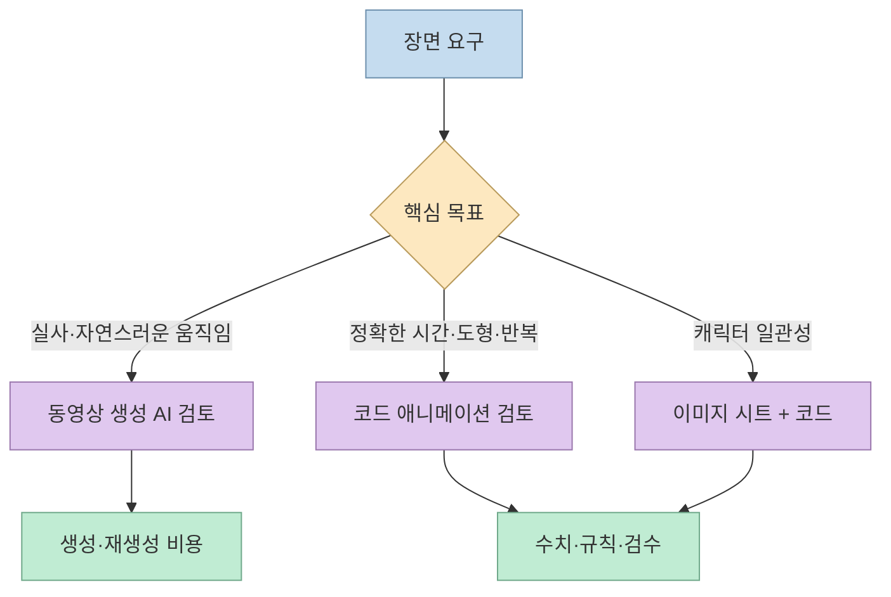
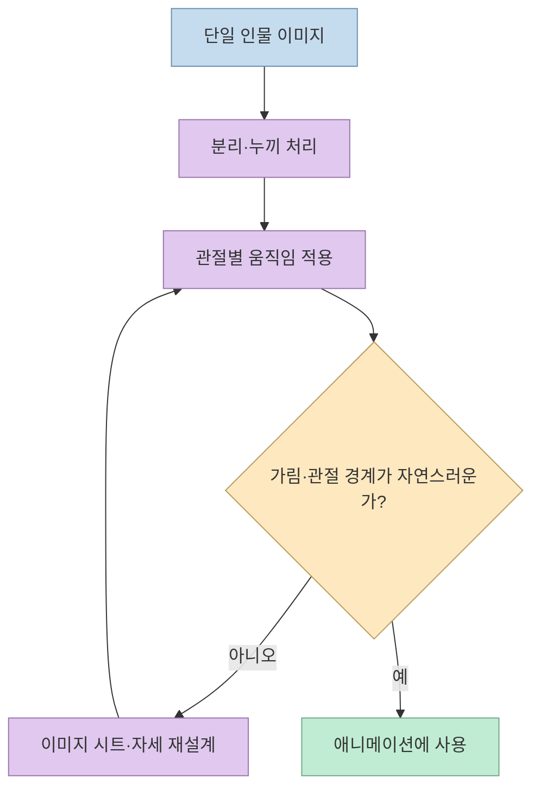
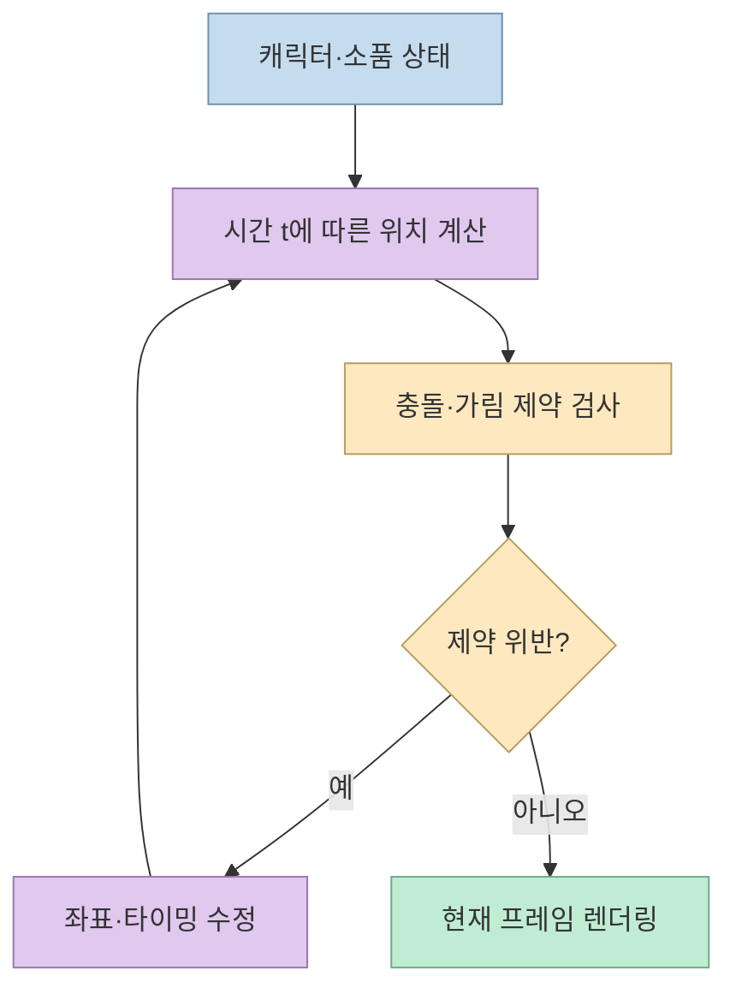
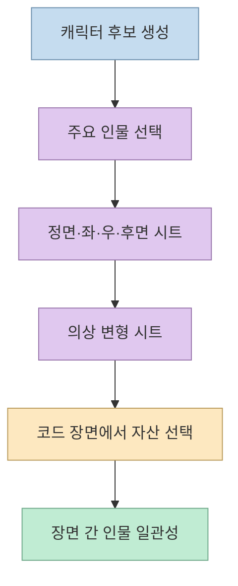
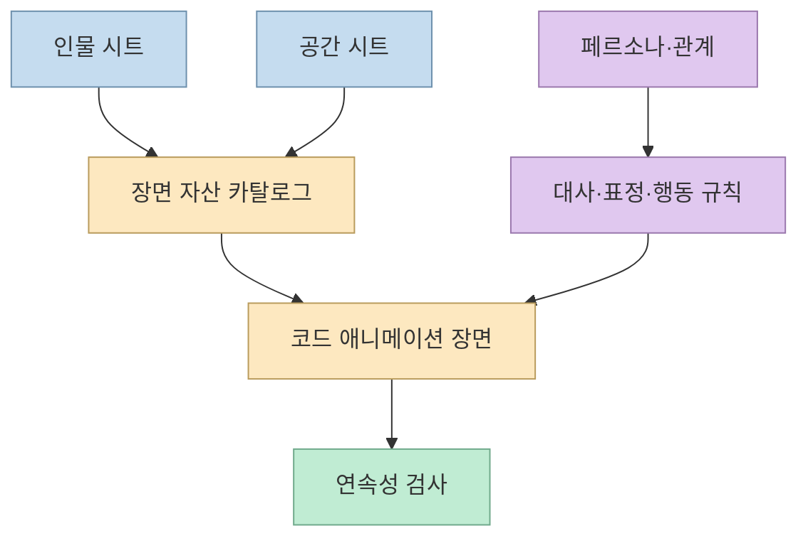
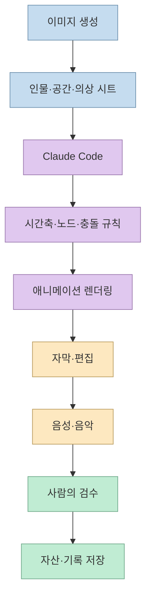
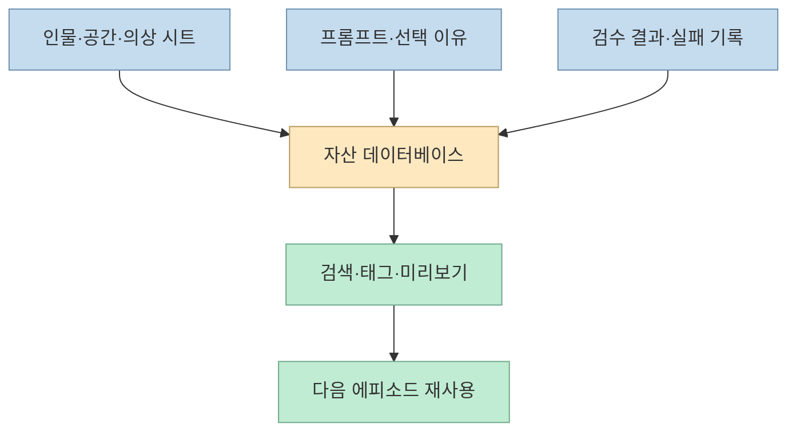

동영상 생성 AI는 짧고 화려한 장면을 빠르게 만들 수 있지만, 긴 애니메이션에서는 인물·공간·행동의 일관성을 유지하기 어렵다. 외부강사 김지백의 영상은 이 문제를 다른 방식으로 풀어 본다. **ChatGPT 이미지로 캐릭터와 배경을 준비하고, Claude Code가 HTML·JavaScript 애니메이션을 조립하며, 사람이 가설을 세우고 결과를 검수하는 방식**이다. 목표는 한 번의 클릭으로 완성하는 것이 아니라, 반복 제작할 수 있는 작은 스튜디오를 만드는 데 있다. [영상 01:00](https://youtu.be/_yWtkaMVbsw?t=60), [영상 10:35](https://youtu.be/_yWtkaMVbsw?t=635)

<!--more-->

## Sources

- [원본 영상: 동영상 AI 없이 파이썬 코드로 가족 애니메이션을 만들었습니다](https://youtu.be/_yWtkaMVbsw?si=YpmPPfrjBnmbQsdB) — 외부강사 김지백. 한국어 자동 생성 자막을 확인하고, 주요 주장에 시간 링크를 붙였다.
- [MDN: `requestAnimationFrame()`](https://developer.mozilla.org/en-US/docs/Web/API/Window/requestAnimationFrame) — 브라우저 애니메이션 루프를 이해하기 위한 보조 자료. 영상의 내부 코드가 이 API를 사용했다는 뜻은 아니다.

## 왜 동영상 생성 AI 대신 코드인가

영상은 힉스필드·Seedance 같은 클라우드 동영상 AI를 쓰면 부드럽고 화려한 장면을 얻을 수 있지만, 1분 분량을 만들 때 비용이 커지고 마음에 들지 않으면 다시 생성해야 한다고 설명한다. 제작자가 말하는 코드 방식의 장점은 **몇 초에 어떤 효과가 일어날지 수치로 지정할 수 있다는 점**이다. 반대로 현실적인 사람의 움직임이나 자연스러운 물리 표현은 코드만으로 어색해질 수 있다. 이는 영상 제작자의 경험에 기반한 비교이지, 모든 모델·모든 장면의 비용과 품질을 측정한 벤치마크는 아니다. [영상 00:28](https://youtu.be/_yWtkaMVbsw?t=28), [영상 01:09](https://youtu.be/_yWtkaMVbsw?t=69)

코드 애니메이션은 “영상 파일을 바로 생성한다”기보다, 브라우저가 시간에 따라 이미지를 배치하고 움직이도록 명세하는 방식이다. 따라서 HTML 결과물을 웹에서 재생할지, 최종적으로 GIF·MP4로 녹화할지는 별도의 출력 단계로 계획해야 한다. 또한 화면 주사율·브라우저 성능에 따라 프레임 호출이 달라질 수 있으므로, 시간을 기준으로 움직임을 계산하고 여러 환경에서 확인하는 것이 안전하다. [영상 01:20](https://youtu.be/_yWtkaMVbsw?t=80), [MDN `requestAnimationFrame()`](https://developer.mozilla.org/en-US/docs/Web/API/Window/requestAnimationFrame)

## 첫 시도에서 드러난 이미지와 관절의 문제

초기에는 HTML로 이미지를 만들고, 로컬 사진에서 인물을 잘라 조각 인형처럼 움직이게 했다. 그러나 누끼 경계와 관절 분리 때문에 팔을 들 때 겨드랑이 주변이 무너지고, 통그림을 써도 어깨·팔이 목각 인형처럼 보였다고 설명한다. 고양이 이미지도 점프하는 순간 형태가 기괴하게 변했다. 이 실패는 코드가 나쁘다는 뜻보다, **한 장의 정지 이미지를 여러 자세로 재사용하려면 관절·가림·깊이 정보를 별도로 설계해야 한다**는 신호다. [영상 02:02](https://youtu.be/_yWtkaMVbsw?t=122), [영상 03:01](https://youtu.be/_yWtkaMVbsw?t=181)

제작자는 이 문제를 해결하기 위해 ChatGPT 이미지가 만든 여러 장의 프레임을 코드에 넣는 가설을 세운다. 고양이와 밥을 주는 사람을 8컷, 12컷 이미지로 만들고 이를 GIF처럼 움직이게 하자 단일 이미지의 관절 변형보다 부드러운 결과를 얻을 수 있었다고 소개한다. 영상 속 시연은 특정 시점의 제작 사례이므로, 해당 이미지 기능이 모든 계정·모델·출력 형식에서 동일하게 제공된다고 일반화해서는 안 된다. [영상 03:15](https://youtu.be/_yWtkaMVbsw?t=195), [영상 03:42](https://youtu.be/_yWtkaMVbsw?t=222)

## 코드의 강점은 물체 간 규칙을 고정하는 데 있다

고양이가 밥그릇에 머리를 파묻는 초기 장면에서 제작자는 물리적으로 이상한 접촉을 발견한다. 동영상 AI라면 프롬프트를 고쳐 다시 생성하는 방식이지만, 코드 애니메이션에서는 “고양이 머리와 그릇이 닿지 않게 한다”는 제약을 명시할 수 있다. 영상은 수정 후 물체가 겹치지 않는 장면을 코드의 장점으로 보여준다. [영상 04:42](https://youtu.be/_yWtkaMVbsw?t=282), [영상 05:18](https://youtu.be/_yWtkaMVbsw?t=318)

이 원리는 충돌 감지의 완전한 물리 시뮬레이션과는 다르다. 실제 코드가 어떤 좌표·경계 상자·깊이 규칙을 사용했는지는 영상만으로 알 수 없기 때문이다. 다만 **장면의 중요한 제약을 명시적 규칙으로 바꾼다**는 설계는 재현성과 디버깅에 유리하다. 캐릭터의 손이 물체를 통과하지 않아야 한다거나, 특정 시점에 컵이 화면 밖으로 나가지 않아야 한다는 요구를 테스트 가능한 조건으로 만들 수 있다. [영상 05:18](https://youtu.be/_yWtkaMVbsw?t=318)

## 긴 가족 드라마에는 캐릭터 시트가 먼저다

제작자는 30초 견본을 넘어 ‘골목 끝 분식집’이라는 가족 드라마를 만들기 위해 다섯 명의 캐릭터를 선택한다. 할아버지·할머니·아버지·어머니·딸 후보를 여러 명 생성한 뒤 이름과 역할을 정하고, 각 캐릭터를 정면·좌측·우측·후면에서 본 인물 시트로 만든다. 앞치마·한복·교복·잠옷처럼 의상 변형도 별도로 준비한다. [영상 05:26](https://youtu.be/_yWtkaMVbsw?t=326), [영상 06:57](https://youtu.be/_yWtkaMVbsw?t=417)

이 작업의 목적은 예쁜 참고 이미지를 모으는 것이 아니다. 장면마다 새 얼굴이 나오지 않게 하고, 카메라를 옮겨도 같은 인물로 보이게 하는 **자산 계약**을 만드는 것이다. 코드 애니메이션에서는 이 시트가 어떤 프레임을 사용할지, 어느 각도와 의상을 선택할지를 결정하는 입력이 된다. 동영상 AI를 사용할 때도 동일한 문제가 생기므로, 제작자는 장기 영상일수록 인물 일관성을 먼저 설계해야 한다고 강조한다. [영상 06:18](https://youtu.be/_yWtkaMVbsw?t=378), [영상 07:28](https://youtu.be/_yWtkaMVbsw?t=448)

## 공간 시트와 페르소나는 연속성을 완성한다

인물만 고정해서는 충분하지 않다. 영상은 분식점 주방, 홀, 부부 방, 조부모 방, 딸의 방, 가족이 함께 식사하는 공간을 각도별로 나눈다. 벽지·가구·소품이 장면마다 달라지면 시청자는 같은 장소인지 혼란스러워하므로, 공간 시트가 필요하다는 설명이다. [영상 07:55](https://youtu.be/_yWtkaMVbsw?t=475), [영상 08:27](https://youtu.be/_yWtkaMVbsw?t=507)

여기에 캐릭터 페르소나를 붙인다. 예를 들어 할아버지는 까칠하지만 츤데레이고, 아버지는 어리버리하지만 가게에 대한 자존심이 있으며, 딸은 AI와 가족 사이에서 성장한다. 이런 성격은 그림 파일이 아니라 대사·표정·행동을 선택하는 규칙이다. 코드 애니메이션의 장점은 해당 규칙을 장면 데이터와 연결해 반복 사용할 수 있다는 데 있다. [영상 08:32](https://youtu.be/_yWtkaMVbsw?t=512), [영상 09:04](https://youtu.be/_yWtkaMVbsw?t=544)

휴대폰·컴퓨터 화면처럼 실제 서비스 UI가 등장하는 장면은 모션그래픽으로 별도 구현할 수 있다. 영상에서는 딸이 유튜브를 찍었다고 말하는 장면의 UI를 직접 만들어 넣는다. 이 역시 화면을 생성 AI 영상에 맡기는 대신, 코드로 레이아웃과 전환을 통제하는 사례다. [영상 09:40](https://youtu.be/_yWtkaMVbsw?t=580)

## 전체 제작은 여러 AI와 사람의 역할 분담이다

영상에서 도구의 역할은 분리되어 있다. ChatGPT 이미지는 얼굴·인물·옷과 같은 시각 자산을 선택하는 데 쓰고, Claude Code는 전체 검토표와 선택 흐름, 코드 애니메이션을 만든다. 자막과 장면을 붙이는 작업은 Hyperframe, 음성·음악은 Typecast와 Higgsfield API 등을 사용한다고 설명한다. 여기서 각 서비스의 최신 지원 범위나 가격은 영상 시점의 사례이므로 별도로 확인해야 한다. [영상 11:06](https://youtu.be/_yWtkaMVbsw?t=666), [영상 11:32](https://youtu.be/_yWtkaMVbsw?t=692)

제작자는 AI가 물체 충돌을 피하도록 만들고 스스로 검수하게 하는 “위임”도 언급한다. 그러나 위임은 책임의 이전이 아니다. 어떤 조건을 통과해야 하는지 사람이 정의하고, 실패한 장면과 선택 이유를 다시 확인해야 한다. 영상의 핵심 메시지도 딸깍 한 번으로 드라마가 완성된다는 것이 아니라, 여러 가설과 실패를 거친 뒤 반복 가능한 흐름을 만든다는 데 있다. [영상 11:39](https://youtu.be/_yWtkaMVbsw?t=699), [영상 10:35](https://youtu.be/_yWtkaMVbsw?t=635)

## 자산 데이터베이스가 다음 제작을 빠르게 한다

인물 시트·공간 시트·의상·카메라 움직임·완성 작품을 Claude의 메모리 폴더에만 보관하면 재사용하기 어렵다. 영상은 개인 데이터베이스나 검색 가능한 웹페이지에 자산과 제작 기록을 저장하라고 권한다. 다음 프로젝트에서 “뉴스 스튜디오 앵커의 옷과 카메라 무빙을 사용하고 싶다”고 말했을 때, 에이전트가 작업실의 카탈로그에서 찾아올 수 있어야 하기 때문이다. [영상 11:48](https://youtu.be/_yWtkaMVbsw?t=708), [영상 12:29](https://youtu.be/_yWtkaMVbsw?t=749)

이 카탈로그에는 원본 파일만 저장하지 말고, 사용 권한, 생성 모델과 날짜, 수정 버전, 프롬프트, 실패 이유, 검수 상태를 함께 기록하는 것이 좋다. 그래야 새 에이전트가 자산을 가져올 때 “비슷하게 보이는 이미지”와 “이 장면에서 승인된 이미지”를 구분할 수 있다.

## 실전 적용 포인트

1. **30초 장면으로 시작한다.** 긴 드라마보다 캐릭터 한 명, 소품 하나, 충돌 규칙 하나를 먼저 검증한다. [영상 04:42](https://youtu.be/_yWtkaMVbsw?t=282)
2. **인물·공간·페르소나를 별도 산출물로 만든다.** 그림을 생성한 뒤 바로 장면에 넣지 말고, 각도·의상·장소·성격을 시트로 고정한다. [영상 07:28](https://youtu.be/_yWtkaMVbsw?t=448), [영상 08:27](https://youtu.be/_yWtkaMVbsw?t=507)
3. **자연어 요구를 테스트 규칙으로 바꾼다.** “어색하지 않게” 대신 “머리와 그릇이 겹치지 않음”, “벽지 색이 장면 사이에 변하지 않음”처럼 판정 가능한 조건으로 적는다. [영상 05:18](https://youtu.be/_yWtkaMVbsw?t=318), [영상 08:04](https://youtu.be/_yWtkaMVbsw?t=484)
4. **도구마다 책임을 나눈다.** 이미지 생성, 코드, 음성, 편집, 검수의 입력·출력을 문서화하고 한 도구가 전체 파이프라인을 책임진다고 가정하지 않는다. [영상 11:06](https://youtu.be/_yWtkaMVbsw?t=666)
5. **가설-검증 주기를 운영한다.** 조회수가 낮다고 즉시 실패로 결론 내리지 말고, 어떤 가설을 몇 편 테스트했는지 기록한 뒤 채택·기각한다. [영상 10:40](https://youtu.be/_yWtkaMVbsw?t=640)
6. **자산을 데이터베이스에 보관한다.** 이미지, 시트, 코드, 프롬프트, 검수 기록을 버전과 권한 정보와 함께 저장해 다음 에피소드에서 재사용한다. [영상 11:48](https://youtu.be/_yWtkaMVbsw?t=708)

## 핵심 요약

- 코드 애니메이션은 실사 동작을 완벽히 대체하는 방법이 아니라, 시간·도형·충돌·UI를 명시적으로 통제하는 제작 방식이다. [영상 01:09](https://youtu.be/_yWtkaMVbsw?t=69)
- 단일 이미지의 관절 왜곡을 줄이려면 여러 컷 이미지와 인물 시트를 준비하고, 장기 영상에서는 공간 시트와 페르소나까지 고정해야 한다. [영상 03:15](https://youtu.be/_yWtkaMVbsw?t=195), [영상 07:55](https://youtu.be/_yWtkaMVbsw?t=475)
- Claude Code는 이미지 자산을 만드는 도구라기보다 자산을 장면·규칙·검수 흐름으로 조립하는 에이전트로 활용된다. [영상 11:06](https://youtu.be/_yWtkaMVbsw?t=666)
- 지속 가능한 제작의 핵심은 한 번의 생성이 아니라 실패와 가설, 승인된 자산을 데이터베이스에 축적하는 것이다. [영상 12:29](https://youtu.be/_yWtkaMVbsw?t=749)

## 결론

동영상 AI 없이 가족 애니메이션을 만든다는 말은 AI를 쓰지 않는다는 뜻이 아니다. 이미지 생성, 코드 에이전트, 음성·음악·편집 도구를 각각의 강점에 맞게 조합하고, 사람이 일관성 규칙과 검수 기준을 설계한다는 뜻이다. 짧은 장면의 성공보다 중요한 것은 캐릭터·공간·페르소나·실패 기록을 재사용 가능한 자산으로 바꾸는 일이다. 그렇게 해야 다음 에피소드가 매번 처음부터 시작되지 않는다.
