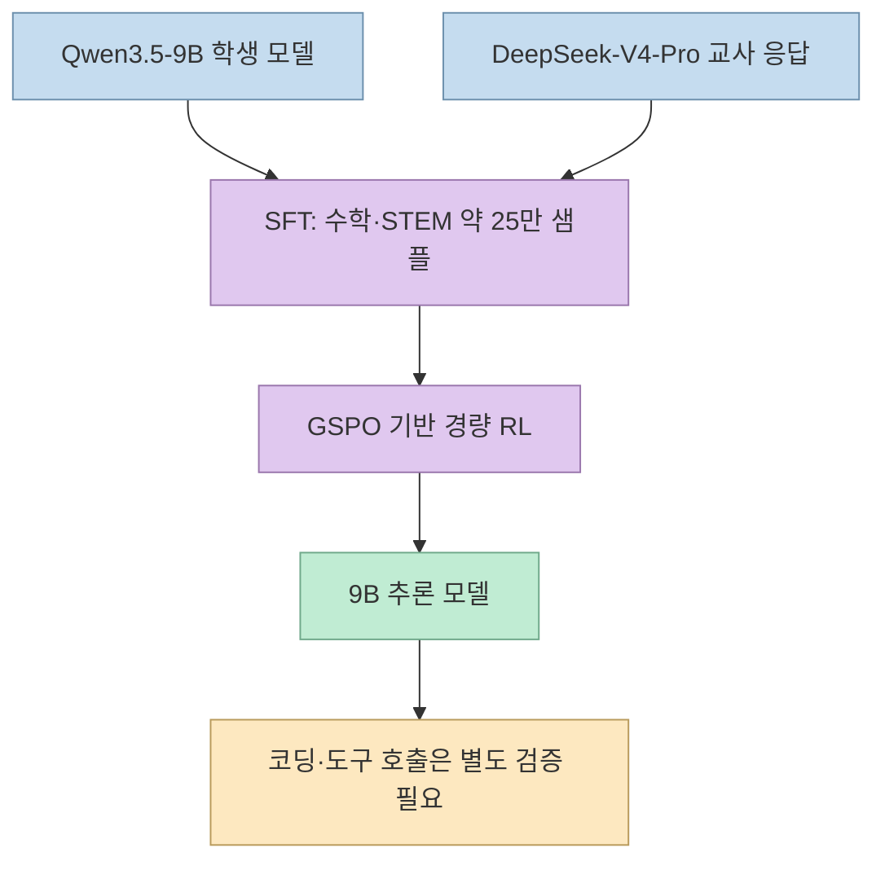
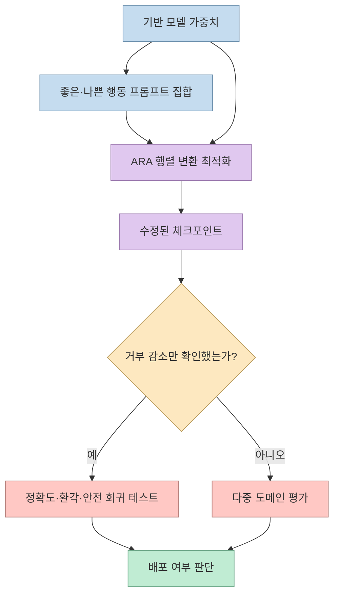
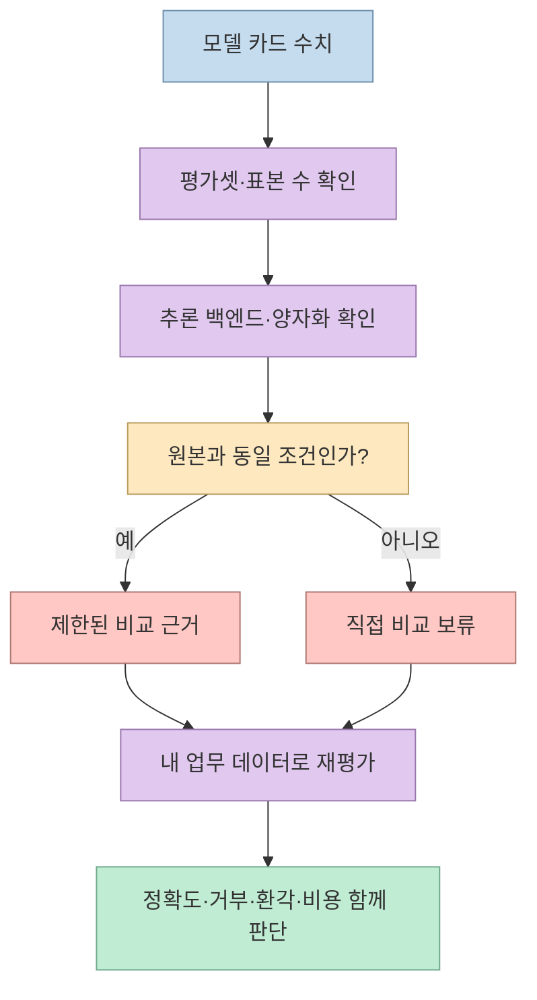
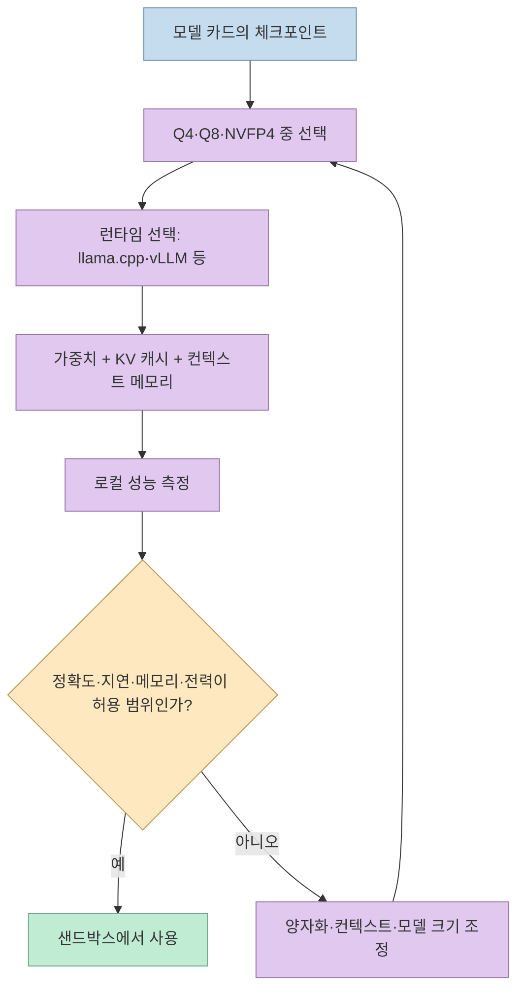

X 게시물은 Hugging Face의 `DeepSeek-V4-Pro-Qwen3.5-9B-UNCENSORED-heretic`를 “DeepSeek-V4-Pro를 Qwen3.5-9B에 증류한 무검열 모델”로 소개한다. 게시물에는 원본 모델의 100개 거부 응답이 변형 모델에서 3개로 줄었다는 비교와, Q4 양자화 시 약 5.6GB라는 설명이 함께 나온다. 그러나 이 수치는 게시물의 독립 검증 결과가 아니라 모델 카드가 제공하는 자체 평가와 배포 정보다. 따라서 “거부가 줄었다”와 “추론 성능이 유지된다”를 같은 주장으로 묶지 않고 각각 검증해야 한다. [X 게시물](https://x.com/HeLi8866/status/2119060068503273594?a=Y4Aei06OlfW3e-xdLcQ&s=35)

<!--more-->

## Sources

- [원문 X 게시물](https://x.com/HeLi8866/status/2119060068503273594?a=Y4Aei06OlfW3e-xdLcQ&s=35) — `scrapling-get`으로 공개 본문과 연결된 Hugging Face 모델 카드 URL을 수집했다.
- [Hugging Face 모델 카드](https://huggingface.co/xtools-at/DeepSeek-V4-Pro-Qwen3.5-9B-UNCENSORED-heretic) — 기반 모델, 학습 데이터, ARA 파라미터, 자체 벤치마크, 제한 사항, 라이선스와 실행 예제를 확인했다.
- [Heretic GitHub](https://github.com/p-e-w/heretic) — ARA가 Heretic의 기본 수정 방식이며 모델 가중치의 특정 행동 방향을 최적화하는 도구라는 점을 교차 확인했다.
- [Heretic ARA 설정 문서](https://heretic-project.org/configuration) — ARA가 행렬 변환을 최적화하고 원래 능력 보존을 목표로 하지만 실험적 기법이라는 설명을 확인했다.

## 모델 카드가 말하는 구성

모델 카드에 따르면 이 체크포인트는 **Qwen3.5-9B를 학생 모델로 삼고 DeepSeek-V4-Pro의 응답을 교사 신호로 사용한 증류 모델**이다. 약 25만 개의 수학·과학(STEM) 샘플로 지도 미세 조정(SFT)을 수행한 뒤 GSPO 기반의 가벼운 강화학습 단계를 적용했다고 설명한다. 코딩 전용 데이터는 두 단계 모두 포함하지 않았으며, 프로그래밍·도구 호출에서 관찰된 향상은 직접 학습이 아닌 일반화 효과로 해석해야 한다고 명시한다. [모델 카드의 증류·학습 데이터](https://huggingface.co/xtools-at/DeepSeek-V4-Pro-Qwen3.5-9B-UNCENSORED-heretic#-1-distillation--training-data)

이 구성에서 “DeepSeek를 9B에 넣었다”는 표현은 가중치를 단순 복사했다는 뜻이 아니다. 교사 모델이 생성한 답변을 학생 모델이 학습하는 **행동 증류**에 가깝다. 따라서 학생이 교사의 모든 지식과 추론 능력을 그대로 보존한다고 볼 수 없고, 어떤 데이터 분포를 선택했는지에 따라 수학·과학에는 강해도 대화·코딩·에이전트 작업에는 편차가 생길 수 있다. 모델 카드도 코딩 데이터가 없다는 점과 코딩 향상이 예비적 관찰이라는 점을 제한 사항으로 적고 있다.

## ARA는 안전 필터를 “지우는 버튼”이 아니라 가중치 변환이다

이 모델은 Jackrong의 DeepSeek-V4-Pro-Qwen3.5-9B 파생 모델에 Heretic v2.0.0.dev0의 **Arbitrary-Rank Ablation(ARA)** 를 적용했다고 모델 카드에 기록한다. 모델 카드에 공개된 값에는 적용 레이어 범위, 좋은 행동 보존 가중치, 나쁜 행동 억제 가중치, 이웃 수 등이 포함되어 있다. Heretic 문서는 ARA를 특정 방향의 행동을 줄이도록 행렬을 최적화하는 수정 방식으로 설명한다. 즉, 런타임에서 프롬프트 필터를 끄는 것과 달리 모델 파라미터 자체를 바꾼 결과물을 배포하는 방식이다. [모델 카드의 ARA 파라미터](https://huggingface.co/xtools-at/DeepSeek-V4-Pro-Qwen3.5-9B-UNCENSORED-heretic#arbitrary-rank-ablation-ara-parameters), [Heretic 설정 문서](https://heretic-project.org/configuration)

거부율이 낮아지는 것은 유용성의 한 축일 뿐이다. 모델이 위험한 요청에도 답하도록 바뀌었는지, 무해한 요청을 과도하게 차단하지 않는지, 사실성·일관성·도구 호출 정확도가 어떻게 변했는지를 별도로 측정해야 한다. 특히 안전 거부를 제거한 모델은 운영 서비스의 기본 안전 정책을 대신하지 않는다. 사내 사용이라면 입력·출력 로깅, 민감 정보 마스킹, 허용 도메인 제한, 사람 검토를 애플리케이션 계층에 둬야 한다.

## “3/100 거부”와 벤치마크 수치를 해석하는 법

모델 카드의 비교표는 원본 모델이 100개 중 100개를 거부했고, ARA 적용 모델이 3개를 거부했다고 보고한다. 이 결과는 **모델 카드가 선택한 100개 프롬프트와 평가 설정에서의 관찰값**이다. 프롬프트 구성, 시스템 메시지, 대화 턴 수, 언어, 샘플링 설정이 달라지면 결과도 달라질 수 있다. 따라서 X 게시물의 “거부율 급락”은 재현 가능한 일반 법칙이 아니라 특정 테스트셋에 대한 주장으로 읽어야 한다. [모델 카드 Performance](https://huggingface.co/xtools-at/DeepSeek-V4-Pro-Qwen3.5-9B-UNCENSORED-heretic#performance)

성능 수치도 같은 원칙으로 봐야 한다. 모델 카드는 NVFP4·vLLM에서 GSM8K 네 번 평균 94.50%, MMLU-Pro의 수학·물리·화학 1,500문항 비교에서 평균 90.53%를 보고한다. 하지만 GSM8K와 MMLU-Pro는 서로 다른 추론 빌드·백엔드를 사용했고, MMLU-Pro는 각 과목에서 500문항씩 추출한 표본이다. 카드 스스로도 이 결과를 종합적인 능력·안전 평가로 볼 수 없다고 명시한다. [GSM8K 평가 설정](https://huggingface.co/xtools-at/DeepSeek-V4-Pro-Qwen3.5-9B-UNCENSORED-heretic#21-gsm8k), [MMLU-Pro 평가 설정](https://huggingface.co/xtools-at/DeepSeek-V4-Pro-Qwen3.5-9B-UNCENSORED-heretic#22-mmlu-pro-math-physics--chemistry)

모델 카드의 자체 벤치마크는 출발점으로는 유용하지만, 운영 도입의 합격선은 별도로 정의해야 한다. 예를 들어 코드 생성이라면 내부 저장소의 비공개 테스트를 사용하고, 수학 답변이라면 정답뿐 아니라 풀이 검증도 함께 기록해야 한다. 무검열 특성이 중요한 연구라면 허용·거부·위험 분류를 분리한 평가셋을 만들고, 평가 프롬프트 자체가 모델 카드에 공개되어 있는지 확인해야 한다.

## 로컬 실행은 가능하지만 “5.6GB면 끝”은 아니다

모델 카드에는 Transformers, vLLM, SGLang, Docker Model Runner, llama.cpp·Ollama·LM Studio용 양자화 탐색 경로가 안내되어 있다. Q4_K_M 컬렉션은 약 5.7GB로 표시되지만, 실제 실행에는 모델 파일 외에 런타임, KV 캐시, 컨텍스트 길이, 운영체제 메모리가 필요하다. 따라서 “5.6GB”는 다운로드 파일 크기에 가까운 지표이지, 모든 노트북에서 동일한 속도로 실행된다는 보장이 아니다. [모델 카드의 양자화 목록](https://huggingface.co/xtools-at/DeepSeek-V4-Pro-Qwen3.5-9B-UNCENSORED-heretic#quantizations)

안전한 시험 순서는 간단하다. 먼저 인터넷이 차단된 별도 환경에서 모델을 내려받고 해시와 라이선스를 기록한다. 다음으로 무해한 내부 샘플을 사용해 출력 형식, 환각, 응답 길이, 메모리 사용량을 측정한다. 마지막으로 애플리케이션에 연결할 때는 모델의 “무검열” 특성에 의존하지 말고, 입력 검증·출력 필터·권한 분리·감사 로그를 별도로 구성한다. Apache-2.0 표시는 사용 조건을 단순화해 주지만, 교사 모델·데이터셋·상표·서비스 약관까지 자동으로 해결해 주는 것은 아니다. 모델 카드의 라이선스와 각 기반 자산의 조건을 함께 검토해야 한다.

## 핵심 요약

- 이 모델은 Qwen3.5-9B에 DeepSeek-V4-Pro 응답을 증류한 9B급 커뮤니티 체크포인트다.
- 모델 카드는 약 25만 개 수학·STEM 샘플, SFT 후 GSPO 기반 RL, 코딩 데이터 부재를 설명한다.
- Heretic ARA는 특정 행동 방향을 줄이도록 가중치를 변환하는 방법이며, 거부 감소와 능력 보존은 별도 평가 항목이다.
- 3/100 거부, GSM8K 94.50%, MMLU-Pro 평균 90.53%는 모델 카드가 제시한 제한된 실험 결과다.
- Q4 파일 크기가 작아도 실행 메모리·컨텍스트·런타임 비용은 별도로 발생한다.
- 로컬 배포 시 안전 필터, 데이터 보호, 검증 파이프라인은 모델 밖의 애플리케이션 계층에서 마련해야 한다.

## 결론

이 X 게시물의 흥미로운 지점은 “무검열 모델이 나왔다”는 자극적인 문구보다, 작은 학생 모델에 강한 교사 모델의 추론 데이터를 증류하고 ARA로 행동 특성을 바꾼 뒤 로컬 배포를 시도할 수 있다는 점이다. 다만 거부율이 낮다는 사실만으로 지능과 실용성이 증명되지는 않는다. 모델 카드의 평가 조건을 재현하고, 자신의 데이터로 정확도·안전·비용을 함께 측정할 때 비로소 이 모델이 연구용인지 실제 도구인지 판단할 수 있다.
