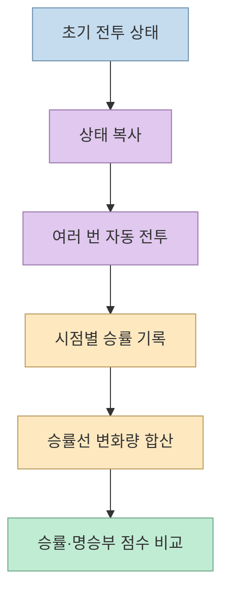
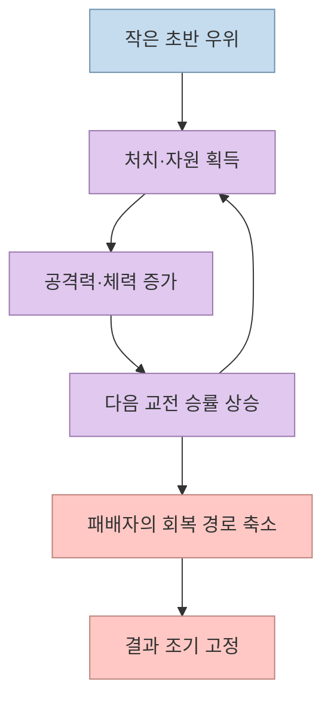
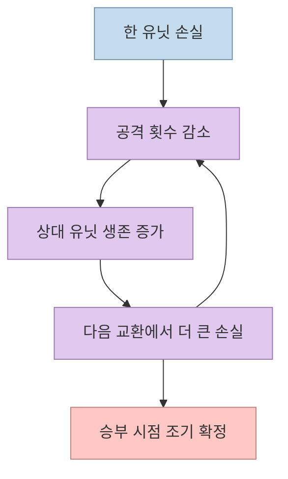
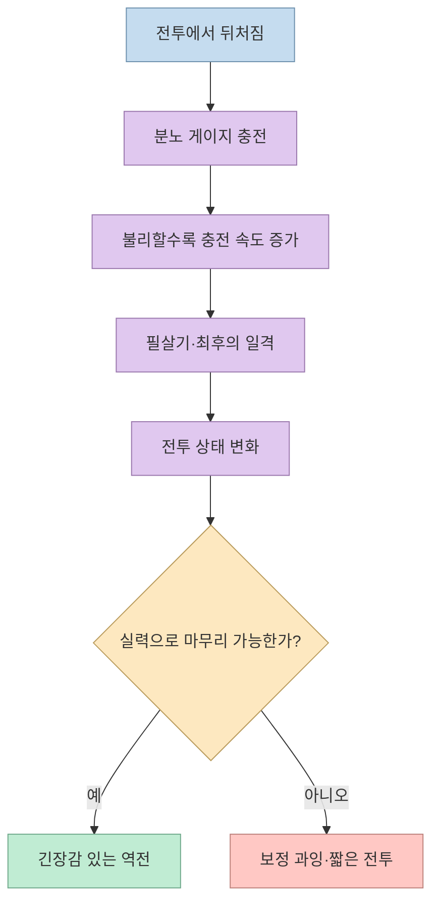
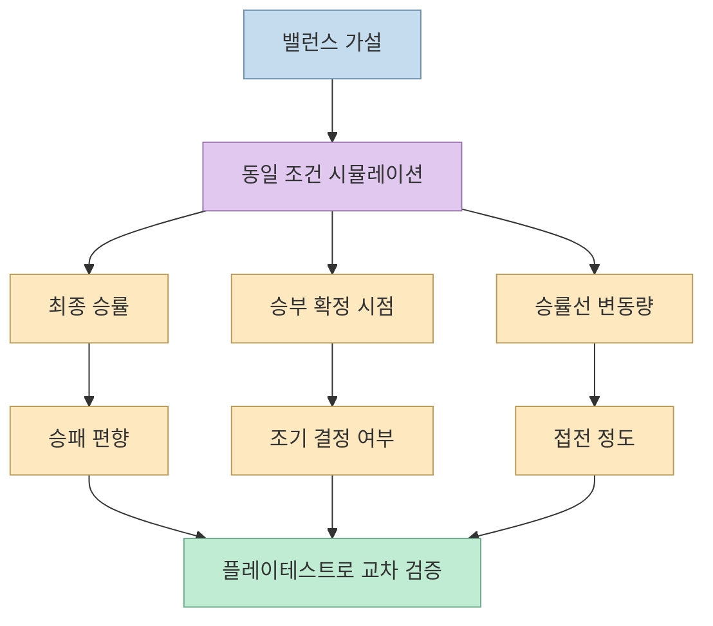

게임을 하다 보면 중반에 이미 승자가 정해지고, 남은 시간은 결과를 확인하는 절차처럼 느껴질 때가 있다. 밥따뚜의 쇼츠는 이 문제를 **몬테카를로 시뮬레이션**으로 측정한다. 같은 상태를 여러 번 복사해 끝까지 싸우고, 승률이 어떻게 움직였는지 기록한다. 이 글은 영상의 세 가지 전투 구조를 재현 가능한 밸런스 질문으로 바꾸고, 승률만 볼 때 생기는 함정까지 정리한다. [영상 00:00](https://youtu.be/kHjA7wGAa_g?t=0)

<!--more-->

## Sources

- [원본 쇼츠: 결과가 뻔한 게임이 재미없는 이유](https://youtube.com/shorts/kHjA7wGAa_g?si=bLueVev5FfOzayAP) — 밥따뚜. 한국어 자동 생성 자막을 확인했고, 주요 주장에 시간 링크를 붙였다.

## 1. 재미를 “승률선의 움직임”으로 바꾸기

영상은 현재 상태를 그대로 복사해 여러 번 전투를 진행하고, 이긴 비율을 승률로 기록한다. 이를 몬테카를로 시뮬레이션이라고 부른다. 이어서 시간에 따른 승률선이 오르내린 길이를 모두 더해 **명승부 점수**라는 자체 지표를 만든다. 승률이 초반에 한쪽으로 붙은 뒤 거의 움직이지 않으면 점수가 낮고, 끝까지 여러 번 흔들리면 점수가 높아진다는 직관이다. [영상 00:15](https://youtu.be/kHjA7wGAa_g?t=15), [영상 00:23](https://youtu.be/kHjA7wGAa_g?t=23)

여기서 중요한 점은 이 점수가 업계 표준 지표가 아니라 영상 제작자가 만든 분석용 지표라는 것이다. “명승부”를 승률선의 총 이동 거리 하나로 완전히 정의할 수는 없다. 플레이어의 선택, 긴장감, 정보의 불확실성, 반복 피로도, 관전 재미도 함께 작용한다. 대신 동일한 전투 규칙을 바꿔 가며 상대 비교하기에는 유용하다. [영상 01:59](https://youtu.be/kHjA7wGAa_g?t=119)

## 2. 눈덩이 굴리기: 앞선 쪽이 계속 강해지는 구조

첫 번째 사례는 눈덩이 굴리기다. 적을 잡을 때마다 경험치와 아이템이 쌓이고, 앞서던 쪽이 더 강해지는 구조다. 영상의 전투에서는 앞선 유닛이 벽을 쓰러뜨릴 때마다 공격력과 체력을 얻는다. [영상 00:29](https://youtu.be/kHjA7wGAa_g?t=29), [영상 00:39](https://youtu.be/kHjA7wGAa_g?t=39)

이 구조는 선두의 보상을 강화하는 대신, 한 번의 손실을 복구할 경로를 줄인다. 영상에서는 첫 유닛이 쓰러지는 순간 승률이 한쪽으로 급격히 쏠리고, 60회 실행에서 먼저 한 명을 잃은 쪽이 이긴 경우가 한 번도 없었다고 설명한다. 이 수치는 특정 시뮬레이션의 결과이며, 모든 눈덩이형 게임에 일반화할 수 없다. [영상 00:45](https://youtu.be/kHjA7wGAa_g?t=45)

눈덩이 구조가 항상 나쁜 것은 아니다. 짧은 라운드나 보스전에서 초반의 좋은 플레이를 즉시 보상하고 빠르게 끝내는 것이 목표라면 명확한 선두 보상이 시원하게 느껴질 수 있다. 문제는 플레이어가 실수한 뒤에도 학습·선택·전투로 돌아올 수 있는 시간이 남아 있는지다. [영상 01:44](https://youtu.be/kHjA7wGAa_g?t=104)

## 3. 아무 장치도 없을 때도 전투는 스스로 기울어진다

두 번째 사례는 별도의 성장 보정이나 역전 장치가 없는 구조다. 영상은 유닛 수가 줄면 공격 횟수도 줄어들고, 그 자체로 전투가 조금씩 눈덩이처럼 된다고 설명한다. 전투는 약 24초 진행되지만, 승부는 15초쯤 이미 정해져 남은 시간이 의미 없이 이어진다. [영상 00:55](https://youtu.be/kHjA7wGAa_g?t=55), [영상 01:01](https://youtu.be/kHjA7wGAa_g?t=61)

이 장면은 보너스가 없어도 **행동 가능한 개체 수와 피해량의 감소가 피드백**이 될 수 있음을 보여준다. 한쪽의 공격 빈도가 줄고 상대의 생존 개체가 더 많이 남으면, 다음 시점의 교환도 불리해진다. 따라서 밸런스를 볼 때 “추가 경험치가 있는가?”만 확인할 것이 아니라, 숫자가 줄어드는 순간 어떤 쪽의 행동량이 더 빨리 감소하는지도 봐야 한다.

영상에서는 먼저 한 명을 잃은 쪽이 이긴 경우가 다섯 번에 한 번 정도였다고 말한다. 이것도 시뮬레이션 설정에 따른 관찰값이다. 승률이 20%라는 사실만으로 전투가 재미없다고 단정하기보다, 그 승리가 실력·전략·운 중 무엇에서 나왔는지, 플레이어가 결과를 바꿀 입력을 갖고 있었는지를 함께 확인해야 한다. [영상 01:06](https://youtu.be/kHjA7wGAa_g?t=66)

## 4. 역전 기회는 패배 보정이 아니라 선택 가능한 시간이다

세 번째 사례는 컴백 메커닉이다. 맞을수록 분노 게이지가 차고, 지고 있을수록 더 빨리 차며, 가득 차면 필살기가 발동한다. 마지막 한 명만 남았을 때 더 세고 빠르게 공격하는 최후의 일격도 추가한다. [영상 01:10](https://youtu.be/kHjA7wGAa_g?t=70), [영상 01:18](https://youtu.be/kHjA7wGAa_g?t=78)

효과는 승률선에서 드러난다. 승률이 50%를 여러 번 넘나들고, 승부가 끝나기 직전에 결정된다. 먼저 한 명을 잃은 쪽이 세 번에 한 번은 다시 뒤집었고, 명승부 점수도 48점에서 85점으로 상승했다고 영상은 설명한다. [영상 01:23](https://youtu.be/kHjA7wGAa_g?t=83), [영상 01:30](https://youtu.be/kHjA7wGAa_g?t=90)

역전 장치는 패배자에게 기회를 주는 것이지, 승자의 실력을 무효화하는 장치가 되어서는 안 된다. 영상에서는 역전 장치를 두 배로 올리자 필살기가 쏟아져 오히려 게임이 짧아지고 점수도 떨어졌다고 설명한다. 따라서 보정 강도보다 발동 시점, 플레이어의 대응 선택, 사용 후 남은 위험을 조정해야 한다. [영상 01:36](https://youtu.be/kHjA7wGAa_g?t=96), [영상 01:41](https://youtu.be/kHjA7wGAa_g?t=101)

## 5. 승률과 명승부 점수를 어떻게 읽을까

영상의 비교는 세 가지 질문을 분리한다.

- **누가 이기는가:** 반복 실행의 최종 승률
- **언제 승부가 기우는가:** 승률선이 한쪽으로 붙는 시점
- **얼마나 흔들리는가:** 승률선 변화량을 합산한 명승부 점수

승률이 50%에 가깝다고 반드시 재미있는 것은 아니다. 매번 초반에 동전 던지기처럼 결정되고 이후 변화가 없다면 긴장감이 낮을 수 있다. 반대로 한쪽 승률이 높아도 플레이어가 여러 선택으로 결과를 바꿀 수 있고, 마지막까지 불확실성이 남으면 재미가 있을 수 있다. 따라서 시뮬레이션 지표는 플레이테스트를 대체하기보다 어떤 구간을 관찰할지 알려주는 진단 도구로 쓰는 것이 좋다. [영상 00:15](https://youtu.be/kHjA7wGAa_g?t=15), [영상 01:44](https://youtu.be/kHjA7wGAa_g?t=104)

반복 횟수도 중요하다. 영상은 160번 싸워보는 방법을 소개하고, 한 사례에서는 60회 결과를 언급한다. 표본 수가 작으면 승률과 점수의 변동 폭이 커질 수 있으므로, 규칙을 바꿀 때 동일한 시드·초기 조건·실행 횟수를 유지하고 결과의 범위도 함께 기록해야 한다. 영상의 숫자는 해당 시연 설정의 결과이지, 통계적 유의성 검정까지 끝난 값은 아니다. [영상 00:15](https://youtu.be/kHjA7wGAa_g?t=15), [영상 00:45](https://youtu.be/kHjA7wGAa_g?t=45)

## 실전 적용 포인트

1. **전투 상태를 복제할 수 있게 만든다.** 유닛 능력치, 위치, 쿨다운, 난수 시드를 저장하고 같은 조건에서 규칙만 바꿔 비교한다. [영상 00:15](https://youtu.be/kHjA7wGAa_g?t=15)
2. **승률만 저장하지 않는다.** 최종 승패와 함께 시점별 승률, 첫 손실 시점, 마지막 역전 시점, 전투 종료 시각을 기록한다.
3. **눈덩이의 회복 경로를 점검한다.** 경험치·아이템·공격량이 선두를 얼마나 빠르게 강화하는지와 뒤처진 쪽의 선택 가능성을 따로 측정한다. [영상 00:29](https://youtu.be/kHjA7wGAa_g?t=29)
4. **역전 장치를 한 번에 크게 올리지 않는다.** 분노 게이지 충전 속도, 발동 임계값, 필살기 효과, 최후의 일격을 독립 변수로 바꿔 과보정 여부를 본다. [영상 01:36](https://youtu.be/kHjA7wGAa_g?t=96)
5. **자동 시뮬레이션 뒤 사람에게 확인시킨다.** 숫자가 좋아져도 조작감·가독성·반복 피로도·공정성 인식은 플레이테스트에서 확인해야 한다.
6. **모드별 목표를 다르게 둔다.** 짧고 시원한 보스전은 빠른 결정이 허용될 수 있지만, 대전 게임은 끝까지 선택과 긴장감이 남도록 조정한다. [영상 01:44](https://youtu.be/kHjA7wGAa_g?t=104)

## 핵심 요약

- 몬테카를로 시뮬레이션은 같은 전투 상태를 반복 실행해 승률과 승부 흐름을 수치화하는 방법이다. [영상 00:15](https://youtu.be/kHjA7wGAa_g?t=15)
- 눈덩이 구조와 개체 수 감소는 별도 보정이 없어도 선두를 강화해 승부를 일찍 고정할 수 있다. [영상 00:29](https://youtu.be/kHjA7wGAa_g?t=29), [영상 00:55](https://youtu.be/kHjA7wGAa_g?t=55)
- 역전 장치는 패배자에게 선택 가능한 시간을 주지만, 강도를 과하게 올리면 전투가 짧아지고 실력의 의미가 줄어든다. [영상 01:36](https://youtu.be/kHjA7wGAa_g?t=96)
- 명승부 점수는 영상에서 정의한 비교 지표다. 자동 수치와 플레이테스트를 함께 사용해야 한다.

## 결론

재미있는 전투는 반드시 50 대 50이어야 하는 것도, 반드시 마지막 1초까지 이어져야 하는 것도 아니다. 중요한 것은 게임의 목표에 맞게 승부가 결정되는 시점과 뒤집을 수 있는 선택을 설계하는 일이다. 먼저 전투 상태를 복제해 반복 실행하고, 승률선·확정 시점·변동량을 비교한 뒤, 플레이어가 실제로 느끼는 긴장감과 대조하자. 숫자는 재미를 대신하지 않지만, 재미가 사라지는 구조를 빠르게 찾아주는 좋은 탐침이 될 수 있다.
