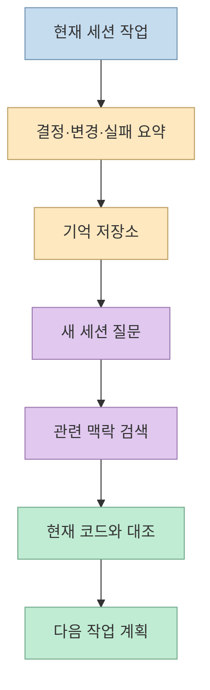
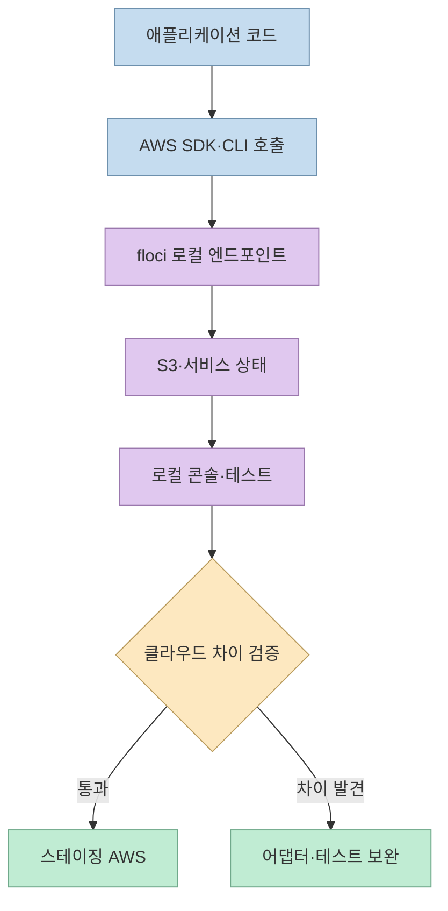
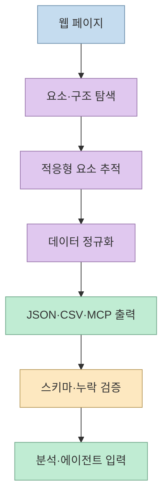
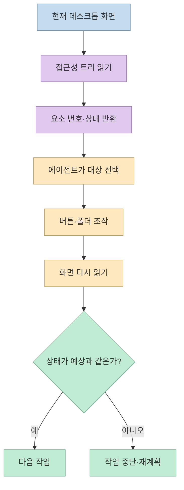
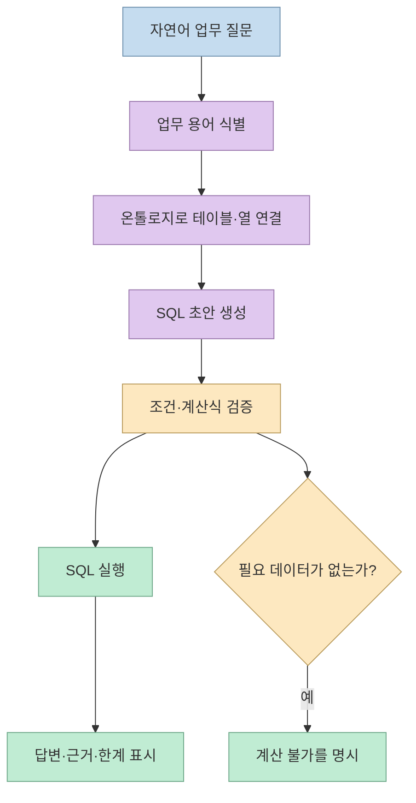
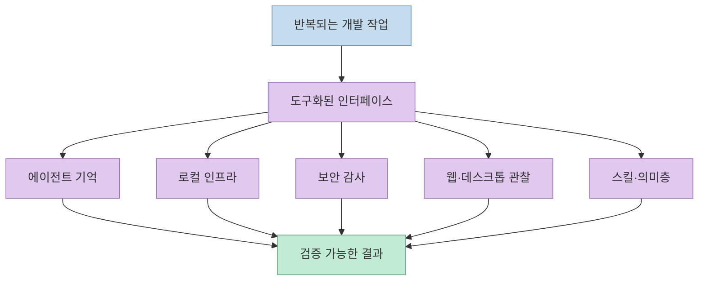

GitHub 트렌딩에는 매일 새로운 프로젝트가 올라오지만, 모든 저장소를 직접 읽기는 어렵다. 문외인 Layperson의 영상은 2026년 11월 8일 기준으로 트렌딩에 오른 8개를 골라 **에이전트 기억, 로컬 AWS 에뮬레이터, 보안 감사, 광학 디스크 이미지, 웹 스크래핑, 데스크톱 제어, 코딩 에이전트 스킬, 자연어 SQL**이라는 서로 다른 흐름으로 소개한다. 순위와 별 수는 빠르게 바뀌는 스냅샷이므로, 이 글은 인기 순위보다 각 도구가 어떤 문제를 해결하는지에 초점을 맞춘다. [영상 00:00](https://youtu.be/LCTvboTNvYQ?t=0), [영상 08:09](https://youtu.be/LCTvboTNvYQ?t=489)

<!--more-->

## Sources

- [원본 영상: 이틀 연속 1위 괴물이 휩쓴 GitHub 트렌딩 TOP8](https://youtu.be/LCTvboTNvYQ?si=A8rhRYBxjt-ENnNm) — 문외인 Layperson. 한국어 자동 생성 자막과 설명란의 저장소 링크를 확인하고, 주장별 시간 링크를 붙였다.
- [NVIDIA/auto-ontology](https://github.com/NVIDIA/auto-ontology) — 데이터베이스 구조에서 의미층을 만들고 자연어 질문을 SQL로 연결하는 저장소.
- [mattpocock/skills](https://github.com/mattpocock/skills) — 코딩 에이전트용 스킬 모음.
- [vercel-labs/agent-desktop](https://github.com/vercel-labs/agent-desktop) — 접근성 정보를 이용해 데스크톱 앱을 읽고 조작하는 도구.
- [D4Vinci/Scrapling](https://github.com/D4Vinci/Scrapling) — 적응형 웹 스크래핑·스파이더 프레임워크.
- [JiaFeiMiao-K-Cat/DiscImageStudio](https://github.com/JiaFeiMiao-K-Cat/DiscImageStudio) — CD·DVD·Blu-ray 기록면에 이미지를 배치하는 도구.
- [cloudflare/security-audit-skill](https://github.com/cloudflare/security-audit-skill) — 에이전트 기반 보안 감사 스킬.
- [floci-io/floci](https://github.com/floci-io/floci) — 로컬 AWS 환경 에뮬레이터.
- [thedotmack/claude-mem](https://github.com/thedotmack/claude-mem) — 코딩 에이전트 작업 맥락을 저장·검색하는 도구.

## 8위: claude-mem — 세션 사이의 작업 맥락 저장

새 세션을 열면 코딩 에이전트는 앞에서 무엇을 했는지 잊기 쉽다. 영상은 `claude-mem`을 작업 내용을 압축해 저장하고, 다음 세션에 필요한 맥락을 다시 주입하는 도구로 소개한다. 저장된 기억을 열람하는 뷰어가 있고 Claude Code뿐 아니라 다른 에이전트에도 연결할 수 있다고 설명한다. [영상 00:45](https://youtu.be/LCTvboTNvYQ?t=45), [claude-mem 저장소](https://github.com/thedotmack/claude-mem)

핵심은 무조건 모든 대화를 보존하는 것이 아니다. 다음 작업에 필요한 결정·파일·실패 원인·남은 할 일을 구조화해 회수해야 한다. 자동 요약은 편리하지만 오래된 기억이나 잘못된 가정을 다시 주입할 수 있으므로, 기억에 출처와 시점을 함께 기록하고 현재 코드와 대조하는 절차가 필요하다.

## 7위: floci — AWS를 로컬에서 재현하는 개발 루프

`floci`는 AWS 계정이나 인증 토큰 없이 컴퓨터에서 AWS 환경을 흉내 내는 로컬 에뮬레이터로 소개된다. 영상에서는 평소 쓰던 AWS 명령으로 S3 버킷을 만들고 웹 콘솔에서 결과를 확인한다. AWS SDK·CLI, Terraform·CDK·OpenTofu의 연결 주소를 로컬로 바꿔 사용할 수 있다는 설명도 나온다. [영상 01:23](https://youtu.be/LCTvboTNvYQ?t=83), [floci 저장소](https://github.com/floci-io/floci)

이 방식의 가치는 비용과 위험을 줄인 개발·테스트 루프다. 그러나 로컬 에뮬레이터가 실제 AWS의 모든 서비스 동작, IAM 정책, 지연 시간, 쿼터, 리전 차이를 재현한다고 가정하면 안 된다. 로컬에서 통과한 테스트와 클라우드에서의 배포 검증을 분리하고, 실제 계정에 적용하기 전에는 권한·비용·데이터 삭제 정책을 점검해야 한다. [영상 02:16](https://youtu.be/LCTvboTNvYQ?t=136)

## 6위: security-audit-skill — 공격자가 아니라 검증자 역할 부여

Cloudflare의 `security-audit-skill`은 코딩 에이전트를 보안 감사자로 바꾸는 스킬로 소개된다. 영상이 설명하는 흐름은 정찰, 범위 확장, 후보 검증, 결과 정리, 독립 재검증, 보고의 6단계다. 한 에이전트가 찾은 후보를 다른 에이전트가 반박해 보고, 끝까지 남은 내용만 보고서에 올리는 구조다. [영상 02:20](https://youtu.be/LCTvboTNvYQ?t=140), [security-audit-skill 저장소](https://github.com/cloudflare/security-audit-skill)

여기서 중요한 것은 취약점 개수보다 증거와 재현성이다. “의심스러운 코드”를 발견하는 것과 실제 악용 가능한 취약점으로 확인하는 것은 다르다. 감사 범위, 테스트 환경, 입력, 영향, 완화책, 재검증 결과를 기록하고, 운영 시스템에서 공격성 테스트를 실행하지 않도록 권한을 제한해야 한다. 배포 전 자동 점검은 보안팀의 검토를 대체하지 않고 보조하는 장치다. [영상 02:37](https://youtu.be/LCTvboTNvYQ?t=157)

## 5위: DiscImageStudio — 이미지 데이터를 물리 매체 패턴으로 바꾸기

`DiscImageStudio`는 이미지를 CD·DVD·Blu-ray의 기록면에 보이도록 데이터를 배치하는 도구다. 영상은 이미지가 디스크 물리 구조에 맞는 데이터로 변환되고, 기록면의 무지개빛 트랙 패턴으로 남는 과정을 보여준다. CD, 단층 DVD, Blu-ray BDR용 데이터를 만들 수 있고, 보정 전후 사진처럼 반지름과 트랙 간격을 조정하면 이미지가 더 반듯해진다고 설명한다. [영상 02:55](https://youtu.be/LCTvboTNvYQ?t=175), [DiscImageStudio 저장소](https://github.com/JiaFeiMiao-K-Cat/DiscImageStudio)

이 프로젝트는 AI 에이전트 도구와 달리 소프트웨어가 물리 매체의 제약을 시각화하는 사례다. 결과는 이미지 파일이 아니라 특정 드라이브·미디어·기록 조건에서 읽히는 디스크 데이터이므로, 저장 장치 호환성과 기록 실패를 별도로 확인해야 한다. 공식 README의 지원 범위와 라이선스를 먼저 읽고, 보존·선물·기념품처럼 합법적인 용도로 사용하는 것이 적절하다. [영상 03:31](https://youtu.be/LCTvboTNvYQ?t=211)

## 4위: Scrapling — 변하는 웹에서 데이터 추출하기

`Scrapling`은 한 페이지의 요소 추출부터 사이트 전체 크롤링까지 다루는 Python 도구다. 영상은 연습용 페이지에서 명언과 저자를 가져오고, 구조가 일부 바뀌어도 이전에 찾던 요소를 추적하는 적응형 기능을 소개한다. 여러 페이지를 모으는 스파이더, 중단 후 재개, JSON·CSV 출력, 에이전트가 사용할 MCP 서버도 언급한다. [영상 03:49](https://youtu.be/LCTvboTNvYQ?t=229), [Scrapling 저장소](https://github.com/D4Vinci/Scrapling)

적응형 추적은 유지보수를 줄일 수 있지만, 잘못된 요소를 “비슷한 항목”으로 선택할 위험도 만든다. 수집 결과에는 원본 URL, 수집 시각, 선택자·추적 근거, 누락 여부를 함께 저장하고, robots.txt·서비스 약관·개인정보·요청 빈도를 확인해야 한다. 웹 구조가 바뀌었을 때 조용히 잘못된 데이터를 내려주는 것보다, 신뢰도가 낮아졌다고 실패하는 편이 안전하다. [영상 04:07](https://youtu.be/LCTvboTNvYQ?t=247), [영상 04:29](https://youtu.be/LCTvboTNvYQ?t=269)

## 3위: agent-desktop — 접근성 트리로 데스크톱 앱 조작

Vercel Labs의 `agent-desktop`은 AI 에이전트가 데스크톱 앱을 직접 읽고 누르게 하는 도구다. 영상은 화면을 이미지로만 보는 대신 화면 낭독기가 사용하는 접근성 정보를 읽어 버튼과 폴더 목록을 JSON으로 반환하고, 요소에 번호를 붙여 클릭한다고 설명한다. Finder의 폴더를 누른 뒤 화면을 다시 읽어 상태 변화를 확인하는 “읽기 → 클릭 → 다시 읽기” 루프가 핵심이다. [영상 04:45](https://youtu.be/LCTvboTNvYQ?t=285), [agent-desktop 저장소](https://github.com/vercel-labs/agent-desktop)

화면이 바뀐 뒤 예전 번호표를 누르면 도구가 거부하고 새 화면을 다시 읽는다는 장면은 중요한 안전장치다. UI 자동화는 좌표를 맹목적으로 클릭하는 대신 현재 상태를 재확인해야 한다. 다만 데스크톱 앱에 파일 삭제·전송·결제 같은 파괴적 기능이 있다면, 읽기 전용 테스트 계정과 사용자 승인 단계를 둬야 한다. 영상은 macOS·Windows·Linux 동작과 MCP 연결도 소개하지만, 실제 지원 범위는 저장소의 최신 문서에서 확인해야 한다. [영상 05:18](https://youtu.be/LCTvboTNvYQ?t=318)

## 2위: Matt Pocock의 skills — 코딩 에이전트에 작업 규칙 주입

`mattpocock/skills`는 개발자가 자주 쓰는 코딩 에이전트 스킬 모음으로 소개된다. 영상은 작업 전에 에이전트가 사람에게 질문을 연달아 던져 의도를 맞추는 스킬, 큰 작업을 작고 고쳐 쓰기 쉬운 스킬로 나누는 구조를 예로 든다. Claude Code에서는 플러그인 설치 명령으로 필요한 스킬을 불러올 수 있다고 설명한다. [영상 05:44](https://youtu.be/LCTvboTNvYQ?t=344), [Matt Pocock skills](https://github.com/mattpocock/skills)

스킬은 모델의 지식 자체를 늘리기보다 **작업 절차와 출력 계약을 재사용**하게 한다. 따라서 설치 전 각 스킬이 읽고 쓰는 파일, 실행하는 명령, 외부 서비스 권한, 사용자 확인 지점을 검토해야 한다. 여러 스킬을 동시에 적용하면 지침이 충돌할 수 있으므로, 한 작업의 목표·완료 조건·권한을 먼저 정하고 필요한 스킬만 활성화하는 것이 좋다. [영상 06:00](https://youtu.be/LCTvboTNvYQ?t=360)

## 1위: NVIDIA auto-ontology — 자연어 질문을 데이터 근거와 연결

`NVIDIA/auto-ontology`는 회사 데이터베이스에 평소 말로 질문하면 에이전트가 SQL로 바꿔 실행하고 답을 보여주는 프로젝트로 소개된다. 예시 질문은 특정 지역·기간의 상품 판매량이며, 에이전트가 매출·상품·지역 같은 업무 용어를 실제 테이블·열과 연결한다. SQL 생성 전 용어 찾기, 테이블 선택, 조건 확인, 실행 단계와 결과의 출처도 함께 보여준다. [영상 06:25](https://youtu.be/LCTvboTNvYQ?t=385), [auto-ontology 저장소](https://github.com/NVIDIA/auto-ontology)

핵심은 데이터베이스 위에 **의미층(ontology)** 을 두는 것이다. 업무 용어와 테이블 관계, 검증된 계산식을 정리하면 자연어를 SQL로 변환할 때 단순 열 이름 추측보다 근거 있는 연결을 만들 수 있다. 영상은 데이터베이스 정보에서 의미층 초안을 자동 생성하되 사람이 확인해 확정하는 흐름을 보여준다. [영상 07:12](https://youtu.be/LCTvboTNvYQ?t=432)

또한 영상은 데이터에 없는 광고비 대비 수익을 묻자 숫자를 지어내지 않고 계산할 수 없다고 답하는 장면을 강조한다. 이 동작은 자연어 분석 시스템의 중요한 실패 처리다. SQL이 실행됐다는 사실만으로 질문이 정확하게 해석됐다고 볼 수 없으므로, 생성 SQL·사용한 테이블·필터·집계식·행 수·데이터 시점을 함께 남겨야 한다. [영상 07:39](https://youtu.be/LCTvboTNvYQ?t=459)

## 여덟 저장소를 한 흐름으로 읽기

겉으로는 디스크 이미지를 굽는 프로젝트와 자연어 SQL 도구가 같은 트렌딩 목록에 섞여 있다. 그러나 공통된 변화는 있다. 사람이 직접 반복하던 관찰·환경 구성·검수·데이터 연결을 **재사용 가능한 인터페이스**로 만들고, 에이전트나 자동화가 그 인터페이스를 호출한다는 점이다.

순위·별 수·“이틀 연속 1위” 같은 정보는 영상 게시 시점의 관찰이다. GitHub 트렌딩은 언어, 기간, 지역, 별 증가량에 따라 변하고, 저장소의 최신 커밋과 릴리스도 달라진다. 따라서 설치 전에는 반드시 원본 README, 라이선스, 최신 릴리스, 이슈와 보안 정책을 확인해야 한다. [영상 08:09](https://youtu.be/LCTvboTNvYQ?t=489)

## 실전 적용 포인트

1. **문제부터 고른다.** 에이전트 기억, 로컬 AWS, 웹 수집, 데스크톱 자동화, 자연어 SQL 중 현재 병목 하나만 선택한다.
2. **저장소의 역할과 경계를 읽는다.** 영상 설명은 입문용 요약이므로 설치 전 README·라이선스·지원 OS·외부 권한을 확인한다.
3. **검증 가능한 출력으로 연결한다.** SQL이면 생성문·테이블·조건을, 스크래핑이면 URL·시각·누락을, UI 자동화면 전후 접근성 트리를 저장한다.
4. **로컬과 운영을 분리한다.** floci에서 통과한 AWS 테스트, 에이전트가 읽은 데스크톱 상태, 자동 보안 감사 결과를 운영 환경의 성공으로 간주하지 않는다.
5. **에이전트 권한을 최소화한다.** 파일 삭제·네트워크 전송·DB 쓰기 권한은 기본 차단하고, 필요한 단계에서만 명시적으로 연다.
6. **트렌딩을 큐로 사용한다.** 인기 순위를 그대로 설치 목록으로 삼지 말고, 일주일에 한 번 관심 저장소의 변경·릴리스·이슈를 다시 확인한다.

## 핵심 요약

- 8개 저장소는 서로 다른 분야에 있지만, 반복 작업을 에이전트가 호출할 수 있는 인터페이스로 바꾼다는 공통점이 있다.
- `claude-mem`은 세션 간 맥락, `floci`는 로컬 클라우드, `security-audit-skill`은 독립 검증 루프를 제공한다. [영상 00:45](https://youtu.be/LCTvboTNvYQ?t=45), [영상 01:23](https://youtu.be/LCTvboTNvYQ?t=83), [영상 02:20](https://youtu.be/LCTvboTNvYQ?t=140)
- `Scrapling`과 `agent-desktop`은 각각 웹과 데스크톱을 관찰·조작하는 인터페이스를 제공한다. [영상 03:49](https://youtu.be/LCTvboTNvYQ?t=229), [영상 04:45](https://youtu.be/LCTvboTNvYQ?t=285)
- `auto-ontology`의 핵심은 자연어를 SQL로 바꾸는 것만이 아니라, 업무 용어·테이블·계산식·근거를 의미층으로 연결하고 데이터가 없을 때 모른다고 말하는 것이다. [영상 06:25](https://youtu.be/LCTvboTNvYQ?t=385), [영상 07:39](https://youtu.be/LCTvboTNvYQ?t=459)

## 결론

이번 트렌딩 목록은 “AI 프로젝트만 뜬다”는 장면보다, 개발 도구의 경계가 넓어지고 있다는 점을 보여준다. 에이전트가 기억하고, 로컬 인프라를 만들고, 웹·데스크톱을 읽고, 보안과 데이터 근거를 검사하는 흐름이 각각 오픈소스 프로젝트로 분리되어 있다. 다만 인기와 별 수는 품질 보증이 아니다. 필요한 문제 하나를 고르고, 권한·라이선스·출력 근거·운영 환경 차이를 확인한 뒤 작은 실험으로 도입하는 것이 가장 안전하다.
