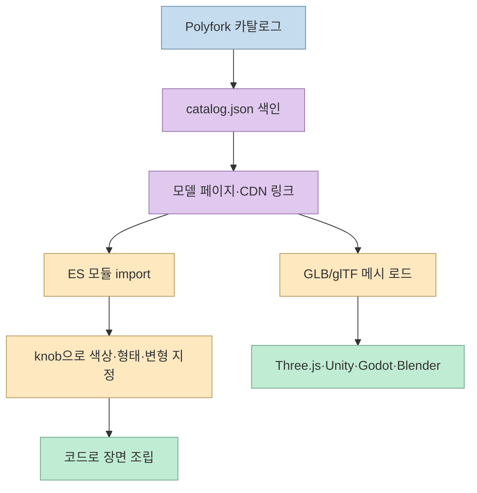
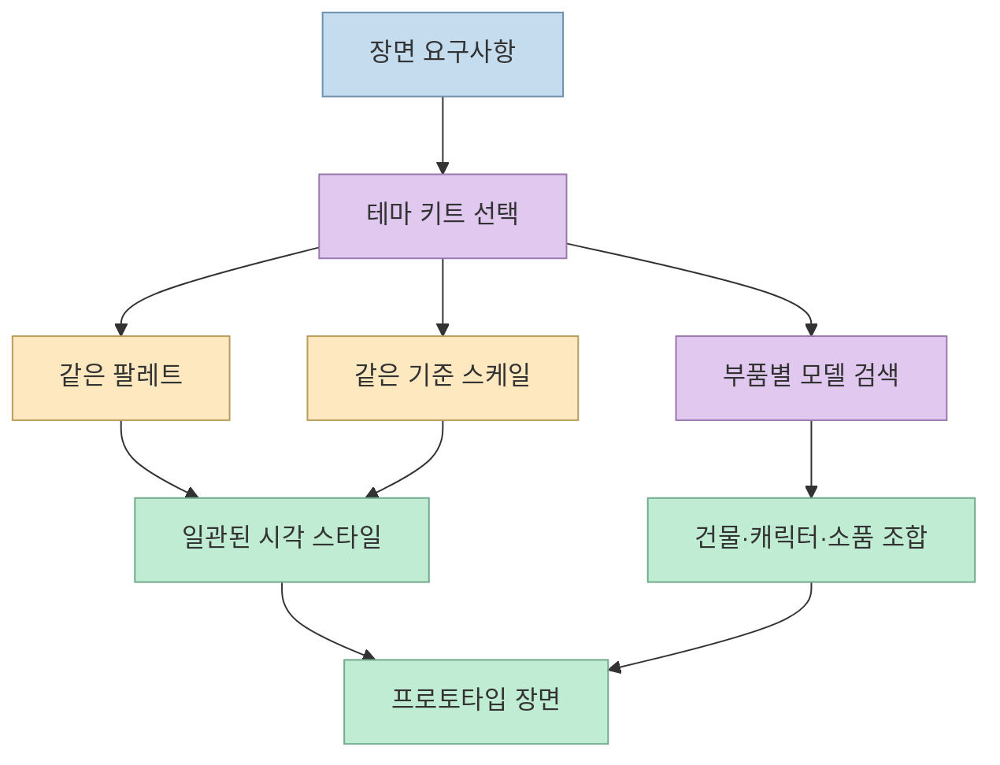
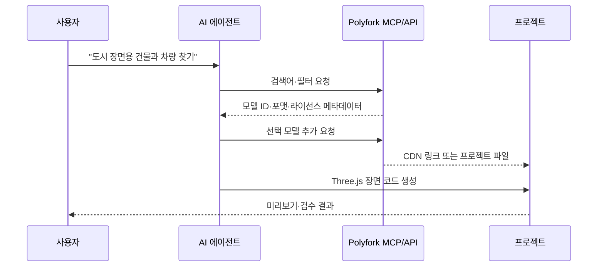
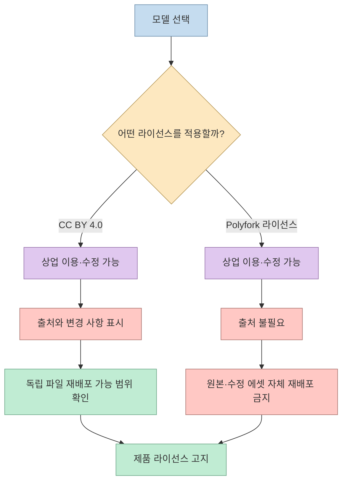

Threads 게시물은 Polyfork를 “3,000개가 넘는 무료 3D 에셋을 오픈소스로 공개한 저장소”로 소개한다. 원문에는 `lucas-martinic/polyfork-catalog` 저장소, Three.js와 JavaScript ES Modules 기반, GLB/glTF·FBX·OBJ·USD 지원, 코드로 색상·형태를 바꾸는 기능, AI 에이전트 연동이 언급되어 있다. 공식 GitHub README의 현재 표기는 **2,791개 모델과 26개 테마 키트**이므로, Threads의 3,000개라는 표현은 빠르게 늘어나는 카탈로그를 반올림한 소개 문구로 보는 편이 정확하다. [Threads 원문](https://www.threads.com/share/BAa5jy1GVI), [Polyfork 카탈로그](https://github.com/lucas-martinic/polyfork-catalog)

<!--more-->

## Sources

- [Threads 원문: 3D 에셋 3000개가 오픈소스로 풀렸어요](https://www.threads.com/share/BAa5jy1GVI) — `agent-browser`로 렌더링된 본문과 댓글을 추출했다.
- [Polyfork GitHub 카탈로그](https://github.com/lucas-martinic/polyfork-catalog) — 모델 수, 포맷, Three.js 예제, CLI, 키트와 라이선스 설명을 확인했다.
- [Polyfork 공식 사이트](https://polyfork.dev/) — 에셋 API와 에이전트 연동 진입점을 확인했다.
- [Polyfork Agents 안내](https://polyfork.dev/agents) — MCP 엔드포인트와 에이전트 사용 흐름을 확인했다.
- [Polyfork 라이선스](https://polyfork.dev/licensing) — 상업적 이용, 재배포 금지, CC BY 4.0 선택 조건을 확인했다.

## Polyfork의 핵심은 “파일 모음”이 아니라 “조립 가능한 카탈로그”다

GitHub 저장소는 모델 파일을 모두 복제해 두는 저장소가 아니다. `catalog.json`에 모델 이름과 링크를 색인하고, 실제 파일은 Polyfork CDN에 둔다. README는 각 모델을 GLB/glTF 메시로 불러오거나, ES 모듈로 가져와 매개변수(knob)를 바꿀 수 있다고 설명한다. 즉 프로젝트에는 필요한 모델만 가져오고, 카탈로그는 최신 링크를 가리키는 인덱스로 동작한다. [저장소 README](https://github.com/lucas-martinic/polyfork-catalog#what-is-in-this-repository)



이 설계는 “다운로드한 파일을 장면에 배치한다”와 “코드가 장면을 생성한다”를 모두 지원한다. 단순한 웹 페이지나 게임 프로토타입은 GLB를 직접 로드하면 되고, 색상·지붕·계절 같은 변형을 반복해서 만들 때는 ES 모듈의 매개변수화가 유리하다. 반대로 CDN 링크에 의존하는 배포물은 네트워크와 버전 안정성을 따로 검토해야 한다. 릴리스 시점의 모델을 고정하려면 파일 해시, 캐시, 자체 아카이브 정책을 설계해야 한다.

## 키트가 해결하는 문제: 규모와 팔레트의 일관성

Polyfork의 테마 키트는 같은 팔레트와 스케일로 구성된 부품 묶음이다. README에는 캠핑장, 병원, 뉴욕, 우주 기지, 철도, 사무실 등 26개 키트가 소개되어 있다. 서로 다른 제작자가 만든 모델을 무작정 섞을 때 생기는 크기·색감·스타일 불일치를 줄이는 것이 키트의 목적이다. [키트 목록](https://github.com/lucas-martinic/polyfork-catalog#kits)



카탈로그의 모델 유형도 캐릭터, 동물, 건물, 차량, 소품, 지형 등으로 나뉜다. 따라서 “3,000개가 있다”보다 중요한 질문은 **내가 만드는 장면의 구성 단위를 얼마나 빨리 찾고, 같은 키트 안에서 재사용할 수 있는가**다. 예를 들어 작은 3D 웹 랜딩 페이지라면 건물 하나와 소품 몇 개만 선택하고, 게임 프로토타입이라면 키트 전체의 충돌·배치 규칙을 별도로 정의하는 식으로 범위를 줄일 수 있다.

## Three.js에서는 ES 모듈과 GLB를 선택한다

저장소 README는 두 가지 기본 사용법을 보여 준다. 첫째, `GLTFLoader`로 CDN의 `.glb`를 읽어 일반 메시처럼 장면에 추가하는 방법이다. 둘째, `.mjs` 모듈에서 `createAsset()`을 가져와 인자를 전달하는 방법이다. 후자는 모델 자체를 코드로 구성하므로 색상·부품·변형을 런타임에 바꾸기 쉽다. [Three.js 예제](https://github.com/lucas-martinic/polyfork-catalog#-a-model-is-a-program)

```js
import * as THREE from "three";
import { createAsset } from "https://polyfork.dev/cdn/pop-top-camper-van-62a322.mjs";

const scene = new THREE.Scene();
scene.add(createAsset({
  colorway: "tomato",
  roof: 0,
  season: "winter"
}));
```

모듈 방식의 장점은 같은 원본에서 여러 변형을 생성할 수 있다는 점이다. 하지만 이 코드는 Three.js 버전, 브라우저의 모듈 로딩, CDN 가용성에 영향을 받는다. 장기 운영 서비스라면 의존 버전을 고정하고, 네트워크 실패 시 대체 이미지나 로컬 캐시를 제공하는 편이 안전하다. 파일 포맷 자체만 필요하면 GLB를 사용해 Unity·Godot·Blender 등 다른 도구로 넘길 수 있다.

## CLI·API·MCP가 에이전트 작업을 바꾼다

Polyfork는 브라우저에서 모델을 찾는 것 외에 터미널과 에이전트가 사용할 수 있는 경로도 제공한다. GitHub README의 CLI 예시는 검색 후 ID를 추가하는 흐름이다.

```bash
npx polyfork search "campfire"
npx polyfork add <model-id>
npx polyfork search "campfire" --json
```

공식 Agents 페이지는 MCP 엔드포인트를 통해 Claude 같은 도구가 에셋을 검색하고 가져오는 흐름을 안내한다. 무료 에셋은 키 없이 API를 사용할 수 있지만, 전체 카탈로그·리믹스·다운로드 범위는 요금제와 라이선스에 따라 달라진다. [CLI·API 설명](https://github.com/lucas-martinic/polyfork-catalog#for-tools-and-agents), [에이전트 안내](https://polyfork.dev/agents), [가격 정책](https://polyfork.dev/pricing)



에이전트 연동의 핵심은 “AI가 알아서 예쁜 모델을 고른다”가 아니다. 검색 결과에서 모델 ID, 파일 포맷, 라이선스, 변형 옵션을 구조적으로 받아 **코드 생성 단계에 넘길 수 있다**는 점이다. 따라서 에이전트 프롬프트에는 스타일·폴리곤 예산·카메라·충돌 규칙·라이선스 선택을 명시하고, 생성된 장면은 사람이 렌더링과 파일 크기를 확인해야 한다.

## 라이선스는 “무료”보다 구체적으로 확인해야 한다

Threads 댓글에는 상업 이용과 출처 표기 불필요라는 설명이 있지만, 공식 라이선스 페이지는 두 가지 선택지를 구분한다. 무료 저폴리 모델의 메시 파일은 CC BY 4.0 또는 Polyfork 라이선스를 선택할 수 있다. CC BY 4.0을 선택하면 출처 표기와 변경 표시가 필요하고, Polyfork 라이선스를 선택하면 출처 표기는 없지만 에셋 파일 자체를 재배포할 수 없다. ES 모듈, HD 에디션, 렌더와 메타데이터는 별도 조건이 적용된다. [공식 라이선스](https://polyfork.dev/licensing)



특히 게임이나 웹 서비스에 모델을 포함하는 것과, 모델 파일만 별도 에셋 팩으로 재판매하는 것은 다르다. 공식 페이지는 제품 안에서 에셋을 사용하는 것은 허용하지만, 원본 또는 수정된 파일을 다른 마켓플레이스·템플릿 라이브러리·파일 공유 사이트에 재배포하는 것은 금지한다고 설명한다. 배포 전에 모델 페이지의 라이선스와 프로젝트의 고지 방식을 함께 기록해 두자.

## 핵심 요약

- Polyfork는 모델 파일을 모두 복제한 저장소가 아니라, CDN 에셋을 가리키는 공개 카탈로그다.
- GitHub README 기준 2,791개 저폴리 모델과 26개 테마 키트를 제공하며, Threads의 “3,000개”는 반올림된 소개로 보인다.
- GLB/glTF는 범용 메시 포맷이고, ES 모듈은 색상·형태·부품을 코드로 조정하는 경로다.
- CLI, API, MCP를 이용하면 에이전트가 모델을 검색하고 프로젝트 코드에 연결할 수 있다.
- 무료·상업 이용 가능 여부와 별개로, CC BY 4.0의 출처 의무와 Polyfork 라이선스의 재배포 금지를 구분해야 한다.
- 실제 도입 시 CDN 의존성, 폴리곤·파일 크기, 렌더링 성능, 라이선스 기록을 함께 검증해야 한다.

## 결론

Polyfork의 가장 큰 장점은 에셋 수 자체보다 **모델을 검색 가능한 데이터로 만들고, 코드·CLI·MCP에서 같은 카탈로그를 재사용하게 한 구조**다. Three.js 프로토타입은 ES 모듈로 빠르게 변형하고, 다른 엔진이나 장기 배포물은 GLB와 라이선스 기록을 기준으로 고정할 수 있다. AI 에이전트가 3D 장면을 조립하는 시대에는 “모델을 많이 모으는 것”보다 검색 조건, 스타일 일관성, 배포 권리를 함께 다루는 워크플로가 더 중요하다.
