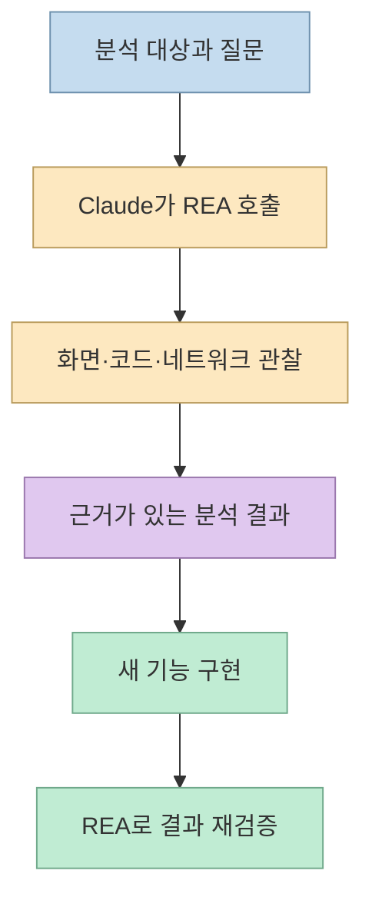
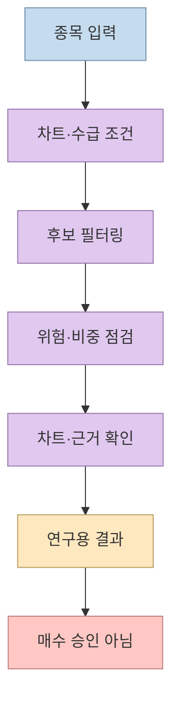
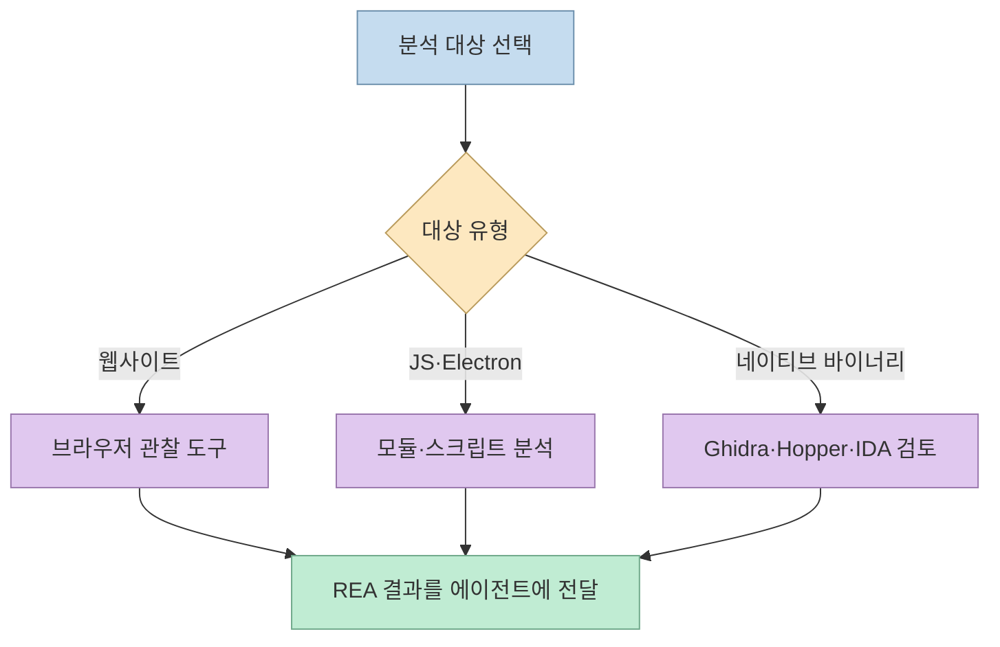
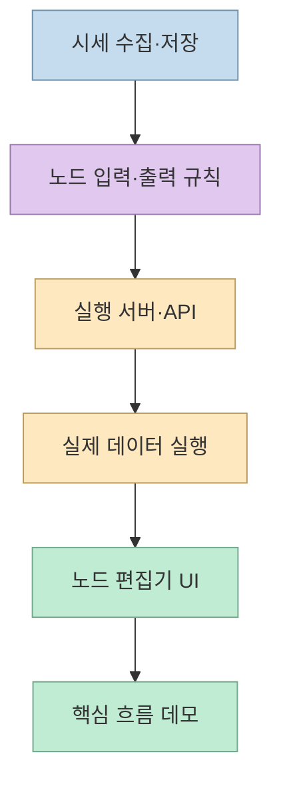
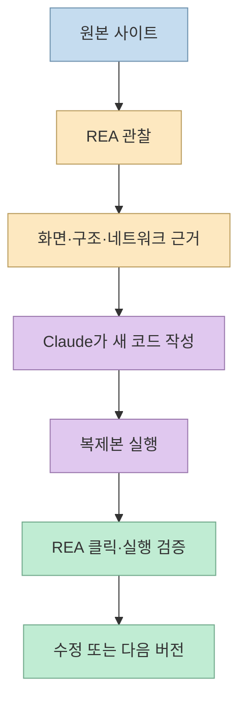

완성된 소프트웨어를 보고 “어떻게 작동하는지”를 파악한 뒤 비슷한 기능을 새로 만드는 일은, 단순한 화면 복사보다 훨씬 어렵다. 호두의 AI 분석실 영상은 **REA(Reverse Engineer Anything)** 를 Claude에 연결해 주식 분석 사이트를 관찰하고, 확인한 근거를 바탕으로 노드형 화면과 실행 흐름을 새로 구현하는 과정을 보여준다. 핵심은 원본 코드를 그대로 가져오는 것이 아니라 **관찰 → 근거 정리 → 독립 구현 → 다시 검증** 루프를 만드는 데 있다. [영상 00:00](https://youtu.be/vE3oIAG0VdE?t=0), [REA 공식 사이트](https://rea.tools/)

<!--more-->

## Sources

- [원본 영상: REA로 주식사이트를 훔쳐보았습니다](https://youtu.be/vE3oIAG0VdE?si=BXzkRC1Jr_japLhY) — 호두의 AI 분석실. 한국어 자동 생성 자막을 확인했고, 주장별 시간 링크를 붙였다.
- [REA 공식 웹사이트](https://rea.tools/) — 코딩 에이전트와 연결되는 분석 기능과 지원 대상.
- [REA GitHub 저장소](https://github.com/morluto/rea) — 공개 저장소의 설치·분석 범위·라이선스 확인.
- [Ghidra 공식 설명](https://www.nsa.gov/serve-from-netstorage/ghidra/) — 네이티브 바이너리 분석에 사용하는 역공학 프레임워크.

## REA는 에이전트의 도구 상자다

영상은 REA를 “AI에게 프로그램을 살펴볼 도구 상자를 연결하는 것”으로 비유한다. 분석 대상과 기능을 정하면 에이전트가 REA를 통해 화면과 동작을 관찰하고, 그 근거를 사용해 코드를 작성한 다음 원본과 비교한다. 공식 사이트도 REA를 웹사이트·JavaScript/Electron 앱·네이티브 바이너리 등의 동작을 코딩 에이전트가 조사하도록 연결하는 도구로 소개한다. [영상 00:20](https://youtu.be/vE3oIAG0VdE?t=20), [REA 공식 사이트](https://rea.tools/)

이 구조에서 중요한 것은 “AI가 알아서 복제한다”가 아니라, 모델이 사용할 **관찰 도구와 증거의 경로가 명시된다**는 점이다. 질문이 모호하면 화면을 비슷하게 그릴 수는 있어도 입력·상태·오류 처리까지 재현하기 어렵다. 따라서 시작 전에 어떤 기능을 관찰할지, 어떤 결과를 독립 구현할지, 무엇을 같은 것으로 판정할지 정해야 한다. [영상 00:21](https://youtu.be/vE3oIAG0VdE?t=21), [영상 07:09](https://youtu.be/vE3oIAG0VdE?t=429)

## 원본 주식 분석 사이트에서 읽어낸 구조

영상의 원본은 종목을 가져와 차트와 수급 조건으로 후보를 좁히는 노드형 분석 화면이다. 각 블록은 역할을, 연결선은 결과가 다음 단계로 넘어가는 경로를 나타낸다. 블록을 선택하면 설정과 결과를 확인할 수 있고, 투자 방식의 조건을 통과한 종목, 투자 비중과 위험 점검 단계도 흐름 안에서 추적한다. [영상 00:43](https://youtu.be/vE3oIAG0VdE?t=43), [영상 01:03](https://youtu.be/vE3oIAG0VdE?t=63)

미국 종목 흐름에서는 종목 선택 뒤 SEC 공시 자료와 언어 모델 분석, 차트 표시가 이어진다. 실행 중에는 어느 단계까지 진행됐는지가 블록에 표시되고, 자료를 모으는 단계와 해석하는 단계를 분리해 볼 수 있다. 영상 속 실행은 답변 길이 제한으로 최종 답변이 나오지 않았으며, 오류 이후 어디를 보완할지 확인하는 장면도 포함한다. 이는 **파이프라인이 화면에 보인다고 해서 분석이 완료된 것은 아님**을 보여준다. [영상 01:31](https://youtu.be/vE3oIAG0VdE?t=91), [영상 01:54](https://youtu.be/vE3oIAG0VdE?t=114)

특히 영상은 연구용 결과가 실제 매수 승인이 아니라고 직접 경고한다. 이 글도 종목·수익률·비중을 추천하지 않는다. 금융 데이터를 수집하고 계산하는 코드가 만들어졌다는 사실과 그 계산이 투자 판단에 충분히 정확하거나 적합하다는 주장은 별개다. 데이터 지연, 결측치, 기업 이벤트, 환율, 거래 비용, 모델의 해석 오류를 별도로 검증해야 한다. [영상 01:17](https://youtu.be/vE3oIAG0VdE?t=77)

## 설치는 도구 연결과 실행 환경 정리다

영상에서는 REA 공식 GitHub의 설치 문서를 Claude에 전달하고, 필요한 도구와 현재 설정을 확인하게 한다. 제작 환경의 Node 버전을 맞추고 REA가 연결되는 실행 환경을 정리한 뒤, 네이티브 프로그램 분석에 쓰는 Ghidra도 추가 설치한다. 영상은 Ghidra가 웹사이트를 볼 때 항상 필요한 것은 아니며, 도구가 설치되고 연결되는 과정을 확인하는 용도라고 설명한다. [영상 02:14](https://youtu.be/vE3oIAG0VdE?t=134), [영상 02:57](https://youtu.be/vE3oIAG0VdE?t=177)

REA 공식 저장소는 JavaScript/Electron, 웹사이트, 네이티브 바이너리 등 분석 대상에 따라 필요한 공급자가 다르다고 설명한다. Ghidra는 NSA Research Directorate가 만든 소프트웨어 역공학 프레임워크로 디스어셈블·디컴파일·그래프·스크립팅을 제공하지만, 웹 브라우저 관찰에 Ghidra가 자동으로 필요한 것은 아니다. 대상별 도구와 권한을 최소화해 설치하는 편이 안전하다. [REA GitHub](https://github.com/morluto/rea), [Ghidra 공식 설명](https://www.nsa.gov/serve-from-netstorage/ghidra/)

설치 로그가 길다는 것보다 중요한 것은 에이전트가 필요한 도구를 실제로 호출할 수 있는지다. 영상에서도 설치가 끝난 뒤 연결 상태와 간단한 실행 결과를 확인하고 Claude를 다시 열어 바뀐 설정을 적용한다. MCP나 CLI를 등록했다고 분석 결과가 자동으로 신뢰할 수 있게 되는 것은 아니므로, 버전·권한·출력 위치·실패 상태를 함께 기록해야 한다. [영상 03:15](https://youtu.be/vE3oIAG0VdE?t=195), [영상 03:27](https://youtu.be/vE3oIAG0VdE?t=207)

## 새 구현은 “전체 복사”가 아니라 수직 슬라이스다

원본 사이트를 REA로 관찰한 뒤 제작자는 모든 기능을 한 번에 넣지 않고, 노드 편집기와 핵심 노드부터 구현하기로 선택한다. 시세를 어디서 받을지, 어떤 개발 방식을 쓸지 정하고, 이 시연에서는 Binance와 Python FastAPI, 단일 HTML 구성을 선택한다. 이 선택은 원본의 서버 코드를 가져온 것이 아니라, 관찰한 입력·출력과 화면 구조를 새 기술 조합으로 다시 만든 것이다. [영상 04:11](https://youtu.be/vE3oIAG0VdE?t=251), [영상 04:28](https://youtu.be/vE3oIAG0VdE?t=268)

구현 순서도 수직 슬라이스에 가깝다. 먼저 시세를 가져와 보관하는 부분을 만들고, 노드별 입력과 출력의 계산 규칙을 작성한 뒤, 실행 서버와 API를 연결한다. 실제 데이터로 한 번 흐름을 돌린 다음 노드 편집기 화면을 만든다. 영상에서는 아홉 개 노드 실행이 성공한 결과가 표시된다. [영상 04:47](https://youtu.be/vE3oIAG0VdE?t=287), [영상 05:09](https://youtu.be/vE3oIAG0VdE?t=309)

완성된 첫 버전은 원본과 비슷한 노드·연결선·오른쪽 패널을 보여주지만, 테마와 이름은 다르다. 템플릿을 선택하면 연결된 노드가 나타나고, 캔버스를 이동·확대하거나 노드를 선택해 설정창을 열 수 있다. 교집합 노드는 여러 목록에 공통으로 남은 종목을 계산하고, 실행 후 처리 완료 수와 결과 표를 보여준다. 리스크 비중 노드는 종목별 비중을 확인하게 한다. [영상 05:35](https://youtu.be/vE3oIAG0VdE?t=335), [영상 06:06](https://youtu.be/vE3oIAG0VdE?t=366)

영상 스스로도 AI·공시 연동과 일부 계산 규칙은 보완해야 하는 첫 버전이라고 말한다. 따라서 비슷한 화면이 나왔다는 사실을 기능적 동등성으로 해석하면 안 된다. UI 구조와 데이터·계산 규칙을 별도로 구현했으며, 원본 서버 계산까지 같다고 확인한 것은 아니기 때문이다. [영상 06:52](https://youtu.be/vE3oIAG0VdE?t=412), [영상 07:57](https://youtu.be/vE3oIAG0VdE?t=477)

## REA는 관찰과 검증에 두 번 쓰인다

영상의 마지막 정리는 REA가 두 군데에서 사용됐다는 것이다. 첫째, 원본 사이트를 열어 화면·구조·오가는 데이터를 기록한다. 이 과정에서 17가지 노드 정보도 얻었다고 설명한다. 둘째, 새 사이트에서 템플릿을 고르고 실행한 뒤 화면이 열리는지 직접 클릭해 검사한다. 중간 분석 자료는 저장하고, 큰 페이지 코드는 내려받아 일반 도구로 검색한 뒤 Claude가 구현에 사용한다. [영상 07:09](https://youtu.be/vE3oIAG0VdE?t=429), [영상 07:40](https://youtu.be/vE3oIAG0VdE?t=460)

이 루프의 중요한 한계도 영상에 명시돼 있다. 원본의 실제 실행 결과와 새 사이트의 서버 계산을 모두 대조한 것이 아니므로, 화면 구조가 비슷하다고 서버 로직까지 같다고 말할 수 없다. 복제라는 표현 대신 **관찰된 계약을 바탕으로 만든 호환성 프로토타입**이라고 부르는 편이 더 정확하다. [영상 07:57](https://youtu.be/vE3oIAG0VdE?t=477)

## 실전 적용 포인트

1. **관찰 질문을 기능 단위로 쪼갠다.** “사이트를 복제해 줘” 대신 노드 생성, 연결, 실행, 결과 표시처럼 확인할 행동을 목록으로 만든다. [영상 00:20](https://youtu.be/vE3oIAG0VdE?t=20)
2. **원본과 새 구현의 경계를 적는다.** 화면·입력·출력만 재현하는지, 서버 계산과 데이터 소스까지 대체하는지 명세에 분리한다. [영상 03:58](https://youtu.be/vE3oIAG0VdE?t=238)
3. **최소 수직 슬라이스를 먼저 만든다.** 시세 수집 → 노드 계산 → API 실행 → 화면 표시가 한 번 끝까지 흐른 뒤 기능을 확장한다. [영상 04:11](https://youtu.be/vE3oIAG0VdE?t=251)
4. **관찰과 검증에 같은 체크리스트를 쓴다.** 원본에서 확인한 템플릿, 입력, 상태, 결과를 복제본에서도 클릭·실행해 본다. [영상 07:09](https://youtu.be/vE3oIAG0VdE?t=429)
5. **금융 결과는 연구용으로 격리한다.** 데이터 최신성, 결측치, 계산 규칙, 거래 비용과 리스크 한도를 검증하기 전에는 매매 자동화나 투자 추천으로 확장하지 않는다. [영상 01:17](https://youtu.be/vE3oIAG0VdE?t=77)
6. **권한과 허가를 먼저 확인한다.** REA와 분석 대상은 본인이 소유하거나 분석 권한을 받은 것에만 사용하고, 인증·보호 장치·비공개 서버를 우회하지 않는다. [REA GitHub](https://github.com/morluto/rea)

## 핵심 요약

- REA의 가치는 복제 버튼이 아니라 코딩 에이전트가 관찰·분석·검증 도구를 호출하게 만드는 데 있다.
- 영상의 주식 사이트 사례는 원본의 화면과 관찰된 입출력을 새 노드형 UI와 데이터 파이프라인으로 재구성한 첫 버전이다. [영상 05:35](https://youtu.be/vE3oIAG0VdE?t=335)
- REA는 원본을 볼 때와 복제본을 검사할 때 모두 사용되며, 두 결과를 비교해야 수정 루프가 만들어진다. [영상 07:40](https://youtu.be/vE3oIAG0VdE?t=460)
- 비슷한 UI는 서버 계산의 동일성이나 투자 판단의 유효성을 증명하지 않는다. 금융 분석 결과는 연구용으로 검증해야 한다. [영상 07:57](https://youtu.be/vE3oIAG0VdE?t=477)

## 결론

REA와 Claude를 결합한 흐름은 완성된 소프트웨어를 무작정 복사하는 기술이라기보다, 관찰 가능한 동작을 근거로 독립 구현을 빠르게 만드는 개발 방법에 가깝다. 가장 좋은 사용법은 작은 기능 하나를 선택하고, 원본 관찰 기록과 새 코드의 검증 결과를 남기는 것이다. 특히 주식 분석처럼 결과의 책임이 큰 영역에서는 화면의 유사성보다 데이터 계약, 계산 규칙, 오류 처리, 리스크 검증을 먼저 완성해야 한다.
