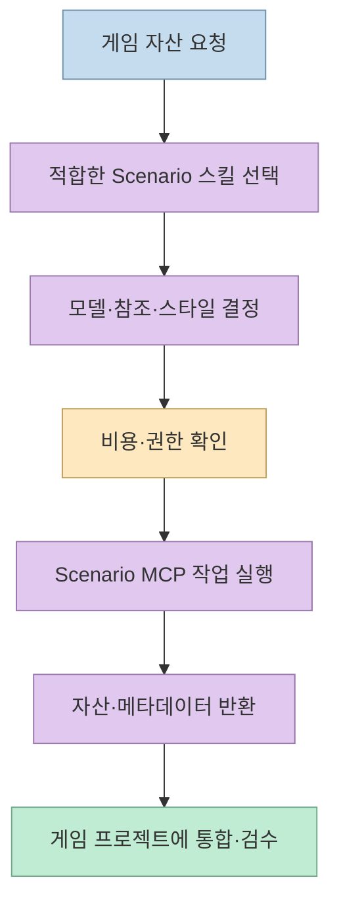
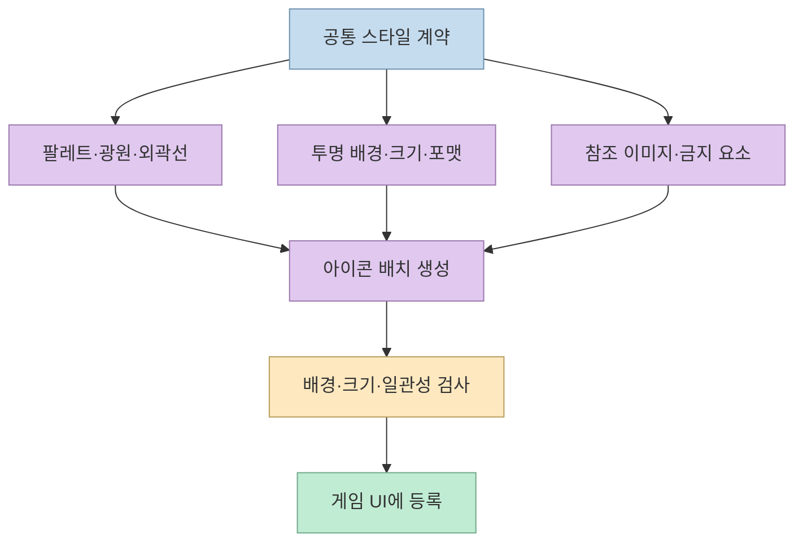
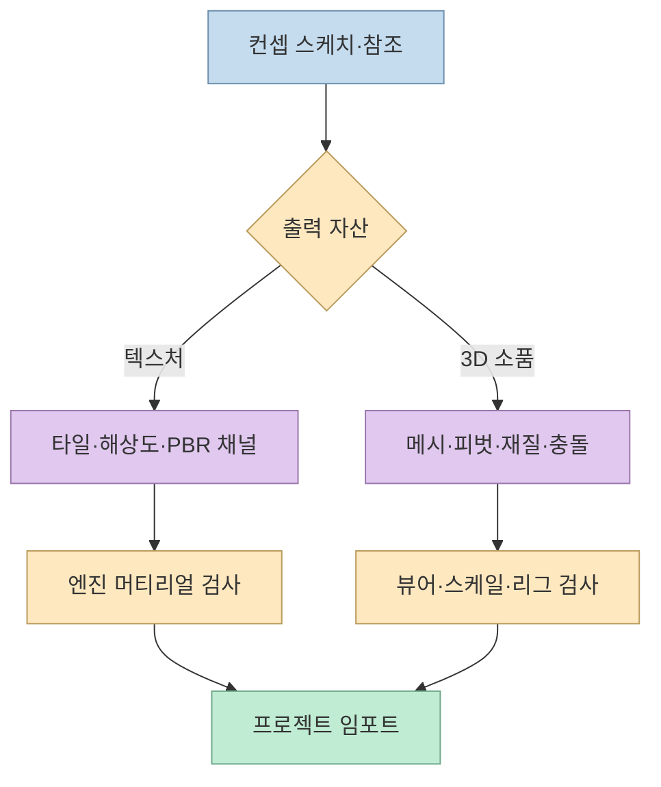
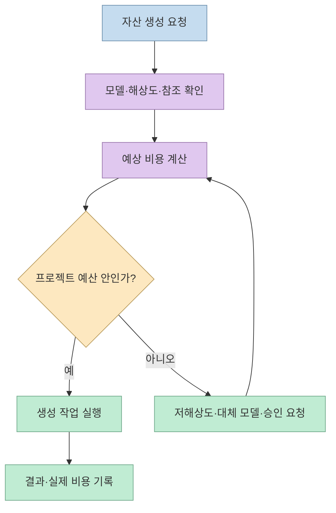

게임을 만들 때 코딩 에이전트가 코드를 작성하는 것과 게임 자산을 준비하는 것은 별도 작업이었다. 민둥이의 쇼츠는 Scenario의 Agent Skills를 연결하면 Claude Code 같은 코딩 에이전트가 이미지·영상·소리·3D 자산까지 대화로 생성할 수 있다고 소개한다. 이 글은 이를 “버튼 한 번으로 게임 완성”이 아니라 **자산 생성 모델을 고르고, 비용을 확인하고, 결과를 프로젝트에 넣는 절차를 스킬로 표준화하는 방식**으로 해석한다. [영상 00:00](https://youtu.be/rrTpvBsRdQw?t=0), [Scenario Skills 저장소](https://github.com/scenario-labs/skills)

<!--more-->

## Sources

- [원본 쇼츠: GitHub 트렌드 디자이너 없이 게임 아이콘·3D까지 뽑는 Claude Code 스킬](https://youtube.com/shorts/rrTpvBsRdQw?si=c_aRfYapR-93UvqN) — 민둥이 | 쉽게 배우는 AI. 한국어 자동 생성 자막을 확인하고, 주요 주장에 시간 링크를 붙였다.
- [Scenario Agent Skills GitHub](https://github.com/scenario-labs/skills) — 지원 에이전트, 자산 유형, 스킬 구조에 대한 공식 저장소.
- [Scenario 공식 사이트](https://www.scenario.com/) — 생성 플랫폼과 모델·계정 사용 범위.

## Agent Skills가 추가하는 것은 “자산 제작 절차”다

Scenario 저장소는 Claude Code, Cursor, Codex, Copilot 등 여러 코딩 에이전트가 Scenario MCP를 통해 이미지·비디오·오디오·텍스처·스카이박스·3D 자산과 커스텀 모델을 만들도록 가르치는 스킬 모음으로 설명된다. 영상은 기타브 트렌딩 16위와 약 2,700개의 별을 언급하며, 스킬 수가 100개 이상이고 70개가 넘는 에이전트에서 쓸 수 있다고 소개한다. 별 수와 순위는 시점에 따라 바뀌므로 저장소의 현재 상태와 구분해야 한다. [영상 00:00](https://youtu.be/rrTpvBsRdQw?t=0), [Scenario Skills README](https://github.com/scenario-labs/skills)

스킬의 역할은 모델을 직접 호출하는 코드를 매번 새로 쓰는 것이 아니다. 어떤 자산 유형에 어떤 모델·참조 이미지·스타일 조건·비용 확인·검증 단계를 적용할지를 절차로 저장한다. 에이전트는 자연어 요청을 받으면 필요한 스킬을 선택하고, MCP를 통해 Scenario 작업을 실행한 뒤 결과와 상태를 다시 프로젝트 흐름에 연결한다. [영상 00:31](https://youtu.be/rrTpvBsRdQw?t=31)

## 아이콘 생성: 모델보다 먼저 스타일 계약을 정한다

영상의 첫 사례는 RPG에 넣을 물약 아이콘 8개다. 에이전트에게 배경 없는 아이콘을 스타일에 맞춰 만들어 달라고 하면, 적절한 모델과 비용을 먼저 확인한 뒤 결과를 생성한다고 설명한다. [영상 00:09](https://youtu.be/rrTpvBsRdQw?t=9), [영상 00:16](https://youtu.be/rrTpvBsRdQw?t=16)

아이콘 배치에서 중요한 것은 생성 자체보다 **세트 일관성**이다. 색상 팔레트, 외곽선 두께, 광원 방향, 카메라 각도, 투명 배경, 출력 크기, 파일명 규칙을 먼저 고정해야 한다. 8개를 각각 따로 요청하면 같은 게임의 아이콘처럼 보이지 않을 수 있으므로, 스킬 입력에 공통 스타일과 변형 슬롯을 포함하는 것이 좋다.

## 텍스처·3D 자산은 용도별 출력 계약이 다르다

영상은 이음새 없는 벽돌 텍스처를 크게 키우거나, 컨셉 스케치를 3D 소품으로 바꿔 미리 보고 내보내는 흐름도 소개한다. [영상 00:22](https://youtu.be/rrTpvBsRdQw?t=22), [영상 00:25](https://youtu.be/rrTpvBsRdQw?t=25)

텍스처는 타일 반복 시 경계가 보이지 않아야 하고, 해상도·색 공간·노멀·러프니스 같은 PBR 채널이 엔진의 입력과 맞아야 한다. 3D 소품은 메시의 크기·피벗·좌표계·폴리곤 수·재질·충돌 프록시를 확인해야 한다. “이미지에서 3D를 만들었다”는 결과만으로 게임에 바로 넣을 수 있는 것은 아니다. 스킬이 이 후처리와 내보내기 규칙을 함께 제공하는지 README와 해당 `SKILL.md`를 확인해야 한다.

## 비용을 먼저 확인하는 이유

영상은 물약 아이콘 요청에서 알맞은 모델을 고르고 비용을 먼저 확인한다고 강조한다. Scenario의 스킬은 모델·작업 유형별 비용이나 계정 상태를 확인하는 절차를 포함할 수 있지만, 공개 저장소가 무료라는 사실과 생성 API 호출이 무료라는 사실은 다르다. 스킬 파일은 공개되어도 이미지·영상·3D 생성에는 계정·크레딧·모델별 과금이 적용될 수 있다. [영상 00:16](https://youtu.be/rrTpvBsRdQw?t=16), [Scenario Skills README](https://github.com/scenario-labs/skills)

운영에서는 다음을 기록하는 것이 좋다.

- 자산 하나의 생성 비용과 재시도 비용
- 사용한 모델·해상도·프레임 수·참조 이미지 수
- 프로젝트별 월간 예산과 실패한 작업의 비용
- 생성 결과의 승인·폐기 상태
- 동일 자산을 다시 만들지 않기 위한 해시와 버전

비용 확인이 빠진 자동화는 개발자의 클릭을 줄이는 대신 예산을 예측할 수 없게 만든다. 특히 비디오·3D는 이미지보다 작업 시간이 길거나 출력 크기가 크므로, 스킬이 제공하는 미리보기·저해상도 단계부터 실행하는 편이 안전하다.

## MCP와 지원 에이전트의 의미

영상은 Scenario 스킬이 Claude Code뿐 아니라 Cursor·Codex 등 70개가 넘는 에이전트에서 쓸 수 있다고 말한다. 공식 저장소도 여러 코딩 에이전트와 Scenario MCP를 통한 연결을 설명한다. 이때 스킬은 에이전트마다 같은 결과를 보장하는 마법이 아니라, 공통된 절차와 도구 호출 규칙을 전달하는 호환 계층이다. [영상 00:31](https://youtu.be/rrTpvBsRdQw?t=31), [Scenario Skills README](https://github.com/scenario-labs/skills)

에이전트별로 MCP 설정 위치·승인 방식·환경 변수·파일 쓰기 권한이 다르므로, 설치 전 현재 프로젝트에 어떤 설정이 추가되는지 확인해야 한다. 생성된 자산을 자동으로 저장하는 스킬이라면 출력 디렉터리와 덮어쓰기 정책을 고정하고, 외부 서비스로 전송되는 참조 이미지에 개인정보나 비공개 콘셉트가 포함되지 않는지도 점검해야 한다.

## 실전 적용 포인트

1. **자산 종류 하나로 시작한다.** 아이콘·텍스처·3D 소품·사운드 중 하나를 골라 스킬의 입력과 출력 품질을 검증한다. [영상 00:09](https://youtu.be/rrTpvBsRdQw?t=9)
2. **스타일 계약을 먼저 작성한다.** 팔레트, 광원, 시점, 투명 배경, 크기, 파일명, 금지 요소를 프로젝트 문서에 고정한다.
3. **비용 확인을 자동화한다.** 작업 실행 전 모델·해상도·예상 비용을 표시하고, 예산을 넘으면 중단하도록 한다. [영상 00:16](https://youtu.be/rrTpvBsRdQw?t=16)
4. **생성 결과를 게임 엔진 기준으로 검수한다.** 아이콘은 배경·크기, 텍스처는 타일·채널, 3D는 스케일·피벗·충돌·폴리곤을 확인한다.
5. **MCP 권한을 최소화한다.** 참조 자산 읽기와 출력 디렉터리 쓰기만 허용하고, 프로젝트 전체 삭제·외부 업로드 권한은 분리한다.
6. **자산 카탈로그를 만든다.** 모델·프롬프트·참조·비용·해시·승인 상태를 저장해 같은 자산을 반복 생성하지 않는다.
7. **창작물의 권리를 확인한다.** 참조 이미지·브랜드·캐릭터를 사용할 권리가 있는지 확인하고, 외부 서비스의 이용약관과 생성물 조건을 기록한다.

## 핵심 요약

- Scenario Agent Skills는 코딩 에이전트에 자산 생성 모델을 연결하는 절차와 도구 호출 규칙을 제공한다. [Scenario Skills README](https://github.com/scenario-labs/skills)
- 아이콘·텍스처·3D는 각각 스타일·타일·엔진 임포트 조건이 다르므로, 생성보다 출력 검수가 중요하다.
- 공개 스킬 저장소가 무료여도 Scenario의 생성 작업은 계정·크레딧·모델별 비용이 발생할 수 있다. [영상 00:16](https://youtu.be/rrTpvBsRdQw?t=16)
- 안전한 도입은 작은 자산 하나 → 비용 확인 → 결과 검수 → 자산 카탈로그 → 에이전트 권한 최소화 순서다.

## 결론

Scenario 스킬의 핵심은 코딩 에이전트가 이미지·영상·사운드·3D를 “알아서 잘 만든다”는 데 있지 않다. 자산 종류에 맞는 모델 선택, 비용 확인, 참조와 스타일 유지, 게임 엔진용 검수 절차를 재사용 가능한 스킬로 묶는 데 있다. 작은 아이콘 배치부터 시작해 출력 계약과 비용 기록을 검증하면, 에이전트는 코드만 쓰는 도구에서 게임 제작 파이프라인을 조율하는 도구로 확장될 수 있다.
