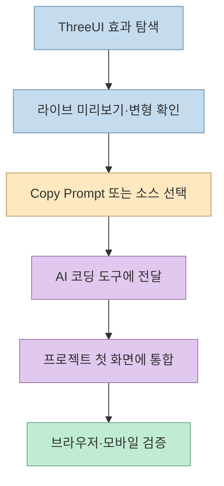
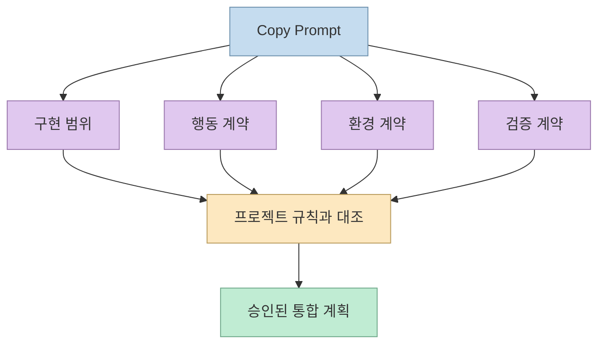
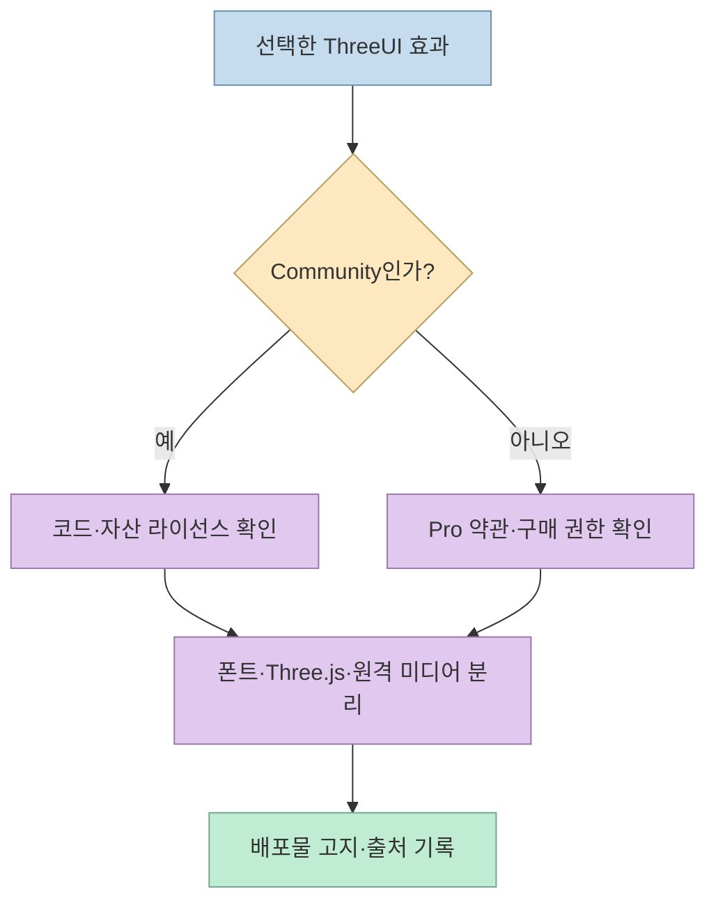
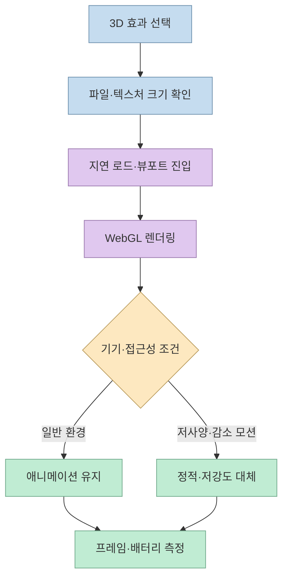

멋진 3D 스크롤 효과를 직접 만들려면 WebGL, 셰이더, 애니메이션, 반응형 레이아웃을 함께 다뤄야 한다. 개발자 김뽑희의 쇼츠는 **ThreeUI**에서 효과를 고르고 `Copy Prompt`를 눌러 AI 코딩 도구에 전달한 뒤, 첫 화면에 적용하는 흐름을 소개한다. 핵심은 프롬프트 한 줄이 아니라, 에이전트가 참고할 구현 지시서와 라이선스·성능 조건을 함께 전달하는 데 있다. [영상 00:00](https://youtu.be/Wbex8KoNryw?t=0), [ThreeUI Community 저장소](https://github.com/MengTo/threeui)

<!--more-->

## Sources

- [원본 쇼츠: 이 사이트 스크롤, 복사해서 AI한테 붙여넣기](https://youtube.com/shorts/Wbex8KoNryw?si=RGcZz9EipVtNOawJ) — 개발자 김뽑희. 한국어 자동 생성 자막을 확인했고 주요 주장에 시간 링크를 붙였다.
- [ThreeUI 공식 사이트](https://threeui.com/browse) — 효과 미리보기와 Copy Prompt 인터페이스.
- [ThreeUI Community GitHub](https://github.com/MengTo/threeui) — 공개 소스, Community 구성, 설치 범위.
- [ThreeUI Asset Licenses](https://github.com/MengTo/threeui/blob/main/ASSET-LICENSES.md) — 코드·이미지·폰트·Three.js·원격 미디어의 라이선스 범위.
- [ThreeUI 공식 가격 페이지](https://threeui.com/pricing) — 유료 구성과 가격은 변동될 수 있으므로 사용 시점에 재확인.

## ThreeUI는 “효과 코드 + 구현 지시서” 카탈로그다

영상은 ThreeUI를 3D 효과 모음으로 소개한다. 마음에 드는 효과를 열고 상단의 `Copy Prompt`를 누른 뒤, 사용 중인 AI 코딩 도구에 붙여 넣고 사이트 첫 화면에 추가해 달라고 요청한다. [영상 00:08](https://youtu.be/Wbex8KoNryw?t=8), [영상 00:16](https://youtu.be/Wbex8KoNryw?t=16)

공식 Community 저장소는 ThreeUI가 단순한 이미지 갤러리가 아니라 React·Three.js 기반 구현과 컨트롤, 변형, 소스 탭을 포함한다고 설명한다. 따라서 에이전트에 넘기는 것은 “이런 느낌으로 만들어 줘”라는 추상적인 요구가 아니라, 특정 효과를 프로젝트에 넣고 수정·검증하기 위한 입력이다. [ThreeUI README](https://github.com/MengTo/threeui)



## Copy Prompt에서 가장 중요한 문장은 무엇인가

쇼츠가 강조하는 지점은 프롬프트의 내용이다. 미리보기를 보고 비슷하게 다시 만들라는 설명보다, 원본 코드와 구현 조건을 그대로 따르도록 지시하는 문장이 포함되어 있다는 것이다. [영상 00:28](https://youtu.be/Wbex8KoNryw?t=28), [영상 00:36](https://youtu.be/Wbex8KoNryw?t=36)

이런 지시서는 보통 다음 네 가지를 묶어야 효과가 있다.

1. **구현 범위:** 어떤 컴포넌트·페이지·파일을 추가하는가.
2. **행동 계약:** 스크롤, 마우스, 터치, 리사이즈 때 무엇이 변하는가.
3. **환경 계약:** React·Three.js 버전, 에셋 경로, 이미 설치된 의존성은 무엇인가.
4. **검증 계약:** 데스크톱·모바일, 고해상도 화면, `prefers-reduced-motion`, 탭 비활성화, WebGL 실패를 어떻게 확인하는가.

따라서 프롬프트를 그대로 붙여 넣기보다 프로젝트 구조와 충돌하는 부분을 먼저 바꿔야 한다. “원본 코드 그대로”라는 문장은 해당 소스의 라이선스와 파일 경로를 지키라는 뜻이지, 프로젝트의 모든 규칙을 무시하라는 뜻이 아니다. [영상 00:36](https://youtu.be/Wbex8KoNryw?t=36)



## 무료 Community와 유료 Pro를 분리해서 읽기

쇼츠는 카드에 `Pro`가 붙은 효과는 유료이고, `Free` 효과는 무료라고 설명하며 영상 시점의 연간 가격으로 199달러를 언급한다. 가격과 구성은 바뀔 수 있으므로 결제 전 공식 가격 페이지를 확인해야 한다. [영상 00:49](https://youtu.be/Wbex8KoNryw?t=49), [ThreeUI 가격 페이지](https://threeui.com/pricing)

GitHub의 Community README는 공개 버전에 Community 컴포넌트와 변형, 구현 소스가 포함되고 Pro·Beta 구현은 포함되지 않는다고 명시한다. Asset Licenses는 Community 코드와 ThreeUI가 만든 이미지·텍스처·장면 자산의 범위, 포함된 폰트의 SIL Open Font License, Three.js의 MIT 라이선스를 각각 구분한다. [ThreeUI README](https://github.com/MengTo/threeui), [Asset Licenses](https://github.com/MengTo/threeui/blob/main/ASSET-LICENSES.md)

라이선스는 카드의 `Free` 표기만 보고 판단하면 안 된다. 다음을 확인해야 한다.

- 사용하는 컴포넌트가 Community인지 Pro인지
- 코드·이미지·텍스처·폰트가 각각 어떤 라이선스인지
- 공식 사이트의 원격 썸네일·미리보기 영상을 그대로 재배포하는지
- MIT 라이선스의 저작권·허가 고지를 보존했는지
- 유료 소스의 사용 권한과 프로젝트 배포 조건이 충족되는지

영상은 무료 효과가 공개 라이선스라 상업 사이트에도 쓸 수 있다고 설명하지만, 실제 배포 전에는 해당 컴포넌트와 자산의 최신 라이선스 파일을 읽어야 한다. [영상 00:55](https://youtu.be/Wbex8KoNryw?t=55)



## 3D 효과는 첫 화면의 성능 예산을 먹는다

쇼츠는 소개한 무료 효과가 그림 15장과 약 3.4MB를 포함해 무거울 수 있다고 말하며, 사이트 전체에 깔기보다 첫 화면 하나에 쓰는 편이 좋다고 조언한다. [영상 01:06](https://youtu.be/Wbex8KoNryw?t=66), [영상 01:12](https://youtu.be/Wbex8KoNryw?t=72)

파일 크기는 시작점일 뿐이다. Three.js와 WebGL 효과는 GPU 프레임 시간, 텍스처 메모리, 초기 셰이더 컴파일, 모바일 발열과 배터리까지 영향을 준다. 첫 화면에 3D를 넣을 때는 다음 순서를 지키는 것이 안전하다.

1. 정적 이미지나 CSS 대체 화면을 먼저 준비한다.
2. 효과를 지연 로드하고 뷰포트에 들어올 때 초기화한다.
3. 화면이 보이지 않거나 탭이 백그라운드면 애니메이션을 줄이거나 멈춘다.
4. `prefers-reduced-motion` 사용자는 정적 상태나 짧은 전환으로 대체한다.
5. 중급 모바일 기기에서 첫 콘텐츠 표시 시간과 프레임 시간을 측정한다.



## AI 코딩 도구에 넣을 때의 안전한 요청 구조

ThreeUI 프롬프트를 붙여 넣고 “첫 화면에 넣어 줘”라고만 요청하면, 에이전트가 기존 레이아웃·번들·라우팅을 깨뜨릴 수 있다. 다음처럼 요청을 단계로 나누는 편이 좋다.

```text
1. 현재 프로젝트의 프레임워크와 첫 화면 진입 파일을 먼저 확인한다.
2. ThreeUI 컴포넌트의 라이선스와 필요한 파일을 기록한다.
3. 기존 스타일·라우팅·빌드 규칙을 바꾸지 않는 통합 계획을 제시한다.
4. 컴포넌트를 별도 모듈로 추가하고, 원본 자산 경로를 유지한다.
5. 데스크톱·모바일·prefers-reduced-motion·WebGL 실패를 검증한다.
6. 변경 파일, 번들 크기, 실행 방법과 남은 위험을 요약한다.
```

이 요청은 AI에게 미리보기의 분위기를 흉내 내라고 하는 대신, 실제 코드와 검증 계약을 프로젝트 안에 통합하도록 유도한다. 특히 원본 코드와 자산을 복사한 뒤 상대 경로가 깨지는 경우가 많으므로, 로컬 파일·CDN·원격 미디어의 출처를 각각 확인해야 한다. [ThreeUI README](https://github.com/MengTo/threeui)

## 실전 적용 포인트

1. **무료 Community 효과 하나만 고른다.** 여러 3D 효과를 동시에 넣지 말고 첫 화면에서 제품 메시지를 강화하는 하나를 선택한다. [영상 00:55](https://youtu.be/Wbex8KoNryw?t=55)
2. **Copy Prompt를 프로젝트 명세로 변환한다.** 구현 파일, 의존성, 에셋 경로, 반응형·접근성·검증 조건을 현재 저장소에 맞게 수정한다.
3. **라이선스를 파일 단위로 기록한다.** 코드·이미지·폰트·원격 미디어를 분리하고 배포물에 필요한 고지를 남긴다. [Asset Licenses](https://github.com/MengTo/threeui/blob/main/ASSET-LICENSES.md)
4. **3D를 지연 로드한다.** 첫 화면이 아닌 아래 구간의 효과는 Intersection Observer 같은 진입 조건 뒤에 초기화하고, 정적 폴백을 준비한다.
5. **모바일과 감소 모션을 먼저 테스트한다.** 데스크톱에서 멋져 보여도 GPU 메모리·프레임 저하·멀미 문제가 있을 수 있다.
6. **유료 기능을 무료 소스로 착각하지 않는다.** `Pro` 카드, CLI, MCP와 Community npm 소스의 권한을 각각 확인한다. [ThreeUI 가격 페이지](https://threeui.com/pricing)

## 핵심 요약

- ThreeUI의 `Copy Prompt`는 단순한 디자인 설명이 아니라 컴포넌트 구현과 검증을 에이전트에 전달하는 작업 지시서다. [영상 00:28](https://youtu.be/Wbex8KoNryw?t=28)
- Community와 Pro는 소스·자산·사용 권한이 다르므로 카드 표기와 최신 라이선스를 확인해야 한다. [ThreeUI README](https://github.com/MengTo/threeui)
- 3D 효과는 이미지 용량뿐 아니라 WebGL 프레임 시간, GPU 메모리, 배터리, 접근성까지 고려해야 한다. [영상 01:06](https://youtu.be/Wbex8KoNryw?t=66)
- 가장 안전한 도입 순서는 효과 하나 선택 → 라이선스 기록 → 별도 모듈 통합 → 모바일·감소 모션·WebGL 실패 검증이다.

## 결론

ThreeUI가 줄여 주는 것은 3D 효과를 처음부터 설계하는 시간이지, 프론트엔드 검증을 없애는 일이 아니다. `Copy Prompt`를 프로젝트 명세로 번역하고, Community·Pro 라이선스와 원격 자산의 경계를 확인한 뒤, 첫 화면의 성능 예산 안에서 하나의 효과만 운영하자. 그러면 AI 코딩 도구는 막연한 “멋진 3D” 생성기가 아니라, 검증 가능한 시각 컴포넌트를 통합하는 구현 파트너가 된다.
