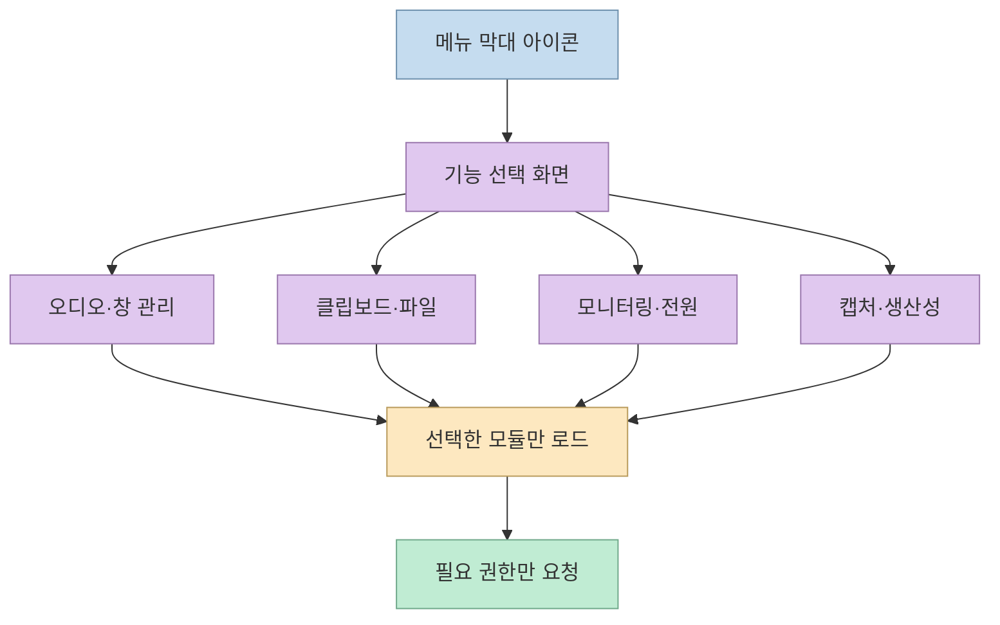
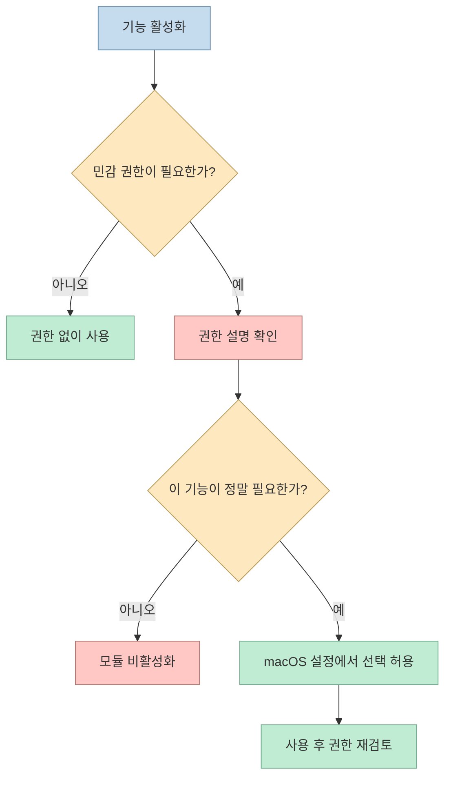
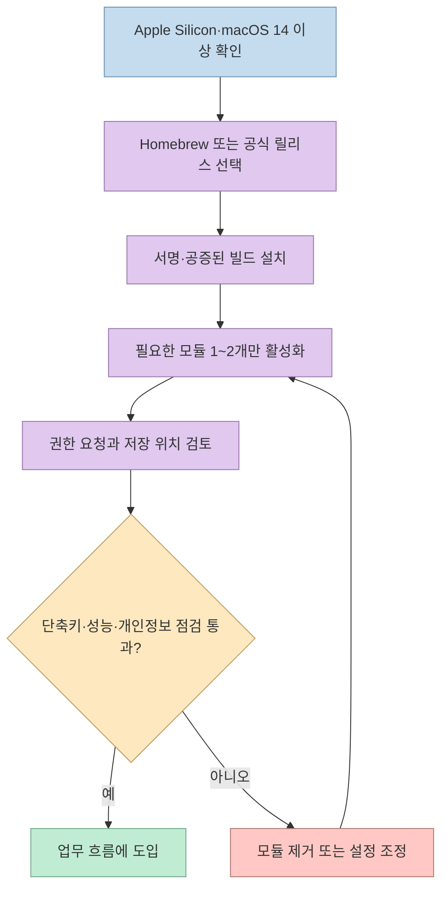
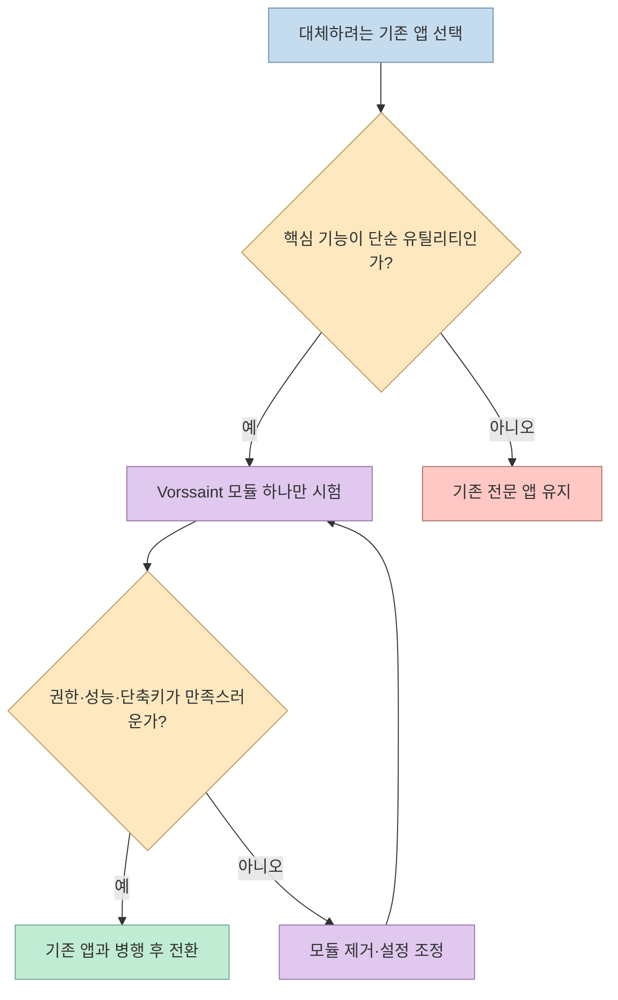

맥에서 볼륨 믹서, 창 정렬, 클립보드 기록, 앱 삭제기 같은 작은 유틸리티를 각각 설치하면 메뉴 막대와 권한 설정이 빠르게 복잡해진다. 이번 쇼츠는 **Vorssaint** 를 “유료 앱 여러 개를 메뉴 막대 아이콘 하나로 묶는 무료 오픈소스 도구”로 소개한다. 자막은 계정·추적이 없고, 필요한 기능만 설치하며, Apple Silicon과 macOS Sonoma 이상이 필요하다고 설명한다. 이는 영상의 소개 내용이며, 실제 설치 조건과 기능 목록은 공식 사이트·저장소의 현재 문서로 다시 확인해야 한다. [쇼츠 00:00](https://youtu.be/RP_-NUlg7BE?t=0), [쇼츠 00:25](https://youtu.be/RP_-NUlg7BE?t=25)

<!--more-->

## Sources

- [원본 쇼츠: 유료 맥 앱 10개를 아이콘 하나로? 무료 Vorssaint](https://youtube.com/shorts/RP_-NUlg7BE?si=kzw5ZhapiBMhFWiJ) — 비치콤버스. 자동 생성 자막을 확인해 기능 소개와 설치 조건에 시간 링크를 붙였다.
- [Vorssaint 공식 홈페이지](https://vorssaint.com/) — Apple Silicon·macOS 14 이상, Homebrew 설치 명령과 기능 개요를 확인했다.
- [Vorssaint GitHub 저장소](https://github.com/vorssaint/vorssaint-utils) — 기능별 설치, 권한 안내, 개인정보 처리, GPL-3.0 라이선스와 빌드 방법을 확인했다.

## “앱 하나”보다 “기능 모듈 묶음”에 가깝다

쇼츠만 보면 거대한 단일 앱처럼 느껴지지만, 공식 문서의 핵심은 **사용할 기능만 선택해 설치하는 모듈형 구조**다. 저장소는 볼륨 믹서, 시스템 모니터, 창 레이아웃, Dock 미리보기, 클립보드 기록, 텍스트 스니펫, 파일 선반, 앱 제거기, 화면 캡처·녹화 등을 한 메뉴 막대 인터페이스에 배치한다. 설치하지 않은 기능은 인터페이스에서 사라지고 로딩도 중단되며, 다시 설치하면 설정을 복원할 수 있다고 설명한다. [공식 기능 목록](https://vorssaint.com/), [GitHub README](https://github.com/vorssaint/vorssaint-utils)



이 구조는 “기능이 많다”는 장점보다 **기능을 줄일 수 있다**는 점이 중요하다. 예를 들어 클립보드 기록이 필요 없다면 해당 모듈을 설치하지 않고, 창 관리만 활성화할 수 있다. 여러 독립 앱을 동시에 실행하는 대신 공통 설정과 단축키를 한 곳에서 관리할 수 있지만, 반대로 한 프로세스에 많은 책임이 모이는 만큼 업데이트 후 회귀도 한 번에 체감할 수 있다. 따라서 모든 기능을 켜기보다 자신의 작업 흐름에 필요한 두세 개부터 시작하는 편이 안전하다. [쇼츠 00:30](https://youtu.be/RP_-NUlg7BE?t=30)

## 권한을 “한 번에 허용”하지 않는 것이 핵심

macOS 유틸리티는 화면 기록, 손쉬운 사용, 파일 접근처럼 민감한 권한을 요구할 수 있다. Vorssaint 공식 README는 선택한 기능에 필요한 권한만 요청하고, 각 권한이 어떤 기능에서 사용되는지 설명하며, 더 이상 사용하지 않는 권한은 철회할 수 있도록 안내한다고 밝힌다. 이 방식은 권한을 줄여 주지만, **오픈소스라는 사실만으로 모든 기능이 자동으로 안전해지는 것은 아니다.** 실제로 활성화한 모듈, 부여한 권한, 네트워크가 필요한 기능을 따로 기록해야 한다. [권한 안내](https://github.com/vorssaint/vorssaint-utils#private-by-default)



특히 화면 캡처·녹화나 클립보드 기록은 업무 데이터가 직접 들어갈 수 있다. 회사 맥에서는 보안 정책과 MDM 프로파일이 권한 변경을 제한할 수 있고, 개인 맥에서도 금융·비밀번호·고객 정보가 클립보드에 남을 수 있다. “로컬 우선”이라는 설명은 데이터 흐름을 판단하는 출발점이지, 운영 점검을 생략할 근거가 아니다. 자동 삭제 기간, 기록 제외 앱, 화면 녹화 파일의 저장 위치를 확인한 뒤 업무용과 개인용 프로필을 분리하는 것이 좋다. [공식 개인정보 안내](https://github.com/vorssaint/vorssaint-utils#private-by-default)

## 설치는 짧지만, 검증 순서는 길게

공식 저장소가 안내하는 Homebrew 설치 명령은 다음과 같다.

```bash
brew install --cask vorssaint
```

공식 빌드는 Apple Developer ID로 서명되고 공증되며, 대안으로 릴리스 디스크 이미지를 내려받아 응용 프로그램 폴더로 드래그할 수 있다. 요구 조건은 Apple Silicon Mac과 macOS 14 Sonoma 이상이다. Intel Mac이나 이전 macOS를 사용한다면 설치 전에 릴리스 노트와 호환성 이슈를 먼저 확인해야 한다. [설치 안내](https://github.com/vorssaint/vorssaint-utils#install)



설치 뒤에는 다음 네 가지를 확인하면 된다.

1. **권한**: 활성화한 기능이 요구하는 손쉬운 사용·화면 기록·파일 접근만 허용한다.
2. **충돌**: 기존 Rectangle, Maccy, Amphetamine 같은 도구와 단축키·백그라운드 훅이 겹치는지 확인한다.
3. **성능**: 시스템 모니터·화면 녹화·Dynamic Island를 동시에 켠 뒤 CPU, 메모리, 배터리 변화를 관찰한다.
4. **복구**: 문제가 생기면 모듈을 먼저 제거하고, 필요하면 Homebrew로 앱 전체를 삭제한다.

```bash
brew uninstall --cask vorssaint
```

설정과 권한까지 완전히 정리하려면 저장소의 `Tools/uninstall.sh` 절차를 읽고 실행해야 한다. 삭제 명령은 환경에 따라 설정 파일까지 지울 수 있으므로, 내보내기·백업이 필요한지 먼저 판단한다. [제거 안내](https://github.com/vorssaint/vorssaint-utils#uninstall)

## 어떤 사용자에게 맞는가

Vorssaint는 “맥용 앱을 하나로 통합하면 무조건 이득”인 도구가 아니다. 다음 조건에 가까울수록 시도할 가치가 있다.

- 메뉴 막대와 단축키를 한곳에서 관리하고 싶은 사용자
- 볼륨 믹서·창 정렬·클립보드처럼 가벼운 유틸리티를 여러 개 사용하는 사용자
- 기능별 권한을 직접 검토하고, 오픈소스 릴리스와 이슈를 확인할 수 있는 사용자

반대로 회사 보안 정책상 화면 기록이나 손쉬운 사용 권한을 허용할 수 없거나, 기존 도구 하나가 특정 기능에서 더 안정적이라면 전부 교체할 필요가 없다. 쇼츠의 “유료 앱 10개”라는 표현은 기능 범위를 직관적으로 보여 주는 카피에 가깝고, 실제 대체 가능성은 사용하는 기능의 깊이와 안정성에 따라 달라진다. 먼저 무료 모듈 하나로 일주일간 시험하고, 기존 앱을 바로 삭제하지 않은 채 단축키 충돌·배터리·권한 로그를 비교하는 것이 합리적인 도입 순서다. [쇼츠 00:13](https://youtu.be/RP_-NUlg7BE?t=13), [GitHub 이슈·릴리스](https://github.com/vorssaint/vorssaint-utils)



결국 Vorssaint의 흥미로운 점은 기능의 개수보다 **작은 맥 유틸리티를 선택적으로 조립하고, 권한과 데이터 흐름을 사용자가 통제하게 만든 제품 구조**다. 설치 후 무엇을 켰는지 설명할 수 있고 필요 없을 때 모듈을 떼어낼 수 있다면, “아이콘 하나”는 단순한 편의 기능을 넘어 관리 가능한 개인 작업 환경이 된다.
