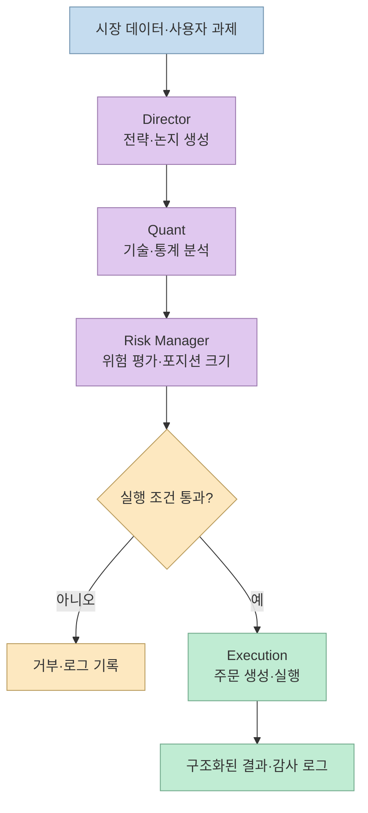
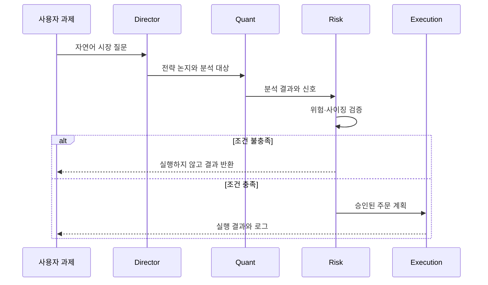
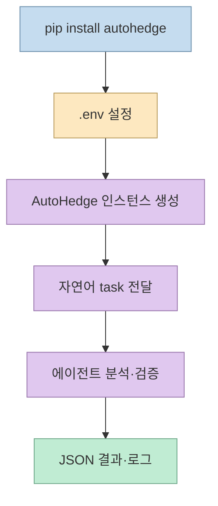
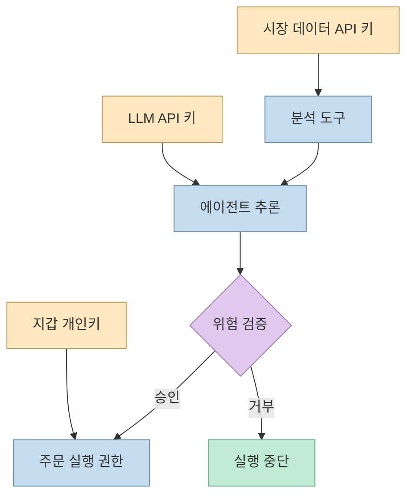

AI 에이전트 여러 개를 묶어 시장을 분석하고 주문까지 실행한다는 아이디어는 매력적이다. 하지만 “잠자는 동안 돈을 벌어주는 오픈소스”라는 표현만으로는 시스템의 실제 책임 경계와 위험을 알 수 없다. 이 글은 `DeepTechTR`의 X 게시물이 연결한 [AutoHedge 저장소](https://github.com/The-Swarm-Corporation/AutoHedge)를 기준으로, 무엇이 구현되어 있고 무엇을 별도로 검증해야 하는지 분해한다.

<!--more-->

## Sources

- [입력 X 게시물](https://x.com/DeepTechTR/status/2119478777046876323)
- [AutoHedge GitHub 저장소](https://github.com/The-Swarm-Corporation/AutoHedge)
- [AutoHedge `pyproject.toml`](https://raw.githubusercontent.com/The-Swarm-Corporation/AutoHedge/main/pyproject.toml)
- [AutoHedge 예제](https://raw.githubusercontent.com/The-Swarm-Corporation/AutoHedge/main/example.py)
- [AutoHedge 환경 변수 예시](https://raw.githubusercontent.com/The-Swarm-Corporation/AutoHedge/main/.env.example)

## 홍보 문구와 저장소가 말하는 범위

X 게시물은 AutoHedge를 Director, Quant, Risk, Execution 네 에이전트가 협력하는 자율 헤지펀드 예시로 소개한다. 저장소 README도 시장 분석, 트레이딩 논지 생성·검증, 포지션 사이징, 주문 실행을 하나의 파이프라인으로 묶는다고 설명한다. 다만 현재 지원 범위는 **Solana에서의 자율 거래**이며 Coinbase와 다른 거래소는 “coming soon” 또는 로드맵으로 표시된다. 따라서 여러 거래소를 이미 안정적으로 지원하는 범용 헤지펀드로 해석하면 안 된다.



핵심은 에이전트 수가 아니라 **권한을 단계별로 나눴다는 점**이다. Director가 만든 논지를 곧바로 주문으로 연결하지 않고 Quant 분석과 Risk 판단을 거치게 하면, 전략 생성과 자금 집행을 분리할 수 있다. 그러나 이 구조가 손실을 자동으로 막는다는 뜻은 아니다. 데이터 오류, 잘못된 모델 추론, 지갑 권한 오용, 네트워크 실패는 여전히 실행 계층에서 발생할 수 있다.

## 네 에이전트 파이프라인을 책임 단위로 읽기

README의 역할 설명을 코드 운영 관점으로 번역하면 다음과 같다.

1. **Director** 는 사용자의 과제에서 전략과 트레이딩 논지를 만든다. 예제에서는 “원유 시장의 감정과 추세를 분석하라”는 자연어 과제가 입력된다.
2. **Quant** 는 기술적·통계적 분석을 담당한다. Director의 서술을 가격·시장 데이터에 연결하는 단계다.
3. **Risk Management** 는 위험 평가와 포지션 사이징을 실행 전에 수행한다. 이 단계가 별도 에이전트라는 점이 AutoHedge의 risk-first 설계다.
4. **Execution** 은 승인된 결과를 주문으로 만들고 지원되는 venue에 전송한다.



저장소가 강조하는 구조화된 JSON 출력과 상세 로깅은 이 분리를 운영 가능한 인터페이스로 만든다. 각 단계의 결과를 문자열로 이어 붙이는 대신 downstream 시스템이 읽을 수 있는 형식으로 남기면, “왜 주문이 나갔는가”를 사후에 추적하기 쉬워진다. 반대로 로그가 있다고 해서 금융 규제상 감사 요건이나 전략 검증이 충족되는 것은 아니므로, 실제 운용에서는 거래소 응답·잔고·슬리피지·재시도까지 별도로 저장해야 한다.

## 설치와 가장 작은 실행 경로

패키지 메타데이터는 Python 3.10 이상을 요구하고, CLI 진입점으로 `autohedge = "autohedge.cli:main"`을 제공한다. README의 기본 설치는 다음과 같다.

```bash
pip install -U autohedge
autohedge
```

의존성에는 `swarms`, `pydantic`, `loguru`, `httpx`, `solders`, `yfinance`, `python-dotenv` 등이 포함된다. 즉 에이전트 오케스트레이션, 데이터 접근, Solana 타입 처리, 설정 로딩이 하나의 Python 패키지 집합으로 묶여 있다. 버전이 모두 고정된 형태는 아니므로 재현 가능한 운영 환경에서는 별도의 lock 파일과 격리된 가상환경을 준비하는 편이 안전하다.

예제 코드는 `.env`를 읽는 `AutoHedge`를 만들고, 자연어 과제를 `run()`에 전달한다.

```python
from autohedge import AutoHedge

trading_system = AutoHedge(
    name="swarms-fund",
    description="Private Hedge Fund for Swarms Corp",
)

task = "Analyze the sentiment of oil market and provide a thesis on the overall market position and expected trends."
print(trading_system.run(task=task))
```



## 키와 지갑은 에이전트보다 더 중요한 경계다

`.env.example`에는 Jupiter API 키, OpenAI·Anthropic API 키, 작업 디렉터리, `WALLET_PRIVATE_KEY`가 정의되어 있다. README는 Jupiter를 토큰 가격·검색 도구에 사용한다고 설명하고, OpenAI·Anthropic 에이전트는 실험적이라고 표시한다. 이 구성은 “모델 선택”과 “거래 권한”을 하나의 프로세스에서 함께 다루게 만든다.



특히 개인키는 단순한 분석용 비밀값이 아니라 자산 이동 권한이다. 개발 단계에서는 최소 권한 지갑, 작은 금액, 출금 제한, 샌드박스 또는 수동 승인 모드를 우선해야 한다. 개인키를 로그·프롬프트·소스 저장소에 노출하지 않는 것은 기본이며, API 키와 지갑 키를 서로 다른 실행 계정과 비밀 저장소로 분리하는 것이 바람직하다. 저장소의 MIT 라이선스는 코드 사용 허가이지 수익 보장이나 금융 자문이 아니다.

## “자율 거래”를 운영 시스템으로 바꾸려면

AutoHedge의 README는 실시간 분석, risk-first 설계, 구조화된 출력, 로깅, 모듈식 확장을 기능으로 제시한다. 실제 운영에서는 여기에 다음 검증층을 추가해야 한다.

- **데이터 검증**: 가격 시각, 체결 가능성, 결측·지연 여부를 주문 전에 확인한다.
- **리스크 상한**: 종목별·전략별·일일 손실 한도와 최대 포지션을 코드로 강제한다.
- **주문 멱등성**: 네트워크 재시도 때 동일 주문이 중복 체결되지 않도록 client order ID를 관리한다.
- **사람 승인**: 초기에는 Execution 직전에 사람이 승인하도록 하고, 자동화 범위를 단계적으로 넓힌다.
- **관찰 가능성**: 입력 데이터, 에이전트별 JSON, 위험 판정, 거래소 응답, 실제 체결을 한 상관 ID로 묶는다.

이 목록은 저장소에 이미 모두 구현됐다는 뜻이 아니라, README가 제시한 파이프라인을 실제 자금 운용에 적용할 때 필요한 운영 보완점이다. X 게시물의 “잠자는 동안 수익”이라는 표현은 마케팅적 요약으로 보고, 백테스트·페이퍼 트레이딩·소액 실거래로 각각 검증해야 한다.

## 핵심 요약

- AutoHedge는 Director·Quant·Risk·Execution으로 시장 분석부터 주문까지 나누는 Python 기반 멀티 에이전트 프로젝트다.
- 저장소가 명시한 완전 자율 거래 지원 범위는 현재 Solana이며 Coinbase와 다른 거래소는 개발·로드맵 상태다.
- Python 3.10 이상, `swarms`, `solders`, 데이터·LLM API 키, 지갑 개인키가 실행 경계에 관여한다.
- 구조화된 출력과 로그는 추적성을 높이지만, 수익·안전·규제 준수를 보장하지 않는다.
- 실제 자금에 연결하기 전에는 최소 권한 지갑, 리스크 상한, 중복 주문 방지, 수동 승인과 페이퍼 트레이딩이 필요하다.

## 결론

AutoHedge의 중요한 아이디어는 “에이전트를 많이 붙인다”가 아니라 분석·위험·실행을 서로 다른 책임 단위로 분리하는 것이다. 이 구조는 자동화 파이프라인을 이해하고 실험하기 좋은 출발점이지만, 금융 시스템의 신뢰성은 모델 이름이나 에이전트 수가 아니라 데이터 검증, 권한 통제, 실패 시 중단, 체결 감사에서 결정된다. 따라서 이 저장소는 자동 수익 기계가 아니라, 위험 게이트를 갖춘 거래 에이전트 아키텍처를 학습하고 검증하기 위한 실험 기반으로 읽는 것이 정확하다.
